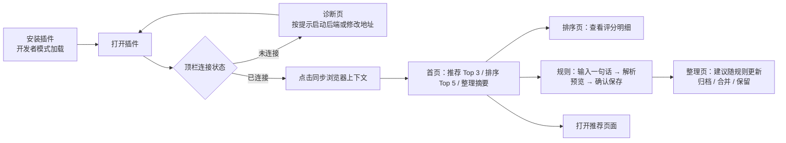
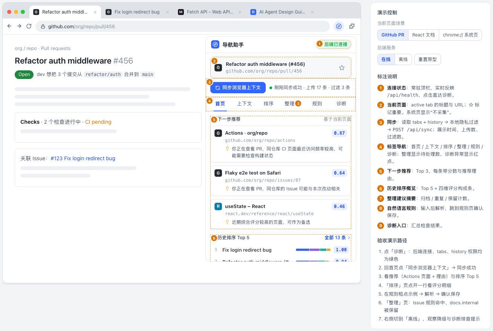
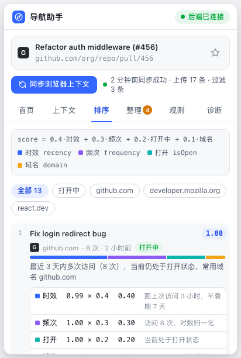
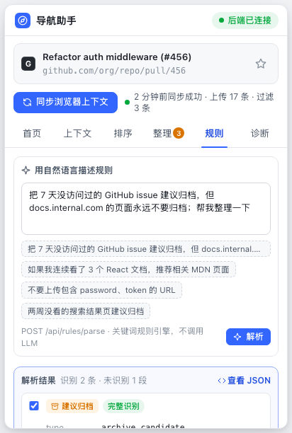
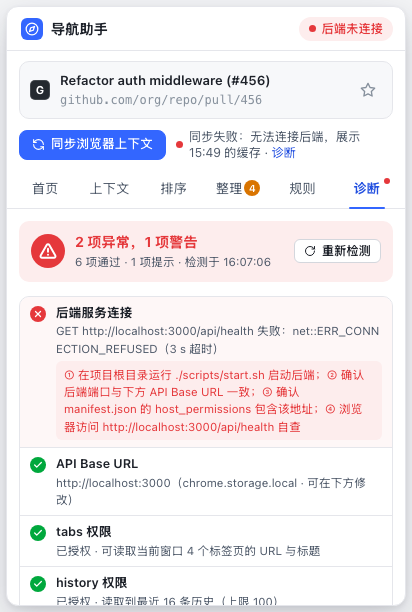
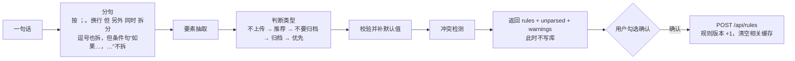
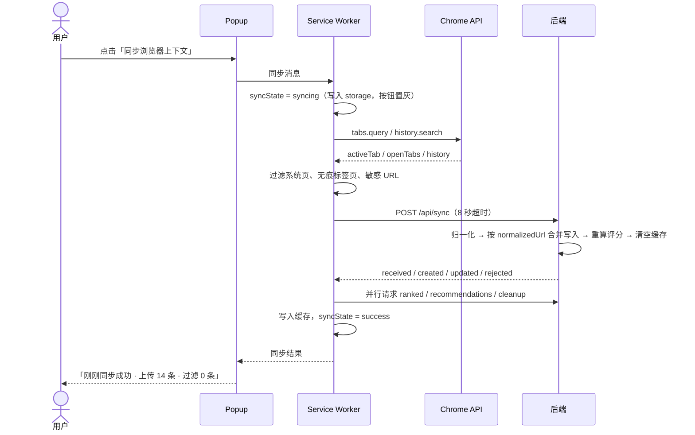
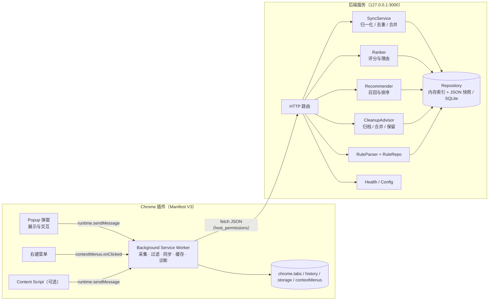

# 浏览器导航助手 · 产品需求文档（PRD）

| 项目 | 内容 |
| --- | --- |
| 产品名称 | 浏览器导航助手（AI Browser Navigation Agent） |
| 文档版本 | v1.1（按工作流规范重组：Feature ID、验收标准、决策记录、REQ 追溯） |
| 更新日期 | 2026-11-02 |
| 依据 | 题目 `PROBLEM.md`、样例数据 `resource.json`、需求理解 [`docs/01-需求理解.md`](01-需求理解.md) |
| 追溯 | 需求点 [`docs/trace/requirements.json`](trace/requirements.json)、Feature 注册表 [`docs/trace/features.json`](trace/features.json) |
| 交互原型 | [`docs/prototype/index.html`](prototype/index.html)（浏览器直接打开，可交互） |
| 算法参考实现 | [`docs/prototype/engine.js`](prototype/engine.js)（评分 / 推荐 / 整理 / 规则解析，`node docs/prototype/engine.js` 可打印样例结果） |
| 规模 | <!-- GEN:STATS -->75 个 Feature（本期 70 个，其中 P0 57 个、P1 13 个；范围外 5 个），验收标准 195 条，决策 27 项<!-- /GEN:STATS --> |

> 编写约定：第 4 章的验收标准与 `docs/trace/features.json` 逐字一致（先改 JSON，再由脚本同步到本文）。每条验收标准按 `F-XXX-NN#ACn` 被测试用例引用，发布后只能追加、不能重排。第 3 章、第 4 章、第 12 章和附录 A 中 `GEN` 注释包围的内容由脚本根据 JSON 生成，不要手改。

## 摘要

**做什么**：一个 Chrome 插件（Manifest V3）加一个本地后端服务。插件采集当前页面、打开的标签页和浏览历史，后端对页面打分排序、推荐下一步要访问的页面、找出旧页面和重复页面；用户可以用一句中文配置整理规则；插件内置启动诊断，用来确认权限和配置是否正确。

**给谁用**：每天同时开着几十个标签页、在文档、GitHub、内部系统和搜索结果之间来回切换的知识工作者，以研发工程师为主。

**核心价值**：

1. **找得到**：从一长串历史里排出“现在最该看”的页面，每个分数都说明理由。
2. **接得上**：根据当前页面推荐下一步，比如正在看 PR 时推荐同仓库的 CI 页面。
3. **理得清**：给出旧页面归档、重复页面合并、受保护页面保留三类建议，每条都附理由。
4. **说得通**：用一句话配置规则，系统先展示解析结果，用户确认后才生效。
5. **起得来**：一个诊断页面检查后端连接、权限、API 地址、同步状态和规则数量，并给出排查步骤。

**几个关键设计决定**（完整列表见第 12 章）：

| 决定 | 原因 | 决策 |
| --- | --- | --- |
| 所有浏览器 API 调用和后端通信都放在 Service Worker 里，Popup 只负责展示 | Popup 失去焦点就会关闭，正在进行的请求会中断；状态集中在一处，也便于做缓存和降级 | 附录 C |
| 隐私过滤放在插件端，上传前就完成；后端再检查一遍 | 题目要求敏感 URL 不能上传，只在后端过滤就已经泄露了 | D-18 |
| 评分采用线性加权：`0.4·时效 + 0.3·频次 + 0.2·打开中 + 0.1·域名` | 每一项都能单独解释，权重可以配置，适合演示和答辩 | D-05 |
| 推荐分两步：先按规则召回候选，再排序（`0.6·上下文相关度 + 0.4·页面评分`） | 召回只查索引，不扫全量数据，能做到 10 万条数据下 100ms 以内 | D-22 |
| 规则解析用关键词规则引擎，“先解析、再预览、再保存” | 不依赖 LLM，结果可预期；解析不了的部分明确告诉用户 | D-08、D-10 |
| 样例数据导入时整体平移时间，读接口支持 `?now=` | 样例是 2024 年的数据，不平移的话所有页面都是“旧页面” | D-01 |

---

## 1 背景与目标

### 1.1 背景

团队在构建类 browser-use 的 AI 浏览器助手基础设施。在让 AI 直接操作浏览器之前，需要先有一层更基础的能力：**理解用户的浏览上下文**，也就是知道用户开着什么、看过什么、哪些页面重要、下一步可能去哪。本产品就是这层能力的最小可用版本。

### 1.2 用户痛点

| 痛点 | 典型场景 | 现状 | 本产品的做法 |
| --- | --- | --- | --- |
| 标签页越开越多 | 一个需求同时开着 PR、Issue、CI、设计文档、MDN 和三次搜索结果 | 凭感觉关，常常误关，或者干脆一个都不关 | 整理建议：归档、合并、保留，每条都有理由 |
| 历史很长，找不到“最近没用但可能重要”的页面 | 上周看过的内部设计文档要再看一次 | 在历史里翻，或者靠搜索碰运气 | 历史排序：综合时效、频次、打开状态和域名打分，并给出理由 |
| 不知道下一步该看哪 | 看完 PR 想确认 CI 状态，看完 React 文档想查 MDN | 手动找标签页或者重新搜索 | 下一步推荐：结合当前页面类型、同仓库、同站点和用户规则 |
| 规则因人而异 | 有人想自动清理旧 Issue，有人希望内部文档永远不被清理 | 现有工具只有固定规则或复杂的配置界面 | 用一句中文配置规则，解析后预览，确认后生效 |
| 隐私顾虑 | 历史里有重置密码链接、网银页面 | 担心全部被上传 | 敏感 URL 在本地就过滤掉，上下文页面会明确标出哪些“不上传” |

### 1.3 产品目标

| 编号 | 目标 | 衡量方式 | 关联 Feature |
| --- | --- | --- | --- |
| G1 | 插件安装后 1 分钟内完成首次同步并看到推荐 | 诊断全部通过 → 同步成功 → 至少 1 条带理由的推荐 | F-DIAG-01、F-SYNC-01、F-REC-08 |
| G2 | 排序、推荐、整理的每条结果都能解释 | 100% 结果带 `reason`，排序结果可以展开看到各项得分 | F-RANK-03、F-RANK-05、F-REC-01、F-CLEAN-01 |
| G3 | 用户能用自然语言配置规则，并在整理建议里看到效果 | 题目示例句子能完整解析；保存后整理建议立即刷新 | F-RULE-02、F-RULE-06、F-CLEAN-05 |
| G4 | 出问题时用户自己能排查 | 诊断页的每个失败项都有可直接执行的排查步骤 | F-DIAG-11 |
| G5 | 隐私敏感 URL 不出本机 | 含敏感关键词的 URL 在插件端被拦截，后端同样拒收 | F-PRIV-01、F-PRIV-03 |

**成功标准**：PROBLEM.md 验收流程第 1–10 步全部可以在本地演示（第 11 章），所有 P0 Feature 的验收标准都有通过的自动化用例或 UI 探索记录作证。本产品不追求算法复杂度，强调**可解释、可演示、可排障**。

### 1.4 非目标（这一版不做）

- 不控制浏览器自动完成任务（点击、填表单等）。
- 不调用真实 LLM，规则解析和推荐都用规则引擎实现，但接口按“以后可以换成 LLM”来设计。
- 不采集网页正文、停留时长或键鼠行为，只使用 URL、标题、时间和次数。
- 不做账号体系、多设备同步、多用户隔离。
- 不使用现成的推荐系统平台。

---

## 2 用户与核心场景

### 2.1 目标用户

| 角色 | 特征 | 主要诉求 |
| --- | --- | --- |
| 研发工程师（主要用户） | 高频访问 GitHub PR、Issue、Actions，技术文档和内部系统；标签页常常超过 20 个 | 在 PR、CI 和文档之间快速跳转；定期清理旧 Issue；内部文档不能被误清理 |
| 产品 / 调研人员 | 大量查看竞品页面、搜索结果和内部文档 | 找回“上周看过的那个页面”；合并重复的搜索结果 |
| 插件开发和运维（内部角色） | 负责安装、启动和排障 | 一眼看出是后端没启动、权限缺失，还是地址配置错了 |

### 2.2 核心场景

| # | 场景 | 过程 | 涉及的 Feature |
| --- | --- | --- | --- |
| 1 | 首次安装与排障 | 启动后端 → 开发者模式加载插件 → 打开诊断页确认后端连接、tabs / history 权限、API 地址 | F-DEMO-01、F-CTX-01、F-CTX-02、F-DIAG-01、F-DIAG-02、F-DIAG-03、F-DIAG-04、F-DIAG-05、F-DIAG-06、F-DIAG-07、F-DIAG-11 |
| 2 | 同步并查看排序 | 打开 GitHub、MDN、搜索页 → 点击同步（敏感 URL 在本地被过滤）→ 查看排序分数和理由 | F-CTX-03、F-CTX-05、F-CTX-06、F-SYNC-01、F-SYNC-06、F-PRIV-01、F-RANK-01、F-RANK-02、F-RANK-03、F-RANK-05 |
| 3 | 在 PR 页面找下一步 | 当前页是 PR #456 → 首页推荐同仓库 Actions，并说明原因 | F-REC-01、F-REC-02、F-REC-05、F-REC-08 |
| 4 | 用一句话配置整理规则 | 输入“7 天没访问的 GitHub issue 建议归档，docs.internal.com 永不归档”→ 预览 → 确认 → 整理建议随之变化 → 删除规则后恢复 | F-RULE-01、F-RULE-02、F-RULE-06、F-RULE-07、F-RULE-08、F-CLEAN-04、F-CLEAN-05、F-CLEAN-07 |
| 5 | 后端不可用时 | 后端挂掉 → popup 展示缓存并标明时间 → 诊断给出排查步骤 → 后端恢复后自动同步 | F-CACHE-01、F-CACHE-02、F-DIAG-01、F-SYNC-06 |

### 2.3 用户故事

| 编号 | 用户故事 | 优先级 | 关联 Feature |
| --- | --- | --- | --- |
| US-01 | 作为用户，我打开插件就能看到当前页面、当前窗口的标签页和最近的浏览历史 | P0 | F-CTX-03、F-CTX-05、F-CTX-06 |
| US-02 | 作为用户，我点一下“同步浏览器上下文”就能把数据发给后端，并看到成功或失败 | P0 | F-SYNC-01、F-SYNC-06 |
| US-03 | 作为用户，我能看到按重要程度排序的页面，并知道为什么这样排 | P0 | F-RANK-01、F-RANK-03、F-RANK-05 |
| US-04 | 作为用户，我在看 PR 时，插件推荐同仓库的 CI 或 Issue 页面，并说明原因 | P0 | F-REC-02、F-REC-08 |
| US-05 | 作为用户，我能看到哪些页面该归档、哪些疑似重复、哪些被规则保护 | P0 | F-CLEAN-02、F-CLEAN-03、F-CLEAN-04、F-CLEAN-07 |
| US-06 | 作为用户，我输入“7 天没访问的 GitHub issue 建议归档”，确认后整理建议随之变化 | P0 | F-RULE-01、F-RULE-06、F-CLEAN-05 |
| US-07 | 作为用户，我能查看、停用和删除已有规则 | P0（停用为 P1） | F-RULE-07、F-RULE-08、F-RULE-09 |
| US-08 | 作为安装者，我能在诊断页确认后端连接、tabs 和 history 权限、API 地址、同步状态和规则数量 | P0 | F-DIAG-01、F-DIAG-02、F-DIAG-03、F-DIAG-04、F-DIAG-06、F-DIAG-07 |
| US-09 | 作为用户，我不希望含 password、token、bank、secret 的 URL 被上传 | P0（题目的总体约束） | F-PRIV-01、F-PRIV-02、F-PRIV-03 |
| US-10 | 作为用户，后端挂掉时仍能看到上次的结果，并知道该怎么修 | P1 | F-CACHE-01、F-CACHE-02 |
| US-11 | 作为用户，我能在任意网页右键“标记为重要”，这个页面就不会被建议归档 | P1 | F-MENU-01、F-CLEAN-06 |
| US-12 | 作为用户，我连续看了几篇 React 文档后，插件按我的规则推荐 MDN 页面 | P1 | F-RULE-10、F-REC-07 |

### 2.4 核心使用流程



---

## 3 范围（In / Out）

> P0 = 题目必做项，或题目总体约束要求的能力；P1 = 进阶项中本期实现的部分；P2 = 本期不做。范围决策见 D-15。

### 3.1 In Scope

<!-- GEN:CH3_IN -->
| 模块 | 名称 | 数量 | Feature ID |
|---|---|---|---|
| CTX | 插件加载与浏览器上下文读取 | 7 | F-CTX-01、F-CTX-02、F-CTX-03、F-CTX-04、F-CTX-05、F-CTX-06、F-CTX-07 |
| SYNC | 浏览器数据同步 | 7 | F-SYNC-01、F-SYNC-02、F-SYNC-03、F-SYNC-04、F-SYNC-05、F-SYNC-06、F-SYNC-07 |
| RANK | 历史排序 | 5 | F-RANK-01、F-RANK-02、F-RANK-03、F-RANK-04、F-RANK-05 |
| REC | 下一步推荐 | 8 | F-REC-01、F-REC-02、F-REC-03、F-REC-04、F-REC-05、F-REC-06、F-REC-07、F-REC-08 |
| CLEAN | 旧页面与重复页面整理 | 8 | F-CLEAN-01、F-CLEAN-02、F-CLEAN-03、F-CLEAN-04、F-CLEAN-05、F-CLEAN-06、F-CLEAN-07、F-CLEAN-08 |
| RULE | 自然语言规则配置 | 10 | F-RULE-01、F-RULE-02、F-RULE-03、F-RULE-04、F-RULE-05、F-RULE-06、F-RULE-07、F-RULE-08、F-RULE-09、F-RULE-10 |
| DIAG | 启动诊断与配置检查 | 11 | F-DIAG-01、F-DIAG-02、F-DIAG-03、F-DIAG-04、F-DIAG-05、F-DIAG-06、F-DIAG-07、F-DIAG-08、F-DIAG-09、F-DIAG-10、F-DIAG-11 |
| PRIV | 隐私过滤 | 5 | F-PRIV-01、F-PRIV-02、F-PRIV-03、F-PRIV-04、F-PRIV-05 |
| CACHE | 本地缓存与离线降级 | 2 | F-CACHE-01、F-CACHE-02 |
| INCR | 增量同步 | 1 | F-INCR-01 |
| PERF | 快速响应 | 2 | F-PERF-01、F-PERF-02 |
| MENU | 右键菜单 | 1 | F-MENU-01 |
| PERSIST | 后端持久化 | 1 | F-PERSIST-01 |
| DEMO | 启动与样例数据 | 2 | F-DEMO-01、F-DEMO-02 |
| **合计** | | **70** | P0 57 个，P1 13 个 |
<!-- /GEN:CH3_IN -->

### 3.2 Out of Scope

<!-- GEN:CH3_OUT -->
| Feature ID | 名称 | 优先级 | 不做的理由 |
|---|---|---|---|
| F-PERSIST-02 | SQLite 持久化实现 | P2 | 本期只在技术方案中给出 SQLite 表结构与索引（第 7.7 节），不实现。（D-15） |
| F-CLEAN-09 | 重复打开的标签页建议关闭 | P2 | 同一 normalizedUrl 打开了多个标签页时，整理页提示「重复打开」，并建议关闭多余的标签页。本期不做。（D-15） |
| F-PRIV-06 | 清空我的数据 | P2 | 提供接口和按钮，清空后端中的页面、规则和同步日志。本期不做。（D-15） |
| F-HL-01 | 页面高亮推荐关键词与 Issue 编号 | P2 | Content Script 在 GitHub 页面中高亮推荐结果里出现的 Issue 编号（#123）和关键词；页面不可注入时静默跳过。本期不做。（D-15） |
| F-SIM-01 | 标题相似度召回与聚合 | P2 | 对标题分词（英文按单词、中文按 2 字片段），Jaccard 相似度 ≥ 0.3 作为推荐召回的一路（rel=0.5），也用于相关页面聚合。本期不做。（D-15） |
<!-- /GEN:CH3_OUT -->

此外，后端持久化的生产方案（SQLite）只在第 7.7 节和技术方案中解释，不实现（F-PERSIST-02）。

### 3.3 功能点与 Feature 对照

| 模块 | 功能点 | 优先级 | 对应题目 | 原型画面 | Feature |
| --- | --- | --- | --- | --- | --- |
| 插件基础 | MV3 manifest、权限声明、开发者模式加载 | P0 | 必做 1 | — | F-CTX-01、F-CTX-02 |
| 上下文读取 | 当前 tab、当前窗口的 tabs、最近 100 条历史、系统页降级 | P0 | 必做 1 | S3、S12 | F-CTX-03 ~ F-CTX-07 |
| 同步 | 一键同步、按 URL 去重、区分来源、展示同步状态 | P0 | 必做 2 | S1、S2 | F-SYNC-01 ~ F-SYNC-07 |
| 隐私过滤 | 上传前过滤敏感 URL 和系统页面，后端兜底，关键词可配置 | P0（可配置为 P1） | 总体约束 + 进阶 | S3 | F-PRIV-01 ~ F-PRIV-05 |
| 历史排序 | 打分排序、给出理由、展开评分明细 | P0 | 必做 3 | S4 | F-RANK-01 ~ F-RANK-05 |
| 下一步推荐 | 基于规则召回再排序、给出理由、排除重复 | P0 | 必做 4 | S2、S11、S12 | F-REC-01 ~ F-REC-08 |
| 整理建议 | 归档、合并、保留 | P0 | 必做 5 | S5 | F-CLEAN-01 ~ F-CLEAN-07 |
| 整理执行 | 归档、合并、忽略、撤销 | P1 | — | S5 | F-CLEAN-08 |
| 自然语言规则 | 解析、预览、确认保存、列表、删除 | P0 | 必做 6 | S6、S7 | F-RULE-01 ~ F-RULE-08 |
| 规则扩展 | 隐私过滤、关联推荐、排序加权三类规则；规则启停 | P1 | 必做 6 的示例 | S7、S11 | F-RULE-09、F-RULE-10、F-REC-07、F-PRIV-05 |
| 启动诊断 | 11 项检查、排查建议、修改 API 地址、复制诊断报告 | P0 | 必做 7 | S8、S9 | F-DIAG-01 ~ F-DIAG-11 |
| 本地缓存 / 离线 | 用 storage.local 缓存结果，离线时展示缓存 | P1 | 进阶 | S10 | F-CACHE-01、F-CACHE-02 |
| 增量同步 | 记录同步游标，只上传新增的历史 | P1 | 进阶 | — | F-INCR-01 |
| 后端持久化 | JSON 快照（演示用），可替换为 SQLite | P1（SQLite 为 P2） | 进阶 | — | F-PERSIST-01、F-PERSIST-02 |
| 快速响应 | 预计算评分、索引召回、推荐结果缓存 | P1 | 进阶 | — | F-PERF-01、F-PERF-02 |
| 右键菜单 | 添加到分析、标记为重要 | P1 | 进阶 | S13 | F-MENU-01 |
| 启动与样例 | 一条命令启动、样例数据导入 | P0 | 验收 1、9 | — | F-DEMO-01、F-DEMO-02 |
| 页面高亮 | 用 Content Script 高亮推荐关键词和 Issue 编号 | P2 | 进阶 | — | F-HL-01 |
| 标题相似度 | 用标题词集合的相似度聚合相关页面 | P2 | 进阶 | — | F-SIM-01 |

---

## 4 功能清单

列说明：类型取 action（用户操作）/ display（展示）/ system（系统自动行为）/ api（接口能力）/ rule（业务规则或算法口径）/ nfr（非功能）；端表示需要哪一端写代码才能让验收标准成立。验收标准中「已按 D-01 导入 resource.json 样例」指：把样例时间平移到「最新一条 = 导入时刻 − 5 分钟」后，通过 POST /api/sync 导入，并在导入后立即查询；涉及数值的验收标准可以用第 13 章的方法复算。

<!-- GEN:CH4 -->
### 4.1 CTX 插件加载与浏览器上下文读取

| Feature ID | 名称 | 类型 | 优先级 | 端(FE/BE) | 描述 | 验收标准 |
|---|---|---|---|---|---|---|
| F-CTX-01 | manifest 合法并声明必需权限 | 系统（system） | P0 | FE | extension/manifest.json 使用 Manifest V3：permissions 至少包含 tabs、history、storage、activeTab（右键菜单另加 contextMenus，见 D-15）；host_permissions 覆盖本地后端（D-11）；background 为 ES module 类型的 service worker；action.default_popup 指向 popup 页面；不加载远程代码。交付文档 README 需说明每项权限的用途。 | AC1：Given extension/manifest.json When 解析该文件 Then manifest_version 为 3，permissions 包含 tabs、history、storage、activeTab 四项<br>AC2：Given extension/manifest.json When 检查 host_permissions Then 包含 http://localhost/* 和 http://127.0.0.1/*<br>AC3：Given extension/manifest.json When 检查 background 和 action 字段 Then background.service_worker 指向的文件存在且 type 为 module，action.default_popup 指向的 popup 页面文件存在 |
| F-CTX-02 | 开发者模式加载插件无报错 | 系统（system） | P0 | FE | 在 chrome://extensions 开发者模式下「加载已解压的扩展程序」选择 extension/ 目录即可运行，没有构建步骤；popup 与 service worker 遵守 MV3 CSP（无内联脚本、无远程代码）。 | AC1：Given 用 Chromium 以 --load-extension 加载 extension/ 目录 When 插件启动 Then service worker 注册成功，service worker 控制台没有未捕获的错误<br>AC2：Given 插件已加载 When 打开 popup 页面 Then 顶栏显示「导航助手」，并显示首页、上下文、排序、整理、规则、诊断 6 个页签，页面控制台没有未捕获的错误 |
| F-CTX-03 | popup 展示当前页面的标题和 URL | 展示（display） | P0 | FE | popup 打开时由 service worker 读取当前页面（判定规则见 D-25），在当前页面卡片中展示标题和 URL；只依赖浏览器 API，后端不可用时也能展示。 | AC1：Given 当前窗口的活动标签页为 https://github.com/org/repo/pull/456，标题为「Refactor auth middleware (#456)」 When 打开 popup Then 当前页面卡片显示该标题和 URL<br>AC2：Given 后端未启动 When 打开 popup Then 当前页面卡片仍显示活动标签页的标题和 URL |
| F-CTX-04 | 当前页面判定排除插件自身页面 | 系统（system） | P0 | FE | 活动标签页是插件自身页面（chrome-extension://）时，取最后聚焦窗口中 lastAccessed 最大的 http(s) 标签页作为当前页面；没有可用页面时按系统页处理。 | AC1：Given 依次打开 https://github.com/org/repo/pull/456 和 https://developer.mozilla.org/en-US/docs/Web/API/Fetch_API，再以标签页方式打开插件的 popup 页面 When popup 加载完成 Then 当前页面卡片显示 https://developer.mozilla.org/en-US/docs/Web/API/Fetch_API，而不是以 chrome-extension:// 开头的地址<br>AC2：Given 当前窗口中除插件页面外没有 http(s) 标签页 When popup 加载完成 Then 当前页面卡片显示「系统页 · 不采集」 |
| F-CTX-05 | 展示当前窗口的标签页列表 | 展示（display） | P0 | FE | 上下文页签的「当前窗口标签页」列表展示 chrome.tabs.query({ currentWindow: true }) 的结果（标题 + URL），跳过无痕标签页；同步时的标签页范围见 D-21。 | AC1：Given 当前窗口打开了 https://github.com/org/repo/pull/456、https://github.com/org/repo/issues/123、https://developer.mozilla.org/en-US/docs/Web/API/Fetch_API、https://docs.internal.com/ai-agent-design 4 个页面 When 打开 popup 的上下文页签 Then「当前窗口标签页」列表包含这 4 条记录，每条显示标题和 URL<br>AC2：Given 另一个窗口打开了 https://example.com/other When 打开当前窗口 popup 的上下文页签 Then「当前窗口标签页」列表中没有 https://example.com/other |
| F-CTX-06 | 展示最近浏览历史（最多 100 条） | 展示（display） | P0 | FE | service worker 调用 chrome.history.search，显式传入 startTime = now − 30 天、maxResults = maxHistoryItems（默认 100），在上下文页签的「最近浏览历史」列表中按 lastVisitTime 倒序展示（D-19）。 | AC1：Given 浏览器历史中有 3 条刚访问过的 http(s) 页面 When 打开 popup 的上下文页签 Then「最近浏览历史」列表显示这 3 条，按访问时间从新到旧排列<br>AC2：Given 浏览器历史中有 120 条 30 天内的记录 When 打开上下文页签 Then「最近浏览历史」列表显示 100 条<br>AC3：Given 打开上下文页签 When service worker 读取历史 Then 调用 chrome.history.search 时传入的 startTime 为当前时间减 30 天（误差 1 分钟以内），maxResults 为 100 |
| F-CTX-07 | 系统页面降级展示 | 展示（display） | P0 | FE | chrome://、edge://、about:、file://、chrome-extension:// 页面视为系统页：当前页面卡片显示「系统页 · 不采集」，上下文页签中标注「系统页 · 跳过」，这些页面不上传；推荐退化为全局高分页面（F-REC-06）。 | AC1：Given 活动标签页为 chrome://version/ When 打开 popup Then 当前页面卡片显示「系统页 · 不采集」，popup 页面没有未捕获的错误<br>AC2：Given 当前窗口打开了 chrome://version/ 和 https://react.dev/learn When 打开上下文页签 Then chrome://version/ 一行标注「系统页 · 跳过」，https://react.dev/learn 一行没有该标注 |

### 4.2 SYNC 浏览器数据同步

| Feature ID | 名称 | 类型 | 优先级 | 端(FE/BE) | 描述 | 验收标准 |
|---|---|---|---|---|---|---|
| F-SYNC-01 | 点击「同步浏览器上下文」上报数据 | 操作（action） | P0 | FE+BE | popup 发送同步消息，service worker 读取当前页、所有普通窗口的标签页（D-21）和最近历史，过滤系统页面、无痕标签页和敏感 URL 后调用 POST /api/sync；后端完成入库并返回统计。同步期间按钮禁用。 | AC1：Given 后端已启动且数据为空，当前窗口打开 https://github.com/org/repo/pull/456 和 https://developer.mozilla.org/en-US/docs/Web/API/Fetch_API When 点击「同步浏览器上下文」 Then 后端收到 1 次 POST /api/sync，请求体包含 activeTab、openTabs、history 三个字段，之后 GET /api/pages/ranked 中包含这 2 个 URL<br>AC2：Given 当前窗口还打开了 chrome://version/ When 点击同步 Then POST /api/sync 的请求体中没有任何以 chrome:// 开头的 URL<br>AC3：Given 一次同步正在进行 When 再次点击同步按钮 Then 按钮处于禁用状态，后端只收到 1 次 POST /api/sync |
| F-SYNC-02 | 后端按 normalizedUrl 去重入库 | 规则（rule） | P0 | BE | 后端以 normalizedUrl 为存储主键（D-03）：小写 host、去掉 hash、去掉跟踪参数、query 参数排序、去掉末尾的 /，保留业务 query。 | AC1：Given 后端数据为空 When POST /api/sync 提交 resource.json（activeTab 1 条、openTabs 3 条、history 10 条） Then 响应 200，received=14、created=10、updated=4、pageCount=10<br>AC2：Given 后端数据为空 When 同步 https://GitHub.com/org/repo/issues/123/?utm_source=mail#c1 和 https://github.com/org/repo/issues/123 两条历史 Then pageCount=1，该页面的 normalizedUrl 为 https://github.com/org/repo/issues/123<br>AC3：Given 后端数据为空 When 同步 https://github.com/org/repo/issues/123 和 https://github.com/org/repo/issues/123?tab=comments 两条历史 Then pageCount=2（是否重复由整理建议判断） |
| F-SYNC-03 | visitCount、lastVisitedAt、firstSeenAt 与标题的合并口径 | 规则（rule） | P0 | BE | visitCount 取 max(已有值, history.visitCount)，最小为 1（D-02）；lastVisitedAt 取 max(已有值, history.lastVisitTime, tab.lastAccessed)，活动标签页记为本次同步时间；firstSeenAt 取最小值；title 用非空的新值覆盖，为空时用 URL。 | AC1：Given 已同步一次 resource.json When 再次同步同一份数据 Then pageCount 仍为 10，https://github.com/org/repo/issues/123 的 visitCount 仍为 8<br>AC2：Given 已按 D-01 导入 resource.json 样例 When GET /api/pages/ranked Then issues/123 的 lastVisitedAt 等于导入请求 history 中它的 lastVisitTime，pull/456 的 lastVisitedAt 等于导入响应中的 syncedAt<br>AC3：Given 后端数据为空 When 同步一条 title 为空字符串的历史 https://example.com/a Then GET /api/pages/ranked 中该页面的 title 为 https://example.com/a |
| F-SYNC-04 | 区分并合并页面来源 sources | 规则（rule） | P0 | BE | sources 为 active_tab、open_tab、history（右键「添加到分析」为 manual）的并集，多次同步累积、不丢失；GET /api/pages/ranked 返回 sources 字段（D-16）。 | AC1：Given 后端数据为空 When POST /api/sync 提交 resource.json Then GET /api/pages/ranked 中 pull/456 的 sources 包含 active_tab 和 history，issues/123 的 sources 包含 open_tab 和 history，https://react.dev/learn 的 sources 只有 history<br>AC2：Given 已同步 resource.json When 再同步一次，openTabs 只包含 https://react.dev/learn Then https://react.dev/learn 的 sources 变为 history 和 open_tab |
| F-SYNC-05 | isOpen 按最近一次同步快照刷新 | 规则（rule） | P0 | BE | 每次同步后，本次出现在 activeTab 或 openTabs 中的页面 isOpen=true，其余页面 isOpen=false；activeTab 对应的页面 isActive=true。 | AC1：Given 已同步 resource.json（docs.internal.com/ai-agent-design 在 openTabs 中） When 再次同步，openTabs 只包含 issues/123 和 Fetch_API Then GET /api/pages/ranked 中 https://docs.internal.com/ai-agent-design 的 isOpen=false，issues/123 的 isOpen=true<br>AC2：Given 同 AC1 When 第二次同步的 activeTab 为 null Then pull/456 的 isOpen=false |
| F-SYNC-06 | 同步状态展示、持久化与中断恢复 | 展示（display） | P0 | FE | 同步状态机 idle → syncing → success \| error 保存在 chrome.storage.local（D-26）；popup 监听存储变化实时更新；同步在 service worker 中执行，关闭 popup 不会中断；syncing 超过 30 秒视为中断失败；失败时保留已有数据。 | AC1：Given 后端已启动 When 点击同步并完成 Then 同步状态行显示「同步成功」，以及本次上传条数和过滤条数<br>AC2：Given API base URL 指向一个没有服务的端口 When 点击同步 Then 同步状态行显示「同步失败」和失败原因，并提供「诊断」入口，已展示的排序、推荐、整理数据没有被清空<br>AC3：Given 同步成功后关闭 popup When 重新打开 popup Then 同步状态行仍显示「同步成功」和上次同步时间<br>AC4：Given 点击同步后立即关闭 popup When 3 秒后重新打开 popup Then 同步状态行显示「同步成功」，GET /api/health 的 pageCount 大于 0<br>AC5：Given chrome.storage.local 中的同步状态为 syncing，且开始时间在 31 秒前 When 打开 popup Then 同步状态行显示「同步失败」，原因包含「中断」 |
| F-SYNC-07 | /api/sync 入参校验与错误返回 | 接口（api） | P1 | BE | 结构错误返回 400；单条记录的 URL 不是 http(s)、无法解析、超过 2048 个字符或含敏感关键词时计入 rejected，不影响其他记录；单次最多 500 条，请求体最大 1 MB。 | AC1：Given 后端数据为空 When POST /api/sync 的请求体不是合法 JSON Then 响应 400，body 为 { error: { code: "INVALID_JSON", message: 非空字符串 } }，GET /api/health 的 pageCount 仍为 0<br>AC2：Given 后端已启动 When POST /api/sync 的 openTabs 是字符串而不是数组 Then 响应 400，error.code 为 VALIDATION_FAILED<br>AC3：Given 后端已启动 When 一次提交 501 条 history Then 响应 413，error.code 为 PAYLOAD_TOO_LARGE<br>AC4：Given 后端数据为空 When history 中有一条 url 为 javascript:alert(1) 的记录和一条 https://example.com/ok Then 响应 200，rejected=1、created=1 |

### 4.3 RANK 历史排序

| Feature ID | 名称 | 类型 | 优先级 | 端(FE/BE) | 描述 | 验收标准 |
|---|---|---|---|---|---|---|
| F-RANK-01 | GET /api/pages/ranked 返回按评分降序的页面 | 接口（api） | P0 | BE | 返回 { pages, total }，每项在题目字段的基础上增加 isOpen、sources、scoreDetail（D-16）；支持 limit（默认 20）、domain、openOnly 查询参数，以及 ?now= 时间覆盖（D-01）。 | AC1：Given 已按 D-01 导入 resource.json 样例 When GET /api/pages/ranked Then 响应 200，total=10，pages 共 10 条且按 score 从高到低排列，每条包含 url、title、domain、visitCount、lastVisitedAt、score、reason、isOpen、sources、scoreDetail<br>AC2：Given 同 AC1 When GET /api/pages/ranked?limit=3 Then pages 依次为 https://github.com/org/repo/issues/123、https://github.com/org/repo/pull/456、https://developer.mozilla.org/en-US/docs/Web/API/Fetch_API<br>AC3：Given 同 AC1 When GET /api/pages/ranked?openOnly=true Then pages 共 4 条，且每条 isOpen=true<br>AC4：Given 同 AC1 When GET /api/pages/ranked?domain=react.dev Then pages 只包含 https://react.dev/reference/react/useState 和 https://react.dev/learn<br>AC5：Given 后端数据为空 When GET /api/pages/ranked Then 响应 200，pages 为空数组，total=0 |
| F-RANK-02 | 评分公式与各分量口径 | 规则（rule） | P0 | BE | score = 0.4 × recency + 0.3 × frequency + 0.2 × isOpen + 0.1 × domainBoost，取值 0–1、保留 2 位小数；recency = 0.5^(未访问天数 / 7)；frequency = ln(1 + visitCount) / ln(1 + 最大 visitCount)；domainBoost 默认为该域名访问量 / 访问量最大的域名（D-05）；权重和半衰期来自配置。交付文档 README 需包含评分策略说明。 | AC1：Given 已按 D-01 导入 resource.json 样例且没有规则 When 导入后立即 GET /api/pages/ranked Then issues/123 的 score=1.00、pull/456=0.94、Fetch_API=0.83、useState=0.69、react.dev/learn=0.57、docs.internal.com/ai-agent-design=0.56、issues/100=0.23、Google 搜索页=0.11<br>AC2：Given 同 AC1 When 查看 https://github.com/org/repo/issues/100 的 scoreDetail Then recency=0.09、frequency=0.32、open=0、domain=1.00<br>AC3：Given 同 AC1 When 查看每一个页面 Then score 在 0 到 1 之间，并且与 0.4×recency + 0.3×frequency + 0.2×open + 0.1×domain 的差不超过 0.01 |
| F-RANK-03 | 排序理由生成 | 规则（rule） | P0 | BE | 按第 6.3 节的条件顺序最多取 3 句，用「，」连接（D-23）。 | AC1：Given 已按 D-01 导入 resource.json 样例且没有规则 When GET /api/pages/ranked Then issues/123 的 reason 为「最近 3 天内多次访问（8 次），当前仍处于打开状态，常用域名 github.com」，pull/456 的 reason 以「正在浏览」开头<br>AC2：Given 同 AC1 When 查看 issues/100 和 Google 搜索页 Then reason 分别包含「已 24 天未访问」和「已 35 天未访问」<br>AC3：Given 同 AC1 When 查看全部 10 个页面 Then 每条 reason 非空，且按「，」分隔后不超过 3 句 |
| F-RANK-04 | 规则与「标记为重要」影响排序 | 规则（rule） | P0 | BE | 命中 never_archive、boost_domain 规则或被标记为重要的页面，domainBoost 取 1，并在 reason 中说明；archive_candidate 不降权。保存、删除、启停规则后立即生效。 | AC1：Given 已按 D-01 导入 resource.json 样例 When 保存 never_archive 规则（domain=docs.internal.com）后 GET /api/pages/ranked Then https://docs.internal.com/ai-agent-design 的 scoreDetail.domain 从 0.10 变为 1.00，score 从 0.56 变为 0.65，名次从第 8 升到第 7，reason 包含「属于受保护域名」<br>AC2：Given 同 AC1 When 删除该规则后再次请求 Then 该页面 score 恢复为 0.56、排第 8，reason 不包含「属于受保护域名」<br>AC3：Given 已按 D-01 导入 resource.json 样例 When 保存 boost_domain 规则（domain=react.dev）后 GET /api/pages/ranked Then react.dev 两个页面的 scoreDetail.domain=1.00，reason 包含「命中优先域名规则」 |
| F-RANK-05 | popup 展示历史排序（首页 Top 5 与排序页明细） | 展示（display） | P0 | FE | 首页「历史排序」区块展示 Top 5；排序页签展示完整列表，可按「打开中」或域名筛选，展开任意一行可以看到四项得分。 | AC1：Given 已按 D-01 导入 resource.json 样例 When 打开 popup 首页 Then「历史排序」区块展示 5 条，按分数从高到低排列，每条显示标题、两位小数的分数和非空理由<br>AC2：Given 同 AC1 When 打开排序页签并展开第 1 条 Then 显示该页面的时效、频次、打开、域名四项得分<br>AC3：Given 同 AC1 When 在排序页签选择「打开中」筛选 Then 列表只显示 4 条<br>AC4：Given 后端数据为空 When 打开 popup 首页 Then「历史排序」区块显示空状态，文案包含「同步浏览器上下文」 |

### 4.4 REC 下一步推荐

| Feature ID | 名称 | 类型 | 优先级 | 端(FE/BE) | 描述 | 验收标准 |
|---|---|---|---|---|---|---|
| F-REC-01 | POST /api/recommendations/next 返回推荐列表 | 接口（api） | P0 | BE | 请求体为 { currentPage, openTabs, recentHistory }（recentHistory 最多 20 条，currentPage 为 null 表示当前是系统页）；返回 { recommendations, cached }，每条包含 id、type=next_visit、url、title、score、reason、strategy、createdAt，最多 5 条（D-22）。 | AC1：Given 已按 D-01 导入 resource.json 样例 When POST /api/recommendations/next，currentPage 为样例的 activeTab，openTabs 和 recentHistory 取样例数据 Then 响应 200，recommendations 有 1–5 条，按 score 从高到低排列，每条 type=next_visit，并包含 url、title、score、reason、strategy<br>AC2：Given 后端已启动 When 请求体缺少 currentPage 字段，或 openTabs 不是数组 Then 响应 400，error.code 为 VALIDATION_FAILED<br>AC3：Given 后端数据为空 When 以 https://github.com/org/repo/pull/456 为 currentPage 请求推荐 Then 响应 200，recommendations 为空数组 |
| F-REC-02 | GitHub 页面推荐同仓库页面 | 规则（rule） | P0 | BE | 当前页为 github.com/{owner}/{repo}/… 时召回同仓库页面：PR→Actions 的上下文相关度 rel=1.0，PR→Issue 0.8，Issue→PR 0.9，其他 0.7（D-22）。 | AC1：Given 已按 D-01 导入 resource.json 样例 When 以 https://github.com/org/repo/pull/456 为 currentPage、样例 openTabs 请求推荐 Then 第 1 条为 https://github.com/org/repo/actions，strategy=same_repo，score=0.87，reason 包含「PR」和「CI」<br>AC2：Given 同 AC1 的数据 When 以 https://github.com/org/repo/issues/123 为 currentPage、openTabs 为空数组请求推荐 Then 第 1 条为 https://github.com/org/repo/pull/456，strategy=same_repo |
| F-REC-03 | 文档页推荐同站点高频页面 | 规则（rule） | P0 | BE | 当前页属于文档站（D-17 的域名列表，或路径包含 /docs、/reference、/learn、/guide）时，召回同域名页面，rel=0.8。 | AC1：Given 已按 D-01 导入 resource.json 样例 When 以 https://react.dev/learn 为 currentPage、openTabs 为空数组请求推荐 Then 第 1 条为 https://react.dev/reference/react/useState，strategy=same_doc_site，reason 包含「react.dev」<br>AC2：Given 同 AC1 的数据 When 以 https://developer.mozilla.org/en-US/docs/Web/JavaScript 为 currentPage、openTabs 为空数组请求推荐 Then 第 1 条为 https://developer.mozilla.org/en-US/docs/Web/API/Fetch_API，strategy=same_doc_site |
| F-REC-04 | 同域名推荐高分页面 | 规则（rule） | P0 | BE | 当前页既不是 GitHub 仓库页也不是文档站，但库中有同域名页面时，召回同域名的高分页面，rel=0.6。 | AC1：Given 已同步 https://news.example.org/a（1 天前访问，visitCount=5）和 https://news.example.org/b（1 天前访问，visitCount=1） When 以 https://news.example.org/c 为 currentPage、openTabs 为空数组请求推荐 Then 第 1 条为 https://news.example.org/a，第 2 条为 https://news.example.org/b，strategy 都是 same_domain，reason 包含「同域名」 |
| F-REC-05 | 推荐排除当前页、已打开页、重复页和待归档页 | 规则（rule） | P0 | BE | 按判重 key 排除当前页和全部已打开页面；排除已归档和正在被建议归档的页面；排除 final < 0.3 的结果；同一判重 key 只保留分数最高的一条。 | AC1：Given 已按 D-01 导入 resource.json 样例 When 以 https://github.com/org/repo/pull/456 为 currentPage、样例 openTabs 请求推荐 Then 结果中不包含 pull/456、issues/123、Fetch_API、docs.internal.com/ai-agent-design，也不包含 https://github.com/org/repo/issues/123?tab=comments<br>AC2：Given 同 AC1 When 查看结果 Then 不包含被建议归档的 https://github.com/org/repo/issues/100 和 Google 搜索页，且每条 score ≥ 0.3<br>AC3：Given 已同步 https://example.com/p?id=1&tab=x（visitCount=5）和 https://example.com/p?id=1&tab=y（visitCount=2） When 以 https://example.com/q 为 currentPage 请求推荐 Then 这两个 URL 中只出现 https://example.com/p?id=1&tab=x |
| F-REC-06 | 兜底推荐全局高分页面 | 规则（rule） | P0 | BE | 以上策略都没有命中，或当前是系统页（currentPage 为 null）时，召回全局高分页面，rel=0.3，保证有数据时至少返回 1 条。 | AC1：Given 已按 D-01 导入 resource.json 样例 When currentPage 为 null、openTabs 为样例 openTabs 时请求推荐 Then 至少返回 1 条，strategy 都是 global_top，reason 为「近期综合评分较高的页面，可作为备选」<br>AC2：Given 同 AC1 的数据 When 以 https://unknown.example.net/x 为 currentPage 请求推荐 Then 至少返回 1 条 strategy=global_top 的推荐 |
| F-REC-07 | 关联推荐规则触发（recommend_related） | 规则（rule） | P1 | BE | 已保存 recommend_related 规则时，从 recentHistory 最近一条往前数，连续 ≥ minCount 个不同页面属于触发域名，就召回目标域名的页面，rel=0.95，strategy=rule。 | AC1：Given 已按 D-01 导入 resource.json 样例，并保存「如果我连续看了 3 个 React 文档，推荐相关 MDN 页面」 When recentHistory 最近 3 条为 3 个不同的 react.dev 页面时请求推荐 Then 第 1 条为 https://developer.mozilla.org/en-US/docs/Web/API/Fetch_API，strategy=rule，reason 包含「连续浏览 3 个 React 页面」<br>AC2：Given 同一规则 When recentHistory 最近 3 条中只有 2 条是 react.dev 页面 Then 结果中没有 strategy=rule 的推荐 |
| F-REC-08 | popup 展示下一步推荐 Top 3 | 展示（display） | P0 | FE | 首页「下一步推荐」区块展示前 3 条，每条显示标题、分数和理由；点击后在新标签页打开。 | AC1：Given 已按 D-01 导入 resource.json 样例，当前窗口打开样例中的 4 个页面且活动页为 https://github.com/org/repo/pull/456 When 打开 popup 首页 Then「下一步推荐」区块展示 1–3 条，第 1 条标题为「Actions · org/repo」，每条显示分数和非空理由<br>AC2：Given 首页推荐区有推荐 When 点击第 1 条 Then 浏览器新开一个标签页，打开 https://github.com/org/repo/actions<br>AC3：Given 后端数据为空 When 打开 popup 首页 Then「下一步推荐」区块显示空状态，文案包含「同步浏览器上下文」 |

### 4.5 CLEAN 旧页面与重复页面整理

| Feature ID | 名称 | 类型 | 优先级 | 端(FE/BE) | 描述 | 验收标准 |
|---|---|---|---|---|---|---|
| F-CLEAN-01 | GET /api/pages/cleanup-suggestions 返回整理建议 | 接口（api） | P0 | BE | 返回 { summary: { archive, merge, keep }, suggestions }：archive 项含 url、title、reason、ageDays、ruleId；merge 项含 urls、keepUrl、reason；keep 项含 url、title、reason、ruleId；支持 ?now= 时间覆盖（D-01）。 | AC1：Given 已按 D-01 导入 resource.json 样例且没有规则 When GET /api/pages/cleanup-suggestions Then 响应 200，summary 为 { archive: 2, merge: 1, keep: 0 }，archive 项都包含 url、title、reason、ageDays，merge 项包含 urls、keepUrl、reason<br>AC2：Given 后端数据为空 When 请求整理建议 Then 响应 200，suggestions 为空数组，summary 的三项都为 0 |
| F-CLEAN-02 | 旧页面归档判定（默认阈值） | 规则（rule） | P0 | BE | 未访问整天数（向下取整）大于 cleanupThresholdDays（默认 14），并且当前没有打开的页面，建议归档；reason 写明阈值和实际天数。 | AC1：Given 已按 D-01 导入 resource.json 样例且没有规则 When 请求整理建议 Then archive 恰好包含 Google 搜索页（ageDays=35）和 issues/100（ageDays=24），reason 分别为「超过 14 天未访问（已 35 天），且不在当前打开的 tab 中」和「超过 14 天未访问（已 24 天），且不在当前打开的 tab 中」<br>AC2：Given 同步一条 20 天前访问、当前仍打开的页面 https://example.com/open When 请求整理建议 Then 该页面不在 archive 中<br>AC3：Given 同步一条未打开的页面 https://example.com/old，以 ?now= 固定时间使其未访问 14 天 23 小时 When 请求整理建议 Then 该页面不在 archive 中；把 now 推后到未访问恰好 15 天时，该页面出现在 archive 中，ageDays=15 |
| F-CLEAN-03 | 重复页面识别（判重 key） | 规则（rule） | P0 | BE | 按判重 key（host + path + 有语义的 query：q、query、wd、keyword、search、v、id）分组，组内 ≥ 2 个页面输出 1 条 merge，keepUrl 为组内最短的 URL。 | AC1：Given 已按 D-01 导入 resource.json 样例 When 请求整理建议 Then 只有 1 条 merge，urls 为 https://github.com/org/repo/issues/123 和 https://github.com/org/repo/issues/123?tab=comments，keepUrl 为 https://github.com/org/repo/issues/123，reason 为「去掉 query 参数后 URL 相同，疑似重复页面」<br>AC2：Given 同步 https://example.com/doc、https://example.com/doc?tab=a、https://example.com/doc?tab=b When 请求整理建议 Then 输出 1 条 merge，urls 包含这 3 个 URL，keepUrl 为 https://example.com/doc<br>AC3：Given 同步 https://www.google.com/search?q=a 和 https://www.google.com/search?q=b When 请求整理建议 Then 没有同时包含这两个 URL 的 merge |
| F-CLEAN-04 | never_archive 保护（keep 建议） | 规则（rule） | P0 | BE | 命中 never_archive 规则（页面域名等于规则域名或以「.规则域名」结尾，可选 urlPattern）的页面输出 keep，不出现在 archive 中。 | AC1：Given 已按 D-01 导入 resource.json 样例并保存 never_archive 规则（domain=docs.internal.com） When 请求整理建议 Then 有 1 条 keep，url 为 https://docs.internal.com/ai-agent-design，reason 包含「被保护域名配置（docs.internal.com）」，该 URL 不在 archive 中<br>AC2：Given 同一规则，并同步一条 30 天前访问、未打开的 https://docs.internal.com/old When 请求整理建议 Then 该页面出现在 keep 中，不在 archive 中<br>AC3：Given 保存 never_archive 规则（domain=internal.com），并同步一条 30 天前访问、未打开的 https://docs.internal.com/old When 请求整理建议 Then 该页面出现在 keep 中 |
| F-CLEAN-05 | archive_candidate 规则覆盖默认阈值 | 规则（rule） | P0 | BE | 命中 archive_candidate 规则（domain + urlPattern）的页面使用规则的 inactiveDays 作为阈值；多条命中时取最小天数；reason 引用规则原文，ruleId 为规则 id。 | AC1：Given 已按 D-01 导入 resource.json 样例并保存「把 7 天没访问过的 GitHub issue 建议归档」 When 请求整理建议 Then issues/100 的 reason 为「超过 7 天未访问（已 24 天），且不在当前打开的 tab 中；命中规则「把 7 天没访问过的 GitHub issue 建议归档」」，ruleId 等于保存接口返回的规则 id<br>AC2：Given 同一规则，并同步一条 10 天前访问、未打开的 https://github.com/org/repo/issues/87 When 请求整理建议 Then issues/87 出现在 archive 中，ageDays=10（没有该规则时不会出现）<br>AC3：Given 同时保存 inactiveDays 为 7 和 10 的两条 GitHub issue 归档规则，并同步一条 8 天前访问、未打开的 https://github.com/org/repo/issues/88 When 请求整理建议 Then issues/88 出现在 archive 中，reason 中的阈值为 7 天 |
| F-CLEAN-06 | 整理判定优先级 | 规则（rule） | P0 | BE | 单个页面按 never_archive > 标记为重要 > 当前打开 > archive_candidate > 默认阈值 的顺序判定，命中即停止。 | AC1：Given 已按 D-01 导入 resource.json 样例，同时保存「7 天没访问的 GitHub issue 建议归档」和「github.com 永远不要归档」 When 请求整理建议 Then https://github.com/org/repo/issues/100 出现在 keep 中，不在 archive 中<br>AC2：Given 保存「7 天没访问的 GitHub issue 建议归档」，并同步一条 20 天前访问、当前仍打开的 https://github.com/org/repo/issues/90 When 请求整理建议 Then issues/90 既不在 archive 中，也不在 keep 中<br>AC3：Given 30 天前访问的 https://example.com/important 已被标记为重要 When 请求整理建议 Then 该页面出现在 keep 中，reason 为「你已标记为重要，不建议归档」 |
| F-CLEAN-07 | popup 展示整理建议（首页摘要与整理页分组） | 展示（display） | P0 | FE | 首页「整理建议」区块显示归档、重复、保留三类的数量；整理页签分三组展示，命中规则的建议带「规则」标签并显示规则原文；页签标题显示待处理数。 | AC1：Given 已按 D-01 导入 resource.json 样例并保存题目示例的两条规则 When 打开 popup 首页 Then「整理建议」区块显示「归档 2」「重复 1」「保留 1」<br>AC2：Given 同 AC1 When 打开整理页签 Then 分为归档、重复、保留三组，issues/100 一行带「规则」标签，并显示「把 7 天没访问过的 GitHub issue 建议归档」<br>AC3：Given 后端数据为空 When 打开整理页签 Then 显示空状态，文案包含「同步浏览器上下文」 |
| F-CLEAN-08 | 执行整理建议（归档 / 合并 / 忽略 / 撤销） | 操作（action） | P1 | FE+BE | 整理页签中每条建议可以「归档 / 合并 / 忽略」，执行后可以撤销：归档调用 POST /api/pages/archive（isArchived=true，从排序、推荐、整理中移除），撤销调用 POST /api/pages/unarchive；合并调用 POST /api/pages/merge（组内除 keepUrl 外的页面归档）；忽略只保存在插件本地，7 天内不再出现。 | AC1：Given 整理页签中有 issues/100 的归档建议 When 点击「归档」 Then POST /api/pages/archive 返回 200，issues/100 从归档建议、GET /api/pages/ranked 和推荐结果中消失<br>AC2：Given 刚归档了 issues/100 When 点击「撤销」 Then POST /api/pages/unarchive 返回 200，GET /api/pages/ranked 中重新出现 issues/100<br>AC3：Given 整理页签中有 issues/123 的重复建议 When 点击「合并」 Then POST /api/pages/merge 返回 200，GET /api/pages/ranked 中保留 https://github.com/org/repo/issues/123，不再出现 https://github.com/org/repo/issues/123?tab=comments<br>AC4：Given 整理页签中有 Google 搜索页的归档建议 When 点击「忽略」并重新打开 popup Then 该建议不再显示，chrome.storage.local 中记录了忽略时间 |
| F-CLEAN-09 | 重复打开的标签页建议关闭（范围外） | 规则（rule） | P2 | BE | 同一 normalizedUrl 打开了多个标签页时，整理页提示「重复打开」，并建议关闭多余的标签页。本期不做。 | AC1：Given 同一 URL 打开了 2 个标签页 When 请求整理建议 Then 出现 1 条「重复打开」的提示 |

### 4.6 RULE 自然语言规则配置

| Feature ID | 名称 | 类型 | 优先级 | 端(FE/BE) | 描述 | 验收标准 |
|---|---|---|---|---|---|---|
| F-RULE-01 | 输入自然语言并解析预览 | 操作（action） | P0 | FE+BE | 在规则页签（以及首页的规则输入框）输入一句话后点击「解析」，调用 POST /api/rules/parse，以卡片展示每条规则的类型、结构化字段、原文和置信度；无法识别的部分用黄色提示框展示原因和例句；解析不写库。 | AC1：Given 后端已启动 When 在规则页签输入「把 7 天没访问过的 GitHub issue 建议归档，但 docs.internal.com 的页面永远不要归档」并点击「解析」 Then 展示 2 张规则卡片：「建议归档」（github.com · /issues/ · 7 天）和「永不归档」（docs.internal.com），每张都显示原文和置信度<br>AC2：Given 解析完成但还没有确认 When GET /api/rules Then 规则数量与解析前相同<br>AC3：Given 在规则页签输入「帮我整理一下」 When 点击「解析」 Then 显示黄色提示框，内容包含「没有识别到动作」，没有规则卡片<br>AC4：Given 后端不可达 When 打开规则页签 Then「解析」按钮不可用，并提示后端未连接 |
| F-RULE-02 | 规则要素抽取（天数、域名、页面类型、动作） | 规则（rule） | P0 | BE | 天数支持阿拉伯数字和中文数字，单位为天 / 日 / 周 / 星期 / 个月（周按 7 天、月按 30 天）；域名支持显式域名和别名表（GitHub、MDN、React、Google、飞书、语雀等）；页面类型映射为 urlPattern（issue→/issues/、PR→/pull/、actions / CI→/actions、搜索结果→/search）；没有写天数时使用默认 14 天，并标记 confidence=medium。交付文档 README 需包含规则解析说明。 | AC1：Given 无 When POST /api/rules/parse 提交「把 7 天没访问过的 GitHub issue 建议归档，但 docs.internal.com 的页面永远不要归档」 Then 返回 2 条规则：第 1 条 type=archive_candidate、domain=github.com、urlPattern=/issues/、inactiveDays=7、action=suggest_archive，rawText 为「把 7 天没访问过的 GitHub issue 建议归档」；第 2 条 type=never_archive、domain=docs.internal.com、action=keep，rawText 为「docs.internal.com 的页面永远不要归档」<br>AC2：Given 无 When 解析「七天没访问的 GitHub issue 建议归档」 Then inactiveDays=7<br>AC3：Given 无 When 解析「两周没看的搜索结果页建议归档」 Then type=archive_candidate、urlPattern=/search、inactiveDays=14<br>AC4：Given 无 When 解析「1 个月没访问的 GitHub issue 建议归档」 Then inactiveDays=30<br>AC5：Given 无 When 解析「GitHub 的页面建议归档」 Then inactiveDays=14、confidence=medium，并带有「未指定天数，使用默认 14 天」的提示 |
| F-RULE-03 | 否定识别（永远不要归档） | 规则（rule） | P0 | BE | 先识别否定再识别动作：「永远 / 始终 + 不要 / 别 / 不 / 禁止 + 归档 / 清理 / 关闭」、保留、保护、白名单都解析为 never_archive，避免把「永远不要归档」误解析为归档。 | AC1：Given 无 When 解析「docs.internal.com 的页面永远不要归档」 Then 返回 1 条 type=never_archive、action=keep 的规则，没有 archive_candidate<br>AC2：Given 无 When 解析「别归档 github.com 的页面」 Then 返回 1 条 type=never_archive、domain=github.com 的规则 |
| F-RULE-04 | 多子句拆分 | 规则（rule） | P0 | BE | 按「；」「。」、换行、「但」「另外」「同时」以及逗号拆分子句，「如果…，…」这类条件句不拆；每个子句的原文作为 rawText（D-09）。 | AC1：Given 无 When 解析「7 天没访问的 issue 归档；github.com 永远不要归档」 Then 返回 2 条规则，rawText 分别为「7 天没访问的 issue 归档」和「github.com 永远不要归档」<br>AC2：Given 无 When 解析「如果我连续看了 3 个 React 文档，推荐相关 MDN 页面」 Then 只返回 1 条规则 |
| F-RULE-05 | 无法识别、使用默认值与冲突的告知 | 规则（rule） | P0 | BE | 无法识别的子句放入 unparsed，附原因和可以照写的例句；规则之间有冲突时在 warnings 中说明执行时 never_archive 优先；text 为空或超过 500 个字符返回 400（D-16）。 | AC1：Given 无 When 解析「帮我整理一下」 Then rules 为空数组，unparsed 有 1 条，reason 为「没有识别到动作（归档 / 不要归档 / 推荐 / 不上传 / 优先）」，并附至少 1 条例句<br>AC2：Given 无 When 解析「别关闭 docs 页面」 Then rules 为空数组，unparsed 中的 reason 包含「没找到作用的域名或页面类型」<br>AC3：Given 无 When 解析「7 天没访问的 GitHub issue 建议归档；github.com 永远不要归档」 Then 返回 2 条规则，warnings 有 1 条，内容包含「冲突」和「永不归档」<br>AC4：Given 后端已启动 When POST /api/rules/parse 的 text 为空字符串，或长度为 501 个字符 Then 响应 400，error.code 为 VALIDATION_FAILED |
| F-RULE-06 | 确认保存规则 | 操作（action） | P0 | FE+BE | 解析结果默认全部勾选，用户可以取消勾选；点击「确认保存 N 条」后调用 POST /api/rules（请求体 { rules }），后端重新校验并分配 id（D-08），返回 201；保存后规则立即生效（规则版本号加 1，相关缓存失效）。 | AC1：Given 已解析题目示例句并勾选 2 条 When 点击「确认保存 2 条」 Then POST /api/rules 返回 201，返回的 2 条规则都有后端分配的 id 且 enabled=true，规则列表显示 2 条<br>AC2：Given 解析出 2 条规则后取消勾选第 2 条 When 点击「确认保存 1 条」 Then GET /api/rules 只返回 archive_candidate 那 1 条<br>AC3：Given 后端已启动 When POST /api/rules 提交一条 type=unknown_type 的规则 Then 响应 400，error.code 为 VALIDATION_FAILED，GET /api/rules 的数量不变 |
| F-RULE-07 | 查看规则列表 | 展示（display） | P0 | FE+BE | GET /api/rules 返回 { rules }；规则页签的已保存列表展示类型标签、摘要、原文、启停开关和删除按钮。 | AC1：Given 已保存 2 条规则 When GET /api/rules Then 响应 200，rules 共 2 条，每条包含 id、rawText、type、action、enabled<br>AC2：Given 已保存 2 条规则 When 打开规则页签的已保存列表 Then 显示 2 条，每条都有类型标签、原文、启停开关和删除按钮 |
| F-RULE-08 | 删除规则 | 操作（action） | P0 | FE+BE | 在列表中点击删除并确认后调用 DELETE /api/rules/:id；删除后排序、整理、推荐立即恢复。 | AC1：Given 已保存题目示例的 2 条规则 When 在列表中删除 never_archive 那条 Then DELETE /api/rules/:id 返回 200，列表剩 1 条，GET /api/health 的 ruleCount=1<br>AC2：Given 后端已启动 When DELETE /api/rules/rule_not_exist Then 响应 404，error.code 为 NOT_FOUND<br>AC3：Given 已按 D-01 导入 resource.json 样例，保存题目示例的 2 条规则后又删除了 never_archive 那条 When 请求整理建议 Then 没有 https://docs.internal.com/ai-agent-design 的 keep 建议 |
| F-RULE-09 | 启用 / 停用规则 | 操作（action） | P1 | FE+BE | 列表中的开关调用 PATCH /api/rules/:id 修改 enabled；停用的规则不参与排序、整理和推荐。 | AC1：Given 已按 D-01 导入 resource.json 样例并保存 never_archive 规则（domain=docs.internal.com） When 在列表中关闭它的开关 Then PATCH /api/rules/:id 返回 enabled=false，整理建议中没有 https://docs.internal.com/ai-agent-design 的 keep<br>AC2：Given 该规则已停用 When 重新打开开关 Then 整理建议中重新出现该页面的 keep |
| F-RULE-10 | 扩展规则类型解析（隐私、关联推荐、排序加权） | 规则（rule） | P1 | BE | 解析 privacy_filter（action=exclude_upload，keywords）、recommend_related（action=recommend，trigger / target）、boost_domain（action=boost，domain）三类规则；生效方式见 F-PRIV-05、F-REC-07、F-RANK-04。 | AC1：Given 无 When 解析「不要上传包含 password、token 的 URL」 Then 返回 1 条 type=privacy_filter、action=exclude_upload 的规则，keywords 为 ["password","token"]<br>AC2：Given 无 When 解析「如果我连续看了 3 个 React 文档，推荐相关 MDN 页面」 Then 返回 1 条 type=recommend_related 的规则，trigger.domain=react.dev、trigger.minCount=3、target.domain=developer.mozilla.org<br>AC3：Given 无 When 解析「飞书文档优先显示」 Then 返回 1 条 type=boost_domain、domain=feishu.cn、action=boost 的规则 |

### 4.7 DIAG 启动诊断与配置检查

| Feature ID | 名称 | 类型 | 优先级 | 端(FE/BE) | 描述 | 验收标准 |
|---|---|---|---|---|---|---|
| F-DIAG-01 | 诊断：后端服务连接 | 展示（display） | P0 | FE+BE | service worker 请求「API Base URL + /api/health」（3 秒超时），记录耗时，并区分连接被拒绝、超时、非 200、返回的不是 JSON 四类错误；popup 打开时做 1.5 秒超时的轻量检查，结果显示在顶栏。 | AC1：Given 后端已启动且 API base URL 指向它 When 打开诊断页签 Then「后端服务连接」显示通过，并显示 version=1.0.0 和本次耗时（毫秒）<br>AC2：Given API base URL 指向没有服务的端口 When 打开诊断页签 Then「后端服务连接」显示失败，错误类型为「连接被拒绝」，并给出 4 条排查步骤，第 1 条包含「./scripts/start.sh」<br>AC3：Given API base URL 指向没有服务的端口 When 打开 popup Then 顶栏显示「后端未连接」，诊断页签上出现红点；改回可用的地址后重新打开 popup，顶栏显示「后端已连接」 |
| F-DIAG-02 | 诊断：API Base URL 展示与修改 | 操作（action） | P0 | FE | 诊断页展示当前的 API Base URL（默认 http://127.0.0.1:3000，保存在 chrome.storage.local 的 apiBaseUrl 中），可以修改：保存前校验 URL 格式，并用 chrome.permissions.contains 检查该地址是否已授权。 | AC1：Given 插件首次安装，存储中没有 apiBaseUrl When 打开诊断页签 Then「API Base URL」显示 http://127.0.0.1:3000<br>AC2：Given 在诊断页把地址改为 http://127.0.0.1:4100 并保存 When 重新打开 popup Then 显示 http://127.0.0.1:4100，chrome.storage.local 中的 apiBaseUrl 为该值，之后的后端请求都发往该地址<br>AC3：Given 输入 not-a-url 并保存 When 校验完成 Then 提示「地址格式错误」，chrome.storage.local 中的 apiBaseUrl 保持原值 |
| F-DIAG-03 | 诊断：tabs 权限 | 展示（display） | P0 | FE | 用 chrome.permissions.contains({ permissions: ['tabs'] }) 检查，再调用 tabs.query 确认返回的 url 可读。 | AC1：Given manifest 声明了 tabs 权限，当前窗口打开 https://react.dev/learn When 打开诊断页签 Then「tabs 权限」显示通过<br>AC2：Given「tabs 权限」检查失败 When 查看该项 Then 显示排查建议，包含「检查 manifest 的 permissions」和「在 chrome://extensions 中重新加载」 |
| F-DIAG-04 | 诊断：history 权限 | 展示（display） | P0 | FE | 用 chrome.permissions.contains({ permissions: ['history'] }) 检查，再调用 history.search({ text: '', maxResults: 1 }) 确认可用。 | AC1：Given manifest 声明了 history 权限 When 打开诊断页签 Then「history 权限」显示通过<br>AC2：Given「history 权限」检查失败 When 查看该项 Then 显示排查建议，包含「检查 manifest 的 permissions」 |
| F-DIAG-05 | 诊断：storage 可用性 | 展示（display） | P0 | FE | 写入、读取、删除探测键 __diag__，并读取 getBytesInUse。 | AC1：Given 插件已加载 When 打开诊断页签 Then「storage 可用」显示通过，并显示已使用的字节数<br>AC2：Given 诊断完成 When 读取 chrome.storage.local Then 没有残留的 __diag__ 键 |
| F-DIAG-06 | 诊断：最近一次同步 | 展示（display） | P0 | FE | 读取同步状态：从未同步为警告；最近一次失败为错误；最近一次成功但已超过 24 小时为警告；24 小时内成功为通过（D-27）。 | AC1：Given 从未同步 When 打开诊断页签 Then「最近一次同步」显示警告「从未同步」，并提供同步入口<br>AC2：Given 10 分钟前同步成功 When 打开诊断页签 Then 显示通过，以及最近同步时间和上传条数<br>AC3：Given 最近一次同步失败 When 打开诊断页签 Then 显示失败和失败原因，建议先处理「后端服务连接」<br>AC4：Given 最近一次成功同步在 25 小时前 When 打开诊断页签 Then 显示警告「超过 24 小时未同步」 |
| F-DIAG-07 | 诊断：当前规则数量 | 展示（display） | P0 | FE | 对比插件缓存的规则数和 GET /api/health 的 ruleCount：一致为通过；不一致为警告，并自动重新拉取规则。 | AC1：Given 后端已保存 2 条规则，插件缓存的规则也是 2 条 When 打开诊断页签 Then「当前规则数量」显示 2，状态为通过<br>AC2：Given 插件缓存的规则为 1 条、health.ruleCount 为 2 When 打开诊断页签 Then 先显示警告「规则数不一致」，自动重新拉取后显示 2 |
| F-DIAG-08 | 诊断：附加检查项（activeTab、隐私过滤、无痕模式、版本兼容） | 展示（display） | P0 | FE | activeTab 权限（chrome.permissions.contains）；隐私过滤（config.enablePrivacyFilter 与关键词数量，关闭时为警告）；无痕模式（chrome.extension.isAllowedIncognitoAccess，只作提示）；版本兼容（health.version 的主版本号与插件期望一致，P1 细节）。 | AC1：Given 插件已加载、后端已启动且使用默认配置 When 打开诊断页签 Then 显示「activeTab 权限」「隐私过滤」「无痕模式」三项，前两项为通过，「无痕模式」为提示，并说明无痕窗口的数据不会被采集<br>AC2：Given GET /api/config 返回 enablePrivacyFilter=false When 打开诊断页签 Then「隐私过滤」显示警告<br>AC3：Given GET /api/health 返回的 version 主版本号为 2，插件期望为 1 When 打开诊断页签 Then「版本兼容」显示失败，并提示升级插件或后端 |
| F-DIAG-09 | GET /api/health 返回健康信息 | 接口（api） | P0 | BE | 返回 { status, version, uptime（秒）, pageCount, ruleCount, lastSyncAt }。 | AC1：Given 后端刚启动且数据为空 When GET /api/health Then 响应 200，status="ok"、version="1.0.0"，uptime 为非负整数，pageCount=0，ruleCount=0<br>AC2：Given 已按 D-01 导入 resource.json 样例并保存 2 条规则 When GET /api/health Then pageCount=10、ruleCount=2，lastSyncAt 等于导入响应中的 syncedAt |
| F-DIAG-10 | GET /api/config 返回配置 | 接口（api） | P0 | BE | 返回 cleanupThresholdDays、maxHistoryItems、enablePrivacyFilter、privacySensitiveKeywords，并增加 historyLookbackDays、recencyHalfLifeDays、weights、minRecommendationScore；privacySensitiveKeywords 已合并 privacy_filter 规则中的关键词。 | AC1：Given 后端以默认配置启动 When GET /api/config Then 响应 200，cleanupThresholdDays=14、maxHistoryItems=100、enablePrivacyFilter=true、privacySensitiveKeywords 为 ["password","token","bank","secret"]<br>AC2：Given 同 AC1 When 查看扩展字段 Then historyLookbackDays=30、recencyHalfLifeDays=7、weights 为 { recency: 0.4, frequency: 0.3, open: 0.2, domain: 0.1 }、minRecommendationScore=0.3 |
| F-DIAG-11 | 排查建议、重新检测与诊断报告 | 展示（display） | P0 | FE | 每个失败或警告项都说明发生了什么，并给出可以直接执行的排查步骤；支持「重新检测」；「复制诊断报告」（P1 细节）把检查结果、版本和配置以 JSON 复制到剪贴板，不包含浏览记录中的 URL。交付文档 README 需包含诊断说明。 | AC1：Given 任一检查项失败 When 查看该项 Then 显示失败原因和至少 1 条可以直接执行的排查步骤，而不只显示错误码<br>AC2：Given 诊断页签已完成检测 When 点击「重新检测」 Then 全部检查项重新执行，检测时间更新<br>AC3：Given 已同步 resource.json 样例 When 点击「复制诊断报告」 Then 剪贴板中是 JSON，包含检查结果、插件版本和配置，不包含 github.com/org/repo 等浏览记录中的 URL |

### 4.8 PRIV 隐私过滤

| Feature ID | 名称 | 类型 | 优先级 | 端(FE/BE) | 描述 | 验收标准 |
|---|---|---|---|---|---|---|
| F-PRIV-01 | 插件端上传前过滤敏感 URL | 系统（system） | P0 | FE | service worker 在调用 POST /api/sync 之前过滤：完整 URL 转小写后包含任一敏感关键词就不上传；被过滤的记录只在上下文页签本地标注，同步状态只展示过滤条数。已知局限：子串匹配会误伤 tokenizer 这类单词（D-18）。 | AC1：Given 当前窗口打开 https://accounts.example.com/reset-password?token=8f2a91c 和 https://bank.example.com/account/overview When 点击同步 Then POST /api/sync 的请求体不包含这 2 个 URL，同步状态显示过滤 2 条，GET /api/pages/ranked 中也没有它们<br>AC2：Given 当前窗口打开 https://example.com/login?TOKEN=abc When 点击同步 Then 该 URL 不出现在请求体中（匹配不区分大小写）<br>AC3：Given 同 AC1 When 打开上下文页签 Then 这 2 条记录分别标注「含 password · 不上传」和「含 bank · 不上传」 |
| F-PRIV-02 | 敏感关键词来源与兜底 | 系统（system） | P0 | FE | 关键词取自 GET /api/config 并缓存到本地；拿不到时用本地缓存，再拿不到时用内置默认的 password、token、bank、secret。 | AC1：Given GET /api/config 返回的 privacySensitiveKeywords 包含 cookie，当前窗口打开 https://example.com/?cookie=1 When 点击同步 Then 该 URL 不出现在 POST /api/sync 的请求体中<br>AC2：Given 后端不可达且本地没有缓存的配置，当前窗口打开 https://example.com/?secret=1 When 打开上下文页签 Then 该记录标注「含 secret · 不上传」<br>AC3：Given 本地缓存的配置中关键词包含 cookie，后端不可达，当前窗口打开 https://example.com/?cookie=1 When 打开上下文页签 Then 该记录标注「含 cookie · 不上传」 |
| F-PRIV-03 | 后端兜底拒收敏感 URL | 规则（rule） | P0 | BE | POST /api/sync 收到含敏感关键词的记录时不入库，计入 rejected；后端日志只记录域名和数量，不记录完整 URL。 | AC1：Given 后端数据为空 When 直接 POST /api/sync 提交一条 https://example.com/reset?token=abc 的历史 Then 响应 200，rejected=1，GET /api/pages/ranked 中没有该 URL<br>AC2：Given 同 AC1 When 查看该请求期间的后端日志 Then 日志中不出现「reset?token=abc」 |
| F-PRIV-04 | 无痕窗口的标签页不上传 | 系统（system） | P0 | FE | tabs.query 返回的 incognito=true 的标签页一律跳过，不展示也不上传；chrome.history 本身不记录无痕浏览。 | AC1：Given 插件被允许在无痕模式下运行，无痕窗口打开 https://example.com/private When 点击同步 Then POST /api/sync 的请求体中不包含 https://example.com/private<br>AC2：Given 同 AC1 When 打开普通窗口的上下文页签 Then「当前窗口标签页」列表中没有 https://example.com/private |
| F-PRIV-05 | 敏感关键词可配置 | 规则（rule） | P1 | BE | privacy_filter 规则中的关键词合并进 GET /api/config 返回的 privacySensitiveKeywords；PUT /api/config 可以修改关键词列表和阈值。 | AC1：Given 已保存规则「不要上传包含 cookie 的 URL」 When GET /api/config Then privacySensitiveKeywords 包含 cookie，以及 password、token、bank、secret<br>AC2：Given 同 AC1 When POST /api/sync 提交一条 https://example.com/?cookie=1 的历史 Then rejected=1，该 URL 不入库<br>AC3：Given 后端已启动 When PUT /api/config 把 privacySensitiveKeywords 改为 ["password","token","bank","secret","session"] Then 之后 GET /api/config 返回的列表包含 session |
| F-PRIV-06 | 清空我的数据（范围外） | 操作（action） | P2 | FE+BE | 提供接口和按钮，清空后端中的页面、规则和同步日志。本期不做。 | AC1：Given 已同步数据 When 点击「清空我的数据」并确认 Then GET /api/health 的 pageCount=0、ruleCount=0 |

### 4.9 CACHE 本地缓存与离线降级

| Feature ID | 名称 | 类型 | 优先级 | 端(FE/BE) | 描述 | 验收标准 |
|---|---|---|---|---|---|---|
| F-CACHE-01 | 本地缓存结果并优先展示缓存 | 系统（system） | P1 | FE | 同步成功和每次拉取之后，把 ranked、recommendations（以当前页 URL 为 key）、cleanup、rules、config 写入 chrome.storage.local，并记录 cachedAt；popup 打开时先渲染缓存，再后台刷新。 | AC1：Given 同步成功 When 读取 chrome.storage.local Then 缓存中有 ranked、recommendations、cleanup、rules、config 和 cachedAt<br>AC2：Given 本地已有缓存且后端可用 When 打开 popup Then 首屏先展示缓存的排序、推荐、整理数据，后台刷新完成后展示最新数据 |
| F-CACHE-02 | 后端不可用时展示缓存并自动恢复 | 展示（display） | P1 | FE | 离线时首页、排序页、整理页顶部显示红色提示条和缓存时间，规则解析不可用；上下文页签照常工作；后端恢复后自动重新同步 1 次（D-26）。 | AC1：Given 已同步成功并有缓存，之后把 API base URL 指向没有服务的端口 When 打开 popup Then 首页、排序页、整理页顶部显示红色提示条「以下为 HH:mm 同步时缓存的结果」，展示的数据与缓存一致<br>AC2：Given 同 AC1 When 把 API base URL 改回可用的后端并重新打开 popup Then 自动重新同步 1 次，提示条消失<br>AC3：Given 后端不可达且没有任何缓存 When 打开 popup 首页 Then 各区块显示后端未连接的提示和「诊断」入口，上下文页签照常显示标签页和历史 |

### 4.10 INCR 增量同步

| Feature ID | 名称 | 类型 | 优先级 | 端(FE/BE) | 描述 | 验收标准 |
|---|---|---|---|---|---|---|
| F-INCR-01 | 增量同步历史 | 系统（system） | P1 | FE | 保存 cursor = 上次成功同步时间；下次调用 history.search 时 startTime = cursor − 5 分钟；打开的标签页每次全量上传；首次同步或用户选择「全量同步」时忽略游标。 | AC1：Given 上次成功同步的时间为 T When 再次点击同步 Then POST /api/sync 的 mode 为 incremental、cursor 为 T，history 中只有 T − 5 分钟之后访问的记录<br>AC2：Given 第一次同步，或选择了「全量同步」 When 同步 Then mode 为 full，history 包含最近 30 天内的记录（最多 100 条）<br>AC3：Given 增量同步 When 查看请求体 Then openTabs 仍包含当前全部打开的普通标签页 |

### 4.11 PERF 快速响应

| Feature ID | 名称 | 类型 | 优先级 | 端(FE/BE) | 描述 | 验收标准 |
|---|---|---|---|---|---|---|
| F-PERF-01 | 推荐与排序接口响应时间 | 非功能（nfr） | P1 | BE | 同步时预计算频次、打开、域名三项得分，并维护 byDomain、byRepo、byDupKey、openSet 索引；推荐召回每一路最多取 50 条、总候选不超过 200 条，不扫全表。 | AC1：Given 已导入 100000 个页面 When 以某个 GitHub PR 为 currentPage 连续调用 POST /api/recommendations/next 20 次 Then p95 耗时小于 100ms<br>AC2：Given 已导入 100000 个页面 When 连续调用 GET /api/pages/ranked?limit=20 共 20 次 Then p95 耗时小于 50ms |
| F-PERF-02 | 推荐结果缓存与失效 | 非功能（nfr） | P1 | BE | 推荐结果按（当前页 normalizedUrl、打开页集合的 hash、数据版本、规则版本）缓存 60 秒；同步或规则变化时失效；响应带 cached 字段。 | AC1：Given 已按 D-01 导入 resource.json 样例 When 用相同的请求体连续请求 2 次推荐 Then 第 2 次响应 cached=true，recommendations 与第 1 次相同<br>AC2：Given 第 1 次请求之后执行了 POST /api/sync 或保存了规则 When 再次用相同的请求体请求 Then cached=false |

### 4.12 MENU 右键菜单

| Feature ID | 名称 | 类型 | 优先级 | 端(FE/BE) | 描述 | 验收标准 |
|---|---|---|---|---|---|---|
| F-MENU-01 | 右键菜单：添加到分析、标记为重要 | 操作（action） | P1 | FE+BE | 注册 contextMenus：「添加到分析」立即上传当前页面（source=manual，同样经过隐私过滤）；「标记为重要」写入本地 importantUrls 并调用 POST /api/pages/important，排序时 domainBoost 取 1，整理时始终为 keep。 | AC1：Given 插件已加载 When 在任意 http(s) 页面上打开右键菜单 Then 出现「添加到分析」和「标记为重要」两项<br>AC2：Given 在 https://example.com/note 上点击「添加到分析」 When 完成 Then GET /api/pages/ranked 中出现该页面，sources 包含 manual；在 https://example.com/reset?token=1 上点击时不上传<br>AC3：Given 在 https://docs.internal.com/ai-agent-design 上点击「标记为重要」 When 请求排序 Then 该页面 scoreDetail.domain=1.00，reason 包含「已被你标记为重要」 |

### 4.13 PERSIST 后端持久化

| Feature ID | 名称 | 类型 | 优先级 | 端(FE/BE) | 描述 | 验收标准 |
|---|---|---|---|---|---|---|
| F-PERSIST-01 | 后端 JSON 快照持久化 | 系统（system） | P1 | BE | Repository 默认使用内存索引 + JSON 快照：启动时加载，写入防抖 1 秒，先写临时文件再 rename；没有配置快照文件时只用内存。生产方案为 SQLite（F-PERSIST-02，只在方案中解释）。 | AC1：Given 配置了快照文件，已按 D-01 导入 resource.json 样例并保存 2 条规则 When 等待 2 秒后重启后端进程 Then GET /api/health 的 pageCount=10、ruleCount=2<br>AC2：Given 快照目录中只残留一个写了一半的临时文件 When 启动后端 Then 后端加载上一份完整的快照，GET /api/health 返回 status="ok" |
| F-PERSIST-02 | SQLite 持久化实现（范围外） | 系统（system） | P2 | BE | 本期只在技术方案中给出 SQLite 表结构与索引（第 7.7 节），不实现。 | AC1：Given 配置使用 SQLite 存储 When 重启后端 Then GET /api/health 的 pageCount 与重启前一致 |

### 4.14 DEMO 启动与样例数据

| Feature ID | 名称 | 类型 | 优先级 | 端(FE/BE) | 描述 | 验收标准 |
|---|---|---|---|---|---|---|
| F-DEMO-01 | 一条命令启动后端 | 系统（system） | P0 | BE | scripts/start.sh 用 exec node server/src/index.js 启动后端，默认端口 3000，可以用 PORT 覆盖；启动后打印 /api/health 的返回。交付文档 README 需包含启动说明。 | AC1：Given 已安装 Node.js When 在项目根目录执行 ./scripts/start.sh Then 后端在 3000 端口启动，终端打印 /api/health 的返回，其中 status 为 ok<br>AC2：Given 设置环境变量 PORT=4120 When 执行 ./scripts/start.sh Then GET http://127.0.0.1:4120/api/health 返回 200 |
| F-DEMO-02 | 样例数据导入（时间平移） | 系统（system） | P0 | BE | resource.json 复制为 resources/sample-history.json；导入脚本把时间戳整体平移到「最新一条 = 导入时刻 − 5 分钟」，再通过真实的 POST /api/sync 导入。 | AC1：Given 后端已启动且数据为空 When 执行样例导入脚本 Then 脚本通过 POST /api/sync 导入 resources/sample-history.json，之后 GET /api/health 的 pageCount=10<br>AC2：Given 导入完成 When GET /api/pages/cleanup-suggestions Then archive 中包含 issues/100（ageDays=24）和 Google 搜索页（ageDays=35） |

### 4.15 HL 页面高亮

| Feature ID | 名称 | 类型 | 优先级 | 端(FE/BE) | 描述 | 验收标准 |
|---|---|---|---|---|---|---|
| F-HL-01 | 页面高亮推荐关键词与 Issue 编号（范围外） | 系统（system） | P2 | FE | Content Script 在 GitHub 页面中高亮推荐结果里出现的 Issue 编号（#123）和关键词；页面不可注入时静默跳过。本期不做。 | AC1：Given 打开 https://github.com/org/repo/pull/456，推荐结果包含 issues/123 When 页面加载完成 Then 页面中的「#123」被高亮 |

### 4.16 SIM 标题相似度

| Feature ID | 名称 | 类型 | 优先级 | 端(FE/BE) | 描述 | 验收标准 |
|---|---|---|---|---|---|---|
| F-SIM-01 | 标题相似度召回与聚合（范围外） | 规则（rule） | P2 | BE | 对标题分词（英文按单词、中文按 2 字片段），Jaccard 相似度 ≥ 0.3 作为推荐召回的一路（rel=0.5），也用于相关页面聚合。本期不做。 | AC1：Given 库中有标题为「Fix login redirect bug」的页面 When 当前页标题为「login redirect regression」 Then 推荐结果中出现该页面，strategy=title_similar |

<!-- /GEN:CH4 -->

---

## 5 页面与交互

### 5.1 popup 信息架构

弹窗尺寸固定为 400 × 600（Chrome 弹窗最大是 800 × 600）。上部固定，下部可以滚动：

```
┌──────────────────────────────────────┐
│ ◎ 导航助手                 ● 后端已连接 │ ① 顶栏：连接状态，点击进入诊断
│ ┌──────────────────────────────────┐ │
│ │ G  Refactor auth middleware (#456) ☆│ │ ② 当前页面：标题 / URL / 标记重要
│ │    github.com/org/repo/pull/456     │ │
│ └──────────────────────────────────┘ │
│ [⟳ 同步浏览器上下文]  ● 2 分钟前同步成功… │ ③ 同步按钮与状态
│ 首页  上下文  排序  整理(3)  规则  诊断• │ ④ 页签：待处理数、异常红点
├──────────────────────────────────────┤
│ 下一步推荐 Top 3（分数 + 理由）          │ ⑤
│ 历史排序 Top 5（评分构成条）             │ ⑥
│ 整理建议  [归档 2] [重复 1] [保留 1]     │ ⑦
│ 用一句话配置规则 [________] [解析]       │ ⑧
│ 启动诊断 · 11 项检查全部正常  ›          │ ⑨
└──────────────────────────────────────┘
```



### 5.2 区块与可操作元素

| 区块 | 元素 | 交互 | 关联 Feature |
| --- | --- | --- | --- |
| ① 顶栏 | 连接状态（后端已连接 / 后端未连接） | 点击进入诊断页签；未连接时诊断页签出现红点 | F-DIAG-01 |
| ② 当前页面卡片 | 标题、URL、☆ 标记重要 | 系统页显示「系统页 · 不采集」；☆ 等同右键「标记为重要」 | F-CTX-03、F-CTX-04、F-CTX-07、F-MENU-01 |
| ③ 同步 | 「同步浏览器上下文」按钮、同步状态行、「诊断」入口 | 同步中按钮禁用；结果显示上传条数和过滤条数；失败显示原因 | F-SYNC-01、F-SYNC-06、F-PRIV-01 |
| ④ 页签 | 首页、上下文、排序、整理、规则、诊断 | 整理页签显示待处理数，诊断页签异常时显示红点 | F-CTX-02、F-CLEAN-07、F-DIAG-01 |
| ⑤ 下一步推荐（首页） | Top 3 推荐卡片（标题、分数、理由） | 点击在新标签页打开 | F-REC-08 |
| ⑥ 历史排序（首页 / 排序页） | 首页 Top 5；排序页完整列表、筛选（打开中 / 域名）、展开明细 | 展开某行显示四项得分 | F-RANK-05 |
| ⑦ 整理建议（首页 / 整理页） | 首页三类数量；整理页三组列表、「规则」标签、归档 / 合并 / 忽略 / 撤销 / 全部归档 | 执行后可以撤销；忽略 7 天内不再出现 | F-CLEAN-07、F-CLEAN-08 |
| ⑧ 规则（首页 / 规则页） | 输入框、「解析」按钮、规则卡片（勾选、置信度、查看 JSON）、未识别提示、「确认保存 N 条」、已保存列表（启停开关、删除） | 解析不写库；确认后才保存；离线时「解析」不可用 | F-RULE-01、F-RULE-06、F-RULE-07、F-RULE-08、F-RULE-09 |
| ⑨ 诊断（诊断页） | 11 个检查项、API Base URL 输入框和保存按钮、「重新检测」、「复制诊断报告」 | 失败项展开排查步骤 | F-DIAG-01 ~ F-DIAG-11 |
| 上下文页签 | 当前窗口标签页列表、最近浏览历史列表、敏感关键词说明 | 被过滤的记录灰色加删除线并标注原因 | F-CTX-05、F-CTX-06、F-CTX-07、F-PRIV-01 |
| 离线提示条 | 红色提示条「以下为 HH:mm 同步时缓存的结果」 | 后端恢复后消失 | F-CACHE-02 |

> testId 由前端技术方案在 `docs/trace/ui-contract.json` 中统一定义，本 PRD 只用区块名和可见文本描述界面。

### 5.3 画面清单

| 编号 | 画面 | 要点 | 截图 |
| --- | --- | --- | --- |
| S1 | 首页 · 首次打开（未同步） | 各区块显示空状态并引导去同步；规则输入和诊断入口可以使用 | [S01](prototype/screenshots/S01.png) |
| S2 | 首页 · 已同步 | 推荐 Top 3、排序 Top 5、整理摘要、规则输入、诊断入口 | [S02](prototype/screenshots/S02.png) |
| S3 | 上下文 | 标签页和历史的原始数据，标出不上传的记录 | [S03](prototype/screenshots/S03.png) |
| S4 | 历史排序 · 评分明细 | 公式和图例常驻，可以按“打开中”或域名筛选，展开某一行看明细 | [S04](prototype/screenshots/S04.png) |
| S5 | 整理建议 | 归档、重复、保留三组；规则标签；忽略、归档、合并、撤销 | [S05](prototype/screenshots/S05.png) |
| S6 | 规则 · 解析预览 | 结构化卡片、无法识别的提示、查看 JSON、确认保存 | [S06](prototype/screenshots/S06.png) |
| S7 | 规则 · 已保存列表 | 类型标签、摘要、原文、启停开关、删除 | [S07](prototype/screenshots/S07.png) |
| S8 | 诊断 · 全部正常 | 汇总、检查项、API 地址、版本信息、复制报告 | [S08](prototype/screenshots/S08.png) |
| S9 | 诊断 · 后端不可达 | 失败项给出排查步骤，同步状态和规则数相应降级 | [S09](prototype/screenshots/S09.png) |
| S10 | 离线降级 | 红色提示条，标明缓存时间 | [S10](prototype/screenshots/S10.png) |
| S11 | 规则触发的推荐 | React 连续 3 篇后推荐 MDN | [S11](prototype/screenshots/S11.png) |
| S12 | 系统页降级 | 当前页不采集，推荐退化为全局高分页面 | [S12](prototype/screenshots/S12.png) |
| S13 | 右键菜单 | 添加到分析、标记为重要 | [S13](prototype/screenshots/S13.png) |

<table>
<tr>
<td></td>
<td></td>
<td></td>
</tr>
<tr><td align="center">S4 评分明细</td><td align="center">S6 规则解析预览</td><td align="center">S9 诊断 · 后端不可达</td></tr>
</table>

### 5.4 状态规范

| 状态 | 表现 | 关联 Feature |
| --- | --- | --- |
| 空状态 | 虚线框，加一句“下一步做什么”，例如“点击上方「同步浏览器上下文」…” | F-RANK-05、F-REC-08、F-CLEAN-07 |
| 加载中 | 按钮内显示转圈并置灰，旁边说明正在读取几个标签页和几条历史 | F-SYNC-06 |
| 成功 | 底部提示 2.6 秒，例如“同步成功 · 上传 17 条 · 过滤 3 条” | F-SYNC-06 |
| 失败 | 状态行变红，写明原因，并提供“诊断”入口；不清空已有数据 | F-SYNC-06、F-DIAG-11 |
| 离线 | 首页、排序页、整理页顶部显示红色提示条和缓存时间；规则解析按钮不可用 | F-CACHE-02、F-RULE-01 |
| 系统页 | 当前页面卡片变成黄色，显示“系统页 · 不采集” | F-CTX-07 |

### 5.5 文案原则

- 理由先说事实，再给建议，数字要具体：“超过 7 天未访问（已 24 天），且不在当前打开的 tab 中”。
- 规则带来的结果都要能追溯到规则本身：理由里引用规则原文，卡片上显示“规则”标签。
- 错误信息说明“发生了什么、怎么办”，不要只显示错误码。

---

## 6 业务规则与算法口径

### 6.1 URL 归一化、去重与入库合并

**存储主键 normalizedUrl**（D-03）：小写 host、去掉 `#hash`、去掉跟踪参数（`utm_*`、`ref`、`ref_src`、`spm`、`from`、`fbclid`、`gclid`、`_ga`）、query 参数排序、去掉末尾的 `/`。**保留**业务 query，所以 `issues/123` 和 `issues/123?tab=comments` 是两条记录，由整理功能判断是否重复（第 6.5 节）。

**判重 key dupKey**（D-07）：`host（去掉 www.）+ path（去掉末尾 /）+ 有语义的 query`，有语义的参数为 `q`、`query`、`wd`、`keyword`、`search`、`v`、`id`；其他 query 和 hash 都不参与判重。用于整理建议的 merge 和推荐的排除。

**只接受 http / https**：`chrome://`、`edge://`、`about:`、`file://`、`chrome-extension://`、`javascript:` 等 URL 在插件端跳过，后端收到时计入 `rejected`。

**入库合并规则**（后端）：

| 字段 | 合并规则 | 说明 | 决策 |
| --- | --- | --- | --- |
| `normalizedUrl` | 见上 | 存储主键 | D-03 |
| `visitCount` | `max(已有值, history.visitCount)`，最小为 1 | Chrome 的 `visitCount` 本身就是累计值，累加的话重复同步会让次数翻倍 | D-02 |
| `lastVisitedAt` | `max(已有值, history.lastVisitTime, tab.lastAccessed)`；当前 tab 记为本次同步时间 | 当前 tab 表示用户正在看 | — |
| `firstSeenAt` | `min(已有值, 首次出现时间)` | | — |
| `sources` | 取并集：`active_tab` / `open_tab` / `history`（右键「添加到分析」为 `manual`） | 题目要求区分来源 | — |
| `isOpen` / `isActive` | **快照语义**：本次同步出现在 openTabs 或 activeTab 中就是 `true`，否则是 `false` | 关掉的标签页在下次同步时自动变为未打开 | D-04 |
| `title` | 用非空的新值覆盖 | 标题为空时用 URL 代替 | — |

同步时上传所有普通（非无痕）窗口的标签页，popup 只展示当前窗口（D-21）。

### 6.2 隐私过滤

| 项目 | 口径 |
| --- | --- |
| 执行位置 | **插件端，发送 POST /api/sync 之前**（F-PRIV-01）；后端收到后再检查一次并拒收（F-PRIV-03） |
| 匹配方式 | 完整 URL 转小写后，包含任一关键词即命中；不检查标题（D-18） |
| 关键词来源 | GET /api/config 的 `privacySensitiveKeywords`（已合并 `privacy_filter` 规则中的关键词）→ 本地缓存的配置 → 内置默认 `password`、`token`、`bank`、`secret`，宁可多拦（F-PRIV-02） |
| 同时跳过 | 系统页面、无痕窗口的标签页（F-PRIV-04） |
| 结果展示 | 被过滤的记录只在上下文页签本地标注（「含 password · 不上传」）；同步状态只展示过滤条数，不上传任何内容 |
| 后端日志 | 只记录域名和数量，不记录被拒收的完整 URL |
| 已知局限 | 子串匹配会误伤，例如 `tokenizer` 含有 `token`；默认宁可多拦，后续可以按单词边界匹配并增加白名单 |

### 6.3 评分公式与理由生成

**公式**（D-05）

```
score = 0.4 × recency + 0.3 × frequency + 0.2 × isOpen + 0.1 × domainBoost      （0～1，保留 2 位小数；同分按 lastVisitedAt 倒序）
```

| 维度 | 计算方式 | 权重 | 为什么这样设计 |
| --- | --- | --- | --- |
| **recency 时效** | `0.5 ^ (距上次访问天数 / 7)`，即半衰期 7 天 | 0.4 | 导航场景下，“最近在用”最能反映当前任务。7 天后降到一半，3 周后约为 0.125，和“一个迭代周期”的直觉一致 |
| **frequency 频次** | `ln(1 + visitCount) / ln(1 + 当前最大 visitCount)` | 0.3 | 代表长期价值。用对数归一化，防止某个访问上百次的首页压过其他所有页面 |
| **isOpen 打开中** | 打开为 1，否则为 0 | 0.2 | 页面还开着说明还在用，是一个强信号，但只有 0/1 两个值，太高会压过时效 |
| **domainBoost 域名** | 默认为该域名的访问量 ÷ 访问量最大的域名；**被标记为重要、命中 never_archive 或 boost_domain 规则时直接取 1** | 0.1 | 一个较弱的先验，同时让规则和“标记重要”能影响排序，又不会主导结果；archive_candidate 不降权 |

权重和半衰期在 GET /api/config 的 `weights`、`recencyHalfLifeDays` 中可见。

**取舍说明**

- 没有使用停留时长、滚动深度等信号：这些需要 Content Script 采集，隐私成本高，而且 `history` API 拿不到。
- 没有做个性化学习：没有点击反馈数据，硬学容易过拟合。先把规则和权重做成可配置的，后续可以用推荐点击率来调整。
- 已知的局限：一个挂了很久但没再看的标签页，打开分会让它保持中等分数。用 `tab.lastAccessed` 代替“同步时间”可以部分缓解。

**理由生成**（D-23）：按以下顺序取最多 3 句，用“，”连接：

| 顺序 | 条件 | 文案 |
| --- | --- | --- |
| 1 | 是当前标签页 | 正在浏览 |
| 2 | 3 天内访问且访问次数 ≥ 3 | 最近 3 天内多次访问（8 次） |
| 2 | 否则 1 天内访问 | 今天访问过 |
| 2 | 否则 3 天内访问 | 最近 3 天内访问 |
| 2 | 否则未访问天数 ≥ 归档阈值 | 已 24 天未访问 |
| 2 | 否则 | 6 天前访问 |
| 3 | 访问次数 ≥ 5，且不是 3 天内访问 | 高频访问（6 次） |
| 4 | 打开中（不是当前页） | 当前仍处于打开状态 |
| 5 | 被标记为重要 / 受保护 / 加权 / 域名分 ≥ 0.6 | 已被你标记为重要 / 属于受保护域名 / 命中优先域名规则 / 常用域名 github.com |

### 6.4 推荐规则与兜底

**两阶段**（D-22）：先**召回**（多种策略各自从索引中取候选，并给出上下文相关度 `rel`），再**排序**（`final = 0.6 × rel + 0.4 × 页面 score`），取 Top 5，popup 首页展示 Top 3。

| 召回策略 | 触发条件 | 候选来源 | rel | 理由模板 | Feature |
| --- | --- | --- | --- | --- | --- |
| `rule` 关联推荐规则 | 从最近一次访问往前数，连续 ≥ N 个不同页面属于触发域名 | 目标域名的页面；库里没有时，推荐目标站点的站内搜索 | 0.95 | 你已连续浏览 3 个 React 页面，按你的规则推荐相关 MDN 页面 | F-REC-07 |
| `same_repo` 同仓库 | 当前页是 `github.com/{owner}/{repo}/…` | 同一仓库下的页面 | PR→Actions 1.0；PR→Issue 0.8；Issue→PR 0.9；其他 0.7 | 你正在查看 PR，同仓库 CI 页面最近访问频率较高，可能需要检查构建状态 | F-REC-02 |
| `same_doc_site` 同文档站 | 当前页是文档站（D-17：MDN、react.dev、docs.internal.com、vuejs.org、nodejs.org，或路径包含 `/docs`、`/reference`、`/learn`、`/guide`） | 同一域名下的页面 | 0.8 | 你正在看 react.dev 文档，这是同站点访问 6 次的高频页面 | F-REC-03 |
| `same_domain` 同域名 | 域名相同 | 同一域名的高分页面 | 0.6 | 与当前页面同域名，历史评分较高（0.68） | F-REC-04 |
| `title_similar` 标题相似（P2，本期不做） | 标题词集合的 Jaccard 相似度 ≥ 0.3 | 全部页面 | 0.5 | 标题与当前页面相似（关键词：auth、login） | F-SIM-01 |
| `global_top` 兜底 | 以上都没有命中，或当前是系统页面 | 全局高分页面 | 0.3 | 近期综合评分较高的页面，可作为备选 | F-REC-06 |

**过滤规则**（召回之后、排序之前，F-REC-05）

1. 排除当前页面和所有已打开的标签页，按**判重 key** 比较，所以打开了 `issues/123` 时，`issues/123?tab=comments` 也会被排除。
2. 排除已归档的页面，以及**正在被建议归档**的旧页面，避免同一页面一边被推荐、一边被建议归档。
3. 排除 `final < 0.3` 的结果，宁可少推荐也不凑数。
4. 同一个判重 key 只保留分数最高的一条。

**为什么是 0.6 / 0.4**：“下一步”首先要和当前任务相关，页面本身的质量用来在相关页面之间分高低。只看页面评分的话，推荐会变成“全局热门”，失去上下文。

### 6.5 整理规则与优先级

**单个页面的判定**（D-24，按优先级从高到低，命中即停止）

| 顺序 | 条件 | 结果 | Feature |
| --- | --- | --- | --- |
| 1 | 命中 `never_archive` 规则 | `keep`：被保护域名配置，不建议归档 | F-CLEAN-04 |
| 2 | 被用户标记为重要 | `keep`：你已标记为重要，不建议归档 | F-CLEAN-06、F-MENU-01 |
| 3 | 当前打开中 | 不给建议，因为打开中的页面不会被建议归档 | F-CLEAN-06 |
| 4 | 命中 `archive_candidate` 规则，且未访问整天数 > 规则的 `inactiveDays`（多条命中时取最小天数） | `archive`，理由中引用规则原文 | F-CLEAN-05 |
| 5 | 未访问整天数 > `cleanupThresholdDays`（默认 14 天） | `archive` | F-CLEAN-02 |

- **阈值边界**（D-20）：未访问天数按整天向下取整，整天数 > N 才建议归档。阈值 14 天时，未访问 14 天 23 小时不归档，满 15 天才归档。
- **规则匹配**：页面域名等于规则的 `domain`，或以「.domain」结尾；`urlPattern` 对 `path + query` 做包含匹配。
- **keep 的展示范围**（D-06）：所有命中 never_archive 的页面都输出 keep（包括打开中的页面），用来证明规则生效。

**重复判断**（F-CLEAN-03）：按判重 key 分组，组内页面数 ≥ 2 就输出一条 `merge`，`keepUrl` 取组内最短的 URL，理由为「去掉 query 参数后 URL 相同，疑似重复页面」。

**执行建议**（P1，F-CLEAN-08，原型 S5）：每条建议都可以“归档 / 合并 / 忽略”，执行后可以撤销；有 2 条以上归档建议时显示“全部归档”。归档的页面会从排序和推荐中移除。忽略的状态保存在插件本地，同一条建议 7 天内不再出现。

### 6.6 规则解析

**规则类型**（D-10）

| type | 含义 | action | 关键字段 | 优先级 | 生效位置 |
| --- | --- | --- | --- | --- | --- |
| `archive_candidate` | N 天未访问的某类页面建议归档 | `suggest_archive` | `domain`、`urlPattern`、`inactiveDays` | P0 | 整理（F-CLEAN-05） |
| `never_archive` | 某个域名或某类页面永远不归档 | `keep` | `domain`、`urlPattern` | P0 | 整理（F-CLEAN-04）、排序（F-RANK-04） |
| `privacy_filter` | 含指定关键词的 URL 不上传 | `exclude_upload` | `keywords[]` | P1 | 隐私过滤（F-PRIV-05） |
| `recommend_related` | 连续看 N 个 A 站点的页面后推荐 B 站点 | `recommend` | `trigger{domain, minCount}`、`target{domain}` | P1 | 推荐（F-REC-07） |
| `boost_domain` | 某个域名在排序中加权 | `boost` | `domain` | P1 | 排序（F-RANK-04） |

**解析流程**



**要素抽取**（F-RULE-02、F-RULE-03）

| 要素 | 识别方式 | 例子 |
| --- | --- | --- |
| 天数 | `数字或中文数字 + 天 / 日 / 周 / 星期 / 个月`，周按 7 天、月按 30 天换算；没写天数时用默认 14 天并标记 confidence=medium | 7 天、两周 → 14、1 个月 → 30 |
| 域名 | 显式域名的正则，加上别名表：GitHub→github.com、MDN→developer.mozilla.org、React→react.dev、Google/谷歌→google.com、Stack Overflow→stackoverflow.com、npm→npmjs.com、飞书→feishu.cn、语雀→yuque.com | docs.internal.com、GitHub |
| 页面类型 → `urlPattern` | issue→`/issues/`、PR / pull request→`/pull/`、actions / CI→`/actions`、搜索结果→`/search` | GitHub issue |
| 动作词 | 归档 / 清理 / 关闭；推荐；上传 / 同步；优先 / 置顶 / 重要 | 建议归档 |
| 否定词（先于动作识别） | “永远 / 始终 + 不要 / 别 / 不 / 禁止 + 归档 / 清理 / 关闭”、保留、保护、白名单 | 永远不要归档 |
| 关键词 | “包含 / 含有 / 带有 / 含 X、Y 的” | password、token |
| 次数 | “连续 + 看 / 访问了 + N + 个 / 篇 / 次” | 连续看了 3 个 |

**rawText**：存拆分后的子句原文（D-09）。**id**：parse 返回预览 id（`rule_1`、`rule_2`…），保存时后端重新分配（D-08）。

**支持的说法与边界**

| 输入 | 结果 |
| --- | --- |
| 把 7 天没访问过的 GitHub issue 建议归档，但 docs.internal.com 的页面永远不要归档 | 2 条：`archive_candidate`（github.com、`/issues/`、7 天）+ `never_archive`（docs.internal.com） |
| 如果我连续看了 3 个 React 文档，推荐相关 MDN 页面 | `recommend_related`，触发条件 react.dev 连续 3 个，目标 developer.mozilla.org |
| 不要上传包含 password、token 的 URL | `privacy_filter`，keywords 为 password、token，合并进敏感关键词表 |
| 两周没看的搜索结果页建议归档 | `archive_candidate`，`/search`，14 天 |
| 飞书文档优先显示 | `boost_domain`，feishu.cn |
| GitHub 的页面建议归档（没有写天数） | 解析成功，`inactiveDays` 使用默认 14，并提示“未指定天数，使用默认 14 天”，标记为“使用了默认值” |
| 帮我整理一下 | **无法识别**：没有识别到动作（归档 / 不要归档 / 推荐 / 不上传 / 优先） |
| 别关闭 docs 页面 | **无法识别**：识别到“不要归档”，但没找到作用的域名或页面类型 |
| 7 天没访问的 GitHub issue 建议归档；github.com 永远不要归档 | 两条都解析成功，同时提示**冲突**：执行时“永不归档”优先 |

**当前不支持的说法**（遇到时放进 `unparsed`，并给出可以照着写的例句，F-RULE-05）：相对日期（“上周以后”）、“或”条件、正则表达式、一句话里有多个域名（只取第一个，建议拆成多句）、基于标题或正文内容的条件。`text` 为空或超过 500 个字符时返回 400。

**确认保存的交互**（原型 S6 / S7，F-RULE-06）：解析结果以卡片形式展示，每条规则一张卡片，包括类型标签、结构化字段、原文和置信度（完整识别 / 使用了默认值）。用户可以取消勾选某一条；无法识别的部分用黄色提示框展示原因；可以“查看 JSON”。点击“确认保存 N 条”后，规则立即对排序、整理和推荐生效。规则列表支持启用 / 停用（F-RULE-09）和删除（F-RULE-08）。

**可以替换为 LLM**：`RuleParser` 的接口是“输入文本，输出 `{rules, unparsed, warnings}`”。以后接入 LLM 时用相同的 JSON Schema 约束输出，并保留“预览后确认”这一步，前端不用改。

### 6.7 时间基准

- 后端始终用服务器当前时间计算时效、未访问天数和归档判定（D-01）。
- 样例数据导入（F-DEMO-02）时把 `resource.json` 的时间戳整体平移到「最新一条 = 导入时刻 − 5 分钟」，各页面之间的相对天数不变。不平移的话，2024 年的样例数据在今天全部超过 965 天，排序和整理失去区分度。
- 读接口（`/api/pages/ranked`、`/api/recommendations/next`、`/api/pages/cleanup-suggestions`）支持可选的 `?now=<毫秒时间戳>` 覆盖当前时间，用于复现第 13 章的数值和测试「恰好 N 天」这类边界。
- 客户端传来的时间戳超过「现在 + 5 分钟」时，按「现在」处理（时钟偏差）。

### 6.8 同步状态、增量同步与缓存

- **同步状态机**（D-26，F-SYNC-06）：`idle → syncing → success | error`，写入 `chrome.storage.local`，popup 监听 `chrome.storage.onChanged` 实时更新。同步进行中不允许重复点击；失败时保留上次的结果和缓存，popup 提示“同步失败：无法连接后端，展示 14:32 的缓存 · 诊断”。`syncing` 超过 30 秒视为中断失败。后端恢复后，popup 下次打开或诊断检测到连接正常时，自动重试一次。
- **超时与重试**：health 3 秒（popup 顶栏的轻量检查 1.5 秒），sync 8 秒，其他接口 5 秒；GET 请求失败重试 1 次，POST 不自动重试。
- **增量同步**（P1，F-INCR-01）：保存 `cursor = 上次成功同步时间`。下次调用 `history.search` 时使用 `startTime = cursor − 5 分钟`（留 5 分钟重叠，防止漏数据）。打开的标签页每次都全量上传，因为打开状态是快照。首次同步和用户手动选择“全量同步”时忽略游标。
- **本地缓存**（P1，F-CACHE-01）：缓存 `ranked`、`recommendations`（以当前 URL 为 key）、`cleanup`、`rules`、`config`，并记录 `cachedAt`。popup 打开时先展示缓存，再后台刷新。

**同步时序**



---

## 7 数据模型

字段名沿用 PROBLEM.md 的 camelCase，只增不减。

### 7.1 页面 Page

| 字段 | 类型 | 说明 | 示例 |
| --- | --- | --- | --- |
| `id` | string | `page_xxx` | `page_1` |
| `url` | string | 首次出现时的原始 URL | `https://github.com/org/repo/issues/123` |
| `normalizedUrl` | string | 存储主键（第 6.1 节） | `https://github.com/org/repo/issues/123` |
| `dupKey` | string | 判重 key（第 6.1 节），建索引 | `github.com/org/repo/issues/123` |
| `title` | string | 标题为空时用 URL | `Fix login redirect bug` |
| `domain` | string | 小写 host，去掉 `www.` | `github.com` |
| `visitCount` | number | 取各来源的最大值，最小为 1 | `8` |
| `lastVisitedAt` / `firstSeenAt` | number(ms) | | `1710090000000` |
| `sources` | string[] | `active_tab` / `open_tab` / `history` / `manual` | `["history","open_tab"]` |
| `isOpen` / `isActive` | boolean | 最近一次同步的快照 | `true` / `false` |
| `isArchived` / `archivedAt` | boolean / number | 整理执行（P1） | `false` |
| `isImportant` | boolean | 来自右键菜单或 ☆（P1） | `false` |
| `score` | number | 0～1，同步时更新 | `1.0` |
| `scoreDetail` | object | `{recency, frequency, open, domain}`，用于展开明细 | `{"recency":0.99,"frequency":1,"open":1,"domain":1}` |
| `reason` | string | 排序理由 | `最近 3 天内多次访问（8 次），…` |
| `updatedAt` | number | | |

### 7.2 规则 Rule

| 字段 | 类型 | 说明 |
| --- | --- | --- |
| `id` | string | 由后端生成的 `rule_xxx`（parse 阶段为预览 id，D-08） |
| `rawText` | string | 分句后的原文（D-09） |
| `type` | enum | `archive_candidate` / `never_archive` / `privacy_filter` / `recommend_related` / `boost_domain` |
| `domain` | string \| null | 匹配方式：等于该域名，或以 `.domain` 结尾 |
| `urlPattern` | string \| null | 对 `path + query` 做包含匹配 |
| `inactiveDays` | number \| null | 仅 `archive_candidate` 使用 |
| `keywords` | string[] | 仅 `privacy_filter` 使用 |
| `trigger` / `target` | object | 仅 `recommend_related` 使用：`{domain, minCount}` / `{domain}` |
| `action` | enum | `suggest_archive` / `keep` / `exclude_upload` / `recommend` / `boost` |
| `enabled` | boolean | 保存时默认 `true` |
| `confidence` | `high` \| `medium` | 解析时给出；`medium` 表示用了默认值 |
| `createdAt` / `updatedAt` | number | |

### 7.3 推荐 Recommendation

`{ id, type: "next_visit", url, title, score, reason, strategy, contextUrl, createdAt }`，其中 `strategy` 是召回策略，`contextUrl` 是生成推荐时的当前页面，用作缓存 key 和统计归因。

### 7.4 整理建议 CleanupSuggestion

`{ action: "archive" | "merge" | "keep", url?, urls?, keepUrl?, title, reason, ruleId?, ageDays? }`

### 7.5 同步日志 SyncLog、同步状态与配置 Config

- `SyncLog`（后端）：`{ id, syncedAt, mode, received, created, updated, rejected, durationMs, clientVersion, ok, error? }`，用于诊断和统计。
- 同步状态（插件，`chrome.storage.local.syncState`）：`{ status: idle|syncing|success|error, startedAt, lastSyncAt, lastSuccessAt, lastError, cursor, stats: { uploaded, filtered } }`。
- `Config`：`cleanupThresholdDays`（14）、`maxHistoryItems`（100）、`historyLookbackDays`（30）、`enablePrivacyFilter`（true）、`privacySensitiveKeywords`（password、token、bank、secret）、`recencyHalfLifeDays`（7）、`weights`（0.4 / 0.3 / 0.2 / 0.1）、`minRecommendationScore`（0.3）。

### 7.6 插件本地存储（`chrome.storage.local`）

| key | 内容 |
| --- | --- |
| `apiBaseUrl` | 后端地址，默认 `http://127.0.0.1:3000`（D-11，顶层 key，与测试夹具和前端规范 FE-API-02 一致；用户仍可手动改为 `http://localhost:<端口>`，host_permissions 保留 `http://localhost/*`） |
| `settings` | `{ historyLimit }` |
| `syncState` | 见第 7.5 节 |
| `cache` | `{ ranked, recommendations: { [currentUrl]: items }, cleanup, rules, config, cachedAt }` |
| `importantUrls` | `string[]` |
| `ignoredSuggestions` | `{ [suggestionKey]: ignoredAt }` |

最终的 key 名以前端技术方案的 `ui-contract.json`（storageKeys）为准。

### 7.7 持久化方案（SQLite，本期只做方案说明）

演示阶段使用内存索引 + JSON 快照（F-PERSIST-01）；生产方案使用 SQLite（F-PERSIST-02，本期不实现）：

```sql
CREATE TABLE pages (
  id TEXT PRIMARY KEY, url TEXT NOT NULL, normalized_url TEXT NOT NULL UNIQUE, dup_key TEXT NOT NULL,
  title TEXT, domain TEXT NOT NULL, visit_count INTEGER NOT NULL DEFAULT 1,
  last_visited_at INTEGER NOT NULL, first_seen_at INTEGER NOT NULL, sources TEXT NOT NULL,   -- JSON 数组
  is_open INTEGER NOT NULL DEFAULT 0, is_active INTEGER NOT NULL DEFAULT 0,
  is_archived INTEGER NOT NULL DEFAULT 0, archived_at INTEGER, is_important INTEGER NOT NULL DEFAULT 0,
  score REAL NOT NULL DEFAULT 0, score_detail TEXT, reason TEXT, updated_at INTEGER NOT NULL
);
CREATE INDEX idx_pages_domain_score ON pages(domain, score DESC);
CREATE INDEX idx_pages_dup_key     ON pages(dup_key);
CREATE INDEX idx_pages_last_visit  ON pages(last_visited_at);
CREATE INDEX idx_pages_open        ON pages(is_open) WHERE is_open = 1;

CREATE TABLE rules (
  id TEXT PRIMARY KEY, raw_text TEXT NOT NULL, type TEXT NOT NULL, domain TEXT, url_pattern TEXT,
  inactive_days INTEGER, keywords TEXT, trigger_json TEXT, target_json TEXT, action TEXT NOT NULL,
  enabled INTEGER NOT NULL DEFAULT 1, created_at INTEGER NOT NULL, updated_at INTEGER NOT NULL
);

CREATE TABLE sync_logs (
  id TEXT PRIMARY KEY, synced_at INTEGER NOT NULL, mode TEXT, received INTEGER, created INTEGER,
  updated INTEGER, rejected INTEGER, duration_ms INTEGER, client_version TEXT, ok INTEGER, error TEXT
);
```

---

## 8 接口需求概览

| 方法 | 路径 | 用途 | 优先级 | 关联 Feature |
| --- | --- | --- | --- | --- |
| POST | `/api/sync` | 同步浏览器上下文 | P0 | F-SYNC-01、F-SYNC-02、F-SYNC-03、F-SYNC-04、F-SYNC-05、F-SYNC-07、F-PRIV-03 |
| GET | `/api/pages/ranked?limit=20&domain=&openOnly=&now=` | 按评分排序的页面 | P0 | F-RANK-01、F-RANK-02、F-RANK-03、F-RANK-04 |
| POST | `/api/recommendations/next` | 下一步推荐 | P0 | F-REC-01 ~ F-REC-07、F-PERF-01、F-PERF-02 |
| GET | `/api/pages/cleanup-suggestions?now=` | 整理建议 | P0 | F-CLEAN-01 ~ F-CLEAN-06 |
| POST | `/api/rules/parse` | 解析自然语言，**不写库** | P0 | F-RULE-01 ~ F-RULE-05、F-RULE-10 |
| POST | `/api/rules` | 保存规则（可以一次保存多条） | P0 | F-RULE-06 |
| GET | `/api/rules` | 规则列表 | P0 | F-RULE-07 |
| DELETE | `/api/rules/:id` | 删除规则 | P0 | F-RULE-08 |
| PATCH | `/api/rules/:id` | 启用 / 停用规则 | P1 | F-RULE-09 |
| GET | `/api/health` | 健康检查 | P0 | F-DIAG-09、F-DIAG-01 |
| GET | `/api/config` | 查询配置 | P0 | F-DIAG-10、F-PRIV-02 |
| PUT | `/api/config` | 修改阈值、关键词等配置 | P1 | F-PRIV-05 |
| POST | `/api/pages/archive` · `/api/pages/unarchive` · `/api/pages/merge` | 执行整理建议 | P1 | F-CLEAN-08 |
| POST | `/api/pages/important` | 标记或取消标记重要 | P1 | F-MENU-01 |

详细契约（字段类型、错误码表、示例）在阶段 2 的 `docs/trace/api-contract.json` 中定稿；与本章冲突时，以契约评审后的结果为准并回写本章。

### 8.1 统一错误格式

`{ "error": { "code": "VALIDATION_FAILED", "message": "history 必须是数组", "details": { "fields": ["history"] } } }`（D-16，错误码表与 `specs/backend.spec.md` 一致）

| HTTP 状态码 | code | 场景 |
| --- | --- | --- |
| 400 | `INVALID_JSON` | 请求体不是合法 JSON |
| 400 | `VALIDATION_FAILED` | 缺少字段、类型或取值错误（例如 `openTabs` 不是数组、`text` 为空或超过 500 个字符、规则 type 不合法），`details.fields` 列出具体字段 |
| 415 | `UNSUPPORTED_MEDIA_TYPE` | 有请求体，但 Content-Type 不是 `application/json` |
| 405 | `METHOD_NOT_ALLOWED` | 路径存在，但方法不支持 |
| 404 | `NOT_FOUND` | 规则不存在 |
| 413 | `PAYLOAD_TOO_LARGE` | 单次条目超过 500 条，或请求体超过 1 MB |
| 500 | `INTERNAL` | 未知错误，日志中不包含 URL |

### 8.2 主要接口说明

**POST /api/sync**

请求体沿用题目定义的结构，另外增加以下可选字段：`clientVersion`、`mode`（`full` / `incremental`）、`cursor`、`openTabs[].lastAccessed`、`history[].visitCount`。

```json
// 响应
{ "ok": true, "syncedAt": 1710100300000, "received": 14, "created": 10, "updated": 4, "rejected": 0, "pageCount": 10 }
```

校验规则：只接受 http 和 https；URL 长度不超过 2048；单次最多 500 条；包含敏感关键词或不合法的条目计入 `rejected`，不入库，也不影响其他条目。

**GET /api/pages/ranked**（在题目字段的基础上增加 `isOpen`、`sources`、`scoreDetail` 和 `total`）

```json
{
  "pages": [
    {
      "url": "https://github.com/org/repo/issues/123",
      "title": "Fix login redirect bug",
      "domain": "github.com",
      "visitCount": 8,
      "lastVisitedAt": 1710090000000,
      "isOpen": true,
      "sources": ["history", "open_tab"],
      "score": 1.0,
      "scoreDetail": { "recency": 0.99, "frequency": 1.0, "open": 1, "domain": 1.0 },
      "reason": "最近 3 天内多次访问（8 次），当前仍处于打开状态，常用域名 github.com"
    }
  ],
  "total": 10
}
```

**POST /api/recommendations/next**

请求体沿用题目的结构；`recentHistory` 只需要传最近 20 条，用于判断连续浏览的规则；当前是系统页时 `currentPage` 传 `null`。

```json
{
  "recommendations": [
    { "id": "rec_1", "type": "next_visit", "url": "https://github.com/org/repo/actions", "title": "Actions · org/repo",
      "score": 0.87, "strategy": "same_repo", "createdAt": 1710100300000,
      "reason": "你正在查看 PR，同仓库 CI 页面最近访问频率较高，可能需要检查构建状态" }
  ],
  "cached": false
}
```

**GET /api/pages/cleanup-suggestions**：返回 `{ summary: { archive, merge, keep }, suggestions }`，样例见第 13.5 节。

**POST /api/rules/parse**：返回 `{ rules, unparsed, warnings }`，样例见第 13.6 节。**POST /api/rules** 的请求体是 `{ "rules": [ ...解析结果中用户勾选的规则 ] }`，后端会重新校验并分配 id，返回 201 和保存后的规则列表。

**GET /api/health**

```json
{ "status": "ok", "version": "1.0.0", "uptime": 3600, "pageCount": 128, "ruleCount": 3, "lastSyncAt": 1710100300000 }
```

**GET /api/config**

```json
{
  "cleanupThresholdDays": 14,
  "maxHistoryItems": 100,
  "enablePrivacyFilter": true,
  "privacySensitiveKeywords": ["password", "token", "bank", "secret"],
  "historyLookbackDays": 30,
  "recencyHalfLifeDays": 7,
  "weights": { "recency": 0.4, "frequency": 0.3, "open": 0.2, "domain": 0.1 },
  "minRecommendationScore": 0.3
}
```

返回的 `privacySensitiveKeywords` 已经合并了 `privacy_filter` 规则中的关键词，插件同步前会拉取这份配置。

---

## 9 诊断项

PROBLEM.md 要求的 7 项（第 1–7 行）之外，增加 4 项附加检查（D-27）。popup 打开时只做轻量检查（只请求 /api/health，1.5 秒超时），结果显示在顶栏的连接状态上；进入诊断页时运行全部检查，也可以手动“重新检测”。

| # | 检查项 | 判定方式 | 失败提示 | 排查建议 | 关联 Feature |
| --- | --- | --- | --- | --- | --- |
| 1 | 后端服务连接 | SW 请求 `${API Base URL}/api/health`，3 秒超时，记录耗时；返回 200 且 `status=ok` 为通过 | 区分连接被拒绝、超时、非 200、返回的不是 JSON | ① 运行 `./scripts/start.sh` 启动后端；② 核对端口和 API Base URL 是否一致；③ 确认 `host_permissions` 包含该地址；④ 在浏览器里直接打开 `/api/health` 自查 | F-DIAG-01、F-DIAG-09 |
| 2 | tabs 权限 | `chrome.permissions.contains({permissions:['tabs']})`，再试调 `tabs.query` 看 `url` 是否为空 | tabs 权限未授权或 URL 不可读 | 检查 manifest 的 `permissions`，在 `chrome://extensions` 里点“重新加载” | F-DIAG-03 |
| 3 | history 权限 | `contains(['history'])`，再调用 `history.search({maxResults:1})` | history 权限未授权 | 同上 | F-DIAG-04 |
| 4 | storage 可用 | 写入、读取、删除 `__diag__` 键，并读取 `getBytesInUse` | 读写结果不一致 | 检查磁盘或配额，清理缓存 | F-DIAG-05 |
| 5 | API Base URL | 读取 `chrome.storage.local.apiBaseUrl`（默认 `http://127.0.0.1:3000`）；检查 URL 格式；用 `chrome.permissions.contains({origins})` 检查是否已授权 | 地址格式错误 / 未授权 | 改回 `http://127.0.0.1:3000`，或在 manifest 里加入这个地址 | F-DIAG-02 |
| 6 | 最近一次同步 | 读取 `syncState`：最近一次同步成功且在 24 小时内为通过 | 从未同步：警告；同步失败：错误；超过 24 小时：警告 | 从未同步时引导去同步；同步失败时先修复第 1 项 | F-DIAG-06 |
| 7 | 当前规则数量 | 对比本地缓存的规则条数和 `health.ruleCount` | 两者不一致时警告 | 自动重新拉取规则 | F-DIAG-07 |
| 8 | activeTab 权限 | `contains(['activeTab'])` | 未授权 | 同第 2 项 | F-DIAG-08 |
| 9 | 隐私过滤 | `config.enablePrivacyFilter` 和关键词数量 | 关闭时警告 | 检查后端配置 | F-DIAG-08 |
| 10 | 无痕模式 | `chrome.extension.isAllowedIncognitoAccess()` | 仅作提示 | 说明无痕窗口的数据不会被采集 | F-DIAG-08 |
| 11 | 版本兼容（P1 细节） | `health.version` 的主版本号与插件期望的 API 版本一致 | 不一致时失败 | 升级插件或后端 | F-DIAG-08 |

**诊断报告**（F-DIAG-11）：“复制诊断报告”会把检查结果、版本、配置（不含浏览记录中的 URL）以 JSON 格式复制到剪贴板，方便发给别人排查。交付文档 README 需要包含诊断说明（每个诊断项的含义和排查方法）。

---

## 10 非功能需求

### 10.1 性能

| 指标 | 目标 | 实现方式 | Feature |
| --- | --- | --- | --- |
| Popup 首屏 | < 200ms | 先渲染 `storage.local` 里的缓存，再后台刷新（stale-while-revalidate） | F-CACHE-01 |
| 同步（100 条历史） | P95 < 500ms（本机） | 批量写入；只重算受影响的页面 | F-SYNC-01 |
| 排序接口 | 10 万页面下 P95 < 50ms | 同步时预先算好频次、打开、域名三项；时效只和时间有关，查询时用 O(1) 计算，或者每 10 分钟批量刷新一次 | F-PERF-01 |
| **推荐接口** | **10 万页面下 P95 < 100ms** | ① 索引：`byDomain`（按分数排序）、`byRepo`、`byDupKey`、`openSet`；② 召回只取每个索引的 Top 50，总候选不超过 200 条，不扫全表；③ 结果缓存，key 为 `(当前页 normalizedUrl, 打开页集合的 hash, 数据版本, 规则版本)`，TTL 60 秒，同步或规则变化时清空；④ 请求只带当前页、打开的标签页和最近 20 条历史 | F-PERF-01、F-PERF-02 |
| 规则解析 | < 20ms | 纯正则和字典匹配 | F-RULE-02 |

### 10.2 可靠性与降级

| 场景 | 处理方式 | Feature |
| --- | --- | --- |
| 后端不可用 | 上下文页签照常显示（只读本地数据）；排序、推荐、整理显示缓存并标明缓存时间；同步失败时保留原因，健康检查恢复后自动重试一次；规则解析不可用；诊断给出排查步骤 | F-CACHE-02、F-SYNC-06、F-DIAG-01 |
| Service Worker 被回收 | 所有状态都在 `storage.local` 中，下次被唤醒后恢复；同步过程中被回收的话，下次打开时 `syncState` 超过 30 秒还是 `syncing` 视为失败 | F-SYNC-06 |
| 同步时关闭了 Popup | 同步在 Service Worker 中继续，结果写入 storage，下次打开 Popup 能看到 | F-SYNC-06 |
| 请求超时 | health 3 秒，sync 8 秒，其他接口 5 秒；GET 请求失败重试 1 次，POST 不自动重试 | F-SYNC-06 |
| 后端以内存模式重启，数据丢失 | 诊断显示“后端数据为空（pageCount = 0），请重新同步”，并提示开启持久化 | F-PERSIST-01、F-DIAG-01 |
| 权限缺失 | 对应的诊断项失败；相关功能显示“需要权限”而不是报错 | F-DIAG-03、F-DIAG-04 |

### 10.3 隐私与安全

- 只采集 URL、标题、访问时间和次数，**不采集网页正文**。
- 敏感 URL 和系统页面在插件端过滤，后端再检查一次并拒收；后端日志不记录完整 URL，只记录域名和数量（F-PRIV-01、F-PRIV-03）。
- 无痕窗口的标签页一律不上传；`chrome.history` 本身不记录无痕浏览（F-PRIV-04）。
- 后端只监听 `127.0.0.1`；CORS 只允许 `chrome-extension://<插件 id>` 和本机来源。
- 诊断报告不包含 URL 数据（F-DIAG-11）。
- （P2，本期不做）提供“清空我的数据”接口和按钮（F-PRIV-06）。

### 10.4 兼容性

Chrome 114 及以上（MV3 + Service Worker 模块）；Edge（Chromium）同样适用。`tab.lastAccessed` 需要 Chrome 121 及以上，低版本取不到时用历史中的 `lastVisitTime`。

### 10.5 可观测性

后端输出结构化日志（请求路径、耗时、数量，不含 URL），保存同步日志，`/api/health` 返回 `lastSyncAt`。插件记录最近 20 条错误，可以在诊断报告里导出。

### 10.6 MV3 约束、可演示性与可讲解性

- 插件基于 Manifest V3：后台为 Service Worker（随时可能被回收，不能用全局变量保存状态）；popup 禁止内联脚本、不加载远程代码；popup 与 background 不共享内存，通过 `chrome.runtime.sendMessage` 通信（F-CTX-01、F-CTX-02）。
- 所有功能都能在本地完整演示，运行时不依赖云服务或外网 API；一条命令启动后端，样例数据可以导入（F-DEMO-01、F-DEMO-02）。
- 代码保持简单直白，配套 README 说明插件结构、权限配置、通信逻辑、数据模型、评分策略、规则解析和诊断设计。

### 10.7 边界情况

| 场景 | 处理方式 | Feature |
| --- | --- | --- |
| 当前页是 `chrome://`、`edge://`、`about:`、`file://`、Chrome 应用商店 | 不上传，显示系统页提示；推荐退化为全局高分页面；Content Script 不注入 | F-CTX-07、F-REC-06 |
| popup 以标签页方式打开 | 当前页面排除插件自身页面（D-25） | F-CTX-04 |
| 页面没有标题 | 用 URL 作为标题 | F-SYNC-03 |
| 同一个 URL 开了多个标签页 | 按 `normalizedUrl` 去重；整理时提示“重复打开”（P2：建议关闭多余的标签页） | F-SYNC-02、F-CLEAN-09 |
| 敏感词误伤，例如 `tokenizer` 含有 `token` | 已知局限，默认宁可多拦；P2 支持按单词边界匹配和白名单 | F-PRIV-01 |
| 新用户的浏览器没有历史 | 空状态说明；推荐只用打开的标签页 | F-RANK-05、F-REC-08 |
| 标签页超过 200 个 | 最多上传 200 个，其余在提示里说明 | F-SYNC-01 |
| 国际化域名（IDN） | 用 `URL` API 统一转换为 punycode | F-SYNC-02 |
| 规则冲突（同一个域名既要归档又要永不归档） | 解析时提示冲突；执行时 `never_archive` 优先 | F-RULE-05、F-CLEAN-06 |
| 多条归档规则同时命中 | 取 `inactiveDays` 最小的一条，并在理由里写明是哪条规则 | F-CLEAN-05 |
| 时钟偏差 | 时效以后端收到请求的时间为准；客户端传来的时间戳超过“现在 + 5 分钟”时，按“现在”处理 | F-SYNC-03 |
| 题目样例的时间戳是 2024 年 | 演示导入时平移时间（第 6.7 节） | F-DEMO-02 |
| 多窗口 | Popup 展示当前窗口；同步上传所有普通窗口的标签页（D-21） | F-CTX-05、F-SYNC-01 |

---

## 11 验收流程映射

| 验收步骤（PROBLEM.md） | 演示动作 | 可观察结果 | Feature IDs | 原型 |
| --- | --- | --- | --- | --- |
| 1 启动后端服务 | `./scripts/start.sh` | 终端打印 `/api/health` 的返回，`status=ok` | F-DEMO-01、F-DIAG-09 | — |
| 2 在 Chrome 开发者模式加载插件 | 加载 `extension/` | 没有报错，图标出现在工具栏 | F-CTX-01、F-CTX-02 | 主流程 |
| 3 诊断页显示后端连接正常、tabs 和 history 权限正常 | 打开插件 → 诊断 | 后端连接、tabs、history 权限都通过；API Base URL、最近一次同步、规则数量正常展示 | F-DIAG-01、F-DIAG-02、F-DIAG-03、F-DIAG-04、F-DIAG-05、F-DIAG-06、F-DIAG-07、F-DIAG-08、F-DIAG-11 | S8 |
| 4 打开几个测试页面 | 打开 GitHub、MDN、搜索页等 | 当前页面卡片和上下文页签能看到这些页面 | F-CTX-03、F-CTX-04、F-CTX-05、F-CTX-06、F-CTX-07 | S3 |
| 5 点击「同步浏览器上下文」，显示同步成功 | 点击同步 | 显示同步成功，以及上传和过滤的条数 | F-SYNC-01、F-SYNC-02、F-SYNC-03、F-SYNC-04、F-SYNC-05、F-SYNC-06、F-PRIV-01 | S2 |
| 6 展示历史排序结果，分数和排序理由可见 | 查看首页排序 / 排序页 | 分数和理由可见，可以展开明细 | F-RANK-01、F-RANK-02、F-RANK-03、F-RANK-05 | S4 |
| 7 展示推荐（至少 1 条，有 reason） | 查看首页推荐 | 至少 1 条带理由的推荐（在 PR 页上推荐 Actions） | F-REC-01、F-REC-02、F-REC-05、F-REC-06、F-REC-08 | S2 |
| 8 输入自然语言规则 → 解析 → 确认保存 | 输入题目中的规则句子 → 解析 → 确认 | 展示两条结构化规则，保存后出现在规则列表中 | F-RULE-01、F-RULE-02、F-RULE-03、F-RULE-04、F-RULE-06、F-RULE-07 | S6、S7 |
| 9 展示旧页面整理建议，建议与规则配置一致 | 查看整理建议 | 归档、合并、保留与规则一致，理由中引用规则 | F-CLEAN-01、F-CLEAN-02、F-CLEAN-03、F-CLEAN-04、F-CLEAN-05、F-CLEAN-07、F-DEMO-02 | S5 |
| 10 讲解数据模型、评分策略、规则解析和诊断设计 | 结合本文第 6、7、9 章和原型讲解 | 能说清插件结构、权限、通信、数据模型、评分维度、规则句式、诊断项 | F-RANK-02、F-RULE-02、F-DIAG-11、F-CTX-01 | 原型 ③ |

**演示区分度说明**：

- 第 4 步使用真实浏览器数据，刚打开的页面都不满 7 / 14 天，整理建议里通常只有重复页面。
- 第 9 步需要旧页面：先执行样例导入（F-DEMO-02，时间按 D-01 平移），导入后 issues/100（24 天）和 Google 搜索页（35 天）会出现在归档建议中。保存题目示例规则后，issues/100 的理由会引用 7 天规则，docs.internal.com 会出现在保留建议中（第 13 章）。

---

## 12 决策记录

与 `docs/trace/features.json` 的 `decisions` 内容一致；“与 01 文档建议值”一列标出与 [`docs/01-需求理解.md`](01-需求理解.md) 第 11 节建议默认值不同的决策（产品方在 PRD 中定稿的口径优先，与 PROBLEM.md 冲突时以 PROBLEM.md 为准）。

<!-- GEN:CH12 -->
| 决策 ID | 问题 | 决定 | 理由 | 影响的 Feature | 与 01 文档建议值 |
|---|---|---|---|---|---|
| D-01 | Q1 时间基准：样例是 2024 年 3 月的数据，现在是 2026 年 | 后端始终用服务器当前时间计算；样例导入脚本把 resource.json 的时间戳整体平移到「最新一条 = 导入时刻 − 5 分钟」；读接口（ranked、recommendations、cleanup-suggestions）支持可选的 ?now=<毫秒> 覆盖当前时间，用于复现和测试；客户端传来的时间戳超过「现在 + 5 分钟」时按「现在」处理 | 直接用当前时间会让所有样例页面都超过 965 天未访问，排序和整理失去区分度；平移保留了页面之间的相对天数；?now= 让「恰好 N 天」这类边界可以稳定复现；采用 PRD 与 engine.js buildDemoPayload 的 −5 分钟口径 | F-DEMO-02、F-RANK-01、F-CLEAN-01、F-CLEAN-02 | **不同**：平移基准由「最新一条 = 现在」细化为「导入时刻 − 5 分钟」 |
| D-02 | Q2 visitCount 的语义 | 取 max(已有值, history.visitCount)，最小为 1，重复同步不累加 | Chrome 的 visitCount 本身就是累计值，累加会让重复同步的次数翻倍 | F-SYNC-03 | 一致 |
| D-03 | Q3 存储去重主键 | 以 normalizedUrl 为主键：小写 host、去掉 hash、去掉跟踪参数（utm_*、ref、ref_src、spm、from、fbclid、gclid、_ga）、query 参数排序、去掉末尾的 /；保留业务 query | 跟踪参数和 hash 不改变页面内容，应该合并；保留业务 query 后 issues/123 与 issues/123?tab=comments 仍是两条记录，整理功能才能给出 merge 建议（PROBLEM.md 示例） | F-SYNC-02 | **不同**：主键由「原始 URL」改为 normalizedUrl（去掉跟踪参数和 hash、保留业务 query） |
| D-04 | Q4 isOpen 是否按每次同步的快照刷新 | 是：本次出现在 activeTab / openTabs 中为 true，其余为 false；另外记录 isActive | 否则已关闭的页面会一直被当作打开中，「不是当前打开的 tab 才归档」的判断会出错 | F-SYNC-05 | 一致 |
| D-05 | Q5 评分公式、domainBoost 定义，以及规则如何影响排序 | score = 0.4·recency + 0.3·frequency + 0.2·isOpen + 0.1·domainBoost，保留 2 位小数，同分按 lastVisitedAt 倒序；recency = 0.5^(未访问天数 / 7)；frequency = ln(1 + visitCount) / ln(1 + 最大 visitCount)；domainBoost = 该域名访问量 / 访问量最大的域名，被标记为重要、命中 never_archive 或 boost_domain 规则时取 1；archive_candidate 不降权 | 每一项都能单独解释；对数归一化避免高频首页压过其他页面；域名分权重最低，让规则和「标记为重要」能影响排序但不会主导；归档候选已经体现在整理建议里，不再重复惩罚排序 | F-RANK-02、F-RANK-04 | **不同**：archive_candidate 不降权（建议为降权） |
| D-06 | Q6 keep 建议的展示范围 | 所有命中 never_archive 规则的页面都输出 keep（包括当前打开中的页面）；被标记为重要的页面同样输出 keep | 样例中 docs.internal 只有 6.9 天未访问且处于打开状态，只展示「本来会被归档」的页面会让 keep 为空，无法证明规则生效 | F-CLEAN-04、F-CLEAN-06 | 一致 |
| D-07 | Q7 搜索页去掉 query 后会被误判为重复 | 判重 key = host（去掉 www.）+ path（去掉末尾 /）+ 有语义的 query（q、query、wd、keyword、search、v、id）；其他 query 和 hash 不参与判重；组内 ≥ 2 个页面输出 merge，keepUrl 取最短的 URL | 不同搜索词或视频不是同一个页面；PROBLEM.md「去掉 query/hash 后相同，认为可能重复」对非语义参数仍然成立（示例中的 ?tab=comments 照常合并），与原文不冲突 | F-CLEAN-03、F-REC-05 | **不同**：保留有语义的 query（建议为严格去掉全部 query） |
| D-08 | Q8 parse 返回的 rule id | parse 返回预览 id（rule_1、rule_2…，与 PROBLEM.md 示例一致），不写库；POST /api/rules 重新校验并分配正式 id | 解析阶段规则还没有保存，不能占用正式 id；保留示例格式便于对照 | F-RULE-06 | 一致 |
| D-09 | Q9 rawText 存整句还是子句 | 存拆分后的子句原文 | 每条规则都能追溯到自己的原文，整理建议的理由可以直接引用 | F-RULE-04、F-CLEAN-05 | 一致 |
| D-10 | Q10 是否支持背景中的另外两类规则 | 支持 5 类规则：archive_candidate、never_archive（P0）；privacy_filter、recommend_related、boost_domain（P1） | PROBLEM.md 背景的 4 句示例都能被解析和执行，演示更完整；三类扩展规则都复用同一套解析器和执行入口，增量成本低 | F-RULE-10、F-REC-07、F-PRIV-05、F-RANK-04 | **不同**：支持 5 类规则（建议只做必做的 2 类） |
| D-11 | Q11 是否允许在插件中修改 API base URL | 允许，在诊断页修改；默认 http://127.0.0.1:3000（与前端规范 FE-API-02 MUST 一致，评审修订）；保存在 chrome.storage.local 的顶层 key apiBaseUrl（与测试夹具和前端规范 FE-TEST-02 一致）；host_permissions 使用不带端口的 http://localhost/* 和 http://127.0.0.1/*；其他主机通过 optional_host_permissions 动态申请（P1） | 端口冲突或后端换端口时可以自助修复；不带端口的匹配模式让测试端口和自定义端口都能访问；统一存储 key 避免插件与测试各写一套 | F-DIAG-02、F-CTX-01 | 一致（补充默认端口 3000 和存储 key；默认主机按 FE-API-02 定为 127.0.0.1） |
| D-12 | Q12 验收第 9 步需要旧页面，是否提供示例数据导入 | 提供导入脚本：resource.json 复制为 resources/sample-history.json，按 D-01 平移时间后通过真实的 POST /api/sync 导入，不新增专用接口 | 现场刚打开的页面都不满 7 / 14 天，没有旧页面就无法演示整理建议与规则一致 | F-DEMO-02 | 一致 |
| D-13 | Q13 后端技术栈 | Node.js（ESM），原生 http 模块，零运行时依赖 | 与插件同为 JavaScript，启动简单，便于讲解；与工作流约定（CONVENTIONS §5）一致 | F-DEMO-01 | 一致 |
| D-14 | Q14 工程根目录 | 直接使用当前目录 浏览器导航助手/，PROBLEM.md 和 resource.json 保持不动 | 工作流的全部产物路径都相对当前目录 | F-DEMO-01 | 一致 |
| D-15 | Q15 进阶项范围，以及是否实现「执行归档」 | 按 PRD 第 3 章：P0 为隐私过滤（含配置下发的关键词）；P1 纳入本期：整理执行（归档 / 合并 / 忽略 / 撤销）、扩展规则类型与启停、本地缓存与离线降级、增量同步、JSON 快照持久化、快速响应（索引召回、预计算、结果缓存）、右键菜单、PUT /api/config；P2 不做：页面高亮、标题相似度、SQLite 实现（只在方案中解释）、清空我的数据、重复打开标签页的关闭建议 | 产品方在 PRD 中把这些能力定为 P1，它们直接支撑追问点（降级、性能、持久化）和体验闭环；P2 项与验收流程无关 | F-CLEAN-08、F-RULE-09、F-MENU-01、F-PERSIST-01、F-PERSIST-02、F-HL-01、F-SIM-01、F-PRIV-06、F-CLEAN-09 | **不同**：P1 纳入整理执行、规则启停、右键菜单、JSON 快照（建议不做归档动作） |
| D-16 | Q16 /api/sync 的返回格式与统一错误格式 | /api/sync 返回 { ok, syncedAt, received, created, updated, rejected, pageCount }；错误统一为 { error: { code, message } }，code 沿用后端规范（specs/backend.spec.md BE-API-03）的错误码表：INVALID_JSON（400，请求体不是合法 JSON）、VALIDATION_FAILED（400，字段缺失、类型或取值错误）、UNSUPPORTED_MEDIA_TYPE（415）、NOT_FOUND（404）、METHOD_NOT_ALLOWED（405）、PAYLOAD_TOO_LARGE（413）、INTERNAL（500）；请求结构错误返回 400；单条记录的 URL 不是 http(s)、无法解析、超过 2048 个字符或含敏感关键词时计入 rejected，不影响其他记录；单次最多 500 条、请求体最大 1 MB；rules/parse 的 text 长度为 1–500 个字符；ranked 在题目字段的基础上增加 isOpen、sources、scoreDetail 和 total | 统计字段让插件可以直接展示「上传 N 条 · 过滤 M 条」；单条坏数据不应该让整批同步失败；字段只增不减，与 PROBLEM.md 示例兼容；错误码与后端规范保持一致（产品初稿使用单一的 INVALID_ARGUMENT，细分后排查更直接） | F-SYNC-07、F-SYNC-04、F-RANK-01、F-RULE-05 | **不同**：返回字段为 ok / created / updated / rejected（建议为 success / upserted / filtered） |
| D-17 | Q17「文档页」的判定口径 | 域名属于 developer.mozilla.org、react.dev、docs.internal.com、vuejs.org、nodejs.org，或者路径包含 /docs、/reference、/learn、/guide | 覆盖样例中的文档站，规则简单、可以解释 | F-REC-03 | 一致 |
| D-18 | Q18 隐私关键词的匹配范围 | 只匹配 URL，转小写后做包含判断；关键词 = GET /api/config 的 privacySensitiveKeywords（已合并 privacy_filter 规则），拿不到时用本地缓存，再拿不到时用内置默认 password、token、bank、secret（宁可多拦）；已知误伤（tokenizer）在文档中说明 | PROBLEM.md 原文只要求检查 URL；离线时也不能放过敏感 URL | F-PRIV-01、F-PRIV-02、F-PRIV-05 | 一致 |
| D-19 | 上下文读取的历史范围与条数 | 最近 30 天（historyLookbackDays=30）、最多 maxHistoryItems=100 条，按 lastVisitTime 倒序；chrome.history.search 必须显式传入 startTime | history.search 不传 startTime 时只返回最近 24 小时；100 条与 GET /api/config 的 maxHistoryItems 一致 | F-CTX-06 | 新增 |
| D-20 | 阈值边界：「超过 N 天」是否包含恰好 N 天 | 未访问天数按整天向下取整，整天数 > N 才建议归档：阈值 14 天时，未访问满 15 天才归档，14 天 23 小时不归档；reason 和 ageDays 展示整天数 | 与 reason 中「已 24 天」的整天表述一致，边界明确，可以用 ?now= 稳定复现 | F-CLEAN-02、F-CLEAN-05 | 新增 |
| D-21 | 同步时是否上传所有窗口的标签页（PRD 待定问题 Q1） | popup 只展示当前窗口；同步上传所有普通（非无痕）窗口的标签页 | 只上传当前窗口的话，其他窗口中打开的页面会被误判为未打开而被建议归档 | F-SYNC-01、F-CTX-05 | 新增（原 PRD 待定问题 Q1） |
| D-22 | 推荐的召回、排序与过滤口径 | 两阶段：召回（rule 0.95；same_repo：PR→Actions 1.0、PR→Issue 0.8、Issue→PR 0.9、其他 0.7；same_doc_site 0.8；same_domain 0.6；global_top 0.3）→ final = 0.6·rel + 0.4·score；排除当前页和已打开页（按判重 key）、已归档和正在被建议归档的页面、final < 0.3 的结果；同一判重 key 只保留最高分；返回 Top 5，popup 展示 Top 3 | 「下一步」首先要与当前任务相关，页面质量用于在相关页面之间排序；召回只查索引，不扫全量数据 | F-REC-01、F-REC-02、F-REC-05、F-REC-06 | 新增 |
| D-23 | 排序理由的生成规则 | 按第 6.3 节的条件顺序最多取 3 句，用「，」连接；整理理由先说事实再给建议，并引用规则原文 | 理由短而具体，数字可以复算；规则带来的结果能追溯到规则本身 | F-RANK-03、F-CLEAN-05 | 新增 |
| D-24 | 整理判定的优先级与规则冲突 | never_archive > 标记为重要 > 当前打开 > archive_candidate > 默认阈值，命中即停止；多条 archive_candidate 同时命中时取 inactiveDays 最小的一条；解析时检测冲突并给出 warning | 保护类规则优先，避免误归档；取最严格的归档规则，用户更容易理解 | F-CLEAN-06、F-CLEAN-05、F-RULE-05 | 新增 |
| D-25 | 「当前页面」的判定（popup 以标签页方式打开时） | 当前页 = 当前窗口的活动标签页；活动标签页是插件自身页面时，取最后聚焦窗口中 lastAccessed 最大的 http(s) 标签页；都没有时按系统页处理 | popup 以标签页方式打开（自动化测试、从诊断页新开）时，活动标签页就是插件页面本身 | F-CTX-03、F-CTX-04 | 新增 |
| D-26 | 同步状态、超时与重试 | 同步状态机 idle → syncing → success \| error，保存在 chrome.storage.local；syncing 超过 30 秒视为中断失败；超时：health 3 秒（popup 顶栏的轻量检查 1.5 秒）、sync 8 秒、其他接口 5 秒；GET 失败重试 1 次，POST 不自动重试；后端恢复后自动重新同步 1 次 | MV3 的 service worker 随时可能被回收，状态必须持久化；POST 自动重试可能重复写入 | F-SYNC-06、F-CACHE-02 | 新增 |
| D-27 | 诊断项的范围 | 在 PROBLEM.md 要求的 7 项之外，增加 activeTab 权限、隐私过滤、无痕模式、版本兼容 4 项；最近一次同步超过 24 小时为警告 | 覆盖面试追问中的隐身模式问题，也能发现前后端版本不一致 | F-DIAG-08、F-DIAG-06 | 新增 |
<!-- /GEN:CH12 -->

---

## 13 样例数据推演（resource.json）

### 13.1 时间基准与复算方法

`resource.json` 中最新一条历史是 `pull/456`，`lastVisitTime = 1710100000000`（2024-03-10 19:46:40 UTC）。按 D-01，导入时把时间整体平移到「最新一条 = 导入时刻 − 5 分钟」，并在导入后立即查询。下文用未平移的时间表述，取 `now = 1710100300000`（最新一条 + 5 分钟），结果与平移后完全相同。

复算方法（参考实现 `docs/prototype/engine.js` 的口径与本 PRD 一致）：

```bash
node -e "
const E = require('./docs/prototype/engine.js');
const raw = require('./resource.json');
const now = 1710100300000;                       // 最新一条 + 5 分钟（D-01）
const s = E.createStore();
console.log(E.ingest(s, E.filterForUpload(raw, E.DEFAULT_CONFIG).payload, now));
const rules = E.parseRules('把 7 天没访问过的 GitHub issue 建议归档，但 docs.internal.com 的页面永远不要归档', E.DEFAULT_CONFIG).rules;
console.table(E.scorePages(s, [], E.DEFAULT_CONFIG, now, []).map(p => ({ url: p.url, score: p.score, reason: p.reason })));
console.log(E.recommendNext(s, [], E.DEFAULT_CONFIG, { currentPage: raw.activeTab, openTabs: raw.openTabs, recentHistory: raw.history }, now, []));
console.log(E.cleanupSuggestions(s, rules, E.DEFAULT_CONFIG, now, []));
"
```

### 13.2 同步结果

POST /api/sync 提交整份 `resource.json`：activeTab 1 条、openTabs 3 条、history 10 条，共 `received = 14`。activeTab 和 3 个 openTabs 都出现在 history 中，所以 `created = 10`、`updated = 4`、`rejected = 0`、`pageCount = 10`（F-SYNC-02）。

| 页面 | visitCount | 距上次访问 | sources | isOpen |
| --- | --- | --- | --- | --- |
| github.com/org/repo/pull/456 | 5 | 当前页（记为同步时间） | active_tab、history | ✓（isActive） |
| github.com/org/repo/issues/123 | 8 | 2.9 小时（0.12 天） | open_tab、history | ✓ |
| github.com/org/repo/issues/123?tab=comments | 3 | 3.4 小时（0.14 天） | history | |
| github.com/org/repo/actions | 3 | 5.6 小时（0.23 天） | history | |
| developer.mozilla.org/…/Fetch_API | 4 | 8.4 小时（0.35 天） | open_tab、history | ✓ |
| react.dev/reference/react/useState | 6 | 11.2 小时（0.47 天） | history | |
| react.dev/learn | 2 | 12.6 小时（0.52 天） | history | |
| docs.internal.com/ai-agent-design | 2 | 6.95 天 | open_tab、history | ✓ |
| github.com/org/repo/issues/100 | 1 | 24.31 天 | history | |
| google.com/search?q=chrome+extension+manifest+v3 | 1 | 35.88 天 | history | |

### 13.3 排序（GET /api/pages/ranked）

没有规则时（F-RANK-02、F-RANK-03）：

| # | 页面 | 时效 | 频次 | 打开 | 域名 | **score** | reason |
| --- | --- | --- | --- | --- | --- | --- | --- |
| 1 | github.com/org/repo/issues/123 | 0.99 | 1.00 | 1 | 1.00 | **1.00** | 最近 3 天内多次访问（8 次），当前仍处于打开状态，常用域名 github.com |
| 2 | github.com/org/repo/pull/456 | 1.00 | 0.82 | 1 | 1.00 | **0.94** | 正在浏览，最近 3 天内多次访问（5 次），常用域名 github.com |
| 3 | developer.mozilla.org/…/Fetch_API | 0.97 | 0.73 | 1 | 0.20 | **0.83** | 最近 3 天内多次访问（4 次），当前仍处于打开状态 |
| 4 | react.dev/reference/react/useState | 0.95 | 0.89 | 0 | 0.40 | **0.69** | 最近 3 天内多次访问（6 次） |
| 5 | github.com/org/repo/issues/123?tab=comments | 0.99 | 0.63 | 0 | 1.00 | **0.68** | 最近 3 天内多次访问（3 次），常用域名 github.com |
| 6 | github.com/org/repo/actions | 0.98 | 0.63 | 0 | 1.00 | **0.68** | 最近 3 天内多次访问（3 次），常用域名 github.com |
| 7 | react.dev/learn | 0.95 | 0.50 | 0 | 0.40 | **0.57** | 今天访问过 |
| 8 | docs.internal.com/ai-agent-design | 0.50 | 0.50 | 1 | 0.10 | **0.56** | 6 天前访问，当前仍处于打开状态 |
| 9 | github.com/org/repo/issues/100 | 0.09 | 0.32 | 0 | 1.00 | **0.23** | 已 24 天未访问，常用域名 github.com |
| 10 | google.com/search?q=chrome+extension+manifest+v3 | 0.03 | 0.32 | 0 | 0.05 | **0.11** | 已 35 天未访问 |

第 5、6 名同分（0.68），按 lastVisitedAt 倒序，`?tab=comments`（3.4 小时前）排在 actions（5.6 小时前）之前。

保存题目示例的两条规则后（F-RANK-04）：docs.internal.com/ai-agent-design 命中 never_archive，域名分从 0.10 变为 1.00，score 从 0.56 变为 **0.65**，升到第 7 名，reason 变为「6 天前访问，当前仍处于打开状态，属于受保护域名」；react.dev/learn 降到第 8 名；其他页面不变（archive_candidate 不降权）。

### 13.4 推荐（POST /api/recommendations/next，当前页 PR #456，openTabs 为样例中的 3 个）

| # | 推荐页面 | 策略 | final | 理由 |
| --- | --- | --- | --- | --- |
| 1 | Actions · org/repo | same_repo | 0.87 | 你正在查看 PR，同仓库 CI 页面最近访问频率较高，可能需要检查构建状态 |
| 2 | useState – React | global_top | 0.46 | 近期综合评分较高的页面，可作为备选 |
| 3 | Quick Start – React | global_top | 0.41 | 近期综合评分较高的页面，可作为备选 |

排除情况（F-REC-05）：pull/456（当前页）、issues/123、Fetch_API、docs.internal.com（已打开）被排除；`issues/123?tab=comments` 与已打开的 issues/123 判重 key 相同而被排除；issues/100 和 Google 搜索页因为正在被建议归档而被排除。Actions 的 final = 0.6 × 1.0 + 0.4 × 0.68 ≈ 0.87。

其他上下文（F-REC-02、F-REC-03、F-REC-06）：当前页为 issues/123 且没有其他打开页时，第 1 条为 pull/456（same_repo，0.92）；当前页为 react.dev/learn 时，第 1 条为 useState（same_doc_site，0.76）；当前页为系统页（`currentPage = null`）时，全部为 global_top。

### 13.5 整理建议（GET /api/pages/cleanup-suggestions）

没有规则时（默认阈值 14 天）：`summary = { archive: 2, merge: 1, keep: 0 }`。

- archive：Google 搜索页（ageDays=35）「超过 14 天未访问（已 35 天），且不在当前打开的 tab 中」；issues/100（ageDays=24）「超过 14 天未访问（已 24 天），且不在当前打开的 tab 中」。
- merge：issues/123 + issues/123?tab=comments，keepUrl 为 issues/123。
- docs.internal.com/ai-agent-design 只有 6.95 天未访问且仍打开，没有建议。

保存题目示例的两条规则后：`summary = { archive: 2, merge: 1, keep: 1 }`。

```json
{
  "summary": { "archive": 2, "merge": 1, "keep": 1 },
  "suggestions": [
    { "action": "archive", "url": "https://www.google.com/search?q=chrome+extension+manifest+v3",
      "title": "chrome extension manifest v3 - Google Search", "ageDays": 35, "ruleId": null,
      "reason": "超过 14 天未访问（已 35 天），且不在当前打开的 tab 中" },
    { "action": "archive", "url": "https://github.com/org/repo/issues/100",
      "title": "Old bug report from last sprint", "ageDays": 24, "ruleId": "rule_1",
      "reason": "超过 7 天未访问（已 24 天），且不在当前打开的 tab 中；命中规则「把 7 天没访问过的 GitHub issue 建议归档」" },
    { "action": "merge",
      "urls": ["https://github.com/org/repo/issues/123", "https://github.com/org/repo/issues/123?tab=comments"],
      "keepUrl": "https://github.com/org/repo/issues/123",
      "reason": "去掉 query 参数后 URL 相同，疑似重复页面" },
    { "action": "keep", "url": "https://docs.internal.com/ai-agent-design",
      "title": "AI Agent Design Guidelines", "ruleId": "rule_2",
      "reason": "被保护域名配置（docs.internal.com），不建议归档，虽已 6 天未访问" }
  ]
}
```

（`ruleId` 为保存接口分配的正式 id，这里以 `rule_1`、`rule_2` 示意。）`resource.json` 中没有 7–14 天未访问的 Issue，所以 7 天规则在样例上只改变了 issues/100 的理由；要看到规则多归档一页，可以额外同步一条 10 天前访问的 Issue（F-CLEAN-05 AC2，原型中的 Issue #87）。

### 13.6 规则解析（POST /api/rules/parse）

输入：`把 7 天没访问过的 GitHub issue 建议归档，但 docs.internal.com 的页面永远不要归档`

```json
{
  "rules": [
    { "id": "rule_1", "rawText": "把 7 天没访问过的 GitHub issue 建议归档", "type": "archive_candidate",
      "domain": "github.com", "urlPattern": "/issues/", "inactiveDays": 7, "action": "suggest_archive", "enabled": true, "confidence": "high" },
    { "id": "rule_2", "rawText": "docs.internal.com 的页面永远不要归档", "type": "never_archive",
      "domain": "docs.internal.com", "urlPattern": null, "action": "keep", "enabled": true, "confidence": "high" }
  ],
  "unparsed": [],
  "warnings": []
}
```

### 13.7 与 01 文档第 8 节的差异

| 项目 | 01 文档 | 本 PRD | 原因 |
| --- | --- | --- | --- |
| 时间基准 | 最新一条 = 数据中的最新时间 | 最新一条 = 导入时刻 − 5 分钟，导入后立即查询 | D-01：保留导入与演示之间的少量余量；相对天数不变 |
| 推荐第 2、3 条 | 未列出 | useState、Quick Start（global_top） | D-22：推荐过滤排除了正在被建议归档的页面和已打开页面 |
| docs.internal 的 keep | 已列出 | 只在保存 never_archive 规则后出现 | D-06：keep 来自规则，没有规则时不输出 |
| 排序顺序 | issues/123 与 pull/456 在前 | 同（1.00、0.94），并给出完整分数 | D-05 的公式定稿 |

---

## 附录 A · REQ 追溯

<!-- GEN:APP_A -->
共 124 条需求点（REQ），其中必做 96 条、纳入本期 121 条；必做需求点映射到本期 Feature 的比例为 96/96。原文与字段见 `docs/trace/requirements.json`（quote 为 PROBLEM.md 逐字摘录），下表按 REQ 顺序列出纳入本期的需求点及承接它的 Feature。

| REQ ID | 章节 | 原文摘录 | 类型 | 必做 | Feature IDs |
|---|---|---|---|---|---|
| REQ-001 | 背景 | 把 7 天没访问过的 GitHub issue 建议归档 | hint | 否 | F-RULE-02、F-CLEAN-05 |
| REQ-002 | 背景 | 如果我连续看了 3 个 React 文档，推荐相关 MDN 页面 | hint | 否 | F-RULE-10、F-REC-07 |
| REQ-003 | 背景 | docs.internal.com 的页面永远不要归档 | hint | 否 | F-RULE-03、F-CLEAN-04 |
| REQ-004 | 背景 | 不要上传包含 password、token 的 URL | hint | 否 | F-RULE-10、F-PRIV-05 |
| REQ-005 | 总体约束 | 浏览器插件必须基于 Chrome Extension Manifest V3 实现 | constraint | 是 | F-CTX-01、F-CTX-02 |
| REQ-006 | 总体约束 | 后端不限语言和框架，选择你熟悉的即可 | constraint | 是 | F-DEMO-01 |
| REQ-007 | 总体约束 | 可以使用内存存储，但需要能解释真实持久化方案 | constraint | 是 | F-PERSIST-01、F-PERSIST-02 |
| REQ-008 | 总体约束 | 不要求真实调用 LLM，推荐和规则解析均可 mock 或用规则引擎实现 | constraint | 是 | F-RULE-02、F-REC-01 |
| REQ-009 | 总体约束 | 不允许直接使用完整成熟的推荐系统平台作为核心实现 | constraint | 是 | F-RANK-02、F-REC-01 |
| REQ-010 | 总体约束 | 隐私敏感页面（含 password、token、bank 等关键词的 URL）不应上传到后端 | nfr | 是 | F-PRIV-01、F-PRIV-03、F-PRIV-06 |
| REQ-011 | 总体约束 | 所有功能需要能在本地完整演示 | constraint | 是 | F-DEMO-01、F-DEMO-02 |
| REQ-012 | 总体约束 | 可以使用 AI / Coding Agent 辅助开发，但需要能解释插件结构、权限配置、通信逻辑和数据模型 | constraint | 是 | F-CTX-01、F-CTX-02、F-SYNC-01 |
| REQ-013 | 系统架构说明 | 插件至少包含以下三个模块： | constraint | 是 | F-CTX-01、F-CTX-02 |
| REQ-014 | 系统架构说明 > 浏览器插件 > Popup 页面 | 用户点击插件图标后打开，展示： | functional | 是 | F-CTX-02、F-CTX-03 |
| REQ-015 | 系统架构说明 > 浏览器插件 > Popup 页面 | 当前页面标题和 URL | functional | 是 | F-CTX-03、F-CTX-04 |
| REQ-016 | 系统架构说明 > 浏览器插件 > Popup 页面 | 同步按钮和同步状态 | functional | 是 | F-SYNC-01、F-SYNC-06 |
| REQ-017 | 系统架构说明 > 浏览器插件 > Popup 页面 | 推荐的下一步访问页面 | functional | 是 | F-REC-08 |
| REQ-018 | 系统架构说明 > 浏览器插件 > Popup 页面 | 历史排序概览 | functional | 是 | F-RANK-05 |
| REQ-019 | 系统架构说明 > 浏览器插件 > Popup 页面 | 整理建议摘要 | functional | 是 | F-CLEAN-07 |
| REQ-020 | 系统架构说明 > 浏览器插件 > Popup 页面 | 自然语言配置输入框 | functional | 是 | F-RULE-01 |
| REQ-021 | 系统架构说明 > 浏览器插件 > Popup 页面 | 诊断状态入口 | functional | 是 | F-DIAG-01、F-DIAG-11 |
| REQ-022 | 系统架构说明 > 浏览器插件 > Background Service Work… | 响应 popup 操作 | functional | 是 | F-CTX-03、F-SYNC-01 |
| REQ-023 | 系统架构说明 > 浏览器插件 > Background Service Work… | 调用浏览器 tabs / history API | functional | 是 | F-CTX-05、F-CTX-06 |
| REQ-024 | 系统架构说明 > 浏览器插件 > Background Service Work… | 与后端 API 通信 | functional | 是 | F-SYNC-01、F-DIAG-01 |
| REQ-025 | 系统架构说明 > 浏览器插件 > Background Service Work… | 管理同步状态和本地缓存 | functional | 是 | F-SYNC-06、F-CACHE-01 |
| REQ-027 | 系统架构说明 > 后端服务 | 接收并存储浏览器行为数据 | functional | 是 | F-SYNC-02、F-SYNC-03 |
| REQ-028 | 系统架构说明 > 后端服务 | 对页面进行评分和排序 | functional | 是 | F-RANK-01、F-RANK-02 |
| REQ-029 | 系统架构说明 > 后端服务 | 推荐下一步访问页面 | functional | 是 | F-REC-01 |
| REQ-030 | 系统架构说明 > 后端服务 | 识别旧页面和重复页面 | functional | 是 | F-CLEAN-02、F-CLEAN-03、F-CLEAN-09 |
| REQ-031 | 系统架构说明 > 后端服务 | 解析自然语言规则为结构化配置 | functional | 是 | F-RULE-02 |
| REQ-032 | 系统架构说明 > 后端服务 | 提供健康检查和配置查询接口 | functional | 是 | F-DIAG-09、F-DIAG-10 |
| REQ-033 | 核心数据模型 | 页面记录（Page） | functional | 是 | F-SYNC-02、F-SYNC-03、F-SYNC-04、F-SYNC-05、F-CLEAN-08 |
| REQ-034 | 核心数据模型 | 规则（Rule） | functional | 是 | F-RULE-02、F-RULE-06、F-RULE-09 |
| REQ-035 | 核心数据模型 | 推荐（Recommendation） | functional | 是 | F-REC-01 |
| REQ-036 | 必做功能 > 1. 插件可以正确加载并读取浏览器上下文 | 提供合法的 manifest.json，包含必要的权限声明（至少 tabs、history、storage、activeTab） | functional | 是 | F-CTX-01 |
| REQ-037 | 必做功能 > 1. 插件可以正确加载并读取浏览器上下文 | 可以在 Chrome 开发者模式下加载 | functional | 是 | F-CTX-02 |
| REQ-038 | 必做功能 > 1. 插件可以正确加载并读取浏览器上下文 | 插件 popup 能展示： | functional | 是 | F-CTX-03、F-CTX-05、F-CTX-06 |
| REQ-039 | 必做功能 > 1. 插件可以正确加载并读取浏览器上下文 | 当前 active tab 的 URL 和 title | functional | 是 | F-CTX-03、F-CTX-04 |
| REQ-040 | 必做功能 > 1. 插件可以正确加载并读取浏览器上下文 | 当前窗口打开的 tabs 列表（URL、title） | functional | 是 | F-CTX-05 |
| REQ-041 | 必做功能 > 1. 插件可以正确加载并读取浏览器上下文 | 最近 N 条浏览历史（建议 N=50 或 100） | functional | 是 | F-CTX-06 |
| REQ-042 | 必做功能 > 2. 浏览器数据同步到后端 | 插件提供"同步浏览器上下文"按钮，点击后： | functional | 是 | F-SYNC-01 |
| REQ-043 | 必做功能 > 2. 浏览器数据同步到后端 | 将当前 tab、open tabs、最近历史发送给后端 | functional | 是 | F-SYNC-01 |
| REQ-044 | 必做功能 > 2. 浏览器数据同步到后端 | 后端保存页面记录，按 URL 去重 | functional | 是 | F-SYNC-02 |
| REQ-045 | 必做功能 > 2. 浏览器数据同步到后端 | 更新 visitCount / lastVisitedAt | functional | 是 | F-SYNC-03 |
| REQ-046 | 必做功能 > 2. 浏览器数据同步到后端 | 区分 source：active_tab / open_tab / history | functional | 是 | F-SYNC-04 |
| REQ-047 | 必做功能 > 2. 浏览器数据同步到后端 | 插件展示同步成功状态 | functional | 是 | F-SYNC-06 |
| REQ-048 | 必做功能 > 2. 浏览器数据同步到后端 | POST /api/sync | functional | 是 | F-SYNC-01、F-SYNC-07 |
| REQ-049 | 必做功能 > 3. 历史排序接口 | 后端提供按评分排序的页面列表： | functional | 是 | F-RANK-01 |
| REQ-050 | 必做功能 > 3. 历史排序接口 | GET /api/pages/ranked | functional | 是 | F-RANK-01 |
| REQ-051 | 必做功能 > 3. 历史排序接口 | 评分策略需能解释，例如： | functional | 是 | F-RANK-02、F-RANK-03 |
| REQ-052 | 必做功能 > 3. 历史排序接口 | score = recencyScore * 0.4 + frequencyScore * 0.3 + isOpenBoost * 0.2 … | functional | 是 | F-RANK-02 |
| REQ-053 | 必做功能 > 3. 历史排序接口 | 候选人不一定要实现复杂算法，但需要能解释评分维度和取舍。 | functional | 是 | F-RANK-02 |
| REQ-054 | 必做功能 > 4. 推荐下一步访问页面 | 后端根据当前上下文推荐下一步访问： | functional | 是 | F-REC-01 |
| REQ-055 | 必做功能 > 4. 推荐下一步访问页面 | POST /api/recommendations/next | functional | 是 | F-REC-01 |
| REQ-056 | 必做功能 > 4. 推荐下一步访问页面 | 最小实现可以基于规则： | functional | 是 | F-REC-02、F-REC-03、F-REC-04、F-REC-06 |
| REQ-057 | 必做功能 > 4. 推荐下一步访问页面 | 当前是 GitHub PR，推荐同 repo 的 issue / actions | functional | 是 | F-REC-02 |
| REQ-058 | 必做功能 > 4. 推荐下一步访问页面 | 当前是文档页，推荐同域名高频访问页面 | functional | 是 | F-REC-03 |
| REQ-059 | 必做功能 > 4. 推荐下一步访问页面 | 当前页面域名与历史某些页面相同，推荐同域名高分页面 | functional | 是 | F-REC-04 |
| REQ-060 | 必做功能 > 4. 推荐下一步访问页面 | 排除当前已打开页面或重复 URL | functional | 是 | F-REC-05 |
| REQ-061 | 必做功能 > 5. 旧页面与重复页面整理建议 | GET /api/pages/cleanup-suggestions | functional | 是 | F-CLEAN-01 |
| REQ-062 | 必做功能 > 5. 旧页面与重复页面整理建议 | 超过 X 天未访问，且不是当前打开的 tab，建议归档 | functional | 是 | F-CLEAN-02、F-CLEAN-06、F-SYNC-05 |
| REQ-063 | 必做功能 > 5. 旧页面与重复页面整理建议 | URL 去掉 query/hash 后相同，认为可能重复 | functional | 是 | F-CLEAN-03 |
| REQ-064 | 必做功能 > 5. 旧页面与重复页面整理建议 | 被 never_archive 规则保护的域名不归档 | functional | 是 | F-CLEAN-04、F-CLEAN-06 |
| REQ-065 | 必做功能 > 6. 自然语言规则配置 | 插件提供规则输入框，用户输入自然语言，例如： | functional | 是 | F-RULE-01 |
| REQ-066 | 必做功能 > 6. 自然语言规则配置 | 后端提供规则解析接口： | functional | 是 | F-RULE-02 |
| REQ-067 | 必做功能 > 6. 自然语言规则配置 | POST /api/rules/parse | functional | 是 | F-RULE-01、F-RULE-02、F-RULE-05 |
| REQ-068 | 必做功能 > 6. 自然语言规则配置 | 不要求真实 LLM，可以用关键词规则解析器实现（识别：N 天没访问、域名、动作词等）。 | functional | 是 | F-RULE-02、F-RULE-03、F-RULE-04 |
| REQ-069 | 必做功能 > 6. 自然语言规则配置 | 插件需展示解析结果，用户确认后调用保存接口： | functional | 是 | F-RULE-01、F-RULE-06 |
| REQ-070 | 必做功能 > 6. 自然语言规则配置 | POST /api/rules | functional | 是 | F-RULE-06 |
| REQ-071 | 必做功能 > 6. 自然语言规则配置 | 可查看已有规则列表 | functional | 是 | F-RULE-07 |
| REQ-072 | 必做功能 > 6. 自然语言规则配置 | 可删除规则 | functional | 是 | F-RULE-08 |
| REQ-073 | 必做功能 > 6. 自然语言规则配置 | 整理建议和排序接口需要读取规则执行 | functional | 是 | F-RANK-04、F-CLEAN-04、F-CLEAN-05 |
| REQ-074 | 必做功能 > 7. 启动诊断与配置检查 | 这是本题的一个重要考察点，考察候选人是否具备全栈启动、配置和排障能力。 | functional | 是 | F-DIAG-01、F-DIAG-11 |
| REQ-075 | 必做功能 > 7. 启动诊断与配置检查 > 插件端需要展示诊断状态 | 后端服务是否可连接 \| 调用 /api/health 检查 | functional | 是 | F-DIAG-01 |
| REQ-076 | 必做功能 > 7. 启动诊断与配置检查 > 插件端需要展示诊断状态 | tabs 权限是否已授权 \| 检查 manifest 权限配置 | functional | 是 | F-DIAG-03 |
| REQ-077 | 必做功能 > 7. 启动诊断与配置检查 > 插件端需要展示诊断状态 | history 权限是否已授权 \| 检查 manifest 权限配置 | functional | 是 | F-DIAG-04 |
| REQ-078 | 必做功能 > 7. 启动诊断与配置检查 > 插件端需要展示诊断状态 | storage 权限是否可用 \| 检查本地存储可用性 | functional | 是 | F-DIAG-05 |
| REQ-079 | 必做功能 > 7. 启动诊断与配置检查 > 插件端需要展示诊断状态 | API base URL 配置是否正确 \| 展示当前配置的后端地址 | functional | 是 | F-DIAG-02 |
| REQ-080 | 必做功能 > 7. 启动诊断与配置检查 > 插件端需要展示诊断状态 | 最近一次同步是否成功 \| 展示最近同步时间和结果 | functional | 是 | F-DIAG-06 |
| REQ-081 | 必做功能 > 7. 启动诊断与配置检查 > 插件端需要展示诊断状态 | 当前规则数量 \| 已保存的规则条数 | functional | 是 | F-DIAG-07 |
| REQ-082 | 必做功能 > 7. 启动诊断与配置检查 > 后端需要提供 | GET /api/health | functional | 是 | F-DIAG-09 |
| REQ-083 | 必做功能 > 7. 启动诊断与配置检查 > 后端需要提供 | GET /api/config | functional | 是 | F-DIAG-10 |
| REQ-084 | 进阶要求 > 隐私过滤 | 同步前检查 URL 是否包含敏感关键词（password、token、bank、secret 等） | advanced | 否 | F-PRIV-01 |
| REQ-085 | 进阶要求 > 隐私过滤 | 符合条件的 URL 不上传，在插件本地过滤掉 | advanced | 否 | F-PRIV-01 |
| REQ-086 | 进阶要求 > 隐私过滤 | 可配置敏感关键词列表 | advanced | 否 | F-PRIV-02、F-PRIV-05 |
| REQ-087 | 进阶要求 > 支持右键菜单 | 在任意网页右键，出现"添加到分析"或"标记为重要"选项 | advanced | 否 | F-MENU-01 |
| REQ-088 | 进阶要求 > 本地持久化 | 使用 chrome.storage.local 或 IndexedDB 缓存推荐结果和历史排序 | advanced | 否 | F-CACHE-01 |
| REQ-089 | 进阶要求 > 本地持久化 | 离线状态下可以查看上次缓存的结果 | advanced | 否 | F-CACHE-02 |
| REQ-090 | 进阶要求 > 增量同步 | 记录上次同步游标（时间戳） | advanced | 否 | F-INCR-01 |
| REQ-091 | 进阶要求 > 增量同步 | 每次只上传增量历史，避免重复上传 | advanced | 否 | F-INCR-01 |
| REQ-094 | 进阶要求 > 后端持久化 | 使用 SQLite、文件或真实数据库持久化页面记录和规则 | advanced | 否 | F-PERSIST-01、F-PERSIST-02 |
| REQ-095 | 进阶要求 > 后端持久化 | 重启后数据不丢失 | advanced | 否 | F-PERSIST-01 |
| REQ-096 | 进阶要求 > 快速响应优化 | 对推荐结果进行缓存 | advanced | 否 | F-PERF-02 |
| REQ-097 | 进阶要求 > 快速响应优化 | 预计算页面评分，避免每次请求全量扫描 | advanced | 否 | F-PERF-01 |
| REQ-098 | 验收要求 | 启动后端服务 | acceptance | 是 | F-DEMO-01 |
| REQ-099 | 验收要求 | 在 Chrome 开发者模式加载插件 | acceptance | 是 | F-CTX-01、F-CTX-02 |
| REQ-100 | 验收要求 | 插件诊断页显示：后端连接正常、tabs 和 history 权限正常 | acceptance | 是 | F-DIAG-01、F-DIAG-03、F-DIAG-04 |
| REQ-101 | 验收要求 | 打开几个测试页面（例如 GitHub、MDN、搜索页） | acceptance | 是 | F-CTX-03、F-CTX-05、F-CTX-06 |
| REQ-102 | 验收要求 | 点击"同步浏览器上下文"，插件显示同步成功 | acceptance | 是 | F-SYNC-01、F-SYNC-06 |
| REQ-103 | 验收要求 | 插件展示历史排序结果，分数和排序理由可见 | acceptance | 是 | F-RANK-05、F-RANK-03 |
| REQ-104 | 验收要求 | 插件展示推荐下一步访问的页面（至少 1 条，有 reason） | acceptance | 是 | F-REC-08、F-REC-06 |
| REQ-105 | 验收要求 | 输入自然语言规则，后端解析为结构化规则，用户确认保存 | acceptance | 是 | F-RULE-01、F-RULE-02、F-RULE-06 |
| REQ-106 | 验收要求 | 展示旧页面整理建议，建议与规则配置一致 | acceptance | 是 | F-CLEAN-05、F-CLEAN-07、F-DEMO-02 |
| REQ-107 | 验收要求 | 候选人能解释数据模型、评分策略、规则解析和诊断设计 | acceptance | 是 | F-SYNC-02、F-RANK-02、F-RULE-02、F-DIAG-11 |
| REQ-108 | 交付物 | 完整源码（插件 + 后端） | deliverable | 是 | F-CTX-02、F-DEMO-01 |
| REQ-109 | 交付物 | 启动说明（如何安装插件、启动后端） | deliverable | 是 | F-DEMO-01、F-CTX-02 |
| REQ-110 | 交付物 | 架构说明（插件各模块职责、后端 API 列表、数据模型） | deliverable | 是 | F-CTX-01、F-SYNC-01、F-SYNC-02 |
| REQ-111 | 交付物 | 评分策略说明（排序维度和权重取舍） | deliverable | 是 | F-RANK-02 |
| REQ-112 | 交付物 | 规则解析说明（支持哪些自然语言模式） | deliverable | 是 | F-RULE-02、F-RULE-05 |
| REQ-113 | 交付物 | 诊断说明（诊断项含义和排查方法） | deliverable | 是 | F-DIAG-11 |
| REQ-114 | 提示 | 建议先把 manifest 权限配置好并验证可以读取 tabs 和 history，再写业务逻辑 | hint | 否 | F-CTX-01 |
| REQ-115 | 提示 | 插件的 background service worker 和 popup 不能共享内存，需要通过消息通信 | hint | 是 | F-CTX-03、F-SYNC-01 |
| REQ-116 | 提示 | chrome.history.search 可以读取浏览历史，chrome.tabs.query 可以读取打开的 tabs | hint | 否 | F-CTX-05、F-CTX-06 |
| REQ-117 | 提示 | 当前页面为 chrome:// 等系统页面时，content script 无法注入，需要做降级处理 | hint | 是 | F-CTX-07 |
| REQ-118 | 提示 | 规则解析不要求 LLM，先用关键词匹配实现，能解析 "N 天"、"域名"、"动作"即可 | hint | 否 | F-RULE-02 |
| REQ-119 | 提示 | 快速响应很重要：推荐接口应该尽量快，不要每次全量扫描大量历史记录 | nfr | 否 | F-PERF-01 |
| REQ-120 | 提示 | 面试官可能会追问： | interview | 否 | F-PERF-01、F-CACHE-02、F-RULE-05、F-PRIV-04 |
| REQ-121 | 提示 | 如果历史记录有 10 万条，推荐接口如何保持 100ms 内返回？ | interview | 否 | F-PERF-01 |
| REQ-122 | 提示 | 如果后端不可用，插件应该怎么降级处理？ | interview | 否 | F-CACHE-02 |
| REQ-123 | 提示 | 你的规则解析能处理哪些边界情况？不能处理的怎么告知用户？ | interview | 否 | F-RULE-05 |
| REQ-124 | 提示 | 如果用户在隐身模式下，history API 会有什么变化？ | interview | 否 | F-PRIV-04、F-DIAG-08 |

未纳入本期的需求点：

| REQ ID | 原文摘录 | Feature IDs | 说明 |
|---|---|---|---|
| REQ-026 | 如需在网页内注入功能（如高亮推荐关键词）可使用，不强制要求。 | F-HL-01 | 可选模块；页面高亮不在本次范围 |
| REQ-092 | 在网页中通过 content script 高亮推荐关键词或相关 issue 编号 | F-HL-01 | HL（P3，inScope=false） |
| REQ-093 | 对页面 title 做简单相似度聚合，识别相关页面 | F-SIM-01 | SIM（P3，inScope=false） |
<!-- /GEN:APP_A -->

## 附录 B · 修订记录

| 轮次 | 日期 | 改动 | 涉及的 ID |
| --- | --- | --- | --- |
| v1.0 | 2026-11-02 | 产品方初稿（原 `docs/PRD.md`）：背景、目标、范围、架构、功能需求、交互、数据模型、接口、非功能、边界、验收、里程碑、指标、风险 | — |
| v1.1 | 2026-11-02 | 按工作流规范重组为 13 章：拆分 Feature 并补全 Given / When / Then 验收标准；待定问题全部定案为 D-01 ~ D-27；样例推演按 resource.json 复算；补充 REQ 追溯；原 PRD 的系统架构、里程碑、指标、风险、面试追问、目录结构、术语移入附录 | 全部 F-*、D-01 ~ D-27 |
| v1.2 | 2026-11-02 | 需求点范围与 D-15 对齐：右键菜单、后端持久化相关的 3 条 REQ 改为纳入本期（P1）；样例时间平移口径同步到测试夹具 | REQ-087、REQ-094、REQ-095、D-15、D-01 |

## 附录 C · 系统架构（参考设计，以技术方案评审为准）

### C.1 总体架构



原型中也有同样的架构图，见 [`prototype/index.html#ia`](prototype/index.html#ia)。

### C.2 插件模块职责

| 模块 | 职责 | 不负责 |
| --- | --- | --- |
| **Popup**（`extension/popup/`） | 渲染 6 个页签；收集用户操作并发消息给 SW；打开时先展示本地缓存，再请求最新数据；监听 `chrome.storage.onChanged` 来刷新同步状态 | 不直接调用后端，不直接调用 `tabs` / `history` API，不保存业务状态 |
| **Background Service Worker**（`extension/background/`） | 消息路由；调用 `tabs.query` 和 `history.search` 采集数据；上传前的隐私过滤；调用后端（超时、重试）；维护同步状态和游标；读写本地缓存；执行诊断；注册右键菜单 | 不渲染界面；不在内存里保存状态（MV3 的 Service Worker 空闲约 30 秒就会被回收），所有状态都写入 `chrome.storage.local` |
| **Content Script**（可选，`extension/content/`） | 在 GitHub 或文档页面高亮推荐的关键词和 Issue 编号（P2，本期不做） | 不采集网页正文；`chrome://` 和应用商店等页面无法注入，要跳过 |

### C.3 manifest 与权限

```json
{
  "manifest_version": 3,
  "name": "浏览器导航助手",
  "version": "0.1.0",
  "action": { "default_popup": "popup/popup.html" },
  "background": { "service_worker": "background/service-worker.js", "type": "module" },
  "permissions": ["tabs", "history", "storage", "activeTab", "contextMenus"],
  "host_permissions": ["http://localhost/*", "http://127.0.0.1/*"]
}
```

文件路径以前端规范（`specs/frontend.spec.md`）和前端技术方案为准；`host_permissions` 不带端口，测试端口和自定义端口都能访问（D-11）。Content Script（页面高亮）为 P2，本期不在 manifest 中声明。

| 权限 | 用途 | 缺失时的表现 |
| --- | --- | --- |
| `tabs` | 读取所有标签页的 `url` 和 `title` | 只能拿到 tab id，URL 为空，无法同步打开的标签页 |
| `history` | `chrome.history.search` 读取最近的历史 | 无法读取历史，排序和整理没有数据来源 |
| `storage` | 保存设置、同步状态、缓存、重要标记 | 无法离线展示，无法记住 API 地址 |
| `activeTab` | 用户点击插件图标时读取当前页面 | 当前页面卡片可能为空（作为 `tabs` 的兜底） |
| `contextMenus`（P1） | 右键菜单“添加到分析 / 标记为重要” | 右键菜单不出现 |
| `host_permissions` | Service Worker 跨域访问本地后端时不受 CORS 限制 | 请求被 CORS 拦截，诊断中“后端服务连接”失败 |

> 用户在诊断页把 API 地址改成其他主机时，需要通过 `optional_host_permissions` 加 `chrome.permissions.request` 动态申请权限（P1）。诊断项“API Base URL”会检查该地址是否已经授权。

### C.4 通信设计

**为什么 Popup 不直接请求后端？**

1. Popup 失去焦点就会被销毁，同步请求可能还没完成。放在 Service Worker 里，关掉弹窗同步也会继续。
2. 同步状态、缓存、重试和降级只需要在一个地方实现。
3. `host_permissions`、超时和错误码映射集中在 API Client 里，诊断也复用同一套代码。

**消息协议**（Popup → Service Worker，统一用 `chrome.runtime.sendMessage`，SW 在 `onMessage` 中返回 `true`，异步调用 `sendResponse`；最终的消息名以前端技术方案的 `ui-contract.json` 为准）：

统一响应格式：`{ ok: true, data, fromCache?: boolean, cachedAt?: number }` 或 `{ ok: false, error: { code, message } }`

| type | 请求参数 | 返回 data | 是否依赖后端 |
| --- | --- | --- | --- |
| `GET_CONTEXT` | — | `{ activeTab, openTabs, history, filtered[] }` | 否（只读本地） |
| `SYNC` | `{ mode: 'full' \| 'incremental' }` | `{ received, created, updated, rejected, syncedAt }` | 是 |
| `GET_RANKED` | `{ limit }` | `{ pages }` | 是，失败时读缓存 |
| `GET_RECOMMENDATIONS` | — | `{ recommendations }` | 是，失败时读缓存 |
| `GET_CLEANUP` | — | `{ suggestions, summary }` | 是，失败时读缓存 |
| `APPLY_CLEANUP`（P1） | `{ action, urls, keepUrl? }` | `{ affected }` | 是 |
| `PARSE_RULES` | `{ text }` | `{ rules, unparsed, warnings }` | 是 |
| `SAVE_RULES` / `LIST_RULES` / `DELETE_RULE` / `TOGGLE_RULE` | 规则或 id | `{ rules }` | 是 |
| `MARK_IMPORTANT`（P1） | `{ url, important }` | — | 先写本地，再同步给后端 |
| `RUN_DIAGNOSTICS` | `{ full: boolean }` | `{ checks[], summary }` | 部分依赖 |
| `SET_API_BASE` | `{ url }` | `{ check }` | 是（保存后检测一次） |

同步状态变化不走消息推送，Service Worker 写入 `storage.local.syncState`，Popup 监听 `chrome.storage.onChanged` 实时更新。

### C.5 后端模块

| 模块 | 职责 |
| --- | --- |
| SyncService | 校验请求体，规范化 URL，按 `normalizedUrl` 合并写入，更新打开状态快照，标记受影响的页面需要重新计算评分，写同步日志 |
| Ranker | 计算四个维度的得分、总分和理由；同步时更新受影响页面，时效分在查询时实时计算 |
| Recommender | 多路召回加统一排序，结果缓存 |
| CleanupAdvisor | 归档、合并、保留的判断，读取规则 |
| RuleParser | 自然语言转结构化规则（不写库） |
| RuleRepo | 规则的增删改查，维护规则版本号，规则变化时清空相关缓存 |
| Health / Config | 健康检查和配置查询 |
| Repository | 存储抽象：默认内存索引加 JSON 快照；接口不变，可以换成 SQLite |

### C.6 技术选型（D-13）

- **插件**：原生 JS（ES Module），不引入构建步骤，“加载已解压的扩展程序”后即可运行，便于演示和讲解目录结构。
- **后端**：Node.js（ESM），原生 `http` 模块，零运行时依赖（代码规范见 `specs/backend.spec.md`）。
- **持久化**：演示阶段用内存加 JSON 快照（先写临时文件再 rename，防止写一半损坏；写入防抖 1 秒）；生产环境的方案见第 7.7 节的 SQLite 表结构。
- **脚本**：`scripts/start.sh` 启动后端并打印 `/api/health`；`scripts/test.sh` 运行自动化测试。

## 附录 D · 面试追问预案

**1. 历史记录有 10 万条，推荐接口怎么保持 100ms 以内？**
重计算放在写入时做：同步时更新受影响页面的频次、打开、域名三项得分，时效在查询时 O(1) 计算。读取时只做召回加排序：按域名、仓库、判重 key 建立有序索引，每一路召回最多取 50 条，总候选不超过 200 条再打分，不扫全表。结果按“当前页 + 打开集合 + 数据版本 + 规则版本”缓存 60 秒。请求只带最近 20 条历史。存储换成 SQLite 后使用 `(domain, score)` 等索引。插件端先展示缓存，用户感知的等待时间接近 0。

**2. 后端不可用时插件怎么降级？**
上下文页签只依赖本地 API，照常可用；排序、推荐、整理展示 `storage.local` 中的缓存，并标明缓存时间；同步失败保留原因，健康检查恢复后自动重试；规则解析不可用，但已保存的规则仍然可以查看；诊断页给出 4 条排查步骤。还可以进一步在插件端用同一套评分公式做一个简化的本地排序。

**3. 规则解析能处理哪些边界情况？不能处理的怎么告诉用户？**
支持的内容见第 6.6 节：中文数字和“周 / 月”的换算、域名别名、页面类型、否定词、条件句不拆开、缺省值补全、冲突检测。不能处理的情况统一放进 `unparsed`，附上原因和可以照写的例句。所有规则都要先预览再确认保存，用了默认值的会标为“使用了默认值”。

**4. 用户在无痕模式下，history API 会有什么变化？**
默认情况下插件在无痕窗口里不运行；即使用户允许（默认是 spanning 模式，和普通窗口共用同一个 Service Worker），`chrome.history` 也不会记录无痕浏览，所以 `history.search` 查不到无痕访问。`tabs.query` 能返回无痕标签页，但 `tab.incognito` 为 `true`，我们会主动跳过、不上传。诊断页用 `chrome.extension.isAllowedIncognitoAccess()` 显示当前状态。

**5. 为什么由 Service Worker 负责同步，而不是 Popup？**
Popup 失去焦点就会被销毁，请求会中断；同步状态、缓存和重试需要集中在一处；`host_permissions` 和错误处理也只需要写一次。代价是 MV3 的 Service Worker 会被回收，所以所有状态都写入 storage。

**6. visitCount 为什么取最大值而不是累加？**
`chrome.history` 返回的 `visitCount` 本身就是累计值，累加会导致重复同步时次数翻倍。增量同步只是减少上传量，合并逻辑同样取最大值，所以重复上传是安全的。

**7. 内存存储怎么换成真实的持久化？**
Repository 接口不变：演示阶段用 JSON 快照（先写临时文件再 rename，写入防抖）；生产环境用 SQLite（表结构见第 7.7 节），同步写入放在一个事务里，规则表单独维护版本号，用于清空缓存。

## 附录 E · 里程碑（估算）

| 阶段 | 内容 | 交付物 | 估算 |
| --- | --- | --- | --- |
| M0 骨架 | manifest 和权限；Popup 读取 tabs 和 history；后端 `/api/health` | 插件能加载，能看到上下文（验收 1～4） | 0.5 天 |
| M1 同步与排序 | `/api/sync`、URL 归一化、入库规则、评分、`/api/pages/ranked` | 验收 5、6 | 0.5 天 |
| M2 推荐与整理 | 召回和排序、过滤规则、整理三类建议 | 验收 7、9（不含规则部分） | 0.5 天 |
| M3 规则 | 解析器、预览确认、增删改查，接入排序和整理 | 验收 8、9 | 0.5 天 |
| M4 诊断与降级 | 诊断全部检查项、本地缓存、离线展示、自动重试 | 验收 3，以及停掉后端的演示 | 0.5 天 |
| M5 进阶与文档 | 右键菜单、增量同步、JSON 持久化、README、`scripts/test.sh` | 交付物齐全 | 0.5 天 |

实际开发按 `.workflow/browser-nav-sdlc.workflow.js` 的阶段推进（PRD → 技术方案 → 测试用例 → 自动化脚本 → TDD 开发 → 验收）。

## 附录 F · 指标

| 类型 | 指标 | 定义 |
| --- | --- | --- |
| 北极星 | 推荐采纳率 | 推荐被点击的次数 ÷ 推荐展示次数 |
| 功能 | 整理建议采纳率 | 被执行（归档或合并）的建议数 ÷ 展示的建议数 |
| 功能 | 规则完整识别率 | 没有任何未识别片段的解析次数 ÷ 总解析次数（可以用 `unparsed` 的内容扩充词表） |
| 体验 | 首次安装诊断全部通过的比例 | 第一次打开诊断时没有失败项的用户占比 |
| 技术 | 同步成功率，推荐接口 P95，Popup 首屏时间 | 见第 10.1 节 |

> 演示版本只需要在后端日志和同步日志里留下这些数据，不需要做数据看板。

## 附录 G · 风险与待定问题

| # | 问题 | 结论 | 状态 |
| --- | --- | --- | --- |
| R1 | 同步时是否上传**所有窗口**的标签页？题目写的是“当前窗口” | 上传所有普通窗口，否则在其他窗口中打开的页面会被误判为“未打开”而被建议归档；Popup 仍然只展示当前窗口 | 已定案 D-21 |
| R2 | 被过滤的敏感 URL 是否计入同步统计 | 只在本地显示数量，不上传任何内容 | 已定案 D-18 |
| R3 | 关键词规则覆盖的说法有限 | 返回 `unparsed` 并给出例句；接口按以后可以接入 LLM 来设计 | 已定案（第 6.6 节） |
| R4 | 一个打开很久但不再看的标签页分数偏高 | 使用 `tab.lastAccessed`；以后可以把“打开中”从 0/1 改为随时间衰减 | 待观察 |
| R5 | “忽略”是否同步到后端 | 演示版只存在插件本地 | 已定案（第 6.5 节） |

## 附录 H · 交付物与目录结构

```
浏览器导航助手/                     # 工程根目录（D-14）
├── PROBLEM.md / resource.json      # 真相源，只读
├── AGENTS.md                       # 项目约定
├── README.md                       # 启动说明、架构说明、评分 / 规则 / 诊断说明（摘自本 PRD）
├── docs/
│   ├── 01-需求理解.md
│   ├── 02-PRD.md                   # 本文档
│   ├── 03 ~ 08                     # 技术方案、测试用例、测试报告（后续阶段产出）
│   ├── trace/                      # requirements.json、features.json 等追溯文件
│   └── prototype/                  # 交互原型（index.html 可直接打开）+ 截图 + 算法参考实现 engine.js
├── extension/                      # manifest.json、popup/、background/、content/（可选）
├── server/src/                     # 后端源码
├── scripts/                        # start.sh、test.sh、样例导入脚本
├── resources/sample-history.json   # 即题目给出的 resource.json
├── tests/                          # 一个 Case ID 一个脚本
└── evidence/                       # 测试留痕
```

## 附录 I · 术语

| 术语 | 含义 |
| --- | --- |
| normalizedUrl | 存储主键：去掉 hash 和跟踪参数后的规范化 URL |
| dupKey（判重 key） | 判断重复的 key：host + path + 有语义的 query |
| 召回 / 排序 | 推荐的两个阶段：先按策略找候选，再统一打分 |
| 快照语义 | 每次同步都完整反映当前的打开状态，本次没有出现的页面视为已关闭 |
| SW | Background Service Worker（MV3 的后台脚本） |
| REQ / Feature / AC / D | 原始需求点 / 功能点 / 验收标准 / 决策，编号规则见 `.workflow/CONVENTIONS.md` 和 nav-req-analysis 技能 |
