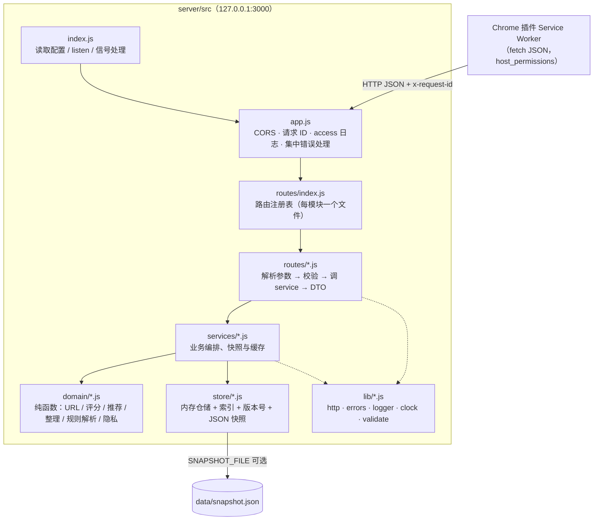
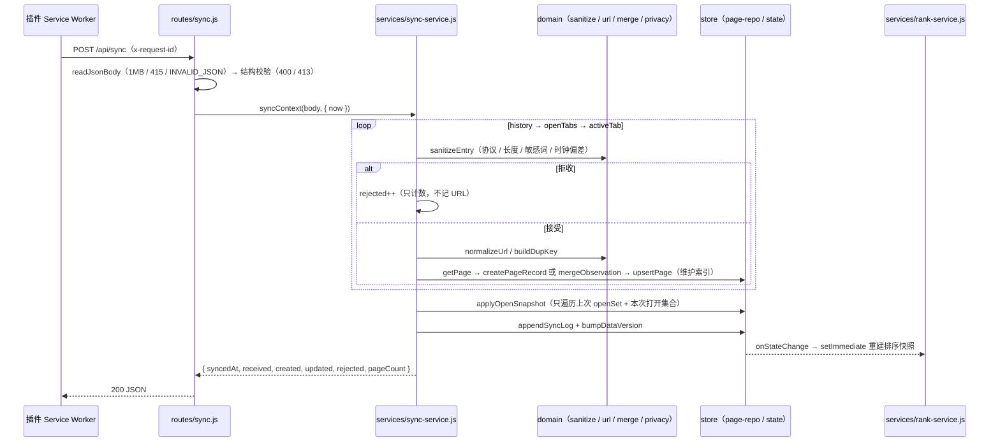

# 浏览器导航助手 · 后端技术方案

| 项目 | 内容 |
| --- | --- |
| 文档编号 | docs/03-技术方案-后端.md |
| 负责人 | 后端技术负责人（后端架构师） |
| 输入 | PROBLEM.md、resource.json（真相源，只读）；docs/02-PRD.md；docs/trace/features.json；specs/backend.spec.md；.workflow/CONVENTIONS.md |
| 产出 | 本文、`docs/trace/code-points-be.json`（60 个后端代码点）、`docs/trace/api-contract.json`（18 个接口，后端为契约 owner） |
| 技术栈 | Node.js v24，ESM，原生 `node:http`，零运行时依赖（BE-DIR-03，PRD D-13） |
| 状态 | 阶段 2 设计稿，已完成第 4 轮交叉评审修订（契约 v1.1.0，见第 15 章） |

> 阅读指引：第 1–3 章讲「系统怎么分层、数据放在哪」；第 5 章是接口契约的可读版（机器可读版是 `api-contract.json`，两者冲突时以 JSON 为准并回写本文）；第 6 章是算法口径（与 PRD 第 6 章、第 13 章样例推演逐项对齐）；第 11–13 章是给并行开发与测试用的「可测试性约定、文件所有权、Code ID 清单」。

---

## 1 架构分层与目录

### 1.1 总体结构



依赖方向只允许 `routes → services → domain / store`（BE-DIR-05）：

- `domain/` 是纯函数层：不做 I/O、不读系统时间（`now` 由调用方传入，BE-DIR-04、BE-TIME-01），可以直接单测和逐行讲解。
- `store/` 只暴露仓储函数（`upsertPage`、`listByDomain`…），`services/` 不直接操作 `Map`（BE-DIR-06），以后替换为 SQLite 只改 `store/`。
- `lib/` 是基础设施，任何层都可以引用；`lib/` 不引用业务层。
- `config.js` 是唯一读取 `process.env` 的文件（BE-RUN-01）；**只放跨模块共享的常量**（清单见 1.4，由 lead 骨架一次写全后冻结），模块私有的算法常量写在所属模块文件顶部（见 1.2 差异表）。两处都逐个注释理由（BE-STYLE-06）。

### 1.2 目录（文件级，所有权见第 12 章）

```
server/src/
├── index.js                     # CORE 入口：config → createApp → listen → SIGTERM/SIGINT
├── app.js                       # CORE CORS、x-request-id、access 日志、集中错误处理
├── config.js                    # CORE 环境变量 + 业务常量
├── routes/
│   ├── index.js                 # CORE 路由注册表：汇总各模块 xxxRoutes 数组
│   ├── test-api.js              # CORE POST /api/__test__/reset（仅 ENABLE_TEST_API=1）
│   ├── sync.js                  # SYNC
│   ├── ranked.js                # RANK
│   ├── recommendations.js       # REC
│   ├── cleanup.js  page-actions.js        # CLEAN
│   ├── rules-parse.js  rules.js           # RULE
│   ├── health.js                          # CORE（骨架就绪探针，C-BE-CORE-15 / C-BE-DIAG-01 共用）
│   ├── config.js                          # DIAG
│   ├── config-update.js                   # PRIV（PUT /api/config）
│   └── manual-pages.js  important.js      # MENU
├── services/
│   ├── sync-service.js  open-snapshot.js              # SYNC
│   ├── privacy-service.js  settings-service.js        # PRIV
│   ├── rank-service.js                                # RANK
│   ├── recommend-service.js                           # REC
│   ├── rec-cache.js                                   # PERF
│   ├── cleanup-service.js  page-action-service.js     # CLEAN
│   ├── rule-service.js                                # RULE
│   ├── health-service.js                              # CORE（同上）
│   ├── config-service.js                              # DIAG
│   └── manual-page-service.js  important-service.js   # MENU
├── domain/
│   ├── url.js  rule-match.js                          # CORE（多模块共用的纯函数）
│   ├── sync-sanitize.js  page-merge.js                # SYNC
│   ├── privacy.js                                     # PRIV
│   ├── scoring.js  domain-boost.js  rank-reason.js    # RANK
│   ├── rec-same-repo.js  rec-site.js  rec-fallback.js  rec-rule-trigger.js  rec-rank.js   # REC
│   ├── top-k.js                                       # PERF
│   ├── archive-verdict.js  duplicate-groups.js  cleanup.js                             # CLEAN
│   └── rule-clauses.js  rule-lexicon.js  rule-parser.js  rule-diagnose.js  rule-schema.js  # RULE
├── store/
│   ├── page-repo.js  indexes.js  rule-repo.js  state.js  settings-repo.js   # CORE
│   └── snapshot-writer.js  snapshot-loader.js                              # PERSIST
└── lib/
    └── http.js  errors.js  logger.js  clock.js  validate.js                # CORE
scripts/
├── start.sh  print-health.mjs        # DEMO
├── import-sample.mjs                 # DEMO
└── bench-perf.mjs                    # PERF
resources/
└── sample-history.json               # DEMO
```

与规范推荐结构（BE-DIR-02）的差异与理由：

| 差异 | 理由 |
| --- | --- |
| `routes/pages.js` 拆为 `ranked.js`、`cleanup.js`、`page-actions.js`、`manual-pages.js`、`important.js` | 同一个文件不能被两个业务模块同时修改（RANK / CLEAN / MENU 并行开发），按模块拆分 |
| `domain/recommend.js` 拆为 5 个 `rec-*.js` | 每种召回策略对应一个可独立测试的代码点，文件小、易讲解 |
| `store/memory-store.js` 拆为 `page-repo.js`、`rule-repo.js`、`state.js`、`settings-repo.js` | 仓储按聚合拆分，换 SQLite 时一张表对应一个文件 |
| 新增 `store/snapshot-*.js` | JSON 快照持久化（F-PERSIST-01），属于存储层 |
| 新增 `services/rec-cache.js`、`domain/top-k.js` | 性能模块（F-PERF-01、F-PERF-02）独立成文件，便于讲解「10 万条 100ms」 |
| 业务常量没有全部集中在 `config.js`（BE-STYLE-06 推荐集中）：`config.js` 只放 1.4 清单中的共享常量，模块私有算法常量放在本模块文件顶部（`export const`，带注释理由） | `config.js` 归 CORE。若模块私有常量也放进去，各模块开发时要么改 CORE 文件（并行冲突），要么串行等 lead。私有常量只被本模块读取，放在本模块文件里不影响「一处定义」；被第二个模块使用或需要经 `GET /api/config` 输出时，经 `blockedBy` 由 lead 提升进 `config.js` |
| `routes/health.js`、`services/health-service.js` 归 CORE（原计划归 DIAG） | health 是 `validate.mjs skeleton` 与 playwright `webServer` 的就绪探针，骨架阶段必须返回 200；它只读 CORE 的 repo / state，由 lead 一次实现（C-BE-CORE-15），DIAG 负责用例与验收（C-BE-DIAG-01） |

### 1.3 请求生命周期

1. `app.js` 读取 `x-request-id`（没有就生成 `req_<8 位随机>`），立即写回响应头；对 `Origin` 做 CORS 判定，`OPTIONS` 直接 204。
2. `routes/index.js` 匹配 `method + path`：路径不存在 404，方法不支持 405（`Allow` 头列出支持的方法）。
3. 路由 handler：`readJsonBody`（1 MB 上限、415、`INVALID_JSON`）→ `lib/validate.js` 白名单校验 → `resolveNow(query)` → 调 service。
4. service 组合 domain 纯函数与 store 仓储；写操作结束时 `bump*Version()`，触发排序快照异步重建、推荐缓存失效、快照持久化防抖写入。
5. `sendJson` 输出；`finish` 事件里写一条 access 日志（`reqId/method/path/status/ms`）。
6. 抛出的 `AppError` 按自身 code/status 输出；其他异常 500 `INTERNAL`，`details` 只含 `reqId`，堆栈只写 error 日志（BE-ERR-02）。

### 1.4 常量归属：config.js 共享常量清单与模块私有常量

判定规则：**被两个及以上模块使用，或经 `GET /api/config` / `GET /api/health` 对外输出** → 进 `config.js`（C-BE-CORE-02，lead 骨架阶段一次写全并登记为 symbols，骨架后冻结）；否则写在所属模块文件顶部。

| 符号（config.js） | 值 | 使用方 | 理由 |
| --- | --- | --- | --- |
| `loadConfig()` | `{ port: 3000, host: '127.0.0.1', enableTestApi, logFile, logLevel: 'info', snapshotFile: null }` | CORE、PERSIST、DIAG | 唯一读取 `process.env` 的位置（BE-RUN-01） |
| `DAY_MS` | `86_400_000` | SYNC、RANK、REC、CLEAN | 天数换算口径必须一致（D-20 归档判定、半衰期） |
| `DEFAULT_SETTINGS` | `{ cleanupThresholdDays: 14, maxHistoryItems: 100, historyLookbackDays: 30, enablePrivacyFilter: true, privacySensitiveKeywords: ['password','token','bank','secret'] }` | SYNC、PRIV、CLEAN、REC、DIAG、CORE（settings-repo 复位） | 可经 PUT /api/config 覆盖的默认值，resource.json 口径 |
| `SCORE_WEIGHTS` | `{ recency: 0.4, frequency: 0.3, open: 0.2, domain: 0.1 }` | RANK、DIAG | 评分口径，经 GET /api/config 输出 |
| `RECENCY_HALF_LIFE_DAYS` | `7` | RANK、DIAG | 同上 |
| `MIN_RECOMMENDATION_SCORE` | `0.3` | REC、DIAG | 同上 |
| `LIMITS` | `{ maxItemsPerSync: 500, maxUrlLength: 2048, maxRuleTextLength: 500, maxBodyBytes: 1_048_576, maxArrayItems: 500 }` | CORE（http / validate）、SYNC、RULE、MENU、DIAG | 输入规模上限（BE-SEC-03），经 GET /api/config 输出 |
| `APP_VERSION` / `API_VERSION` | `'1.0.0'` / `'1'` | CORE（health）、DIAG（config） | 插件比对主版本号 |

`LIMITS` 中 `maxArrayItems` 只供 `lib/validate.js` 内部使用，`GET /api/config` 的 `limits` 只输出契约列出的 4 个字段（maxItemsPerSync、maxUrlLength、maxRuleTextLength、maxBodyBytes），由 config-service 显式挑选，不整对象透传。

本节是 config.js 共享常量的**唯一来源**（docs/05 §12.5 应引用本节，不另列清单）；模块组不得在模块文件里重复定义上表中的常量。

模块私有常量（示例，以模块文件为准，不进 config.js）：RANK `RANK_FRESH_MS = 60_000`、`RANKED_LIMIT = { min: 1, max: 500, default: 20 }`（routes/ranked.js，仅 ranked 使用）、`RANK_STALE_MAX_MS = 3_600_000`、`NOW_LRU_SIZE = 8`（rank-service.js）；PERF `BUCKET_TOP_K = 50`（top-k.js）、推荐缓存容量 / TTL（rec-cache.js）；REC 各召回策略条数（rec-*.js）；CLEAN 重复组上限等（cleanup.js）；RULE 词表（rule-lexicon.js）、`MAX_RULES_PER_SAVE = 20`（rule-schema.js，`POST /api/rules` 单次 1–20 条，仅 RULE 使用）；PERSIST `SNAPSHOT_DEBOUNCE_MS = 1000`（snapshot-writer.js）；CORE `SYNC_LOG_CAPACITY = 50`（state.js）。

---

## 2 模块职责

| 模块 | 职责 | 不负责 | 关键文件 | 主要 Feature |
| --- | --- | --- | --- | --- |
| CORE（lead） | 入口、app 组装、路由注册表、配置与共享常量、通用 lib、URL 工具、规则匹配、全部仓储与版本号、测试重置、health 就绪探针 | 任何业务口径 | index.js、app.js、config.js、routes/index.js、routes/health.js、lib/*、store/{page-repo,indexes,rule-repo,state,settings-repo}.js、domain/{url,rule-match}.js、services/health-service.js | F-SYNC-07、F-DIAG-09、F-DEMO-01 |
| SYNC | 校验同步请求、清洗单条记录、按 normalizedUrl 合并入库、来源合并、打开状态快照、同步统计与日志 | 评分计算（交给 RANK 快照） | routes/sync.js、services/sync-service.js、services/open-snapshot.js、domain/sync-sanitize.js、domain/page-merge.js | F-SYNC-01 ~ F-SYNC-05、F-SYNC-07 |
| PRIV | 敏感关键词匹配、有效关键词表（配置 ∪ privacy_filter 规则）、拒收统计、PUT /api/config | 插件端过滤（前端负责） | domain/privacy.js、services/privacy-service.js、services/settings-service.js、routes/config-update.js | F-PRIV-03、F-PRIV-05 |
| RANK | 评分公式、域名分加权来源、排序理由、排序快照（写后预计算、版本失效）、ranked 接口 | 推荐 / 整理口径 | domain/scoring.js、domain/domain-boost.js、domain/rank-reason.js、services/rank-service.js、routes/ranked.js | F-RANK-01 ~ F-RANK-04 |
| REC | 召回策略（规则 / 同仓库 / 文档站 / 同域名 / 全局兜底）、过滤与最终打分、推荐编排 | 缓存实现（PERF） | domain/rec-*.js、services/recommend-service.js、routes/recommendations.js | F-REC-01 ~ F-REC-07 |
| PERF | 推荐结果缓存、桶内 Top-K、10 万条性能基准脚本 | — | services/rec-cache.js、domain/top-k.js、scripts/bench-perf.mjs | F-PERF-01、F-PERF-02 |
| CLEAN | 单页归档判定、重复分组、整理建议组装、执行归档 / 撤销 / 合并 | 插件端「忽略」（只存本地） | domain/archive-verdict.js、domain/duplicate-groups.js、domain/cleanup.js、services/cleanup-service.js、services/page-action-service.js、routes/cleanup.js、routes/page-actions.js | F-CLEAN-01 ~ F-CLEAN-06、F-CLEAN-08 |
| RULE | 分句、要素抽取、类型与否定判定、无法识别 / 冲突告知、保存校验、规则 CRUD 与启停 | 规则的执行（由 RANK / CLEAN / REC / PRIV 读取规则） | domain/rule-*.js、services/rule-service.js、routes/rules-parse.js、routes/rules.js | F-RULE-01 ~ F-RULE-10 |
| DIAG | config 查询；health 的字段口径、用例与验收（health 文件归 CORE，由 lead 骨架实现） | 插件端诊断项（前端负责） | routes/config.js、services/config-service.js | F-DIAG-01、F-DIAG-09、F-DIAG-10 |
| MENU | 右键「添加到分析」「标记为重要」的后端接口 | 菜单注册（前端负责） | routes/manual-pages.js、routes/important.js、services/manual-page-service.js、services/important-service.js | F-MENU-01 |
| PERSIST | JSON 快照写入（防抖、原子替换）、启动加载与损坏回退 | SQLite（F-PERSIST-02 本期只做方案） | store/snapshot-writer.js、store/snapshot-loader.js | F-PERSIST-01 |
| DEMO | 一条命令启动、样例数据、样例导入（时间平移，走真实 /api/sync） | — | scripts/start.sh、scripts/print-health.mjs、scripts/import-sample.mjs、resources/sample-history.json | F-DEMO-01、F-DEMO-02 |

模块之间的调用都是「import 对方导出的函数」，不改对方文件：例如 REC 调用 CLEAN 的 `decideArchive` 排除正在被建议归档的页面，DIAG 调用 PRIV 的 `getEffectiveKeywords` 输出合并后的关键词。

---

## 3 数据模型与存储

### 3.1 页面 Page（store 内部结构 = 对外 DTO 的超集）

| 字段 | 类型 | 说明 | 来源 / 口径 |
| --- | --- | --- | --- |
| `id` | string | `page_<自增>` | 新建时分配 |
| `url` | string | 首次出现时的原始 URL（清洗后） | PROBLEM.md |
| `normalizedUrl` | string | 存储主键（第 6.1 节） | D-03 |
| `dupKey` | string | 判重 key，建索引 | D-07 |
| `title` | string | 非空新值覆盖；新建为空时用 URL | F-SYNC-03 |
| `domain` | string | 小写 host 去 `www.` | — |
| `repo` | string \| null | GitHub `owner/repo`，建索引 | D-22 |
| `visitCount` | number | `max(已有, 新值, 1)` | D-02 |
| `lastVisitedAt` / `firstSeenAt` | number(ms) | max / min | 6.1 |
| `sources` | string[] | `active_tab` / `open_tab` / `history` / `manual` 的并集，按首次出现顺序 | F-SYNC-04 |
| `isOpen` / `isActive` | boolean | 最近一次同步的快照 | D-04 |
| `isArchived` / `archivedAt` / `mergedInto` | boolean / number / string | 整理执行（P1） | F-CLEAN-08 |
| `isImportant` | boolean | 右键或 ☆ 标记 | F-MENU-01 |
| `score` / `scoreDetail` / `reason` | — | **不落库**，由排序快照计算（依赖 now 和全局归一化因子） | D-05 |
| `updatedAt` | number(ms) | 最近一次被写入的时间 | — |

`score` 不存进页面记录的原因：recency 依赖「当前时间」，frequency 和 domain 依赖全局最大值，存进记录会在下一次同步后过期。它们集中放在排序快照（第 7 章）里，按版本号失效。

### 3.2 规则 Rule

`{ id, rawText, type, domain, urlPattern, inactiveDays, keywords?, trigger?, target?, action, enabled, confidence, createdAt, updatedAt }`，五种类型与字段约束见第 6.6 节和 C-BE-RULE-05。`confidence`（high / medium）随规则保存，供插件规则列表展示；解析阶段的 `notes` 不落库（它是解析过程信息）。

### 3.3 运行状态 State 与同步日志 SyncLog

- `versions = { data, rule, config }`：三个计数器，进程内单调递增、**永不归零**。`data` 在同步、添加到分析、标记重要、归档 / 撤销 / 合并时加 1；`rule` 在保存 / 删除 / 启停规则时加 1；`config` 在 PUT /api/config 时加 1；reset 时三个各加 1。它们是排序快照、推荐缓存、有效关键词表的失效依据。
- **重置机制（C-BE-CORE-12、C-BE-CORE-14）**：`state.js` 提供 `onReset(fn)` 注册接口。各模块在模块加载时注册自己的清理函数：page-repo `clearPages`（含索引与 openSet）、rule-repo `clearRules`、RANK `resetRankCache`（默认快照 + `?now=` LRU + 取消待执行重建）、PERF `clearRecCache`、PRIV `resetKeywordCache`。`resetState()` 的顺序：① 三个版本号各加 1；② 清空同步日志、配置覆盖、id 序号；③ 按注册顺序同步调用全部 onReset 回调；④ 触发 `onStateChange`（启用持久化时写入空快照）。`POST /api/__test__/reset` 的 `resetAll` 只调用 `resetState()`，不直接 import 任何业务模块。版本号不归零是为了用例隔离：用例默认在 60 秒内连续执行，若归零，下一个用例 reset→sync 后会得到与上一个用例相同的版本号，推荐缓存 key 和排序快照会按旧版本号命中上一个用例的结果；版本号递增后，即使某个模块漏注册回调，旧缓存也会因 key 不同而失效（双保险）。
- `SyncLog = { id: "sync_<n>", syncedAt, mode, received, created, updated, rejected, rejectedByReason, durationMs, clientVersion, ok }`，环形保留最近 50 条；不记录 URL，只记录数量。`lastSyncAt` 供 `/api/health`。
- `settings`：PUT /api/config 的覆盖值（cleanupThresholdDays、maxHistoryItems、historyLookbackDays、enablePrivacyFilter、privacySensitiveKeywords），缺省取 `config.DEFAULT_SETTINGS`。

### 3.4 内存存储与索引

| 结构 | 键 → 值 | 维护时机 | 用途 |
| --- | --- | --- | --- |
| `pages` | normalizedUrl → Page | upsert | 主表（BE-PERF-02 `byUrl`） |
| `byDupKey` | dupKey → Set\<normalizedUrl\> | 新建页面时 | 整理 merge、推荐排除 |
| `byDomain` | domain → Set\<normalizedUrl\> | 新建页面时 | 同域名 / 文档站召回、domain 过滤、域名访问量 |
| `byRepo` | owner/repo → Set\<normalizedUrl\> | 新建页面时 | 同仓库召回 |
| `openSet` | Set\<normalizedUrl\> | 每次同步的快照 | isOpen 刷新只遍历上次的 openSet |
| `domainVisits` | domain → Σ visitCount（未归档） | visitCount 变化 / 归档时增量更新 | 域名亲和度 |
| 排序快照（services 层） | 版本号 → 有序页面数组 + 每页明细 + 域名 / 仓库 Top-50 桶 + dupKey 最佳页 + builtAt | 写操作后异步预建；版本变化且预建未完成时首个读同步构建；60 秒–1 小时读请求先返回旧快照、后台异步重建；超过 1 小时同步重建 | ranked 查询、推荐召回 |

### 3.5 演示期持久化：JSON 快照（F-PERSIST-01）

- 开关：设置 `SNAPSHOT_FILE` 才启用；`scripts/start.sh` 默认 `data/snapshot.json`，测试（playwright webServer）不设置，保持纯内存与用例隔离。
- 写入：订阅 `onStateChange`，1 秒防抖；写 `<file>.<pid>.tmp` → `fsync` → `rename` 覆盖正式文件。`rename` 在同一文件系统内是原子的，写到一半崩溃只会留下 tmp，正式文件仍是上一份完整快照。
- 退出：SIGTERM / SIGINT 时，**只有配置了 `SNAPSHOT_FILE`** 才调用 `flushSnapshotSync()`；调用包在 `try / catch / finally` 中：catch 记 error 日志，finally 中 `server.close()` → `process.exit(0)`，另有 3 秒 `unref` 定时器兜底。PERSIST 未实现（骨架桩为 no-op）或落盘抛错都不会阻止退出（BE-RUN-03）。
- 加载：启动时读取正式文件，校验 `schemaVersion=1` 与结构；index.js 只按返回值的 `ok` 判断（`const r = loadSnapshot(file); if (r.ok) hydrate(r.data); else` 记 warn 日志、带 `r.reason`、以空数据启动），**不做判空**，因为 `loadSnapshot` 永不返回 null（骨架桩返回 `{ ok: false, reason: 'NOT_IMPLEMENTED' }`）；残留 `*.tmp` 一律忽略并删除；正式文件损坏时打 warn 日志、以空数据启动（不崩溃）。
- 内容：`{ schemaVersion, savedAt, pages, rules, settings, seq: { page, rule, sync }, lastSyncAt }`。索引不落盘，加载后重建。

### 3.6 生产持久化方案：SQLite（F-PERSIST-02，本期只做方案说明）

```sql
CREATE TABLE pages (
  id TEXT PRIMARY KEY,
  url TEXT NOT NULL,
  normalized_url TEXT NOT NULL UNIQUE,          -- 存储主键（D-03），UPSERT 冲突目标
  dup_key TEXT NOT NULL,
  title TEXT NOT NULL,
  domain TEXT NOT NULL,
  repo TEXT,                                    -- GitHub owner/repo，可空
  visit_count INTEGER NOT NULL DEFAULT 1,
  last_visited_at INTEGER NOT NULL,
  first_seen_at INTEGER NOT NULL,
  sources TEXT NOT NULL,                        -- JSON 数组
  is_open INTEGER NOT NULL DEFAULT 0,
  is_active INTEGER NOT NULL DEFAULT 0,
  is_archived INTEGER NOT NULL DEFAULT 0,
  archived_at INTEGER,
  merged_into TEXT,
  is_important INTEGER NOT NULL DEFAULT 0,
  static_score REAL NOT NULL DEFAULT 0,         -- 预计算的 0.3·frequency + 0.2·open + 0.1·domain
  updated_at INTEGER NOT NULL
);
CREATE INDEX idx_pages_domain_static  ON pages(domain, static_score DESC) WHERE is_archived = 0;  -- 同域名 Top-K 召回
CREATE INDEX idx_pages_repo_static    ON pages(repo, static_score DESC)   WHERE repo IS NOT NULL AND is_archived = 0; -- 同仓库召回
CREATE INDEX idx_pages_dup_key        ON pages(dup_key);                                          -- merge 分组、推荐排除
CREATE INDEX idx_pages_last_visit     ON pages(last_visited_at) WHERE is_archived = 0;            -- 归档候选范围扫描
CREATE INDEX idx_pages_open           ON pages(is_open) WHERE is_open = 1;                         -- 打开状态快照刷新

CREATE TABLE rules (
  id TEXT PRIMARY KEY, raw_text TEXT NOT NULL, type TEXT NOT NULL, domain TEXT, url_pattern TEXT,
  inactive_days INTEGER, keywords TEXT, trigger_json TEXT, target_json TEXT, action TEXT NOT NULL,
  enabled INTEGER NOT NULL DEFAULT 1, created_at INTEGER NOT NULL, updated_at INTEGER NOT NULL
);
CREATE INDEX idx_rules_type_enabled ON rules(type, enabled);

CREATE TABLE sync_logs (
  id TEXT PRIMARY KEY, synced_at INTEGER NOT NULL, mode TEXT, received INTEGER, created INTEGER,
  updated INTEGER, rejected INTEGER, duration_ms INTEGER, client_version TEXT, ok INTEGER, error TEXT
);
CREATE INDEX idx_sync_logs_time ON sync_logs(synced_at DESC);

CREATE TABLE settings (key TEXT PRIMARY KEY, value TEXT NOT NULL);   -- PUT /api/config 的覆盖值
```

迁移要点：

1. 只替换 `store/*.js` 的实现，函数签名不变（`upsertPage`、`listByDomain(domain, k)` 等），services / domain 不改。
2. 同步写入用一个事务 + `INSERT … ON CONFLICT(normalized_url) DO UPDATE SET visit_count = MAX(visit_count, excluded.visit_count), last_visited_at = MAX(…)`，与内存口径一致。
3. recency 依赖查询时刻，不落库；落库的是 `static_score`（frequency / open / domain 三项），推荐召回用 `(domain, static_score)`、`(repo, static_score)` 索引各取 Top-50，再在内存里乘上 recency 排序；全局最大值（max visitCount、max domain visits）存在 `settings` 或物化表中，变化时批量刷新 static_score。
4. 打开 WAL 模式（`PRAGMA journal_mode=WAL`），读写互不阻塞；单用户本地场景单连接即可。
5. 运行时需要 SQLite 驱动（`node:sqlite` 在 Node v24 仍为实验特性），这是本期不实现的主要原因——零依赖、可讲解优先。

---

## 4 关键流程

### 4.1 同步（POST /api/sync）



### 4.2 读请求（ranked / recommendations / cleanup）

`resolveNow(query)` → 取排序快照 `getRankSnapshot({ now })` → 各自的 domain 函数 → DTO。推荐接口在取快照前先查推荐缓存。

`getRankSnapshot` 的读路径（C-BE-RANK-04，满足 BE-PERF-01「读接口不重新计算全量评分」）：

| 情况 | 处理 | 读请求的开销 |
| --- | --- | --- |
| 版本号一致，now − builtAt ≤ 60 秒 | 直接返回快照 | O(1) |
| 版本号一致，60 秒 < now − builtAt ≤ 1 小时（`RANK_STALE_MAX_MS`） | **stale-while-revalidate**：本次仍返回旧快照，同时 `setImmediate` 异步重建（同一时刻最多一个重建任务） | O(1) |
| 版本号一致，now − builtAt > 1 小时 | **过时上限**：同步重建一次后返回新快照（10 万条约 100 ms；每小时最多一次，由 p95 容忍）。保证返回的 score / scoreDetail.recency / reason 最多比请求时刻落后 1 小时（第 2 轮评审 [BE] 过时无上限） | O(n log n)，每小时最多一次 |
| 版本号不一致（写后预建还没跑完，或进程刚启动 / reset 后） | 同步构建一次（写操作的响应已先返回，`setImmediate` 预建通常早于下一次读完成；这一分支只在写后极短窗口或冷启动出现）。**因此 POST /api/sync、归档、规则变更、reset 之后的第一次读一定看到写入后的数据，不会读到旧快照或空快照** | O(n log n)，由 p95 容忍 |
| 带 `?now=` | 按 `(versions, now)` 查容量 8 的 LRU，未命中时单独计算并放入 LRU，不污染默认快照；**此路径仅用于测试与复算**（插件不传 `?now=`） | 首次 O(n log n)，重复 O(1) |

注意：
- 整理判定（`decideArchive` 的未访问天数）和推荐的「已打开」排除用请求时刻的 `now`，不取快照的 builtAt；快照只提供排序、score 与 reason。
- **过时上限 1 小时**：默认快照最多比请求时刻落后 1 小时（超过即同步重建），且在此期间页面集合与规则都未变化（否则版本号会变），差异只来自 recency 的时间衰减：0.4 × (1 − 0.5^(1/168)) ≈ 0.0017，不足以改变 2 位小数以外的结论。reason 中的「今天访问过 / N 天前访问 / 已 N 天未访问」最多与整理建议的 ageDays 在跨零点的 1 小时窗口内相差 1 天；归档结论只以整理接口（请求时刻 now）为准。隔天第一次打开 popup 必然走同步重建，不会拿到昨天的快照。
- `GET /api/pages/ranked` 的 `generatedAt` 返回**实际计算 score / reason 所用的 now**，即快照的 `builtAt`（带 `?now=` 时等于该值）；不是请求时刻。整理建议的 `generatedAt` 是请求时刻 now；推荐接口的 `generatedAt` 是请求时刻 now（排除与整理判定所用），其 score 来自快照。

---

## 5 API 设计

### 5.1 共通约定

| 项目 | 约定 |
| --- | --- |
| 基础地址 | `http://127.0.0.1:3000`（`PORT` / `HOST` 可覆盖；契约 `defaultPort=3000`） |
| 格式 | 请求和响应均为 JSON，`Content-Type: application/json; charset=utf-8`；时间戳为毫秒 number（BE-API-01） |
| 请求 ID | 读取请求头 `x-request-id`，缺省生成 `req_<随机>`，原样写回响应头并写入该请求所有日志（BE-LOG-03） |
| CORS | 允许 `chrome-extension://*`、`http://localhost:*`、`http://127.0.0.1:*`；`OPTIONS` 204 + `Access-Control-Allow-Methods: GET, POST, PUT, PATCH, DELETE, OPTIONS` + `Access-Control-Allow-Headers: content-type, x-request-id`；`Access-Control-Expose-Headers: x-request-id`；其他来源不返回 `Access-Control-Allow-Origin`（BE-API-07） |
| 时间覆盖 | `GET /api/pages/ranked`、`POST /api/recommendations/next`、`GET /api/pages/cleanup-suggestions` 支持 `?now=<毫秒>`（D-01）；非正整数返回 400 |
| 字段命名 | camelCase，沿用 PROBLEM.md 字段名，只增不减（BE-NAME-02）；新增字段先写进 `api-contract.json` |
| 上限 | 请求体 1 MB；`openTabs` / `history` / `recentHistory` / `urls` 每个数组 500 条；URL 2048 字符；title 截断到 500 字符；规则文本 1–500 字符；一次最多保存 20 条规则 |
| 超限策略 | 数组超长、请求体超长 → 413（拒绝整个请求）；单条 URL 过长 → 计入 rejected（同步）或 400（单条接口）；title 过长 → 截断（BE-SEC-03 二选一已写入契约） |

统一错误格式（BE-API-02）：

```json
{ "error": { "code": "VALIDATION_FAILED", "message": "openTabs 必须是数组", "details": { "fields": ["openTabs"] } } }
```

| code | 状态码 | 场景 |
| --- | --- | --- |
| `INVALID_JSON` | 400 | 请求体不是合法 JSON |
| `VALIDATION_FAILED` | 400 | 字段缺失、类型或取值错误，`details.fields` 列出全部出错字段 |
| `UNSUPPORTED_MEDIA_TYPE` | 415 | 有请求体但 Content-Type 不是 `application/json` |
| `NOT_FOUND` | 404 | 路由不存在；规则 / 页面不存在；未开启测试接口时的 `/api/__test__/reset` |
| `METHOD_NOT_ALLOWED` | 405 | 路径存在但方法不支持，响应带 `Allow` 头 |
| `PAYLOAD_TOO_LARGE` | 413 | 请求体超过 1 MB，或数组超过 500 条 |
| `INTERNAL` | 500 | 未预期异常，`details` 只含 `reqId` |

### 5.2 接口总表

| 方法 | 路径 | 用途 | 成功状态 | Code IDs | Feature IDs |
| --- | --- | --- | --- | --- | --- |
| POST | `/api/sync` | 上报浏览器上下文：按 normalizedUrl 去重合并入库；isOpen / isActive 按本次快照刷新；单条坏记录计入 rejected，不影响其他记录。 | 200 | C-BE-SYNC-01、C-BE-SYNC-02、C-BE-SYNC-03、C-BE-SYNC-04、C-BE-SYNC-05、C-BE-PRIV-01、C-BE-PRIV-02、C-BE-CORE-05、C-BE-CORE-09、C-BE-CORE-10 | F-SYNC-01、F-SYNC-02、F-SYNC-03、F-SYNC-04、F-SYNC-05、F-SYNC-07、F-PRIV-03、F-PRIV-05、F-DEMO-02 |
| GET | `/api/pages/ranked` | 按评分降序返回未归档页面。同分按 lastVisitedAt 倒序。 | 200 | C-BE-RANK-01、C-BE-RANK-02、C-BE-RANK-03、C-BE-RANK-04、C-BE-RANK-05、C-BE-CORE-07、C-BE-CORE-13 | F-RANK-01、F-RANK-02、F-RANK-03、F-RANK-04、F-MENU-01、F-PERF-01、F-CLEAN-08、F-SYNC-03、F-SYNC-04、F-SYNC-05 |
| POST | `/api/recommendations/next` | 根据当前页、打开的标签页和最近历史推荐下一步访问，最多 5 条，final ≥ 0.3。 | 200 | C-BE-REC-01、C-BE-REC-02、C-BE-REC-03、C-BE-REC-04、C-BE-REC-05、C-BE-REC-06、C-BE-REC-07、C-BE-PERF-01、C-BE-PERF-02、C-BE-CLEAN-01 | F-REC-01、F-REC-02、F-REC-03、F-REC-04、F-REC-05、F-REC-06、F-REC-07、F-PERF-01、F-PERF-02 |
| GET | `/api/pages/cleanup-suggestions` | 旧页面归档、重复页面合并与受保护页面保留建议；顺序 archive（ageDays 降序）→ merge → keep。 | 200 | C-BE-CLEAN-01、C-BE-CLEAN-02、C-BE-CLEAN-03、C-BE-CLEAN-04、C-BE-CORE-07、C-BE-CORE-13 | F-CLEAN-01、F-CLEAN-02、F-CLEAN-03、F-CLEAN-04、F-CLEAN-05、F-CLEAN-06、F-DEMO-02、F-MENU-01 |
| POST | `/api/rules/parse` | 自然语言 → 结构化规则预览，不写库（D-08）。 | 200 | C-BE-RULE-01、C-BE-RULE-02、C-BE-RULE-03、C-BE-RULE-04、C-BE-RULE-06、C-BE-RULE-07 | F-RULE-01、F-RULE-02、F-RULE-03、F-RULE-04、F-RULE-05、F-RULE-10 |
| POST | `/api/rules` | 保存用户勾选的规则（可一次多条），后端重新校验并分配正式 id；全部通过才写入。 | 201 | C-BE-RULE-05、C-BE-RULE-06、C-BE-RULE-08、C-BE-CORE-11 | F-RULE-06、F-RULE-04、F-CLEAN-04、F-CLEAN-05、F-RANK-04、F-REC-07、F-PRIV-05 |
| GET | `/api/rules` | 规则列表，按创建顺序。 | 200 | C-BE-RULE-06、C-BE-RULE-08、C-BE-CORE-11 | F-RULE-07 |
| DELETE | `/api/rules/:id` | 删除规则，立即对排序、整理、推荐和隐私关键词生效。 | 200 | C-BE-RULE-06、C-BE-RULE-08、C-BE-CORE-11 | F-RULE-08 |
| PATCH | `/api/rules/:id` | 启用 / 停用规则。 | 200 | C-BE-RULE-06、C-BE-RULE-08 | F-RULE-09 |
| GET | `/api/health` | 健康检查（插件诊断项 1 与顶栏连接状态；也是 validate skeleton / playwright webServer 的就绪探针，骨架阶段即返回 200 完整字段）。 | 200 | C-BE-DIAG-01、C-BE-CORE-15、C-BE-CORE-12 | F-DIAG-09、F-DIAG-01、F-DEMO-01、F-PERSIST-01、F-RULE-08 |
| GET | `/api/config` | 配置查询；privacySensitiveKeywords 已合并启用的 privacy_filter 规则。 | 200 | C-BE-DIAG-02、C-BE-CORE-02、C-BE-PRIV-02 | F-DIAG-10、F-PRIV-05 |
| PUT | `/api/config` | 修改可配置项（部分更新）；weights、recencyHalfLifeDays 等算法常量只读。 | 200 | C-BE-PRIV-03、C-BE-CORE-12 | F-PRIV-05 |
| POST | `/api/pages/archive` | 执行归档：页面从排序、推荐、整理建议中移除（可撤销）。 | 200 | C-BE-CLEAN-05 | F-CLEAN-08 |
| POST | `/api/pages/unarchive` | 撤销归档（包括合并时被归档的页面）。 | 200 | C-BE-CLEAN-05 | F-CLEAN-08 |
| POST | `/api/pages/merge` | 合并重复页面：统计并入 keepUrl 页面，其余页面归档并记录 mergedInto。 | 200 | C-BE-CLEAN-05 | F-CLEAN-08 |
| POST | `/api/pages/important` | 标记 / 取消标记重要（右键菜单「标记为重要」与插件 ☆）。 | 200 | C-BE-MENU-02 | F-MENU-01 |
| POST | `/api/pages/manual` | 右键「添加到分析」：单条加入页面库，sources 含 manual；不影响打开状态快照。 | 200 | C-BE-MENU-01 | F-MENU-01 |
| POST | `/api/__test__/reset` | 仅 ENABLE_TEST_API=1 时存在：清空全部数据与缓存（页面、规则、同步日志、排序快照、推荐缓存、有效关键词表、id 序号），恢复默认配置；内部版本号各加 1 而不归零，保证用例之间缓存不串（测试夹具在每个用例前调用）。 | 200 | C-BE-CORE-14 | F-DIAG-09 |
| GET | `/api/__test__/state` | 仅 ENABLE_TEST_API=1 时存在，严格只读（BE-RUN-07）：返回 dataVersion、版本号、计数、页面关键字段（超过 2000 页时只给摘要和 pagesHash）、规则、配置、序号、最近同步、持久化文件摘要；隐私 URL 打码。测试夹具在每个用例前后各取一次，生成状态差异证据。 | 200 | C-BE-CORE-14 | F-DIAG-09 |

`/api/__test__/reset` 和 `/api/__test__/state` 只在 `ENABLE_TEST_API=1` 时注册，不属于产品接口。

### 5.3 POST /api/sync（C-BE-SYNC-01 ~ C-BE-SYNC-05；F-SYNC-01、F-SYNC-02、F-SYNC-03、F-SYNC-04、F-SYNC-05、F-SYNC-07、F-PRIV-03）

请求（题目结构 + 可选字段 `clientVersion`、`mode`、`cursor`、`openTabs[].lastAccessed`、`history[].visitCount`）：

```json
{
  "activeTab": { "url": "https://github.com/org/repo/pull/456", "title": "Refactor auth middleware (#456)" },
  "openTabs": [{ "url": "https://github.com/org/repo/issues/123", "title": "Fix login redirect bug", "lastAccessed": 1710099000000 }],
  "history": [{ "url": "https://github.com/org/repo/issues/123", "title": "Fix login redirect bug", "lastVisitTime": 1710090000000, "visitCount": 8 }],
  "clientVersion": "0.1.0", "mode": "full"
}
```

响应 200：

```json
{ "ok": true, "syncedAt": 1710100300000, "received": 14, "created": 10, "updated": 4, "rejected": 0,
  "rejectedByReason": { "invalid_url": 0, "privacy": 0 }, "pageCount": 10, "mode": "full" }
```

| 情况 | 结果 |
| --- | --- |
| 请求体不是 JSON | 400 `INVALID_JSON`，不写入任何数据（F-SYNC-07 AC1） |
| `openTabs` / `history` 不是数组、`activeTab` 不是对象或 null、`mode` 非法 | 400 `VALIDATION_FAILED`，`details.fields` 如 `["openTabs"]`（AC2） |
| 任一数组超过 500 条 / 请求体超过 1 MB | 413 `PAYLOAD_TOO_LARGE`（AC3） |
| 单条 `url` 为 `javascript:` / `chrome://` / 无法解析 / 超过 2048 字符 / 不是字符串 / 条目不是对象 | 计入 `rejected`（`invalid_url`），其他条目照常处理（AC4） |
| 单条 URL 命中敏感关键词（启用隐私过滤时） | 计入 `rejected`（`privacy`），不入库，日志只记域名（F-PRIV-03） |
| Content-Type 不是 JSON | 415 |

### 5.4 GET /api/pages/ranked（C-BE-RANK-01 ~ C-BE-RANK-05；F-RANK-01 ~ F-RANK-04）

查询参数：`limit`（1–500，默认 20）、`domain`（等于或子域）、`openOnly`（`true`/`false`）、`now`。

```json
{
  "pages": [{
    "id": "page_2", "url": "https://github.com/org/repo/issues/123", "normalizedUrl": "https://github.com/org/repo/issues/123",
    "title": "Fix login redirect bug", "domain": "github.com", "visitCount": 8,
    "lastVisitedAt": 1710090000000, "firstSeenAt": 1710090000000, "sources": ["history", "open_tab"],
    "isOpen": true, "isActive": false, "isImportant": false, "score": 1.0,
    "scoreDetail": { "recency": 0.99, "frequency": 1.0, "open": 1, "domain": 1.0, "domainSource": "affinity" },
    "reason": "最近 3 天内多次访问（8 次），当前仍处于打开状态，常用域名 github.com"
  }],
  "total": 10, "domains": ["github.com", "developer.mozilla.org"], "generatedAt": 1710100300000
}
```

`domains`（契约 v1.1.0 新增）：全部未归档页面的去重域名，按页面数降序、同数按字母序，最多 50 个，取自排序快照的 `domainList`，**不受本次 `domain` / `openOnly` / `limit` 过滤影响**，供插件域名筛选下拉直接使用（避免前端从过滤后的结果中提取导致选项缺失）。

错误：`limit` 越界或 `openOnly` 非法 400；`now` 非法 400。空库返回 `{ pages: [], total: 0 }`（F-RANK-01 AC5）。已归档页面不出现（F-CLEAN-08 AC1）。

### 5.5 POST /api/recommendations/next（C-BE-REC-01 ~ C-BE-REC-07、C-BE-PERF-01；F-REC-01 ~ F-REC-07、F-PERF-01、F-PERF-02）

```json
// 请求
{ "currentPage": { "url": "https://github.com/org/repo/pull/456", "title": "Refactor auth middleware (#456)" },
  "openTabs": [{ "url": "https://github.com/org/repo/issues/123", "title": "Fix login redirect bug" }],
  "recentHistory": [{ "url": "https://react.dev/learn", "title": "Quick Start – React", "lastVisitTime": 1710055000000 }] }
// 响应 200
{ "recommendations": [
    { "id": "rec_3", "type": "next_visit", "url": "https://github.com/org/repo/actions", "title": "Actions · org/repo",
      "score": 0.87, "strategy": "same_repo", "contextUrl": "https://github.com/org/repo/pull/456", "createdAt": 1710100300000,
      "reason": "你正在查看 PR，同仓库 CI 页面最近访问频率较高，可能需要检查构建状态" } ],
  "cached": false, "generatedAt": 1710100300000 }
```

错误：缺少 `currentPage` 字段、`currentPage` 不是对象或 null、`openTabs` / `recentHistory` 不是数组 → 400 `VALIDATION_FAILED`（F-REC-01 AC2）；数组超过 500 条 → 413。空库返回 `recommendations: []`（AC3）。`id` 为 `rec_<页面序号>`（规则站内搜索兜底为 `rec_rule_<规则 id>`），同一页面多次推荐 id 稳定，便于插件做点击统计。

### 5.6 GET /api/pages/cleanup-suggestions（C-BE-CLEAN-01 ~ C-BE-CLEAN-04；F-CLEAN-01 ~ F-CLEAN-06）

```json
{
  "summary": { "archive": 2, "merge": 1, "keep": 1 },
  "suggestions": [
    { "key": "archive:https://github.com/org/repo/issues/100", "action": "archive", "url": "https://github.com/org/repo/issues/100",
      "title": "Old bug report from last sprint", "ageDays": 24, "lastVisitedAt": 1708000000000, "ruleId": "rule_1",
      "reason": "超过 7 天未访问（已 24 天），且不在当前打开的 tab 中；命中规则「把 7 天没访问过的 GitHub issue 建议归档」" },
    { "key": "merge:github.com/org/repo/issues/123", "action": "merge",
      "urls": ["https://github.com/org/repo/issues/123", "https://github.com/org/repo/issues/123?tab=comments"],
      "titles": ["Fix login redirect bug", "Fix login redirect bug - Comments"],
      "keepUrl": "https://github.com/org/repo/issues/123", "title": "Fix login redirect bug",
      "reason": "去掉 query 参数后 URL 相同，疑似重复页面" },
    { "key": "keep:https://docs.internal.com/ai-agent-design", "action": "keep", "url": "https://docs.internal.com/ai-agent-design",
      "title": "AI Agent Design Guidelines", "ageDays": 6, "ruleId": "rule_2",
      "reason": "被保护域名配置（docs.internal.com），不建议归档，虽已 6 天未访问" }
  ],
  "thresholdDays": 14, "generatedAt": 1710100300000
}
```

`key` 是「动作 + normalizedUrl / dupKey」的稳定字符串，插件「忽略」时用它作 `ignoredSuggestions` 的键。错误：`now` 非法 400。

### 5.7 规则接口（C-BE-RULE-01 ~ C-BE-RULE-08；F-RULE-01 ~ F-RULE-10）

**POST /api/rules/parse**：请求 `{ "text": "把 7 天没访问过的 GitHub issue 建议归档，但 docs.internal.com 的页面永远不要归档" }`，响应 200：

```json
{
  "rules": [
    { "id": "rule_1", "rawText": "把 7 天没访问过的 GitHub issue 建议归档", "type": "archive_candidate", "domain": "github.com",
      "urlPattern": "/issues/", "inactiveDays": 7, "action": "suggest_archive", "enabled": true, "confidence": "high", "notes": [] },
    { "id": "rule_2", "rawText": "docs.internal.com 的页面永远不要归档", "type": "never_archive", "domain": "docs.internal.com",
      "urlPattern": null, "inactiveDays": null, "action": "keep", "enabled": true, "confidence": "high", "notes": [] }
  ],
  "unparsed": [],
  "warnings": []
}
```

无法识别示例（「帮我整理一下」）：

```json
{ "rules": [], "warnings": [],
  "unparsed": [{ "text": "帮我整理一下", "reason": "没有识别到动作（归档 / 不要归档 / 推荐 / 不上传 / 优先）",
                 "examples": ["把 7 天没访问过的 GitHub issue 建议归档", "docs.internal.com 的页面永远不要归档", "不要上传包含 password、token 的 URL"] }] }
```

`text` 缺失、非字符串、trim 后为空或超过 500 字符 → 400 `VALIDATION_FAILED`（F-RULE-05 AC4）。

**POST /api/rules**：请求 `{ "rules": [ 解析结果中勾选的规则 ] }`，响应 **201** `{ "rules": [保存后的规则，含正式 id、enabled、confidence、createdAt、updatedAt], "ruleCount": 2 }`。任一条校验失败整体 400（`details.fields` 形如 `rules[0].type`），不部分写入（F-RULE-06 AC3）。

**GET /api/rules**：200 `{ "rules": [...], "total": 2 }`，按创建顺序。

**DELETE /api/rules/:id**：200 `{ "deleted": "rule_2", "ruleCount": 1 }`；不存在 404 `NOT_FOUND`（F-RULE-08 AC2）。

**PATCH /api/rules/:id**：请求 `{ "enabled": false }`，200 返回更新后的规则对象（顶层即规则字段，`enabled=false`）；`enabled` 不是 boolean 400；不存在 404。

### 5.8 诊断接口（C-BE-DIAG-01、C-BE-CORE-15、C-BE-DIAG-02、C-BE-PRIV-03；F-DIAG-01、F-DIAG-09、F-DIAG-10、F-PRIV-05）

```json
// GET /api/health
{ "status": "ok", "version": "1.0.0", "uptime": 3600, "pageCount": 128, "ruleCount": 3, "enabledRuleCount": 3,
  "lastSyncAt": 1710100300000, "persistence": "memory", "startedAt": 1710096700000 }
// GET /api/config
{ "cleanupThresholdDays": 14, "maxHistoryItems": 100, "enablePrivacyFilter": true,
  "privacySensitiveKeywords": ["password", "token", "bank", "secret"], "baseSensitiveKeywords": ["password", "token", "bank", "secret"],
  "historyLookbackDays": 30, "recencyHalfLifeDays": 7, "weights": { "recency": 0.4, "frequency": 0.3, "open": 0.2, "domain": 0.1 },
  "minRecommendationScore": 0.3, "apiVersion": "1",
  "limits": { "maxItemsPerSync": 500, "maxUrlLength": 2048, "maxRuleTextLength": 500, "maxBodyBytes": 1048576 } }
```

**PUT /api/config**：部分更新 `{ "privacySensitiveKeywords": ["password","token","bank","secret","session"] }` → 200 返回完整配置（与 GET 同结构）。可写字段：`cleanupThresholdDays`（1–365）、`maxHistoryItems`（1–500）、`historyLookbackDays`（1–90）、`enablePrivacyFilter`、`privacySensitiveKeywords`（≤50 项，每项 1–50 字符，转小写去重）。权重、半衰期、推荐下限只读（保证 PRD 第 13 章数值可复算）。没有任何可识别字段或越界 → 400。

### 5.9 整理执行与右键菜单（C-BE-CLEAN-05、C-BE-MENU-01、C-BE-MENU-02；F-CLEAN-08、F-MENU-01）

| 接口 | 请求 | 响应 200 | 错误 |
| --- | --- | --- | --- |
| `POST /api/pages/archive` | `{ "urls": ["https://github.com/org/repo/issues/100"] }` | `{ "ok": true, "affected": 1, "archivedAt": 1710100300000, "notFound": 0 }` | urls 非法 400；全部不存在 404 |
| `POST /api/pages/unarchive` | `{ "urls": [...] }` | `{ "ok": true, "affected": 1, "notFound": 0 }` | 同上 |
| `POST /api/pages/merge` | `{ "urls": ["…/issues/123", "…/issues/123?tab=comments"], "keepUrl": "…/issues/123" }` | `{ "ok": true, "keepUrl": "…/issues/123", "merged": 1 }` | urls < 2 或 keepUrl 不在 urls 中 400；keepUrl 页面不存在 404 |
| `POST /api/pages/important` | `{ "url": "https://docs.internal.com/ai-agent-design", "title": "…", "important": true }` | `{ "accepted": true, "rejected": 0, "url": "…", "normalizedUrl": "…", "isImportant": true, "created": false }` | url 非 http(s) / 超长 400；敏感 URL 返回 200 `accepted:false, rejected:1` |
| `POST /api/pages/manual` | `{ "url": "https://example.com/note", "title": "Note" }` | `{ "accepted": true, "rejected": 0, "created": true, "pageCount": 11 }` | 同上 |

「添加到分析」不复用 `/api/sync`：同步的打开状态是快照语义，如果用只含一条 history 的同步请求，会把所有页面的 isOpen 刷成 false。

---

## 6 算法设计

### 6.1 URL 归一化与去重（C-BE-CORE-09；F-SYNC-02、F-CLEAN-03）

**normalizedUrl（存储主键，D-03）**

1. `new URL(raw)`，失败或协议不是 `http:` / `https:` → 拒收（BE-SEC-02）。URL API 会把 host 转小写并转成 punycode（IDN）。
2. 去掉 `#hash`。
3. 删除跟踪参数：`utm_*`、`ref`、`ref_src`、`spm`、`from`、`fbclid`、`gclid`、`_ga`（不区分大小写）。
4. 剩余参数按 key 稳定排序（同 key 保持原顺序）。
5. 去掉 path 末尾的 `/`；根路径保留为 `/`。
6. 结果 = `protocol//host + path + (query ? '?' + query : '')`。默认端口由 URL API 自动省略。

例：`https://GitHub.com/org/repo/issues/123/?utm_source=mail#c1` → `https://github.com/org/repo/issues/123`（F-SYNC-02 AC2）；`…/issues/123?tab=comments` 保留业务参数，与 `…/issues/123` 是两条记录（AC3）。

**dupKey（判重 key，D-07）** = `host 去 www.` + `path 去末尾 /` + 语义参数（按 `q、query、wd、keyword、search、v、id` 固定顺序拼接）。`issues/123` 与 `issues/123?tab=comments` → 同一 dupKey；`search?q=a` 与 `search?q=b` → 不同 dupKey（F-CLEAN-03 AC3）。

### 6.2 入库合并（C-BE-SYNC-02 ~ C-BE-SYNC-05；F-SYNC-03 ~ F-SYNC-05）

处理顺序 **history → openTabs → activeTab**，同一请求内同 URL 多次出现按顺序合并（第二次起计入 updated）：

| 字段 | 规则 |
| --- | --- |
| `visitCount` | `max(已有, history.visitCount, 1)`，tab 不带次数时只保证 ≥ 1（D-02） |
| `lastVisitedAt` | `max(已有, history.lastVisitTime, tab.lastAccessed)`；activeTab 记为 `syncedAt`；openTab 无 `lastAccessed` 且库中没有时间时记为 `syncedAt` |
| 时钟偏差 | 客户端时间戳 > `now + 5 分钟` 按 `now` 处理；≤ 0 或非数字视为缺失 |
| `firstSeenAt` | `min(已有, 本次观测时间)` |
| `title` | 非空新值覆盖；新建且为空时用原始 URL（F-SYNC-03 AC3） |
| `sources` | 并集（F-SYNC-04） |
| `isOpen` / `isActive` | 快照：本次 openTabs ∪ activeTab 中出现的为 true，上次 openSet 中本次未出现的置为 false；activeTab 为 null 时无 isActive（F-SYNC-05） |

样例（resource.json）：received = 1 + 3 + 10 = 14，history 10 条全部新建（created=10），activeTab 和 3 个 openTabs 命中已有页面（updated=4），pageCount=10（F-SYNC-02 AC1）。重复同步同一份数据 visitCount 不翻倍（F-SYNC-03 AC1）。

### 6.3 评分与理由（C-BE-RANK-01 ~ C-BE-RANK-03；F-RANK-02 ~ F-RANK-04）

```
score = 0.4 × recency + 0.3 × frequency + 0.2 × open + 0.1 × domain        （保留 2 位小数，同分按 lastVisitedAt 倒序）
recency   = 0.5 ^ (max(0, now − lastVisitedAt) / DAY_MS / 7)               半衰期 7 天
frequency = ln(1 + visitCount) / ln(1 + maxVisitCount)                      maxVisitCount 取未归档页面最大值
open      = isOpen ? 1 : 0
domain    = 1（isImportant / 命中 never_archive / 命中 boost_domain，按此优先级记 domainSource）
            否则 domainVisits[domain] / max(domainVisits)                   域名亲和度
```

`scoreDetail` 输出四个分量（各自 2 位小数）和 `domainSource`；`score` 用未舍入的分量计算后再舍入，保证与 `0.4×recency + …` 的差 ≤ 0.01（F-RANK-02 AC3）。

**取舍**：时效权重最高（导航场景「最近在用」最能代表当前任务）；频次用对数归一化，避免高频首页压过一切；打开是 0/1 强信号但权重低于时效；域名分最弱，作为让规则和「标记重要」影响排序的杠杆而不主导；archive_candidate 不降权（已经体现在整理建议里）。

**理由生成**（D-23，最多 3 句，「，」连接）：

| 顺序 | 条件 | 文案 |
| --- | --- | --- |
| 1 | isActive | 正在浏览 |
| 2 | 未访问 < 3 天且 visitCount ≥ 3 | 最近 3 天内多次访问（N 次） |
| 2 | 否则 < 1 天 | 今天访问过 |
| 2 | 否则 < 3 天 | 最近 3 天内访问 |
| 2 | 否则整天数 ≥ cleanupThresholdDays | 已 N 天未访问 |
| 2 | 否则 | N 天前访问 |
| 3 | visitCount ≥ 5 且不在 3 天内 | 高频访问（N 次） |
| 4 | isOpen 且非 isActive | 当前仍处于打开状态 |
| 5 | domainSource = important / protected / boost / (affinity 且 domain ≥ 0.6) | 已被你标记为重要 / 属于受保护域名 / 命中优先域名规则 / 常用域名 xxx |

**样例推演**（导入后立即查询，与 PRD 13.3 一致）：issues/123 = 0.4×0.99 + 0.3×1.00 + 0.2×1 + 0.1×1.00 = **1.00**；pull/456 = **0.94**；Fetch_API = **0.83**；useState = **0.69**；react.dev/learn = **0.57**；docs.internal.com = **0.56**；issues/100 = **0.23**（recency 0.09、frequency 0.32、open 0、domain 1.00）；Google 搜索 = **0.11**。保存 never_archive(docs.internal.com) 后，该页 domain 0.10 → 1.00，score 0.56 → 0.65，名次第 8 → 第 7（F-RANK-04 AC1）。

### 6.4 推荐与兜底（C-BE-REC-02 ~ C-BE-REC-07、C-BE-PERF-01、C-BE-PERF-02；F-REC-01 ~ F-REC-07）

两阶段（D-22）：

**① 召回**（只读排序快照中的索引桶，不扫全表）

| 策略 | 触发 | 候选来源 | rel | 理由模板 |
| --- | --- | --- | --- | --- |
| `rule` | 启用的 recommend_related 规则：recentHistory 从最近一条往前数，连续属于触发域名的不同页面（dupKey 去重）≥ minCount | 目标域名 Top-50；库里没有时给目标站点站内搜索（score 0.8） | 0.95 | 你已连续浏览 3 个 React 页面，按你的规则推荐相关 MDN 页面 |
| `same_repo` | 当前页是 `github.com/{owner}/{repo}/…` | 同仓库 Top-50 | PR→Actions 1.0；PR→Issue 0.8；Issue→PR 0.9；其他 0.7 | 你正在查看 PR，同仓库 CI 页面最近访问频率较高，可能需要检查构建状态 / 你正在查看 PR，同仓库的 Issue 可能与本次改动相关 / 你正在查看 Issue，同仓库的 PR 可能是对应修复 / 与当前页面属于同一仓库 owner/repo |
| `same_doc_site` | 当前页是文档页（D-17） | 同域名 Top-50 | 0.8 | 你正在看 react.dev 文档，这是同站点访问 6 次的高频页面 |
| `same_domain` | 当前页非文档页、域名相同 | 同域名 Top-50 | 0.6 | 与当前页面同域名，历史评分较高（0.68） |
| `global_top` | 其他候选，或 currentPage 为 null | 全局 Top-50 | 0.3 | 近期综合评分较高的页面，可作为备选 |

候选合并去重后最多 200 条；每个候选取命中策略中 rel 最高的一个（`rule` > 对应的 `same_repo` > `same_doc_site` > `same_domain` > `global_top`）。

**② 过滤与排序**（C-BE-REC-06）

1. 排除当前页和全部已打开页（按 dupKey；打开了 issues/123 时 `?tab=comments` 也被排除，F-REC-05 AC1）。
2. 排除已归档页，以及按 `decideArchive` 判定为 `archive` 的页（不会一边推荐一边建议归档，AC2）。
3. `final = round2(0.6 × rel + 0.4 × score)`；`final < 0.3` 丢弃。
4. 同一 dupKey 只保留 final 最高的一条（AC3）。
5. final 降序（同分按页面 score、lastVisitedAt）取 Top 5。

样例：当前页 pull/456 + 样例 openTabs → 第 1 条 Actions（same_repo，0.6×1.0 + 0.4×0.68 = **0.87**），之后是 useState（global_top 0.46）、Quick Start（0.41）。当前页 issues/123 + 空 openTabs → pull/456（same_repo，0.92）。当前页 react.dev/learn → useState（same_doc_site，0.76）。

**缓存**（C-BE-PERF-01）：key = 当前页 normalizedUrl + 打开页 dupKey 集合摘要 + 最近 20 条历史 dupKey 摘要 + 三个版本号 + now 覆盖值；TTL 60 秒，最多 500 条。命中返回同一份结果（含相同 createdAt）并标 `cached=true`；同步或规则变化后版本号变化，自然未命中（F-PERF-02）。

### 6.5 整理判定与优先级（C-BE-CLEAN-01 ~ C-BE-CLEAN-03；F-CLEAN-02 ~ F-CLEAN-06）

单页判定（D-24，命中即停）：

`decideArchive(page, { rules, settings, now })` 返回 `{ verdict, ageDays, threshold, ruleId, reason }`（第 12 章跨模块接口表冻结）：`verdict ∈ 'archive' | 'keep' | 'open' | 'none'`；`threshold` 为本次比较用的天数（keep / open 时为 null）；`ruleId` 为命中的 never_archive 或 archive_candidate 规则 id，否则 null；`reason` 为下表理由（open / none 时为空串）。

| 顺序 | 条件 | 结果（verdict） | 理由 |
| --- | --- | --- | --- |
| 1 | 命中启用的 never_archive | keep，ruleId=该规则（含打开中的页面，D-06） | 被保护域名配置（docs.internal.com），不建议归档[，虽已 N 天未访问]（N ≥ 3 时追加；仅 urlPattern 的规则写「被保护规则配置（/issues/）」） |
| 2 | isImportant | keep | 你已标记为重要，不建议归档 |
| 3 | isOpen | open（无建议） | — |
| 4 | 命中启用的 archive_candidate 且 ageDays > inactiveDays（多条取 inactiveDays 最小） | archive，ruleId=该规则 | 超过 7 天未访问（已 24 天），且不在当前打开的 tab 中；命中规则「原文」 |
| 5 | ageDays > cleanupThresholdDays | archive，ruleId=null | 超过 14 天未访问（已 35 天），且不在当前打开的 tab 中 |
| 6 | 以上都不满足 | none（无建议） | — |

调用方约定：CLEAN 组装建议时 archive → archive 建议、keep → keep 建议、open / none → 不输出；**REC 只按 `verdict === 'archive'` 排除候选**（F-REC-05 AC2），keep / open / none 都不排除（open 由「已打开」规则单独排除）。

- `ageDays = floor((now − lastVisitedAt) / DAY_MS)`，**严格大于**阈值才归档（D-20）：阈值 14 时 14 天 23 小时不归档，满 15 天归档且 ageDays=15（F-CLEAN-02 AC3）。
- 规则匹配（C-BE-CORE-13）：域名相等或以 `.domain` 结尾；urlPattern 对 `path + query` 做包含匹配。
- merge（C-BE-CLEAN-02）：未归档页面按 dupKey 分组，≥ 2 条输出一条 merge，urls 按长度升序，keepUrl 取最短（F-CLEAN-03）。
- 输出顺序：archive（ageDays 降序）→ merge → keep；summary 统计三类数量。

### 6.6 自然语言规则解析（C-BE-RULE-01 ~ C-BE-RULE-05；F-RULE-02 ~ F-RULE-05、F-RULE-10）

接口形态：`parse(text, { defaults, savedRules }) → { rules, unparsed, warnings }`。纯函数，<20 ms；以后可替换为 LLM（用同一 JSON Schema 约束输出，保留「预览后确认」）。

**① 分句**（C-BE-RULE-01）：先按 `；` `;` `。` 换行 和「但是 / 但 / 另外 / 同时 / 而且 / 并且」强分隔，再按逗号拆；以「如果 / 若 / 当 / 要是」开头的条件句与后一段合并（「如果我连续看了 3 个 React 文档，推荐相关 MDN 页面」只出 1 条，F-RULE-04 AC2）。每个子句的原文就是规则的 `rawText`（D-09）。

**② 要素抽取**（C-BE-RULE-02）

| 要素 | 识别方式 | 例子 |
| --- | --- | --- |
| 天数 | `(数字或中文数字)\s*(天\|日\|周\|星期\|个月\|月)`，周 ×7、月 ×30；中文数字支持 零–九、十、两、十几、几十几 | 7 天、七天 → 7；两周 → 14；1 个月 → 30 |
| 域名 | 显式域名正则 `(?:[a-z0-9-]+\.)+[a-z]{2,}`（去 www.）+ 别名表：GitHub→github.com、MDN→developer.mozilla.org、React→react.dev、Google/谷歌→google.com、Stack Overflow→stackoverflow.com、npm→npmjs.com、飞书→feishu.cn、语雀→yuque.com；按出现位置排序 | docs.internal.com、GitHub |
| 页面类型 | issue→`/issues/`、PR / pull request→`/pull/`、actions / CI→`/actions`、搜索结果 / 搜索页→`/search` | GitHub issue |
| 关键词 | 「包含 / 含有 / 带有 / 含 X、Y 的」，按 `、，, / 和 及` 拆分，转小写 | password、token |
| 次数 | 「连续 / 一连 + 看 / 访问 / 浏览 / 打开 + 了? + N + 个 / 篇 / 次 / 页」 | 连续看了 3 个 |

**③ 类型判定与否定**（C-BE-RULE-03），按顺序第一个命中即确定类型：

| 顺序 | 识别 | type / action | 必要要素 | 缺失时 |
| --- | --- | --- | --- | --- |
| 1 | (不要 / 别 / 不 / 禁止) + (上传 / 同步 / 采集 / 记录)、隐私过滤、屏蔽 | privacy_filter / exclude_upload | keywords | unparsed：没找到要过滤的关键词 |
| 2 | 推荐、建议看 / 打开 / 访问 | recommend_related / recommend | 「推荐」前的触发域名 + 之后的目标域名；次数缺省 3（medium） | unparsed：推荐规则需要触发站点和推荐站点 |
| 3 | **否定先于动作**：(永远 / 永久 / 始终 / 一直 / 千万)? + (不要 / 别 / 不 / 禁止 / 无需 / 不用) + (归档 / 关闭 / 清理 / 删)、保留、保护、白名单 | never_archive / keep | 域名或页面类型 | unparsed：识别到“不要归档”，但没找到作用的域名或页面类型 |
| 4 | 归档 / 清理 / 关闭 / 收起 | archive_candidate / suggest_archive | 天数（缺省 14 天，confidence=medium，notes「未指定天数，使用默认 14 天」）；无域名和页面类型时 notes「未指定域名或页面类型，将作用于全部页面」 | — |
| 5 | 优先 / 置顶 / 重要 / 加权 / 提升 + 域名 | boost_domain / boost | 域名 | 落入 ⑤ 无法识别 |

否定必须在动作之前判断：「永远不要归档」同时含「归档」，若先判归档会得到相反的规则（F-RULE-03）。

**④ 多子句与冲突**（C-BE-RULE-04）：同一句话里的多个子句各自产出规则；对解析结果以及已保存的启用规则，检查「同一范围（域名相等或互为子域）既有 archive_candidate 又有 never_archive」→ warning：「「7 天没访问的 GitHub issue 建议归档」与「github.com 永远不要归档」冲突，执行时“永不归档”优先」（F-RULE-05 AC3）。

**⑤ 无法识别时的告知**：子句进入 `unparsed`，带原因和 ≥1 条可照着写的例句：

| 输入 | 结果 |
| --- | --- |
| 帮我整理一下 | 没有识别到动作（归档 / 不要归档 / 推荐 / 不上传 / 优先） |
| 别关闭 docs 页面 | 识别到“不要归档”，但没找到作用的域名或页面类型 |
| 不要上传敏感页面 | 识别到“不上传”，但没找到要过滤的关键词 |
| 连续看 3 个文档就推荐 | 推荐规则需要“触发站点”和“推荐站点”两个对象 |

当前不支持（文档与 unparsed 例句中说明）：相对日期（「上周以后」）、「或」条件、正则表达式、一句话多个域名（只取第一个并在 notes 中提示拆句）、基于标题或正文的条件。

**支持句式总表**（与 PRD 6.6 对齐）：

| 输入 | 输出 |
| --- | --- |
| 把 7 天没访问过的 GitHub issue 建议归档，但 docs.internal.com 的页面永远不要归档 | archive_candidate(github.com, /issues/, 7) + never_archive(docs.internal.com) |
| 七天没访问的 GitHub issue 建议归档 | inactiveDays=7 |
| 两周没看的搜索结果页建议归档 | archive_candidate(/search, 14) |
| 1 个月没访问的 GitHub issue 建议归档 | inactiveDays=30 |
| GitHub 的页面建议归档 | inactiveDays=14、confidence=medium、notes 含「未指定天数，使用默认 14 天」 |
| 别归档 github.com 的页面 | never_archive(github.com) |
| 7 天没访问的 issue 归档；github.com 永远不要归档 | 2 条，rawText 分别为两个子句 |
| 如果我连续看了 3 个 React 文档，推荐相关 MDN 页面 | recommend_related(trigger react.dev ×3 → target developer.mozilla.org) |
| 不要上传包含 password、token 的 URL | privacy_filter(keywords [password, token]) |
| 飞书文档优先显示 | boost_domain(feishu.cn) |

**⑥ 保存**（C-BE-RULE-05、C-BE-RULE-06）：POST /api/rules 不信任预览结果，按 type 重新校验必填字段并补齐 action，分配正式 id（`rule_<序号>`），`ruleVersion + 1`，立即对排序（never_archive / boost_domain）、整理（archive_candidate / never_archive）、推荐（recommend_related）和隐私关键词（privacy_filter）生效。

---

## 7 性能：10 万条下推荐 100 ms（F-PERF-01、F-PERF-02）

目标：10 万页面下 `POST /api/recommendations/next` p95 < 100 ms，`GET /api/pages/ranked?limit=20` p95 < 50 ms，同步 100 条 p95 < 500 ms。

| 手段 | 落点 | 说明 |
| --- | --- | --- |
| 写入 O(n) | C-BE-SYNC-04、C-BE-CORE-10 | 每条记录 Map 查找 + 索引 Set 插入；isOpen 刷新只遍历上次 openSet，不扫全表（BE-PERF-05） |
| 写后预计算 | C-BE-RANK-04 | 写操作 bump 版本号后 `setImmediate` 异步重建排序快照：一次 O(n) 打分 + O(n log n) 排序（10 万条约 60–90 ms，发生在响应之后），读接口直接用快照（BE-PERF-01 的「写入时预计算」） |
| recency 的时间依赖 | C-BE-RANK-04 | 默认快照 60 秒内视为新鲜（60 秒内 recency 最多变化 0.4×(1−0.5^(1/10080)) ≈ 0.00003，不影响 2 位小数）；**60 秒–1 小时之间读请求仍返回旧快照，同时 `setImmediate` 后台重建（stale-while-revalidate）；超过 1 小时（过时上限）同步重建一次**，对应 BE-PERF-01「recency 按时间分桶缓存」：60 秒是新鲜桶，1 小时是最大桶宽，桶过期只触发后台重建，超过最大桶宽才在读路径重建（每小时最多一次，约 100 ms，由 p95 容忍）。popup 两次打开相隔几分钟时，第一次读拿到旧桶（≤1 ms），后台重建在下一次读之前完成；隔天第一次打开走一次同步重建，保证 score / reason 不按昨天计算。`?now=` 请求按 (versions, now) 放进容量 8 的 LRU，单独计算且不污染默认快照，仅用于测试与复算 |
| 索引桶 Top-K | C-BE-PERF-02 | 快照构建时一次遍历有序数组，为每个域名 / 仓库保留前 50 个 |
| 推荐只看桶 | C-BE-REC-07 | 同仓库 50 + 同域名 50 + 规则目标域名 50 + 全局 50，最多 200 个候选，每个候选 O(规则数) 的整理判定（BE-PERF-03） |
| 结果缓存 | C-BE-PERF-01 | 相同上下文 60 秒内直接返回，`cached=true`；版本号变化即失效（BE-PERF-04） |
| ranked 查询 | C-BE-RANK-05 | 无过滤时 `slice(0, limit)`；domain 过滤走 byDomain 桶内的有序列表；openOnly 走 openSet |
| 验证 | C-BE-PERF-03 | `node scripts/bench-perf.mjs`：每批 500 条经真实 `/api/sync` 导入 10 万合成页面，各调用 20 次打印 p50 / p95 |

复杂度对比：朴素实现每次推荐 = 全表打分 O(n) + 排序 O(n log n) ≈ 100 ms 级；本方案稳态推荐 = O(200 × 规则数) ≈ 1 ms 级。读路径上的同步构建只有两种：① 版本变化后的首个读（冷启动 / reset 后 / 写后预建尚未完成）；② 快照超过 1 小时过时上限（每小时最多一次）。两者都由 p95 容忍；60 秒–1 小时之间的时间过期不会让读请求同步构建。

---

## 8 诊断（后端视角）

| 能力 | 实现 | 对应插件诊断项 |
| --- | --- | --- |
| 健康检查 | `GET /api/health`：status、version（插件比对主版本号）、uptime、pageCount、ruleCount、enabledRuleCount、lastSyncAt、persistence | 后端服务连接、当前规则数量、版本兼容；pageCount=0 且插件有同步记录时提示「后端以内存模式重启，请重新同步」 |
| 配置查询 | `GET /api/config`：阈值、关键词（合并规则后）、权重、上限 | 隐私过滤、API Base URL 页展示的后端配置 |
| 启动日志 | 启动时打印 `{ msg: "server started", port, host, persistence, testApi, logFile }` | 排查「端口不一致」 |
| 端口占用 | `EADDRINUSE` → error 日志「端口 3000 已被占用：换 PORT=xxxx ./scripts/start.sh，并在插件诊断页修改 API Base URL」，exit(1) | 后端服务连接失败的排查步骤 |
| CORS 自查 | 非允许来源不返回 ACAO；debug 级别记录被拒的 Origin（只记 scheme+host） | 「请求被 CORS 拦截」 |
| 请求追踪 | x-request-id 贯穿响应头与日志 | 诊断报告中可附 reqId |
| 同步日志 | 最近 50 条 SyncLog（数量与耗时） | 最近一次同步 |

排查手册（写入 README）：① `./scripts/start.sh` 看终端打印的 health；② `curl http://127.0.0.1:3000/api/health`；③ 插件诊断页核对 API Base URL 与端口；④ 设置 `LOG_LEVEL=debug LOG_FILE=logs/server.log` 复现并按 reqId 检索。

---

## 9 错误处理与日志

**错误处理**（BE-ERR-01 ~ 03）

- 业务错误统一 `throw new AppError(code, status, message, details)`；`app.js` 集中捕获：AppError 按自身输出；其他异常 → 500 `INTERNAL`（`details: { reqId }`），堆栈只写 error 日志。
- 禁止空 catch；确需忽略（如快照 tmp 删除失败）时在 catch 中注释原因并打 warn 日志。
- 单条数据问题不升级为请求失败（同步计入 rejected）；结构问题才 400。
- 进程级：`uncaughtException` / `unhandledRejection` 记录 error 日志后保持进程（演示环境优先可用），SIGTERM 正常退出。

**日志**（BE-LOG-01 ~ 05）

```json
{"ts":"2026-11-02T08:00:00.000Z","level":"info","msg":"request","reqId":"TC-…-01","method":"POST","path":"/api/sync","status":200,"ms":3.2}
{"ts":"2026-11-02T08:00:00.000Z","level":"info","msg":"sync done","reqId":"…","received":14,"created":10,"updated":4,"rejected":1,"rejectedByReason":{"privacy":1,"invalid_url":0},"rejectedDomains":{"example.com":1},"durationMs":2.1}
```

- 一行一条 JSON 到 stdout；`LOG_FILE` 设置时 `fs.appendFileSync` 同步追加，首次写之前 `mkdirSync(dirname, { recursive: true })`。
- access 日志的 `path` 只取 pathname，不带 query；业务日志只记录域名和计数，不记录完整 URL、不打印请求体（F-PRIV-03 AC2）。
- 级别：`debug`（快照重建耗时、缓存命中）、`info`（启动、access、同步统计、规则变更）、`warn`（快照损坏、CORS 拒绝）、`error`（未处理异常、端口占用）。

---

## 10 安全与隐私

| 规则 | 落点 |
| --- | --- |
| 只监听 127.0.0.1（HOST 默认） | C-BE-CORE-01、C-BE-CORE-02 |
| 只接受 http/https，`new URL` 解析失败跳过并计数（BE-SEC-02） | C-BE-SYNC-02 |
| 白名单构造对象，防原型污染（BE-SEC-04） | C-BE-SYNC-02、C-BE-CORE-08、C-BE-RULE-05 |
| 输入规模上限（BE-SEC-03） | C-BE-CORE-05、C-BE-CORE-08 |
| 后端兜底隐私过滤，命中不入库、不记 URL（BE-SEC-05） | C-BE-PRIV-01、C-BE-PRIV-02 |
| 禁止 eval / new Function / child_process（BE-SEC-01） | 全部文件；bench 脚本不 spawn 子进程 |
| 源码不出现样例 URL / 时间戳 / Case ID（BE-RUN-05/06） | 样例只经 `resources/sample-history.json` + 导入脚本 |

---

## 11 可测试性（测试夹具依赖）

| 约定 | 实现 | 代码点 |
| --- | --- | --- |
| `PORT` / `HOST` 环境变量 | config.js 读取，默认 3000 / 127.0.0.1；测试端口按 CONVENTIONS §9 分配（gate 4100、后端 lead 4101、模块组 g 后端 4200+g） | C-BE-CORE-02 |
| `ENABLE_TEST_API=1` → `POST /api/__test__/reset` | 只有此时注册，否则 404；`resetAll` 只调用 `resetState()`：版本号各加 1（不归零），清空同步日志、配置覆盖、id 序号，并触发各模块经 `onReset` 注册的清理回调（页面与索引、规则、排序快照与 LRU、推荐缓存、有效关键词表），机制见 3.3 | C-BE-CORE-14、C-BE-CORE-12、C-BE-CORE-04 |
| `ENABLE_TEST_API=1` → `GET /api/__test__/state` | 只读状态快照（BE-RUN-07）：只读仓储（page-repo、rule-repo、settings-repo、state），不调用业务服务，不触发排序缓存重建；隐私 URL 只保留 host；夹具据此生成 `evidence/<CaseID>/state-{before,after,diff}.json` | C-BE-CORE-14 |
| `LOG_FILE` 同步追加并自动建目录 | logger.js | C-BE-CORE-06 |
| 回传 `x-request-id` | app.js；夹具用 `<CaseID>-NN` 把请求与日志对上号；后端不根据它改变行为（BE-RUN-05） | C-BE-CORE-03 |
| SIGTERM 正常退出 | index.js：仅配置 `SNAPSHOT_FILE` 时 `try { flushSnapshotSync() } catch { error 日志 } finally { server.close() → exit(0) }`，3 秒兜底；PERSIST 桩为 no-op，未实现也能退出；保证 V8 覆盖率落盘 | C-BE-CORE-01、C-BE-PERSIST-01 |
| 时间覆盖 `?now=` | ranked / recommendations / cleanup；路由层解析后作为参数下传 | C-BE-CORE-07 |
| CORS 允许 `chrome-extension://` | UI 用例中插件 SW 直连测试后端 | C-BE-CORE-03 |
| 样例导入 | `scripts/import-sample.mjs`：读取 `resources/sample-history.json`，平移到「最新一条 = 现在 − 5 分钟」，走真实 `POST /api/sync`（与夹具 `api.loadSample()` 口径一致） | C-BE-DEMO-03 |
| 持久化与测试隔离 | 测试不设置 `SNAPSHOT_FILE`；持久化用例自行设置临时文件并重启进程 | C-BE-PERSIST-01、C-BE-PERSIST-02 |
| 可复算 | PRD 第 13 章的每个数字都能由「导入后立即查询」或「?now=」复现；domain 层纯函数可直接单测 | 全部 domain 代码点 |

确定性：所有排序都有确定的次级键（score → lastVisitedAt → normalizedUrl），id 为自增序号，避免用例因顺序抖动而失败。

---

## 12 文件所有权（并行开发）

规则：一个文件只属于一个模块；多模块共用的文件归 CORE，由 lead 负责（validator 对同一文件出现在两个业务模块的代码点会报 CONFLICT）。

| 文件 | 所有者模块 | 代码点 |
| --- | --- | --- |
| `resources/sample-history.json` | DEMO | C-BE-DEMO-02 |
| `scripts/bench-perf.mjs` | PERF | C-BE-PERF-03 |
| `scripts/import-sample.mjs` | DEMO | C-BE-DEMO-03 |
| `scripts/print-health.mjs` | DEMO | C-BE-DEMO-01 |
| `scripts/start.sh` | DEMO | C-BE-DEMO-01 |
| `server/src/app.js` | CORE | C-BE-CORE-03 |
| `server/src/config.js` | CORE | C-BE-CORE-02 |
| `server/src/domain/archive-verdict.js` | CLEAN | C-BE-CLEAN-01 |
| `server/src/domain/cleanup.js` | CLEAN | C-BE-CLEAN-03 |
| `server/src/domain/domain-boost.js` | RANK | C-BE-RANK-02 |
| `server/src/domain/duplicate-groups.js` | CLEAN | C-BE-CLEAN-02 |
| `server/src/domain/page-merge.js` | SYNC | C-BE-SYNC-03 |
| `server/src/domain/privacy.js` | PRIV | C-BE-PRIV-01 |
| `server/src/domain/rank-reason.js` | RANK | C-BE-RANK-03 |
| `server/src/domain/rec-fallback.js` | REC | C-BE-REC-04 |
| `server/src/domain/rec-rank.js` | REC | C-BE-REC-06 |
| `server/src/domain/rec-rule-trigger.js` | REC | C-BE-REC-05 |
| `server/src/domain/rec-same-repo.js` | REC | C-BE-REC-02 |
| `server/src/domain/rec-site.js` | REC | C-BE-REC-03 |
| `server/src/domain/rule-clauses.js` | RULE | C-BE-RULE-01 |
| `server/src/domain/rule-diagnose.js` | RULE | C-BE-RULE-04 |
| `server/src/domain/rule-lexicon.js` | RULE | C-BE-RULE-02 |
| `server/src/domain/rule-match.js` | CORE | C-BE-CORE-13 |
| `server/src/domain/rule-parser.js` | RULE | C-BE-RULE-03 |
| `server/src/domain/rule-schema.js` | RULE | C-BE-RULE-05 |
| `server/src/domain/scoring.js` | RANK | C-BE-RANK-01 |
| `server/src/domain/sync-sanitize.js` | SYNC | C-BE-SYNC-02 |
| `server/src/domain/top-k.js` | PERF | C-BE-PERF-02 |
| `server/src/domain/url.js` | CORE | C-BE-CORE-09 |
| `server/src/index.js` | CORE | C-BE-CORE-01 |
| `server/src/lib/clock.js` | CORE | C-BE-CORE-07 |
| `server/src/lib/errors.js` | CORE | C-BE-CORE-05 |
| `server/src/lib/http.js` | CORE | C-BE-CORE-05 |
| `server/src/lib/logger.js` | CORE | C-BE-CORE-06 |
| `server/src/lib/validate.js` | CORE | C-BE-CORE-08 |
| `server/src/routes/cleanup.js` | CLEAN | C-BE-CLEAN-04 |
| `server/src/routes/config-update.js` | PRIV | C-BE-PRIV-03 |
| `server/src/routes/config.js` | DIAG | C-BE-DIAG-02 |
| `server/src/routes/health.js` | CORE | C-BE-CORE-15、C-BE-DIAG-01 |
| `server/src/routes/important.js` | MENU | C-BE-MENU-02 |
| `server/src/routes/index.js` | CORE | C-BE-CORE-04 |
| `server/src/routes/manual-pages.js` | MENU | C-BE-MENU-01 |
| `server/src/routes/page-actions.js` | CLEAN | C-BE-CLEAN-05 |
| `server/src/routes/ranked.js` | RANK | C-BE-RANK-05 |
| `server/src/routes/recommendations.js` | REC | C-BE-REC-01 |
| `server/src/routes/rules-parse.js` | RULE | C-BE-RULE-07 |
| `server/src/routes/rules.js` | RULE | C-BE-RULE-08 |
| `server/src/routes/sync.js` | SYNC | C-BE-SYNC-01 |
| `server/src/routes/test-api.js` | CORE | C-BE-CORE-14 |
| `server/src/services/cleanup-service.js` | CLEAN | C-BE-CLEAN-04 |
| `server/src/services/config-service.js` | DIAG | C-BE-DIAG-02 |
| `server/src/services/health-service.js` | CORE | C-BE-CORE-15、C-BE-DIAG-01 |
| `server/src/services/important-service.js` | MENU | C-BE-MENU-02 |
| `server/src/services/manual-page-service.js` | MENU | C-BE-MENU-01 |
| `server/src/services/open-snapshot.js` | SYNC | C-BE-SYNC-05 |
| `server/src/services/page-action-service.js` | CLEAN | C-BE-CLEAN-05 |
| `server/src/services/privacy-service.js` | PRIV | C-BE-PRIV-02 |
| `server/src/services/rank-service.js` | RANK | C-BE-RANK-04 |
| `server/src/services/rec-cache.js` | PERF | C-BE-PERF-01 |
| `server/src/services/recommend-service.js` | REC | C-BE-REC-07 |
| `server/src/services/rule-service.js` | RULE | C-BE-RULE-06 |
| `server/src/services/settings-service.js` | PRIV | C-BE-PRIV-03 |
| `server/src/services/sync-service.js` | SYNC | C-BE-SYNC-04 |
| `server/src/store/indexes.js` | CORE | C-BE-CORE-10 |
| `server/src/store/page-repo.js` | CORE | C-BE-CORE-10 |
| `server/src/store/rule-repo.js` | CORE | C-BE-CORE-11 |
| `server/src/store/settings-repo.js` | CORE | C-BE-CORE-12 |
| `server/src/store/snapshot-loader.js` | PERSIST | C-BE-PERSIST-02 |
| `server/src/store/snapshot-writer.js` | PERSIST | C-BE-PERSIST-01 |
| `server/src/store/state.js` | CORE | C-BE-CORE-12 |

**lead 先行骨架（模块开发开始前完成）**

> 骨架冻结项（health 归属、桩返回值、config.js 常量、跨模块签名）以本章与 1.4 节、code-points-be.json 为唯一来源；docs/05 §12 中与此不一致的旧口径以本文件为准（第 5 轮评审已要求架构负责人同步）。

为什么要「全符号桩」：后端是 ESM（`"type": "module"`），import 一个不存在的具名导出会在**模块链接阶段**报 `SyntaxError`，整个进程起不来，所有模块组的接口用例会一起失败。所以骨架必须让每一条跨模块 import 在第一天就能链接成功。

1. CORE 全部文件可运行（真实实现）：入口、app、config（1.4 清单中的共享常量一次写全）、lib、store（含 `onReset` / `onStateChange`）、`domain/url.js`、`domain/rule-match.js`、`routes/index.js`、`routes/test-api.js`，以及 **`routes/health.js` + `services/health-service.js`（C-BE-CORE-15，完整字段、返回 200，数据只取 CORE 的 repo / state）**。入口 `index.js` 按 3.5 / 第 11 章写好退出逻辑：只有配置了 `SNAPSHOT_FILE` 才调用 PERSIST，flush 包在 `try / finally`，finally 中 `server.close()` → `exit(0)`。
2. **按 `ownership.json` 为每个业务模块的 `server/src/**/*.js` 文件生成桩**，把 code-points-be.json 中登记的**全部 symbols** 都导出，附 JSDoc 签名（取自下方「跨模块接口表」和第 13 章），**不写 `@code`**（由模块实现时补，避免未实现代码被计为已覆盖）。桩的写法：
   - 函数：`export function x(...) { throw new AppError('INTERNAL', 500, '尚未实现'); }`；
   - 路由数组 `xxxRoutes`：路由条目（method + path）按第 5 章填好，handler 抛同上 AppError，使 `routes/index.js` 能注册、未实现的接口返回 500 而不是 404；
   - 常量（`RULE_TYPES`、`ACTION_BY_TYPE`、`RULE_EXAMPLES`）：lead 直接写最终值（取自第 6.6 节，属于契约）；
   - **重置回调必须是空实现、不抛错**：`resetRankCache`、`clearRecCache`、`resetKeywordCache` 的桩为 no-op，否则 reset 失败会拖垮全部用例；
   - **PERSIST 桩不抛错**：`createSnapshotWriter` 返回 `{ schedule() {} }`（只有 `schedule`，没有 `flush`；同步落盘一律调 `flushSnapshotSync`），`writeSnapshotAtomic`、`flushSnapshotSync` 为 no-op，`loadSnapshot` 返回 `{ ok: false, reason: 'NOT_IMPLEMENTED' }`，保证 SIGTERM 在 PERSIST 未实现时也能退出（BE-RUN-03）；
   - 桩不得有顶层副作用（不注册 onStateChange / onReset），注册由模块实现时补上。
3. `scripts/*.mjs`、`scripts/start.sh`、`resources/sample-history.json` 不被服务端 import，不需要桩，由模块直接创建。
4. 骨架完成的验收：**`node .workflow/validators/validate.mjs skeleton` 通过**（后端能启动、`GET /api/health` 返回 200 完整字段、设置 `LOG_FILE` 后写出日志、SIGTERM 5 秒内退出）；另外 `POST /api/__test__/reset` 返回 200，未实现的业务接口返回 500 `INTERNAL` 而不是 404 或进程崩溃。
5. 模块需要改 CORE 文件（包括把私有常量提升进 `config.js`），或需要修改跨模块接口签名时，写进 `blockedBy`，由 lead 合并；跨模块接口签名与 `config.js` 共享常量在骨架完成后冻结。

**跨模块接口表**（提供方桩先行导出，调用方按签名直接写调用；同组内部调用不列）

| 提供文件（模块 / 组） | 符号 | 签名（JSDoc） | 调用方（模块 / 组） |
| --- | --- | --- | --- |
| `services/rank-service.js`（RANK / G2） | `getRankSnapshot` | `({ now?: number }) → RankSnapshot`：`{ versions, builtAt, ordered: RankedEntry[], byUrl: Map<normalizedUrl, RankedEntry>, domainTop: Map<domain, RankedEntry[]>, repoTop: Map<repo, RankedEntry[]>, bestByDupKey: Map<dupKey, normalizedUrl>, domainList: string[] }`，`RankedEntry = { page, score, scoreDetail, reason }` | REC（G3）、CLEAN（G4） |
| `services/rec-cache.js`（PERF / G2） | `buildRecCacheKey` | `({ currentUrl, openDupKeys: string[], recentDupKeys: string[], versions, nowOverride? }) → string` | REC（G3） |
| 同上 | `getCachedRecs` | `(key: string, now: number) → RecResult \| null` | REC（G3） |
| 同上 | `putCachedRecs` | `(key: string, result: RecResult, now: number) → void` | REC（G3） |
| `domain/top-k.js`（PERF / G2） | `buildBucketTopK` | `(ordered: RankedEntry[], keyOf: (e) => string \| null, k = 50) → Map<string, RankedEntry[]>` | RANK（G2，同组，列出供参考） |
| `domain/scoring.js`（RANK / G2） | `round2` | `(x: number) → number` | REC（G3）、CLEAN（G4） |
| `domain/archive-verdict.js`（CLEAN / G4） | `decideArchive` | `(page, { rules, settings, now }) → { verdict: 'archive' \| 'keep' \| 'open' \| 'none', ageDays: number, threshold: number \| null, ruleId: string \| null, reason: string }`（判定表见 6.5；REC 只按 `verdict === 'archive'` 排除） | REC（G3） |
| 同上 | `ageInDays` | `(ts: number, now: number) → number` | REC（G3） |
| `domain/page-merge.js`（SYNC / G1） | `createPageRecord`、`mergeObservation` | `(obs, source, now) → Page`；`(page, obs, source, now) → Page` | MENU（G1，同组）、CLEAN（G4，合并整理时累加 visitCount） |
| `domain/sync-sanitize.js`（SYNC / G1） | `sanitizeEntry` | `(raw, { source, keywords: string[], privacyEnabled: boolean, now }) → { ok: true, entry } \| { ok: false, reason: 'privacy' \| 'invalid_url' }` | MENU（G1，同组） |
| `services/privacy-service.js`（PRIV / G1） | `getEffectiveKeywords` | `() → string[]`（已小写去重） | SYNC、MENU（G1）、DIAG（G6） |
| 同上 | `isPrivacyFilterEnabled` | `() → boolean` | SYNC、MENU（G1）、DIAG（G6） |
| `services/config-service.js`（DIAG / G6） | `getPublicConfig` | `() → ConfigDto`（即 GET /api/config 响应体） | PRIV（G1，PUT /api/config 返回同结构） |
| `store/snapshot-writer.js`（PERSIST / G6） | `createSnapshotWriter`、`flushSnapshotSync` | `({ file, debounceMs = 1000 }) → { schedule(): void }`；`() → void` | CORE（`index.js`） |
| `store/snapshot-loader.js`（PERSIST / G6） | `loadSnapshot` | `(file: string) → { ok: boolean, data?: SnapshotV1, reason?: string }` | CORE（`index.js`） |
| `store/state.js`（CORE / lead） | `onReset`、`onStateChange`、`getVersions`、`bump*Version` | `(fn: () => void) → void`；`() → { data, rule, config }` | 全部模块 |

建议的模块组（同组串行、组间并行）：G1 = SYNC + PRIV + MENU；G2 = RANK + PERF；G3 = REC；G4 = CLEAN；G5 = RULE；G6 = DIAG + PERSIST + DEMO。

**测试数据依赖与关键路径**（第 4 轮评审补充）

接口用例除了「代码依赖」，还有「造数依赖」：夹具只能经真实接口造数（测试 API 只有 reset，没有直写数据的后门），所以下列提供方代码点没实现时，依赖方的接口 / E2E 用例无法变绿，即使依赖方代码已写完。

| 依赖方（模块 / 组） | 造数接口 | 必须先就绪的代码点（关键路径） | 提供方 |
| --- | --- | --- | --- |
| RANK、PERF（G2）、REC（G3）、CLEAN（G4）、MENU（G1）、DEMO（G6 样例导入） | `POST /api/sync`（`api.loadSample()`） | C-BE-SYNC-01 ~ C-BE-SYNC-05；C-BE-PRIV-01、C-BE-PRIV-02（同步链路内的兜底隐私过滤与 `getEffectiveKeywords`） | G1 |
| REC、CLEAN、RANK、PRIV 中的规则类用例（F-REC-05、F-CLEAN-04、F-RANK-04、F-PRIV-05 等） | `POST /api/rules` | C-BE-RULE-05（保存校验）、C-BE-RULE-06（规则服务）、C-BE-RULE-08（规则 CRUD 路由） | G5 |
| 全部 | `POST /api/__test__/reset`、`GET /api/health` | C-BE-CORE-14、C-BE-CORE-15 | lead（骨架内已实现） |

交付安排：上表关键路径代码点**由提供方组作为第一批交付**（G1 先做 SYNC 写入链路 + PRIV 兜底过滤，再做 MENU / PUT /api/config；G5 先做 RULE-05/06/08，再做自然语言解析 RULE-01~04/07），lead 在骨架完成后优先评审合并；其他组在关键路径就绪前用 domain 层纯函数单测推进 TDD（domain 不依赖造数），接口用例在关键路径合并后再转绿。若排期上 G1 / G5 无法第一批交付，由 lead 接手实现上述代码点（文件所有权不变，按 blockedBy 流程合并）。

组间依赖边（都只依赖上表中已冻结的签名，桩先行，因此**可以并行开发**；联调用例需等提供方实现）：G3 → G2（快照、推荐缓存、round2）、G3 → G4（`decideArchive`）、G4 → G2（快照）、G4 → G1（`mergeObservation`）、G1(PRIV) → G6(DIAG)（`getPublicConfig`）、G6(DIAG) → G1(PRIV)（`getEffectiveKeywords`）、CORE → G6(PERSIST)（快照读写）。G1 ↔ G6 是双向依赖但不构成导入环：`settings-service.js` → `config-service.js` → `privacy-service.js`，`privacy-service.js` 不 import DIAG。

---

## 13 Code ID 清单

| Code ID | 名称 | 文件 | 符号 | Feature IDs | 接口 |
| --- | --- | --- | --- | --- | --- |
| C-BE-CORE-01 | 入口：启动、端口占用提示与优雅退出 | `server/src/index.js` | `main`、`registerShutdown` | F-DEMO-01 | — |
| C-BE-CORE-02 | 配置读取与跨模块共享常量 | `server/src/config.js` | `loadConfig`、`DEFAULT_SETTINGS`、`SCORE_WEIGHTS`、`LIMITS`、`DAY_MS`、`RECENCY_HALF_LIFE_DAYS`、`MIN_RECOMMENDATION_SCORE`、`APP_VERSION`、`API_VERSION` | F-DIAG-10、F-DEMO-01 | `GET /api/config` |
| C-BE-CORE-03 | 应用组装：CORS、请求 ID、access 日志、集中错误处理 | `server/src/app.js` | `createApp`、`handleRequest`、`applyCors` | F-SYNC-07、F-DIAG-09 | 全部接口 |
| C-BE-CORE-04 | 路由注册表与匹配（404 / 405） | `server/src/routes/index.js` | `buildRouteTable`、`matchRoute` | F-SYNC-07、F-RULE-08 | 全部接口 |
| C-BE-CORE-05 | HTTP 与错误工具：请求体读取、统一响应、AppError | `server/src/lib/http.js`<br>`server/src/lib/errors.js` | `readJsonBody`、`sendJson`、`sendError`、`AppError` | F-SYNC-07 | `POST /api/sync`<br>`POST /api/rules/parse`<br>`POST /api/rules` |
| C-BE-CORE-06 | 结构化日志（stdout + LOG_FILE 同步追加） | `server/src/lib/logger.js` | `log`、`setLogLevel`、`childLogger` | F-PRIV-03、F-DIAG-09 | — |
| C-BE-CORE-07 | 时钟与 ?now= 时间覆盖 | `server/src/lib/clock.js` | `now`、`resolveNow` | F-CLEAN-02、F-RANK-02 | `GET /api/pages/ranked`<br>`POST /api/recommendations/next`<br>`GET /api/pages/cleanup-suggestions` |
| C-BE-CORE-08 | 路由边界入参校验工具 | `server/src/lib/validate.js` | `createValidator`、`readArray`、`readString`、`readInt`、`readBool`、`readEnum` | F-SYNC-07、F-REC-01、F-RULE-05 | `POST /api/sync`<br>`POST /api/recommendations/next`<br>`POST /api/rules/parse`<br>`POST /api/rules` |
| C-BE-CORE-09 | URL 归一化、判重 key、域名与 GitHub 仓库解析 | `server/src/domain/url.js` | `parseHttpUrl`、`normalizeUrl`、`buildDupKey`、`domainOf`、`parseGithubRepo` | F-SYNC-02、F-CLEAN-03、F-REC-05 | `POST /api/sync` |
| C-BE-CORE-10 | 页面仓储与内存索引 | `server/src/store/page-repo.js`<br>`server/src/store/indexes.js` | `upsertPage`、`getPage`、`listPages`、`listOpenPages`、`listByDupKey`、`listByDomain`、`listByRepo`、`countPages`、`clearPages` | F-SYNC-02、F-PERF-01 | `POST /api/sync` |
| C-BE-CORE-11 | 规则仓储 | `server/src/store/rule-repo.js` | `insertRule`、`listRules`、`getRule`、`removeRule`、`updateRule`、`countRules`、`clearRules`、`nextRuleId` | F-RULE-06、F-RULE-07、F-RULE-08 | `POST /api/rules`<br>`GET /api/rules`<br>`DELETE /api/rules/:id` |
| C-BE-CORE-12 | 运行状态：版本号、同步日志与配置覆盖 | `server/src/store/state.js`<br>`server/src/store/settings-repo.js` | `getVersions`、`bumpDataVersion`、`bumpRuleVersion`、`bumpConfigVersion`、`onStateChange`、`onReset`、`appendSyncLog`、`getLastSync`、`getSettings`、`patchSettings`、`resetState` | F-PERF-02、F-DIAG-09、F-PRIV-05 | `GET /api/health`<br>`PUT /api/config` |
| C-BE-CORE-13 | 规则作用范围匹配 | `server/src/domain/rule-match.js` | `matchesRule`、`domainMatches` | F-CLEAN-04、F-RANK-04 | — |
| C-BE-CORE-14 | 测试重置接口 POST /api/__test__/reset | `server/src/routes/test-api.js` | `testApiRoutes`、`resetAll` | F-DIAG-09 | `POST /api/__test__/reset` |
| C-BE-CORE-15 | GET /api/health 最小可用实现（骨架就绪探针） | `server/src/routes/health.js`<br>`server/src/services/health-service.js` | `healthRoutes`、`getHealth` | F-DIAG-09、F-DIAG-01、F-DEMO-01 | `GET /api/health` |
| C-BE-SYNC-01 | POST /api/sync 路由与请求结构校验 | `server/src/routes/sync.js` | `syncRoutes`、`parseSyncBody` | F-SYNC-01、F-SYNC-07 | `POST /api/sync` |
| C-BE-SYNC-02 | 单条记录清洗与时钟偏差处理 | `server/src/domain/sync-sanitize.js` | `sanitizeEntry`、`clampTimestamp` | F-SYNC-07、F-SYNC-03、F-PRIV-03 | `POST /api/sync` |
| C-BE-SYNC-03 | 页面合并口径（visitCount / 时间 / 标题 / 来源） | `server/src/domain/page-merge.js` | `createPageRecord`、`mergeObservation` | F-SYNC-02、F-SYNC-03、F-SYNC-04 | `POST /api/sync` |
| C-BE-SYNC-04 | 同步编排：按 normalizedUrl 批量 upsert 与统计 | `server/src/services/sync-service.js` | `syncContext` | F-SYNC-01、F-SYNC-02、F-SYNC-04 | `POST /api/sync` |
| C-BE-SYNC-05 | 打开状态快照（isOpen / isActive） | `server/src/services/open-snapshot.js` | `applyOpenSnapshot` | F-SYNC-05 | `POST /api/sync` |
| C-BE-PRIV-01 | 敏感关键词匹配 | `server/src/domain/privacy.js` | `findSensitiveKeyword`、`normalizeKeywords` | F-PRIV-03、F-PRIV-05 | `POST /api/sync` |
| C-BE-PRIV-02 | 有效关键词表与拒收统计 | `server/src/services/privacy-service.js` | `getEffectiveKeywords`、`isPrivacyFilterEnabled`、`summarizeRejected`、`resetKeywordCache` | F-PRIV-03、F-PRIV-05 | `POST /api/sync`<br>`GET /api/config` |
| C-BE-PRIV-03 | PUT /api/config 修改阈值与敏感关键词 | `server/src/routes/config-update.js`<br>`server/src/services/settings-service.js` | `configUpdateRoutes`、`updateSettings` | F-PRIV-05 | `PUT /api/config` |
| C-BE-RANK-01 | 评分公式与归一化因子 | `server/src/domain/scoring.js` | `computeNormalizers`、`computeScoreDetail`、`combineScore`、`round2` | F-RANK-02 | `GET /api/pages/ranked` |
| C-BE-RANK-02 | 域名分加权来源（重要 / 受保护 / 优先） | `server/src/domain/domain-boost.js` | `resolveDomainBoost` | F-RANK-04、F-MENU-01 | `GET /api/pages/ranked` |
| C-BE-RANK-03 | 排序理由生成 | `server/src/domain/rank-reason.js` | `buildRankReason` | F-RANK-03、F-RANK-04、F-MENU-01 | `GET /api/pages/ranked` |
| C-BE-RANK-04 | 排序快照：写后预计算、版本失效与查询 | `server/src/services/rank-service.js` | `getRankSnapshot`、`buildRankSnapshot`、`scheduleRankRebuild`、`queryRanked`、`listRankedDomains`、`resetRankCache` | F-RANK-01、F-PERF-01 | `GET /api/pages/ranked`<br>`POST /api/recommendations/next` |
| C-BE-RANK-05 | GET /api/pages/ranked 路由与 DTO | `server/src/routes/ranked.js` | `rankedRoutes`、`toRankedPageDto` | F-RANK-01 | `GET /api/pages/ranked` |
| C-BE-REC-01 | POST /api/recommendations/next 路由与校验 | `server/src/routes/recommendations.js` | `recommendationRoutes`、`parseRecommendBody` | F-REC-01 | `POST /api/recommendations/next` |
| C-BE-REC-02 | 同仓库召回（same_repo） | `server/src/domain/rec-same-repo.js` | `matchSameRepo` | F-REC-02 | `POST /api/recommendations/next` |
| C-BE-REC-03 | 同文档站 / 同域名召回（same_doc_site / same_domain） | `server/src/domain/rec-site.js` | `isDocPage`、`matchSameDocSite`、`matchSameDomain` | F-REC-03、F-REC-04 | `POST /api/recommendations/next` |
| C-BE-REC-04 | 全局兜底召回（global_top） | `server/src/domain/rec-fallback.js` | `matchGlobalTop` | F-REC-06 | `POST /api/recommendations/next` |
| C-BE-REC-05 | 关联推荐规则触发（recommend_related） | `server/src/domain/rec-rule-trigger.js` | `detectTriggeredRules`、`matchRuleTarget`、`buildSiteSearchFallback` | F-REC-07 | `POST /api/recommendations/next` |
| C-BE-REC-06 | 推荐过滤、最终打分与截断 | `server/src/domain/rec-rank.js` | `buildExclusionKeys`、`rankRecommendations` | F-REC-05 | `POST /api/recommendations/next` |
| C-BE-REC-07 | 推荐编排：索引桶召回（候选上限 200） | `server/src/services/recommend-service.js` | `recommendNext`、`collectCandidates` | F-REC-01、F-REC-02、F-PERF-01 | `POST /api/recommendations/next` |
| C-BE-PERF-01 | 推荐结果缓存与失效 | `server/src/services/rec-cache.js` | `buildRecCacheKey`、`getCachedRecs`、`putCachedRecs`、`clearRecCache` | F-PERF-02 | `POST /api/recommendations/next` |
| C-BE-PERF-02 | 桶内 Top-K 维护 | `server/src/domain/top-k.js` | `buildBucketTopK`、`pushTopK` | F-PERF-01 | `POST /api/recommendations/next` |
| C-BE-PERF-03 | 性能基准脚本（10 万页面） | `scripts/bench-perf.mjs` | `runBench`、`percentile` | F-PERF-01 | `POST /api/sync`<br>`POST /api/recommendations/next`<br>`GET /api/pages/ranked` |
| C-BE-CLEAN-01 | 单页归档判定（优先级与阈值边界） | `server/src/domain/archive-verdict.js` | `decideArchive`、`ageInDays` | F-CLEAN-02、F-CLEAN-04、F-CLEAN-05、F-CLEAN-06 | `GET /api/pages/cleanup-suggestions`<br>`POST /api/recommendations/next` |
| C-BE-CLEAN-02 | 重复页面分组（merge） | `server/src/domain/duplicate-groups.js` | `buildMergeGroups` | F-CLEAN-03 | `GET /api/pages/cleanup-suggestions` |
| C-BE-CLEAN-03 | 整理建议组装、理由文案与汇总 | `server/src/domain/cleanup.js` | `buildCleanupSuggestions`、`summarizeSuggestions`、`buildSuggestionKey` | F-CLEAN-01、F-CLEAN-02、F-CLEAN-04、F-CLEAN-05、F-CLEAN-06 | `GET /api/pages/cleanup-suggestions` |
| C-BE-CLEAN-04 | GET /api/pages/cleanup-suggestions 服务与路由 | `server/src/services/cleanup-service.js`<br>`server/src/routes/cleanup.js` | `getCleanupSuggestions`、`cleanupRoutes` | F-CLEAN-01 | `GET /api/pages/cleanup-suggestions` |
| C-BE-CLEAN-05 | 执行整理建议：归档 / 撤销归档 / 合并 | `server/src/services/page-action-service.js`<br>`server/src/routes/page-actions.js` | `archivePages`、`unarchivePages`、`mergePages`、`pageActionRoutes` | F-CLEAN-08 | `POST /api/pages/archive`<br>`POST /api/pages/unarchive`<br>`POST /api/pages/merge` |
| C-BE-RULE-01 | 多子句拆分 | `server/src/domain/rule-clauses.js` | `splitClauses` | F-RULE-04 | `POST /api/rules/parse` |
| C-BE-RULE-02 | 规则要素抽取（天数、域名、页面类型、关键词、次数） | `server/src/domain/rule-lexicon.js` | `parseChineseNumber`、`extractDays`、`extractDomains`、`extractPageType`、`extractKeywords`、`extractCount` | F-RULE-02、F-RULE-10 | `POST /api/rules/parse` |
| C-BE-RULE-03 | 类型判定与否定识别 | `server/src/domain/rule-parser.js` | `parseRuleText`、`classifyClause` | F-RULE-02、F-RULE-03、F-RULE-10 | `POST /api/rules/parse` |
| C-BE-RULE-04 | 无法识别、默认值与冲突的告知 | `server/src/domain/rule-diagnose.js` | `buildUnparsed`、`detectConflicts`、`RULE_EXAMPLES` | F-RULE-05 | `POST /api/rules/parse` |
| C-BE-RULE-05 | 保存前规则校验 | `server/src/domain/rule-schema.js` | `validateRuleInput`、`RULE_TYPES`、`ACTION_BY_TYPE` | F-RULE-06 | `POST /api/rules` |
| C-BE-RULE-06 | 规则服务：保存、列表、删除、启停与版本号 | `server/src/services/rule-service.js` | `previewRules`、`saveRules`、`listAllRules`、`deleteRule`、`setRuleEnabled` | F-RULE-06、F-RULE-07、F-RULE-08、F-RULE-09 | `POST /api/rules`<br>`GET /api/rules`<br>`DELETE /api/rules/:id`<br>`PATCH /api/rules/:id` |
| C-BE-RULE-07 | POST /api/rules/parse 路由 | `server/src/routes/rules-parse.js` | `ruleParseRoutes` | F-RULE-01、F-RULE-05 | `POST /api/rules/parse` |
| C-BE-RULE-08 | 规则 CRUD 路由 | `server/src/routes/rules.js` | `ruleRoutes` | F-RULE-06、F-RULE-07、F-RULE-08、F-RULE-09 | `POST /api/rules`<br>`GET /api/rules`<br>`DELETE /api/rules/:id`<br>`PATCH /api/rules/:id` |
| C-BE-DIAG-01 | GET /api/health 健康信息 | `server/src/routes/health.js`<br>`server/src/services/health-service.js` | `healthRoutes`、`getHealth` | F-DIAG-09、F-DIAG-01 | `GET /api/health` |
| C-BE-DIAG-02 | GET /api/config 配置查询 | `server/src/routes/config.js`<br>`server/src/services/config-service.js` | `configRoutes`、`getPublicConfig` | F-DIAG-10 | `GET /api/config` |
| C-BE-MENU-01 | 右键「添加到分析」POST /api/pages/manual | `server/src/routes/manual-pages.js`<br>`server/src/services/manual-page-service.js` | `manualPageRoutes`、`addManualPage` | F-MENU-01 | `POST /api/pages/manual` |
| C-BE-MENU-02 | 右键「标记为重要」POST /api/pages/important | `server/src/routes/important.js`<br>`server/src/services/important-service.js` | `importantRoutes`、`setImportant` | F-MENU-01 | `POST /api/pages/important` |
| C-BE-PERSIST-01 | JSON 快照写入（防抖 + 原子替换） | `server/src/store/snapshot-writer.js` | `createSnapshotWriter`、`writeSnapshotAtomic`、`flushSnapshotSync` | F-PERSIST-01 | — |
| C-BE-PERSIST-02 | 快照加载与损坏回退 | `server/src/store/snapshot-loader.js` | `loadSnapshot` | F-PERSIST-01 | `GET /api/health` |
| C-BE-DEMO-01 | 一条命令启动后端并打印 health | `scripts/start.sh`<br>`scripts/print-health.mjs` | `start.sh`、`waitAndPrintHealth` | F-DEMO-01 | `GET /api/health` |
| C-BE-DEMO-02 | 样例数据文件 | `resources/sample-history.json` | `activeTab`、`openTabs`、`history` | F-DEMO-02 | `POST /api/sync` |
| C-BE-DEMO-03 | 样例导入脚本（时间平移，走真实 /api/sync） | `scripts/import-sample.mjs` | `shiftSampleTimes`、`importSample` | F-DEMO-02 | `POST /api/sync`<br>`GET /api/health` |

### 13.1 Feature → 后端代码点覆盖

所有 `layers` 含 BE 的 inScope Feature 都至少被 1 个 C-BE 覆盖：

| Feature ID | 名称 | 优先级 | 后端代码点 | 接口 |
| --- | --- | --- | --- | --- |
| F-SYNC-01 | 点击「同步浏览器上下文」上报数据 | P0 | C-BE-SYNC-01、C-BE-SYNC-04 | `POST /api/sync` |
| F-SYNC-02 | 后端按 normalizedUrl 去重入库 | P0 | C-BE-CORE-09、C-BE-CORE-10、C-BE-SYNC-03、C-BE-SYNC-04 | `POST /api/sync` |
| F-SYNC-03 | visitCount、lastVisitedAt、firstSeenAt 与标题的合并口径 | P0 | C-BE-SYNC-02、C-BE-SYNC-03 | `POST /api/sync`<br>`GET /api/pages/ranked` |
| F-SYNC-04 | 区分并合并页面来源 sources | P0 | C-BE-SYNC-03、C-BE-SYNC-04 | `POST /api/sync`<br>`GET /api/pages/ranked` |
| F-SYNC-05 | isOpen 按最近一次同步快照刷新 | P0 | C-BE-SYNC-05 | `POST /api/sync`<br>`GET /api/pages/ranked` |
| F-SYNC-07 | /api/sync 入参校验与错误返回 | P1 | C-BE-CORE-03、C-BE-CORE-04、C-BE-CORE-05、C-BE-CORE-08、C-BE-SYNC-01、C-BE-SYNC-02 | `POST /api/sync` |
| F-RANK-01 | GET /api/pages/ranked 返回按评分降序的页面 | P0 | C-BE-RANK-04、C-BE-RANK-05 | `GET /api/pages/ranked` |
| F-RANK-02 | 评分公式与各分量口径 | P0 | C-BE-CORE-07、C-BE-RANK-01 | `GET /api/pages/ranked` |
| F-RANK-03 | 排序理由生成 | P0 | C-BE-RANK-03 | `GET /api/pages/ranked` |
| F-RANK-04 | 规则与「标记为重要」影响排序 | P0 | C-BE-CORE-13、C-BE-RANK-02、C-BE-RANK-03 | `GET /api/pages/ranked`<br>`POST /api/rules` |
| F-REC-01 | POST /api/recommendations/next 返回推荐列表 | P0 | C-BE-CORE-08、C-BE-REC-01、C-BE-REC-07 | `POST /api/recommendations/next` |
| F-REC-02 | GitHub 页面推荐同仓库页面 | P0 | C-BE-REC-02、C-BE-REC-07 | `POST /api/recommendations/next` |
| F-REC-03 | 文档页推荐同站点高频页面 | P0 | C-BE-REC-03 | `POST /api/recommendations/next` |
| F-REC-04 | 同域名推荐高分页面 | P0 | C-BE-REC-03 | `POST /api/recommendations/next` |
| F-REC-05 | 推荐排除当前页、已打开页、重复页和待归档页 | P0 | C-BE-CORE-09、C-BE-REC-06 | `POST /api/recommendations/next` |
| F-REC-06 | 兜底推荐全局高分页面 | P0 | C-BE-REC-04 | `POST /api/recommendations/next` |
| F-REC-07 | 关联推荐规则触发（recommend_related） | P1 | C-BE-REC-05 | `POST /api/recommendations/next`<br>`POST /api/rules` |
| F-CLEAN-01 | GET /api/pages/cleanup-suggestions 返回整理建议 | P0 | C-BE-CLEAN-03、C-BE-CLEAN-04 | `GET /api/pages/cleanup-suggestions` |
| F-CLEAN-02 | 旧页面归档判定（默认阈值） | P0 | C-BE-CORE-07、C-BE-CLEAN-01、C-BE-CLEAN-03 | `GET /api/pages/cleanup-suggestions` |
| F-CLEAN-03 | 重复页面识别（判重 key） | P0 | C-BE-CORE-09、C-BE-CLEAN-02 | `GET /api/pages/cleanup-suggestions` |
| F-CLEAN-04 | never_archive 保护（keep 建议） | P0 | C-BE-CORE-13、C-BE-CLEAN-01、C-BE-CLEAN-03 | `GET /api/pages/cleanup-suggestions`<br>`POST /api/rules` |
| F-CLEAN-05 | archive_candidate 规则覆盖默认阈值 | P0 | C-BE-CLEAN-01、C-BE-CLEAN-03 | `GET /api/pages/cleanup-suggestions`<br>`POST /api/rules` |
| F-CLEAN-06 | 整理判定优先级 | P0 | C-BE-CLEAN-01、C-BE-CLEAN-03 | `GET /api/pages/cleanup-suggestions` |
| F-CLEAN-08 | 执行整理建议（归档 / 合并 / 忽略 / 撤销） | P1 | C-BE-CLEAN-05 | `GET /api/pages/ranked`<br>`POST /api/pages/archive`<br>`POST /api/pages/unarchive`<br>`POST /api/pages/merge` |
| F-RULE-01 | 输入自然语言并解析预览 | P0 | C-BE-RULE-07 | `POST /api/rules/parse` |
| F-RULE-02 | 规则要素抽取（天数、域名、页面类型、动作） | P0 | C-BE-RULE-02、C-BE-RULE-03 | `POST /api/rules/parse` |
| F-RULE-03 | 否定识别（永远不要归档） | P0 | C-BE-RULE-03 | `POST /api/rules/parse` |
| F-RULE-04 | 多子句拆分 | P0 | C-BE-RULE-01 | `POST /api/rules/parse`<br>`POST /api/rules` |
| F-RULE-05 | 无法识别、使用默认值与冲突的告知 | P0 | C-BE-CORE-08、C-BE-RULE-04、C-BE-RULE-07 | `POST /api/rules/parse` |
| F-RULE-06 | 确认保存规则 | P0 | C-BE-CORE-11、C-BE-RULE-05、C-BE-RULE-06、C-BE-RULE-08 | `POST /api/rules` |
| F-RULE-07 | 查看规则列表 | P0 | C-BE-CORE-11、C-BE-RULE-06、C-BE-RULE-08 | `GET /api/rules` |
| F-RULE-08 | 删除规则 | P0 | C-BE-CORE-04、C-BE-CORE-11、C-BE-RULE-06、C-BE-RULE-08 | `DELETE /api/rules/:id`<br>`GET /api/health` |
| F-RULE-09 | 启用 / 停用规则 | P1 | C-BE-RULE-06、C-BE-RULE-08 | `PATCH /api/rules/:id` |
| F-RULE-10 | 扩展规则类型解析（隐私、关联推荐、排序加权） | P1 | C-BE-RULE-02、C-BE-RULE-03 | `POST /api/rules/parse` |
| F-DIAG-01 | 诊断：后端服务连接 | P0 | C-BE-CORE-15、C-BE-DIAG-01 | `GET /api/health` |
| F-DIAG-09 | GET /api/health 返回健康信息 | P0 | C-BE-CORE-03、C-BE-CORE-06、C-BE-CORE-12、C-BE-CORE-14、C-BE-CORE-15、C-BE-DIAG-01 | `GET /api/health`<br>`POST /api/__test__/reset` |
| F-DIAG-10 | GET /api/config 返回配置 | P0 | C-BE-CORE-02、C-BE-DIAG-02 | `GET /api/config` |
| F-PRIV-03 | 后端兜底拒收敏感 URL | P0 | C-BE-CORE-06、C-BE-SYNC-02、C-BE-PRIV-01、C-BE-PRIV-02 | `POST /api/sync` |
| F-PRIV-05 | 敏感关键词可配置 | P1 | C-BE-CORE-12、C-BE-PRIV-01、C-BE-PRIV-02、C-BE-PRIV-03 | `POST /api/sync`<br>`POST /api/rules`<br>`GET /api/config`<br>`PUT /api/config` |
| F-PERF-01 | 推荐与排序接口响应时间 | P1 | C-BE-CORE-10、C-BE-RANK-04、C-BE-REC-07、C-BE-PERF-02、C-BE-PERF-03 | `GET /api/pages/ranked`<br>`POST /api/recommendations/next` |
| F-PERF-02 | 推荐结果缓存与失效 | P1 | C-BE-CORE-12、C-BE-PERF-01 | `POST /api/recommendations/next` |
| F-MENU-01 | 右键菜单：添加到分析、标记为重要 | P1 | C-BE-RANK-02、C-BE-RANK-03、C-BE-MENU-01、C-BE-MENU-02 | `GET /api/pages/ranked`<br>`GET /api/pages/cleanup-suggestions`<br>`POST /api/pages/important`<br>`POST /api/pages/manual` |
| F-PERSIST-01 | 后端 JSON 快照持久化 | P1 | C-BE-PERSIST-01、C-BE-PERSIST-02 | `GET /api/health` |
| F-DEMO-01 | 一条命令启动后端 | P0 | C-BE-CORE-01、C-BE-CORE-02、C-BE-DEMO-01 | `GET /api/health` |
| F-DEMO-02 | 样例数据导入（时间平移） | P0 | C-BE-DEMO-02、C-BE-DEMO-03 | `POST /api/sync`<br>`GET /api/pages/cleanup-suggestions` |

不在本期范围（inScope=false）：F-PERSIST-02（SQLite，仅第 3.6 节方案）、F-CLEAN-09、F-PRIV-06、F-SIM-01。

---

## 14 风险与待定问题

| # | 问题 | 当前处理 | 需要谁确认 |
| --- | --- | --- | --- |
| 1 | （第 1 轮评审已要求前端对齐，待前端修订确认）「添加到分析」：前端方案假设走 `POST /api/sync` 的 `mode:'manual'` + `manual[]`；后端定稿为独立接口 `POST /api/pages/manual`（理由见 5.9：不污染同步的快照语义，SYNC 与 MENU 文件不冲突）；`/api/sync` 的 `mode` 仍只接受 full / incremental | 请前端把 C-FE-MENU 的「添加到分析」改调 `POST /api/pages/manual` | 前端架构师 |
| 2 | 整理建议 `key` 字段作为插件「忽略」的键 | 新增字段，只增不减；插件应直接使用 `suggestion.key`（merge 为 `merge:<dupKey>`，archive / keep 为 `<action>:<normalizedUrl>`），不自行拼接 | 前端架构师 |
| 3 | `PATCH /api/rules/:id` 直接返回规则对象（顶层字段） | 与 F-RULE-09 AC1「返回 enabled=false」一致 | 测试设计 |
| 4 | F-REC-07 AC1 期望第 1 条为 Fetch_API：若请求的 openTabs 含 Fetch_API 会被「已打开」规则排除 | 用例需让 openTabs 不含 Fetch_API | 测试设计 |
| 5 | 冷启动第一次读、或快照超过 1 小时过时上限时需要同步构建 10 万条快照（约 100 ms） | 写后异步预建 + 60 秒–1 小时走 stale-while-revalidate + 超过 1 小时同步重建（每小时最多一次）+ p95 容忍 | — |
| 6 | 插件增量游标与后端实例脱钩（换后端地址 / 内存模式重启 / reset）导致只上传增量 | 后端已在 `GET /api/health` 提供 `startedAt`、`persistence`、`lastSyncAt`、`pageCount`，插件据此判定游标失效并改为 full（前端 C-FE-INCR-01 / C-FE-DIAG-06 负责）；后端不改契约 | 前端架构师 |

---

## 15 契约变更记录

| 版本 | 日期 | 变更 | 类型 | 影响方 | 来源 |
| --- | --- | --- | --- | --- | --- |
| 1.0.0 | 2026-11-02 | 首版 18 个接口 | 新建 | 前端 / 测试 | 阶段 2 首稿 |
| 1.1.0 | 2026-11-02 | `GET /api/pages/ranked` 响应新增 `domains: string[]`（全部未归档页面去重域名，按页面数降序、同数字母序，最多 50 个，不受 domain / openOnly / limit 过滤影响）；涉及 C-BE-RANK-04（快照增加 domainList、符号 `listRankedDomains`）、C-BE-RANK-05（DTO 输出） | 只增不减（BE-NAME-02），向后兼容 | 前端 C-FE-RANK-01 / C-FE-RANK-03 可直接用于域名下拉；ui-contract GET_RANKED.response.domains 有了后端来源 | 第 1 轮交叉评审（FE minor：domains 无后端字段） |

第 1 轮交叉评审中其余意见（「添加到分析」改调 `POST /api/pages/manual`、PARSE_RULE 的 `unparsed[].examples: string[]` 与 `warnings: string[]`、成功判定为 2xx 且 `POST /api/rules` 为 201、DELETE / PATCH / archive / unarchive 的响应结构与 404 分支、整理建议使用后端 `key`、`currentPage` / `activeTab` 必填可为 null、隐私过滤覆盖 `POST /api/pages/important`）均以**现有契约为准、契约不变**，由前端按契约修订。

第 2 轮交叉评审修订（**契约结构不变，版本仍为 1.1.0**，只改实现设计与说明文字）：

| 评审意见 | 修订 | 涉及 |
| --- | --- | --- |
| [ARCH] 骨架只占位路由文件，ESM 具名导入在链接阶段失败，模块组无法并行 | 第 12 章改为「全符号桩」：按 ownership.json 为每个业务文件导出 code-points 登记的全部 symbols（抛 `AppError('INTERNAL', 500, '尚未实现')`，重置回调为 no-op），附 JSDoc，不写 `@code`；新增「跨模块接口表」和组间依赖边（含 G1(PRIV) ↔ G6(DIAG)） | 第 12 章 |
| [BE] reset 无法通知 RANK / PERF / PRIV 清缓存；版本号归零会让下一个用例命中旧缓存 | 版本号单调递增、reset 时各加 1；`state.js` 新增 `onReset(fn)`（C-BE-CORE-12 符号）；RANK `resetRankCache`、PERF `clearRecCache`、PRIV `resetKeywordCache`、page-repo / rule-repo 各自注册；`resetAll` 只调 `resetState()`。`POST /api/__test__/reset` 的请求与响应不变，契约 description 补充说明 | 3.3、11；C-BE-CORE-12、C-BE-CORE-14、C-BE-RANK-04、C-BE-PERF-01、C-BE-PRIV-02 |
| [BE] 快照过期后读请求同步重建，违反 BE-PERF-01 | 时间过期改为 stale-while-revalidate（返回旧快照 + `setImmediate` 后台重建）；`?now=` 结果按 (versions, now) 放进容量 8 的 LRU，注明仅用于测试与复算；第 7 章补充与 BE-PERF-01 的对应 | 4.2、7、14；C-BE-RANK-04 |
| [FE] 插件默认地址 `http://localhost:3000` 与 FE-API-02 不符 | 后端侧无需改动：契约 `defaultHost` 本来就是 `127.0.0.1`、HOST 默认 127.0.0.1；CORS 继续同时允许 `localhost` 与 `127.0.0.1` 来源。插件默认值由前端改为 `http://127.0.0.1:3000` | — |
| [FE] 连接恢复缺少粘性标记 `recoverPending` | 纯插件存储字段，后端契约无影响 | — |

第 3 轮交叉评审修订（**契约结构不变，版本仍为 1.1.0**；只改 `GET /api/pages/ranked` 的 `response.generatedAt` 说明文字和实现设计）：

| 评审意见 | 修订 | 涉及 |
| --- | --- | --- |
| [BE] `decideArchive` 返回结构在第 12 章（verdict）与 C-BE-CLEAN-01（state）两种写法不一致 | 统一为 `{ verdict: 'archive'\|'keep'\|'open'\|'none', ageDays, threshold, ruleId, reason }`；6.5 判定表补「结果（verdict）」列和第 6 行 none；写明 REC 只按 `verdict === 'archive'` 排除 | 6.5、12；C-BE-CLEAN-01 |
| [BE] SWR 下快照过时无上限，隔天读到按昨天计算的 score / reason，与 D-01、generatedAt 定义冲突 | 采用方案 ①：新增过时上限 `RANK_STALE_MAX_MS = 1 小时`，60 秒–1 小时走 SWR，超过 1 小时同步重建一次（每小时最多一次，约 100 ms）；ranked 的 `generatedAt` 明确为「实际计算所用的 now = 快照 builtAt」 | 3.4、4.2、7、14；C-BE-RANK-04；api-contract `GET /api/pages/ranked` response.generatedAt（仅说明文字） |
| [ARCH] docs/05 §3.2 / §4.1 / §7 写成「读请求始终拿现成快照」，与 C-BE-RANK-04 冲突 | 后端以 4.2 五分支表为准（含版本不一致时同步构建、1 小时过时上限）；docs/05 由架构负责人按 4.2 / C-BE-RANK-04 同步 | 4.2（本文件已是正确口径） |
| [ARCH] docs/05 §12.4 自写签名、§12.1 路由桩为空数组 | 跨模块签名唯一来源为本文件第 12 章「跨模块接口表」（本轮已修正 decideArchive）；路由桩按第 12 章：填好 method+path、handler 抛 `AppError('INTERNAL', 500)`。docs/05 由架构负责人改为引用 | 12 |

第 4 轮交叉评审修订（**契约结构不变，版本仍为 1.1.0**；只改 `GET /api/health` 的 codePoints 与 description 说明文字）：

| 评审意见 | 修订 | 涉及 |
| --- | --- | --- |
| [BE][blocker] 骨架阶段 `/api/health` 是抛错桩，但 validate skeleton 与 playwright webServer 以 health 2xx 为就绪条件，模块组无法并行自测 | 新增 CORE 代码点 C-BE-CORE-15：`routes/health.js`、`services/health-service.js` 改归 CORE，lead 骨架阶段完整实现（数据只取 CORE repo / state）；C-BE-DIAG-01 保留 ID，与 CORE-15 共用文件，DIAG 负责字段口径、用例与验收；骨架验收口径改为「`validate.mjs skeleton` 通过」 | 1.2、2、5.2、5.8、12、13；C-BE-CORE-15（新增）、C-BE-DIAG-01；api-contract `GET /api/health` codePoints / description |
| [BE] SIGTERM 时先 `flushSnapshotSync()`，PERSIST 未实现时桩抛错导致进程不退出 | PERSIST 桩全部不抛错（`createSnapshotWriter().schedule` / `writeSnapshotAtomic` / `flushSnapshotSync` 为 no-op，`loadSnapshot` 返回 `{ ok: false, reason: 'NOT_IMPLEMENTED' }`）；index.js 只有配置了 `SNAPSHOT_FILE` 才调用 PERSIST，flush 包在 `try / catch / finally`，finally 中 `server.close()` → `exit(0)` | 3.5、11、12；C-BE-CORE-01、C-BE-PERSIST-01、C-BE-PERSIST-02 |
| [BE] 各模块算法常量没有冻结在 config.js，模块开发要么改 CORE 文件，要么串行等 lead | 新增 1.4「常量归属」：跨模块共享 / 对外输出的常量清单进 `config.js`，由 lead 骨架一次写全并登记到 C-BE-CORE-02 symbols（新增 `RECENCY_HALF_LIFE_DAYS`、`MIN_RECOMMENDATION_SCORE`、`APP_VERSION`、`API_VERSION`）；模块私有算法常量放本模块文件顶部，写进 1.2 差异表 | 1.1、1.2、1.4、12；C-BE-CORE-02 |
| [ARCH] 组间依赖没体现测试数据依赖 | 第 12 章新增「测试数据依赖与关键路径」：SYNC 写入链路（C-BE-SYNC-01~05）+ PRIV 兜底过滤（C-BE-PRIV-01/02）、RULE 保存（C-BE-RULE-05/06/08）列为关键路径，由提供方第一批交付、必要时 lead 接手；docs/05 §12.3 由架构负责人按此补「测试数据依赖」列 | 12 |
| [PM] 插件默认地址统一为 `http://127.0.0.1:3000` | 后端无需改动：契约 `defaultHost` 已是 `127.0.0.1`，HOST 默认 127.0.0.1，CORS 继续同时允许 `localhost` 与 `127.0.0.1` 来源 | — |

第 5 轮交叉评审修订（**契约结构不变，版本仍为 1.1.0**；后端文件只补澄清，主要修订在 docs/05，由架构负责人完成）：

| 评审意见 | 修订 | 涉及 |
| --- | --- | --- |
| [ARCH] docs/05 §12 仍是第 4 轮前口径：health 归 DIAG、PERSIST 桩 `loadSnapshot` 返回 null / writer 有 `flush`、config.js 只有 5 个 symbols 且半衰期列为 RANK 私有 | 后端口径不变，保持第 4 轮定稿：health 两个文件归 CORE（C-BE-CORE-15）；PERSIST 桩按第 12 章；config.js 9 个 symbols 按 1.4。本轮补充：第 12 章声明骨架冻结项以本文件为唯一来源；3.5 写明 index.js 按 `r.ok` 判断、不判空；writer 只有 `schedule`；1.4 写明 `GET /api/config` 的 `limits` 只输出契约 4 个字段（`maxArrayItems` 内部用），并把 docs/05 原列入 LIMITS 的「规则单次条数 1–20」「ranked limit 1–500」明确为 RULE / RANK 私有常量 | 1.4、3.5、12 |
