# 浏览器导航助手 · 系统架构

| 项目 | 内容 |
| --- | --- |
| 文档编号 | docs/05-系统架构.md |
| 负责人 | 系统架构师（架构整合） |
| 输入 | PROBLEM.md、resource.json（真相源，只读）；docs/02-PRD.md；docs/03-技术方案-后端.md；docs/04-技术方案-前端.md；docs/trace/{features,code-points-be,code-points-fe,api-contract,ui-contract}.json；.workflow/CONVENTIONS.md |
| 规模 | 75 个 Feature（inScope 70）、60 个 C-BE、58 个 C-FE、18 个接口（契约 v1.1.0）、24 种插件消息、172 个 testId |
| 修订说明 | 第 2 轮：第 12 章与 docs/03 / docs/04 现行版本对齐——health 归 CORE（C-BE-CORE-15）、PERSIST 桩返回值、config.js 共享常量改为引用 docs/03 §1.4、popup 外壳以 docs/04 §11.2 为唯一来源（3 个离线横幅 slot、`sync:requested`、缓存标记在 `data` 内）、签名冲突表改为「已定稿」；12.2 按重新生成的 ownership.json 输出 |
| 定位 | 把前后端两份方案整合成一张图：模块边界、关键时序、数据流、测试与追溯体系、并行开发的文件所有权。接口字段以 `api-contract.json` 为准，消息 / testId 以 `ui-contract.json` 为准，算法口径以 docs/03 第 6 章为准；本文与它们冲突时以 JSON 为准 |
| 优先级 | PROBLEM.md > CONVENTIONS.md > 契约 JSON > 技术方案 > 本文（第 12 章的骨架冻结项若与 docs/03 §1.4 / §12、docs/04 §11.1 / §11.2 不一致，以技术方案为准） |

> 阅读指引：第 1–4 章讲「系统长什么样、数据怎么流」；第 5 章是接口总览；第 6–9 章是非功能设计（隐私、性能、部署、持久化）；第 10–12 章是给测试与并行开发用的「可测试性、追溯、文件所有权」。

---

## 1 总体架构图

系统由三部分组成：Chrome MV3 插件（popup 展示 + Service Worker 业务）、本地 Node.js 后端（零依赖原生 `node:http`，内存存储 + 可选 JSON 快照）、测试与留痕体系（Playwright 三个 project + evidence）。

```mermaid
flowchart LR
  subgraph BROWSER["Chrome 浏览器（用户本机）"]
    direction TB
    CHROME_API["chrome.tabs / chrome.history<br/>chrome.contextMenus / chrome.permissions"]
    subgraph EXT["extension/（MV3，无构建）"]
      direction TB
      POPUP["popup/<br/>外壳 popup.html·js（CORE）<br/>views/*.js 每区块一个视图<br/>lib/messaging·bus·dom·cache-first"]
      SW["background/service-worker.js<br/>handlers/index.js 消息注册表"]
      HANDLERS["handlers/*.js（每模块一个文件）<br/>CTX·SYNC·RANK·REC·CLEAN·RULE·DIAG·CACHE·MENU"]
      SERVICES["services/*.js<br/>current-page·collector·sync·cursor·privacy<br/>cache·recovery·diagnostics·context-menu"]
      APICLIENT["services/api-client.js<br/>唯一后端出口（超时 / 重试 / 错误映射）"]
      STORAGE[("chrome.storage.local<br/>apiBaseUrl·syncState·cache·connection<br/>importantUrls·ignoredSuggestions·lastDiagnostics")]
      POPUP -- "runtime.sendMessage<br/>{type,payload,requestId}" --> SW
      SW --> HANDLERS --> SERVICES
      SERVICES --> APICLIENT
      SERVICES <--> STORAGE
      STORAGE -. "storage.onChanged → bus" .-> POPUP
    end
    SERVICES --> CHROME_API
  end

  subgraph SERVER["server/（Node v24 ESM，127.0.0.1:3000）"]
    direction TB
    APP["index.js → app.js<br/>CORS · x-request-id · access 日志 · 集中错误处理"]
    ROUTES["routes/index.js 注册表 → routes/*.js<br/>解析 → 校验 → 调 service → DTO"]
    SVC["services/*.js<br/>sync·rank 快照·recommend·rec-cache·cleanup·rule·health"]
    DOMAIN["domain/*.js 纯函数<br/>url·scoring·rec-*·archive-verdict·rule-*·privacy"]
    STORE[("store/*.js 内存仓储 + 索引<br/>pages·rules·state(versions/SyncLog)·settings")]
    APP --> ROUTES --> SVC
    SVC --> DOMAIN
    SVC --> STORE
  end

  APICLIENT == "HTTP JSON + x-request-id<br/>host_permissions: localhost / 127.0.0.1" ==> APP
  STORE -- "SNAPSHOT_FILE（可选，防抖 1s 原子写）" --> SNAP[("data/snapshot.json")]
  SAMPLE["scripts/import-sample.mjs<br/>resources/sample-history.json"] -- "POST /api/sync（时间平移）" --> APP
  START["scripts/start.sh"] --> APP

  subgraph TEST["测试与留痕"]
    direction TB
    PW["Playwright：api / e2e / ui 三个 project<br/>webServer 启动真实后端（TEST_PORT）"]
    FIX["tests/fixtures/*.mjs<br/>api · extension · evidence · sample · mutation"]
    EVI[("evidence/&lt;CaseID&gt;/<br/>result.json · api/ · server.log · screenshots/ · flow.gif · extension.log")]
    PW --> FIX --> EVI
  end
  FIX -. "真实 HTTP（禁止 mock 后端）" .-> APP
  FIX -. "launchPersistentContext 加载 extension/" .-> EXT
```

架构要点：

1. **popup 只做展示**：所有 `chrome.*` 读取、后端通信、隐私过滤、同步状态、缓存、诊断都在 Service Worker 中执行（docs/04 §0）。popup 关闭不会中断同步（F-SYNC-06）。
2. **插件只有一个后端出口**：`api-client.js`（C-FE-CORE-03）统一处理 base URL、超时、重试、错误码映射，并维护 `storage.connection`，离线降级与诊断都基于它。
3. **后端严格分层**：`routes → services → domain / store`，`domain/` 是不读系统时间、不做 I/O 的纯函数（BE-DIR-04 / 05），`store/` 是唯一持有数据的地方，替换为 SQLite 只改 `store/`。
4. **读多写少，写后预计算**：同步、规则、配置等写操作递增 `versions.{data,rule,config}`，触发排序快照异步重建、推荐缓存失效、快照持久化防抖写入；读接口直接用快照（第 7 章）。
5. **注册表 + 每模块一个文件**：前端 `handlers/index.js`、`views/index.js`，后端 `routes/index.js` 由 lead（CORE）一次性登记全部模块文件，模块开发互不冲突（第 12 章）。

---

## 2 模块职责与边界

模块划分与 Feature / Code ID 的 `MOD` 一致。CORE 是共享层（不是业务模块，没有 Feature），其余 14 个为业务模块。

| 模块 | 后端职责 | 插件职责 | 边界（不负责） | 主要 Feature |
| --- | --- | --- | --- | --- |
| CORE | 入口、app 组装、路由注册表、配置、lib（http / errors / logger / clock / validate）、URL 归一化、规则作用范围匹配、全部仓储与版本号、测试重置接口、`GET /api/health` 骨架就绪探针（C-BE-CORE-15，`routes/health.js` + `services/health-service.js`） | manifest、SW 入口与消息路由、api-client、storage 封装、URL 工具、logger、popup 外壳、send / bus / dom 工具 | 任何业务口径 | 被各模块 Feature 复用 |
| CTX | — | 当前页面判定（排除插件自身页）、当前窗口标签页、所有普通窗口标签页（供同步）、历史读取（显式 startTime / maxResults）、上下文页签 | 上传（交给 SYNC）、过滤（交给 PRIV） | F-CTX-01 ~ F-CTX-07 |
| SYNC | `/api/sync` 校验、单条清洗与时钟偏差、按 normalizedUrl 合并入库、来源合并、isOpen 快照、SyncLog | 同步编排（采集 → 过滤 → 上报 → 刷新缓存）、同步状态机与中断检测、请求体构造、同步按钮与状态行 | 评分（RANK 快照） | F-SYNC-01 ~ F-SYNC-07 |
| PRIV | 敏感词兜底拒收、有效关键词表（配置 ∪ privacy_filter 规则）、`PUT /api/config` | 上传前过滤（无痕 → 系统页 → 关键词）、关键词来源三级兜底 | 页面展示标注（CTX 视图渲染） | F-PRIV-01 ~ F-PRIV-05 |
| INCR | — （后端只把 mode / cursor 写入 SyncLog，合并语义不变） | 增量游标与历史窗口、「全量同步」入口 | 后端合并 | F-INCR-01 |
| RANK | 评分公式、域名分加权来源、排序理由、排序快照、`GET /api/pages/ranked` | GET_RANKED、首页 Top 5、排序页签（筛选、明细） | 推荐 / 整理口径 | F-RANK-01 ~ F-RANK-05 |
| REC | 召回（规则 / 同仓库 / 文档站 / 同域名 / 全局兜底）、过滤与最终打分、推荐编排 | GET_RECOMMENDATIONS、首页 Top 3、OPEN_URL | 缓存实现（PERF） | F-REC-01 ~ F-REC-08 |
| PERF | 推荐结果缓存与失效、桶内 Top-K、10 万条基准脚本 | — | — | F-PERF-01、F-PERF-02 |
| CLEAN | 单页归档判定、重复分组、整理建议组装、执行归档 / 撤销 / 合并 | GET_CLEANUP、整理执行消息、首页摘要、整理页签分组、操作与撤销 | 「忽略」只存插件本地（`ignoredSuggestions`） | F-CLEAN-01 ~ F-CLEAN-08 |
| RULE | 分句、要素抽取、类型与否定判定、无法识别 / 默认值 / 冲突告知、保存校验、CRUD 与启停 | 规则消息、输入与解析预览、勾选保存、规则列表（启停 / 删除）、首页快捷输入 | 规则的执行（RANK / CLEAN / REC / PRIV 读取规则） | F-RULE-01 ~ F-RULE-10 |
| DIAG | `GET /api/config`；`GET /api/health` 的字段口径与用例验收（C-BE-DIAG-01，文件归 CORE，改动走 `blockedBy`） | 11 项诊断、运行器、报告（不含浏览 URL）、API Base URL 读写、顶栏连接状态 | — | F-DIAG-01 ~ F-DIAG-11 |
| CACHE | — | 本地缓存 `{data,cachedAt}`、离线回退、离线提示条、后端恢复后自动重同步 1 次、缓存优先渲染 | 后端业务错误（4xx）不回退缓存 | F-CACHE-01、F-CACHE-02 |
| MENU | `POST /api/pages/manual`（添加到分析）、`POST /api/pages/important` | 右键菜单注册与点击、ADD_TO_ANALYSIS（当前页卡片「添加到分析」按钮）、MARK_IMPORTANT、当前页卡片 ☆ | — | F-MENU-01 |
| PERSIST | JSON 快照写入（防抖 + tmp/fsync/rename）、启动加载与损坏回退 | — | SQLite（F-PERSIST-02 本期只写方案） | F-PERSIST-01 |
| DEMO | 一条命令启动并打印 health、样例数据文件、样例导入（时间平移，走真实 `/api/sync`） | — | — | F-DEMO-01、F-DEMO-02 |

**跨模块调用约定**（只 import 对方导出的函数，不改对方文件；lead 骨架为每个业务模块文件导出 code-points 登记的全部 symbols 桩，见 12.1 第 3 条；完整的跨模块接口表见 12.4）：

| 提供方 → 使用方 | 函数 | 用途 |
| --- | --- | --- |
| RANK → REC / CLEAN | `getRankSnapshot({ now })` | 推荐召回的 Top-50 桶、整理与排序共享同一份评分 |
| CLEAN → REC | `decideArchive(page, { rules, settings, now })` | 推荐排除「正在被建议归档」的页面（D-22） |
| PRIV → SYNC / DIAG / MENU | `getEffectiveKeywords()` | 同步拒收、config 输出、右键接口兜底 |
| SYNC → MENU / CLEAN | `mergeObservation(page, obs, source, now)` | 手动添加与合并沿用同一合并口径 |
| CORE（插件）→ 各模块 | `callApi`、`storageGet/Set/Patch` | 后端访问、状态持久化 |
| CACHE → 各插件 handler | `withCache(name, fetcher, { source, key? })`、`readCache`、`writeCache`、`invalidate` | 离线回退与缓存刷新 |
| CORE（后端 state.js）← RANK / PERF / PRIV | `onReset(fn)` | 测试重置时清空各模块派生缓存（10.3） |

**不在本期范围**（inScope=false，不分配代码点）：F-PERSIST-02（SQLite 持久化实现）、F-CLEAN-09（重复打开的标签页建议关闭）、F-PRIV-06（清空我的数据）、F-HL-01（页面高亮推荐关键词与 Issue 编号）、F-SIM-01（标题相似度召回与聚合）。

---

## 3 关键时序

### 3.1 同步（F-SYNC-01 ~ F-SYNC-07、F-PRIV-01、F-PRIV-03、F-INCR-01）

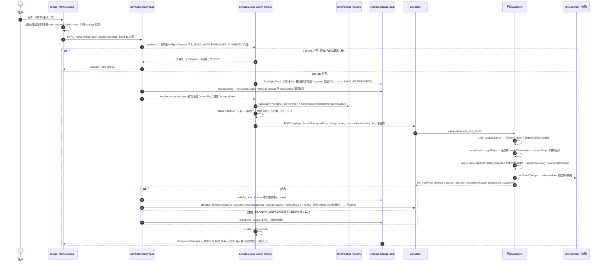

**防并发（F-SYNC-01 AC3）**：`chrome.storage` 的读后写不是原子操作，「先读 syncState 再写 syncing」挡不住快速双击，也挡不住点击与自动恢复同时发生。因此 `services/sync.js`（C-FE-SYNC-03）用**模块级 `inFlight` Promise 单飞**：`runSync` 被调用时若 `inFlight` 非空直接返回同一个 Promise，否则同步赋值后再进入第一个 `await`，`finally` 中清空；`handlers.SYNC_NOW`（C-FE-SYNC-02）与 `maybeAutoResync`（C-FE-CACHE-03）都只经 `runSync` 发请求。`syncState.status=syncing` + 30s 超时检测**只用于** SW 被回收后的中断恢复（内存中的 `inFlight` 随 SW 一起消失）。popup 侧点击时经 bus 事件 `sync:requested` 同步置 `disabled`，作为第三道保险。已在 docs/04 §5.3 / §11.1、C-FE-SYNC-03（新增导出 `isSyncInFlight`）定稿。

### 3.2 历史排序（F-RANK-01 ~ F-RANK-05）

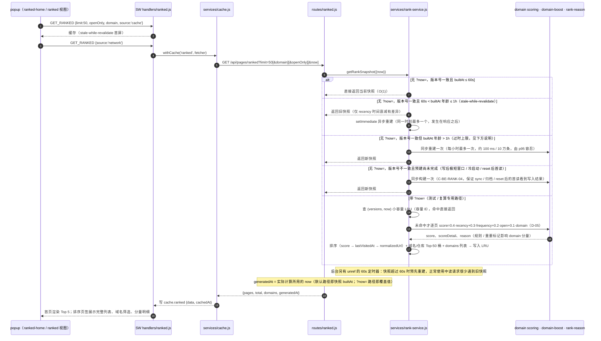

读路径分支以 docs/03 §4.2 与 C-BE-RANK-04 为准：**只有「时间过期」走 stale-while-revalidate，版本号变化后的首个读请求会同步构建一次**。因此 `POST /api/sync`、归档 / 合并、规则保存、`POST /api/__test__/reset` 之后紧接着的 `GET /api/pages/ranked` / `POST /api/recommendations/next` / `GET /api/pages/cleanup-suggestions` 一定看到写入后的数据（E2E 串联与 F-CLEAN-08 AC1 依赖这一点），不会读到写入前的旧快照或 reset 前的空快照。

「1 小时过时上限」是本轮评审新增的约束：若只有 SWR，两次读间隔数天时首读会返回按昨天计算的 score / reason（「今天访问过」「N 天前访问」），与同一请求中按当前 now 计算的整理建议矛盾，也不符合 PRD 6.7 / D-01「后端始终用服务器当前时间计算时效」。上限取 1 小时：此时 recency 漂移约 0.4×(1−0.5^(1/168)) ≈ 0.0016，不影响 2 位小数展示；超过上限才同步重建，每小时最多一次，仍满足 BE-PERF-01「recency 按时间分桶缓存」（1 小时即最大桶宽）。该分支已在 docs/03 §4.2（`RANK_STALE_MAX_MS`）与 C-BE-RANK-04 的 description 中定稿。

### 3.3 下一步推荐（F-REC-01 ~ F-REC-08、F-PERF-01、F-PERF-02）

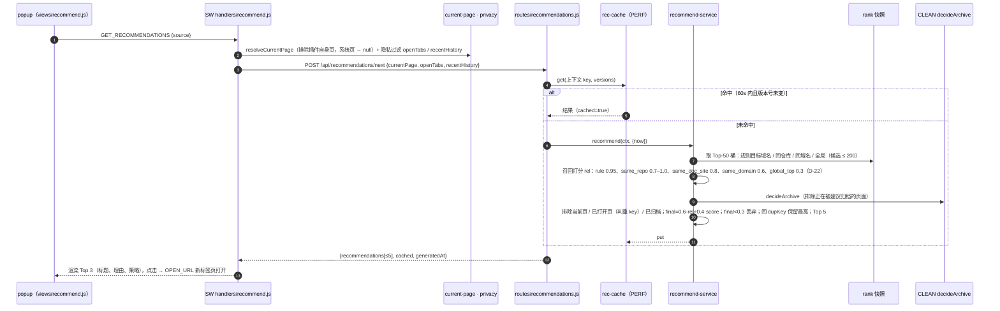

### 3.4 自然语言规则解析与保存（F-RULE-01 ~ F-RULE-10）

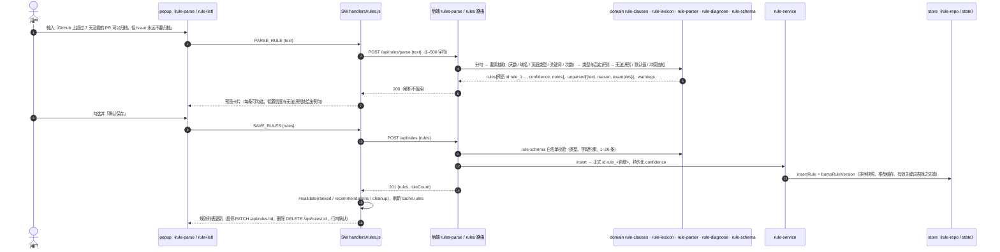

### 3.5 整理建议与执行（F-CLEAN-01 ~ F-CLEAN-08）

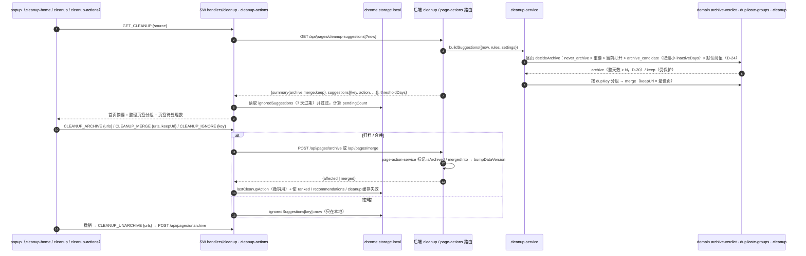

### 3.6 插件诊断（F-DIAG-01 ~ F-DIAG-11）

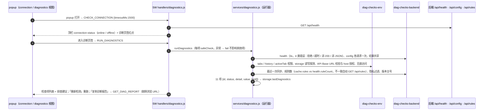

### 3.7 后端不可用时的离线降级与自动恢复（F-CACHE-01、F-CACHE-02）

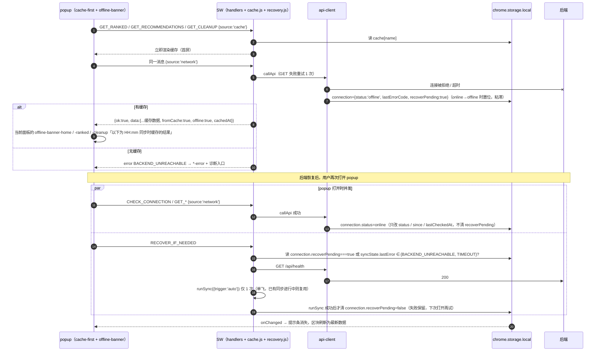

判定只依赖粘滞字段 `connection.recoverPending`，不依赖 `connection.status` 的瞬时值：popup 打开时 CHECK_CONNECTION、缓存优先的网络刷新、诊断页 SET_API_BASE_URL 后的重新检测都可能先把 status 写成 online，但它们都**不得**清除 `recoverPending`；唯一的清除方是 RECOVER_IF_NEEDED 在 `runSync({trigger:'auto'})` 成功之后（C-FE-CACHE-03）。置位方是 api-client 在 online→offline 转换时（C-FE-CORE-03）。这样 F-CACHE-02 AC2「上次同步成功（lastError 为空）→ 后端停 → 恢复 → 重新打开」场景下无论哪个请求先完成都会触发且只触发一次自动重同步。

---

## 4 数据模型与数据流

### 4.1 后端数据模型（内存，store/ 唯一持有）

| 实体 | 关键字段 | 口径 / 来源 | 代码点 |
| --- | --- | --- | --- |
| Page | `id`(page_<n>)、`url`、`normalizedUrl`（主键，D-03）、`dupKey`（判重，D-07）、`title`、`domain`、`repo`、`visitCount`（max 合并，D-02）、`lastVisitedAt`（max）、`firstSeenAt`（min）、`sources[]`（active_tab / open_tab / history / manual）、`isOpen` / `isActive`（最近一次同步快照，D-04）、`isArchived` / `archivedAt` / `mergedInto`、`isImportant`、`updatedAt` | `score` / `scoreDetail` / `reason` **不落库**，由排序快照计算 | C-BE-CORE-10、C-BE-SYNC-03、C-BE-SYNC-05 |
| Rule | `id`(rule_<n>)、`rawText`（子句原文，D-09）、`type`（archive_candidate / never_archive / privacy_filter / recommend_related / boost_domain）、`domain`、`urlPattern`、`inactiveDays`、`keywords?`、`trigger?`、`target?`、`action`、`enabled`、`confidence`、`createdAt`、`updatedAt` | 解析预览 id 为 rule_1…，保存后换正式 id（D-08） | C-BE-CORE-11、C-BE-RULE-05、C-BE-RULE-06 |
| State | `versions{data, rule, config}`（进程内单调递增，reset 不归零而是三者各 +1）、SyncLog 环形 50 条（只记数量与耗时，不记 URL）、`lastSyncAt`、`startedAt`、reset 回调表（`onReset(fn)` 注册） | 版本号是快照 / 缓存 / 关键词表的失效依据；reset 时依次调用回调清空派生缓存 | C-BE-CORE-12 |
| Settings | `cleanupThresholdDays`(14)、`maxHistoryItems`(100)、`historyLookbackDays`(30)、`enablePrivacyFilter`(true)、`privacySensitiveKeywords` | `PUT /api/config` 覆盖，缺省取 `DEFAULT_SETTINGS` | C-BE-CORE-02、C-BE-PRIV-03 |
| 索引 | `byDupKey`、`byDomain`、`byRepo`、`openSet`、`domainVisits` | 写入时增量维护，不落盘，加载后重建 | C-BE-CORE-10 |
| 派生：排序快照 | 有序页面数组 + 每页明细 + 域名 / 仓库 Top-50 桶 + dupKey 最佳页 + domains | 写后 `setImmediate` 预建；仅时间过期（60s < 年龄 ≤ 1h）时返回旧快照并由后台定时器或读后异步重建；版本变化后的首个读（冷启动 / 写后窗口 / reset 后）或年龄 > 1h 时同步构建一次；`?now=` 结果放 (versions, now) 小 LRU（测试 / 复算专用）；通过 `onReset` 注册清空 | C-BE-RANK-04、C-BE-PERF-02 |
| 派生：推荐缓存 | 上下文 key（上下文 + 三个版本号）→ 结果 | TTL 60s，版本号变化即失效；通过 `onReset` 注册 `clearRecCache` | C-BE-PERF-01 |
| 派生：有效关键词表 | 配置关键词 ∪ privacy_filter 规则关键词 | 按 ruleVersion + configVersion 缓存；通过 `onReset` 注册清空 | C-BE-PRIV-02 |

### 4.2 插件数据模型（chrome.storage.local）

| key | 结构 | 写入方 | 用途 |
| --- | --- | --- | --- |
| `apiBaseUrl` | string，默认 `http://127.0.0.1:3000`（FE-API-02，与后端默认 HOST 一致；**已与 F-DIAG-02 AC1、D-11、PRD §7 storage 表、PRD §9 诊断第 5 项对齐**，验收口径唯一；`host_permissions` 仍保留 `http://localhost/*` 与 `http://127.0.0.1/*`，用户可手动改为 localhost） | DIAG | 后端地址；测试夹具直接写入指向测试端口 |
| `syncState` | `{status, startedAt, lastSyncAt, lastSuccessAt, lastError, cursor, mode, trigger, stats}` | SYNC / INCR | 状态机持久化、中断检测、增量游标 |
| `cache` | `{ranked, recommendations{[url]}, cleanup, rules, config}`，每项 `{data, cachedAt}` | CACHE（各模块经 cache.js） | 缓存优先渲染、离线降级。**`cache.ranked` 只由无筛选、默认 limit 的 GET_RANKED 写入**（首页 Top 5 与离线展示的唯一来源）；带 `domain` / `repo` / `q` 等筛选的 GET_RANKED 只走网络、不读不写缓存，离线时返回 `NO_CACHE`，界面提示「筛选需要在线」（testId `ranked-filter-offline-hint`；C-FE-RANK-01，ui-contract `messages.GET_RANKED` 的 note 已定稿） |
| `connection` | `{status, since, lastCheckedAt, lastErrorCode, recoverPending}` | CORE（api-client 置位 recoverPending=true）；CACHE（recovery 在自动重同步成功后清除） | 顶栏状态、离线提示条；`recoverPending` 为粘滞标记，是自动恢复的判定依据（见 3.7） |
| `importantUrls` | string[] | MENU | ☆ 状态 |
| `ignoredSuggestions` | `{[key]: ignoredAt}`，7 天过期 | CLEAN | 「忽略」只在本地生效 |
| `lastCleanupAction` | `{kind, urls, at}` | CLEAN | 撤销 |
| `lastDiagnostics` | `{checkedAt, summary, items}` | DIAG | 诊断结果 |

完整列表见 `ui-contract.json.storageKeys`。storage 中不保存被过滤的 URL；缓存只含后端已返回（已过滤）的数据。

### 4.3 端到端数据流

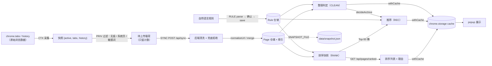

时间口径（D-01）：后端一律用服务器当前时间；读接口支持 `?now=` 覆盖；客户端时间戳超过「现在 + 5 分钟」按「现在」处理；样例数据平移到「最新一条 = 导入时刻 − 5 分钟」。

---

## 5 接口总览

基础地址 `http://127.0.0.1:3000`（`PORT` / `HOST` 可覆盖，契约 `defaultPort=3000`）。全部为 JSON；时间戳为毫秒；请求头 `x-request-id` 原样回写；统一错误格式 `{ error: { code, message, details? } }`，错误码 `INVALID_JSON` / `VALIDATION_FAILED`（400）、`NOT_FOUND`（404）、`METHOD_NOT_ALLOWED`（405）、`PAYLOAD_TOO_LARGE`（413）、`UNSUPPORTED_MEDIA_TYPE`（415）、`INTERNAL`（500）。

| # | method | path | Code ID | Feature ID |
| --- | --- | --- | --- | --- |
| 1 | POST | `/api/sync` | C-BE-SYNC-01、C-BE-SYNC-02、C-BE-SYNC-03、C-BE-SYNC-04、C-BE-SYNC-05、C-BE-PRIV-01、C-BE-PRIV-02、C-BE-CORE-05、C-BE-CORE-09、C-BE-CORE-10 | F-SYNC-01、F-SYNC-02、F-SYNC-03、F-SYNC-04、F-SYNC-05、F-SYNC-07、F-PRIV-03、F-PRIV-05、F-DEMO-02 |
| 2 | GET | `/api/pages/ranked` | C-BE-RANK-01、C-BE-RANK-02、C-BE-RANK-03、C-BE-RANK-04、C-BE-RANK-05、C-BE-CORE-07、C-BE-CORE-13 | F-RANK-01、F-RANK-02、F-RANK-03、F-RANK-04、F-MENU-01、F-PERF-01、F-CLEAN-08、F-SYNC-03、F-SYNC-04、F-SYNC-05 |
| 3 | POST | `/api/recommendations/next` | C-BE-REC-01、C-BE-REC-02、C-BE-REC-03、C-BE-REC-04、C-BE-REC-05、C-BE-REC-06、C-BE-REC-07、C-BE-PERF-01、C-BE-PERF-02、C-BE-CLEAN-01 | F-REC-01、F-REC-02、F-REC-03、F-REC-04、F-REC-05、F-REC-06、F-REC-07、F-PERF-01、F-PERF-02 |
| 4 | GET | `/api/pages/cleanup-suggestions` | C-BE-CLEAN-01、C-BE-CLEAN-02、C-BE-CLEAN-03、C-BE-CLEAN-04、C-BE-CORE-07、C-BE-CORE-13 | F-CLEAN-01、F-CLEAN-02、F-CLEAN-03、F-CLEAN-04、F-CLEAN-05、F-CLEAN-06、F-DEMO-02、F-MENU-01 |
| 5 | POST | `/api/rules/parse` | C-BE-RULE-01、C-BE-RULE-02、C-BE-RULE-03、C-BE-RULE-04、C-BE-RULE-06、C-BE-RULE-07 | F-RULE-01、F-RULE-02、F-RULE-03、F-RULE-04、F-RULE-05、F-RULE-10 |
| 6 | POST | `/api/rules` | C-BE-RULE-05、C-BE-RULE-06、C-BE-RULE-08、C-BE-CORE-11 | F-RULE-06、F-RULE-04、F-CLEAN-04、F-CLEAN-05、F-RANK-04、F-REC-07、F-PRIV-05 |
| 7 | GET | `/api/rules` | C-BE-RULE-06、C-BE-RULE-08、C-BE-CORE-11 | F-RULE-07 |
| 8 | DELETE | `/api/rules/:id` | C-BE-RULE-06、C-BE-RULE-08、C-BE-CORE-11 | F-RULE-08 |
| 9 | PATCH | `/api/rules/:id` | C-BE-RULE-06、C-BE-RULE-08 | F-RULE-09 |
| 10 | GET | `/api/health` | C-BE-CORE-15、C-BE-DIAG-01、C-BE-CORE-12 | F-DIAG-09、F-DIAG-01、F-DEMO-01、F-PERSIST-01、F-RULE-08 |
| 11 | GET | `/api/config` | C-BE-DIAG-02、C-BE-CORE-02、C-BE-PRIV-02 | F-DIAG-10、F-PRIV-05 |
| 12 | PUT | `/api/config` | C-BE-PRIV-03、C-BE-CORE-12 | F-PRIV-05 |
| 13 | POST | `/api/pages/archive` | C-BE-CLEAN-05 | F-CLEAN-08 |
| 14 | POST | `/api/pages/unarchive` | C-BE-CLEAN-05 | F-CLEAN-08 |
| 15 | POST | `/api/pages/merge` | C-BE-CLEAN-05 | F-CLEAN-08 |
| 16 | POST | `/api/pages/important` | C-BE-MENU-02 | F-MENU-01 |
| 17 | POST | `/api/pages/manual` | C-BE-MENU-01 | F-MENU-01 |
| 18 | POST | `/api/__test__/reset` | C-BE-CORE-14 | F-DIAG-09 |

插件侧的消息协议（popup ↔ SW，信封 `{type, payload, requestId}` → `{ok, data | error}`）共 24 种（以 ui-contract `messages` 为准），与后端接口的映射：

| 消息 | 模块 | 调用的后端接口 |
| --- | --- | --- |
| `GET_CONTEXT` | CTX | 无（只读 chrome API；关键词来自 `GET /api/config` 缓存） |
| `SYNC_NOW` / `GET_SYNC_STATE` | SYNC | `POST /api/sync`，成功后刷新 ranked / recommendations / cleanup / rules / config |
| `GET_RANKED` | RANK | `GET /api/pages/ranked` |
| `GET_RECOMMENDATIONS` / `OPEN_URL` | REC | `POST /api/recommendations/next` / 无 |
| `GET_CLEANUP` / `CLEANUP_ARCHIVE` / `CLEANUP_UNARCHIVE` / `CLEANUP_MERGE` / `CLEANUP_IGNORE` | CLEAN | `GET /api/pages/cleanup-suggestions`、`POST /api/pages/archive`、`POST /api/pages/unarchive`、`POST /api/pages/merge` / 无（本地） |
| `PARSE_RULE` / `SAVE_RULES` / `LIST_RULES` / `DELETE_RULE` / `TOGGLE_RULE` | RULE | `POST /api/rules/parse`、`POST /api/rules`、`GET /api/rules`、`DELETE /api/rules/:id`、`PATCH /api/rules/:id` |
| `CHECK_CONNECTION` / `RUN_DIAGNOSTICS` / `GET_DIAG_REPORT` / `GET_API_BASE_URL` / `SET_API_BASE_URL` | DIAG | `GET /api/health`、`GET /api/config`、`GET /api/rules` |
| `RECOVER_IF_NEEDED` | CACHE | `GET /api/health` → `POST /api/sync` |
| `MARK_IMPORTANT` | MENU | `POST /api/pages/important` |
| `ADD_TO_ANALYSIS`（当前页面卡片「添加到分析」按钮；右键菜单回调走同一个 `addToAnalysis`） | MENU | `POST /api/pages/manual` |

---

## 6 隐私与安全

**双层隐私过滤**（D-18：只匹配 URL，转小写后包含判断）：

| 层 | 位置 | 行为 | 代码点 |
| --- | --- | --- | --- |
| 插件端（主） | SW，发送前 | 判定顺序：无痕 → 非 http(s) 系统页 → 敏感关键词；命中不上传，只保留计数与本地标注「含 password · 不上传」；推荐请求、右键添加同样过滤 | C-FE-PRIV-01、C-FE-PRIV-03 |
| 关键词来源 | SW | `GET /api/config.privacySensitiveKeywords`（已合并 privacy_filter 规则）→ `cache.config` → 内置 `password / token / bank / secret`（宁可多拦） | C-FE-PRIV-02 |
| 后端（兜底） | 清洗阶段 | 命中有效关键词不入库，计入 `rejectedByReason.privacy`，日志只记域名与计数 | C-BE-PRIV-01、C-BE-PRIV-02 |
| 可配置 | 后端 | `PUT /api/config` 修改关键词与开关，`versions.config` 递增 | C-BE-PRIV-03 |

**数据最小化**：后端日志的 access `path` 不带 query；SyncLog 只记数量；诊断报告用正则剔除除 `apiBaseUrl` 外的所有 URL（C-FE-DIAG-10）；插件 logger 对 URL 打码只留 host（C-FE-CORE-05）。

**安全边界**：

| 威胁 | 措施 | 落点 |
| --- | --- | --- |
| 局域网访问本地数据 | 后端只监听 127.0.0.1 | C-BE-CORE-01、C-BE-CORE-02 |
| 任意网页跨域读取 | CORS 只放行 `chrome-extension://*`、`http://localhost:*`、`http://127.0.0.1:*`，其他来源不返回 ACAO | C-BE-CORE-03 |
| 恶意 / 超大输入 | 请求体 1 MB、数组 500 条、URL 2048 字符、title 截断 500 字符、规则文本 1–500 字符；白名单构造对象防原型污染 | C-BE-CORE-05、C-BE-CORE-08、C-BE-SYNC-02、C-BE-RULE-05 |
| 代码注入 | 禁止 eval / new Function / child_process；popup 渲染只用 `textContent` / `el()`，MV3 默认 CSP | C-FE-CORE-07、C-FE-CORE-01 |
| 权限过大 | manifest 只申请 tabs / history / storage / activeTab / contextMenus，host 只含 localhost / 127.0.0.1；不注入 content script | C-FE-CORE-01 |
| 测试接口泄露 | `POST /api/__test__/reset` 只在 `ENABLE_TEST_API=1` 时注册，否则 404 | C-BE-CORE-14 |

---

## 7 性能设计

目标（F-PERF-01）：10 万页面下 `POST /api/recommendations/next` p95 < 100 ms；`GET /api/pages/ranked?limit=20` p95 < 50 ms；同步 100 条 p95 < 500 ms。

| 手段 | 说明 | 代码点 |
| --- | --- | --- |
| 写入 O(n) | Map 查找 + 索引 Set 插入；isOpen 刷新只遍历上次 openSet 与本次打开集合 | C-BE-SYNC-04、C-BE-SYNC-05、C-BE-CORE-10 |
| 写后预计算 | 写操作 bump 版本号 → `setImmediate` 异步重建排序快照（O(n log n)，发生在响应之后） | C-BE-RANK-04 |
| recency 时间依赖 | 仅时间过期不触发同步构建：默认快照年龄在 60s–1h 之间时先返回旧快照，同时 `setImmediate` 异步重建（stale-while-revalidate）；年龄超过 1h 时同步重建一次（过时上限，每小时最多一次）；版本号变化后的首个读请求若预建尚未完成，同步构建一次（冷启动 / 写后窗口）；另有 `unref` 的 60s 定时器后台预建，进程空闲退出不受影响。60s 内 recency 漂移远小于 2 位小数精度。`?now=` 是测试 / 复算专用路径，结果按 (versions, now) 放进容量 8 的 LRU，不污染默认快照 | C-BE-RANK-04、C-BE-CORE-07 |
| 桶内 Top-K | 构建快照时为每个域名 / 仓库保留前 50 个 | C-BE-PERF-02 |
| 推荐只看桶 | 候选 ≤ 200（同仓库 / 同域名 / 规则目标 / 全局各 50），整理判定 O(规则数) | C-BE-REC-07 |
| 结果缓存 | 相同上下文 60s 内直接返回 `cached=true`，版本号变化即失效（F-PERF-02） | C-BE-PERF-01 |
| 基准验证 | `node scripts/bench-perf.mjs`：经真实 `/api/sync` 每批 500 条导入 10 万合成页面，打印 p50 / p95 | C-BE-PERF-03 |
| 插件端 | 缓存优先渲染（首屏不等网络）、首页只渲染 Top 5 / Top 3、增量同步缩小 history 读取窗口、send 超时防止转圈 | C-FE-CACHE-04、C-FE-INCR-01、C-FE-CORE-07 |

**与 specs/backend.spec.md BE-PERF-01（MUST）的对应**：

| BE-PERF-01 要求 | 本设计的落点 |
| --- | --- |
| 评分在写入时预计算 | 每次写操作 bump 版本号 → `onStateChange` → `scheduleRankRebuild` 在 `setImmediate` 中重建快照，发生在写请求响应之后（C-BE-RANK-04） |
| 读接口不重新计算全量评分 | `GET /api/pages/ranked`、`POST /api/recommendations/next`、`GET /api/pages/cleanup-suggestions` 的默认路径在稳态下只读现成快照：仅时间过期（≤ 1h）不触发同步构建，返回旧快照并异步重建（stale-while-revalidate）；版本变化后的首个读可能同步构建一次（冷启动 / 写后窗口，O(n log n)，由 p95 容忍，与 docs/03 §7 末段复杂度说明一致）；年龄超过 1h 时同步重建一次（每小时最多一次） |
| recency 按时间分桶缓存 | 等价实现为「60s 时间桶 + 1h 过时上限」：`unref` 定时器每 60s 检查并后台预建快照；SWR 期间返回的旧桶最多落后 1 小时（recency 误差 ≈ 0.0016），远小于 2 位小数展示精度；`generatedAt` 返回实际计算所用的 now（快照 builtAt） |
| 例外说明 | 带 `?now=` 的请求是测试 / 复算专用路径（插件从不发送），允许按需计算，结果按 (versions, now) 缓存在容量 8 的 LRU；性能基准（C-BE-PERF-03）只测默认路径 |


---

## 8 部署与启动

| 步骤 | 命令 / 操作 | 说明 |
| --- | --- | --- |
| 1 安装 | `npm install`（仅测试依赖；后端零运行时依赖） | Node v24 |
| 2 启动后端 | `./scripts/start.sh` | 默认 `PORT=3000 HOST=127.0.0.1 SNAPSHOT_FILE=data/snapshot.json`，启动后打印 `/api/health`（C-BE-DEMO-01）；端口占用时提示换端口并 exit(1)（C-BE-CORE-01） |
| 3 导入样例 | `node scripts/import-sample.mjs` | 读 `resources/sample-history.json`，时间平移后走真实 `POST /api/sync`（C-BE-DEMO-02、C-BE-DEMO-03，D-12） |
| 4 加载插件 | `chrome://extensions` → 开发者模式 → 加载已解压的扩展程序 → 选择 `extension/` | 无构建步骤（F-CTX-02） |
| 5 配置地址 | 默认 `http://127.0.0.1:3000`（与后端默认只监听 127.0.0.1 一致，避免 localhost 解析到 ::1）；换端口时在诊断页签修改 API Base URL | F-DIAG-02 |
| 6 运行测试 | `npm test` / `npm run test:api|test:e2e|test:ui`；单用例 `npm run test:case` | webServer 自动启动后端（见第 10 章） |

运行时环境变量（只在 `server/src/config.js` 读取，BE-RUN-01）：

| 变量 | 默认 | 用途 |
| --- | --- | --- |
| `PORT` / `HOST` | 3000 / 127.0.0.1 | 监听地址 |
| `SNAPSHOT_FILE` | 未设置（start.sh 设为 `data/snapshot.json`） | 启用 JSON 快照持久化 |
| `ENABLE_TEST_API` | 未设置 | `1` 时注册 `POST /api/__test__/reset` |
| `LOG_FILE` / `LOG_LEVEL` | 未设置 / info | 日志同步追加到文件（自动建目录） |

**优雅退出（BE-RUN-03，C-BE-CORE-01 `registerShutdown`）**：收到 SIGTERM / SIGINT 时，只有配置了 `snapshotFile` 才调用 PERSIST 的 `flushSnapshotSync()`，且调用包在 `try { … } catch (e) { logger.warn } finally { server.close(); process.exit(0) }` 中。这样即使 PERSIST 仍是桩、或 flush 抛错，进程也一定退出；测试默认不设置 `SNAPSHOT_FILE`，根本不会走到 PERSIST。

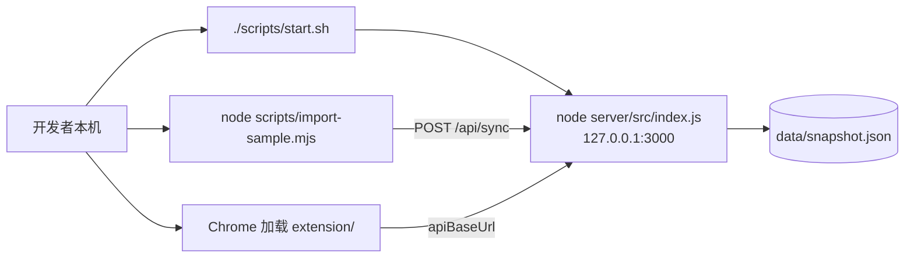

---

## 9 持久化演进

| 阶段 | 方案 | 状态 | 说明 |
| --- | --- | --- | --- |
| P0 | 纯内存 | 默认（测试） | 测试不设置 `SNAPSHOT_FILE`，配合 reset 接口保证用例隔离 |
| P1 | JSON 快照 | 本期实现（F-PERSIST-01） | 订阅 `onStateChange`，1s 防抖；写 `<file>.<pid>.tmp` → fsync → rename 原子替换；SIGTERM 同步 flush（仅配置 `snapshotFile` 时调用，try/finally 保证退出，见第 8 章）；启动校验 `schemaVersion=1`，残留 tmp 忽略删除，损坏打 warn 并以空数据启动；内容 `{schemaVersion, savedAt, pages, rules, settings, seq, lastSyncAt}`，索引加载后重建（C-BE-PERSIST-01、C-BE-PERSIST-02） |
| P2 | SQLite | 只写方案（F-PERSIST-02，inScope=false） | 表 pages / rules / sync_logs / settings；`normalized_url UNIQUE` 做 UPSERT 冲突目标，`MAX()` 合并口径与内存一致；`(domain, static_score)`、`(repo, static_score)` 索引支持 Top-K 召回，recency 查询时再乘；WAL 模式；`node:sqlite` 在 Node v24 仍为实验特性，故本期不实现 |

演进原则：**只替换 `store/*.js` 的实现，仓储函数签名不变**（`upsertPage`、`listByDomain(domain, k)` 等），services / domain / routes / 插件全部不动；`health.persistence` 字段（memory / snapshot）让插件诊断识别后端重启是否丢数据，插件据 `startedAt` / `pageCount` 判定增量游标失效并改为全量同步。

---

## 10 可测试性架构

### 10.1 测试分层

| 层 | 目录 / 工具 | 对象 | 约束 |
| --- | --- | --- | --- |
| API | `tests/api/<CaseID>.spec.mjs`，Playwright `request` | 单个后端接口的正例 / 反例 / 边界 / 异常 / 安全 | 只引用 C-BE 代码点；真实 HTTP，禁止 mock 后端 |
| E2E | `tests/e2e/<CaseID>.spec.mjs` | 多接口串联（同步 → 排序 → 推荐 → 规则解析 → 保存 → 整理 → 删除规则 → 健康检查） | ≥ 5 个，每个 ≥ 3 步，代码点跨 ≥ 2 个模块，步骤间断言状态传递 |
| UI | `tests/ui/<CaseID>.spec.mjs`，`chromium.launchPersistentContext` 加载 `extension/` | popup 交互、消息协议、storage、离线降级 | `channel:'chromium'`；只 route 外部站点；选择器只用 ui-contract 的 testId；以 tab 方式打开 popup |
| 基准 | `scripts/bench-perf.mjs` | 10 万页面性能 | 走真实 `/api/sync` |
| 断言有效性 | `run-cases.mjs --mutation` | API / E2E 响应变异 | 杀死率 ≥ 80% |

**无法由 Playwright 直接驱动的浏览器入口**（不得用检测测试环境的特判绕过，FE-TEST-01）：

- 右键菜单注册（F-MENU-01 AC1）：在 SW 上下文执行 `chrome.contextMenus.update('nav-add', {})` 与 `chrome.contextMenus.update('nav-important', {})`，回调中 `chrome.runtime.lastError` 为空即说明两项菜单已注册。
- 「添加到分析」点击（F-MENU-01 AC2）：原生菜单无法打开、`contextMenus.onClicked` 无法派发，MV3 module SW 也不能动态 `import()`。建议产品界面增加同一路径的入口：当前页面卡片上的「添加到分析」按钮（testId `current-page-add`）→ 消息 `ADD_TO_ANALYSIS` → 与 `onMenuClick` 共用的 `addToAnalysis(url, title)`（C-FE-MENU-01）。UI 用例经按钮验证「普通 URL 上传 / 敏感 URL 不上传」。该按钮、消息和 symbol 已在 docs/04 §5.8、§10、ui-contract 与 C-FE-MENU-01 / C-FE-MENU-02 / C-FE-MENU-03 定稿（见 12.4 已定稿表）。

公共夹具（锁定后不得修改）：`tests/fixtures/api.mjs`（自动 reset、`loadSample()`、请求留痕）、`extension.mjs`（加载插件、`ext.snap()`）、`evidence.mjs`、`sample.mjs`（时间平移工具）、`mutation.mjs`。

### 10.2 端口（CONVENTIONS §9）

| 用途 | 端口 |
| --- | --- |
| 演示默认 | 3000 |
| 门禁 / 终检 | 4100 |
| 后端 lead / 前端 lead | 4101 / 4102 |
| API 仲裁 / 变异检查 | 4103 / 4105 |
| UI 探索 i | 4180 + i |
| 骨架检查 / `--list` | 4198 / 4199 |
| 模块组 g 后端开发 / 前端开发 | 4200 + g / 4220 + g |
| 模块组 g 后端修复 / 前端修复 | 4240 + g / 4260 + g |

测试端口统一取 `TEST_PORT`；UI 用例通过 `chrome.storage.local.set({ apiBaseUrl: 'http://127.0.0.1:<TEST_PORT>' })` 把插件指向测试后端。离线场景把 `apiBaseUrl` 指向无服务端口实现，不 route 后端。

### 10.3 重置接口与状态隔离

- `POST /api/__test__/reset`（C-BE-CORE-14）：仅 `ENABLE_TEST_API=1` 注册；`resetAll` **只调用** `resetState()`，返回 `{ ok: true }`。
- `resetState()`（C-BE-CORE-12，`store/state.js`）：清空页面、规则、同步日志、配置覆盖与 id 序号；**版本号单调递增、不归零**——`versions.data / rule / config` 各 +1；然后按注册顺序调用全部 reset 回调。
- reset 回调由各模块在模块加载时通过 `onReset(fn)`（C-BE-CORE-12 的新增导出）注册，CORE 不 import 业务模块，避免反向依赖：

| 注册方 | 文件 | 清理内容 |
| --- | --- | --- |
| RANK | `server/src/services/rank-service.js` | 默认排序快照、`?now=` LRU、待执行的重建标记 |
| PERF | `server/src/services/rec-cache.js` | `clearRecCache()`：推荐结果缓存 |
| PRIV | `server/src/services/privacy-service.js` | 按 ruleVersion + configVersion 缓存的有效关键词表 |

- 双保险：即使某个回调遗漏，版本号 +1 也会让所有以版本号为 key 的缓存（推荐缓存 key = 上下文 + 三个版本号、快照、关键词表）在下一个用例中失效，60s 内连续执行的用例不会读到上一个用例的结果。
- 夹具 `api` 在每个测试开始前自动调用；`workers: 1`、`retries: 0`，共享后端串行执行。
- 测试不设置 `SNAPSHOT_FILE`；持久化用例自行设置临时文件并重启进程。
- UI 用例每个使用全新的 persistent context（空 profile），`chrome.storage` 天然隔离。

### 10.4 时间基准

| 手段 | 说明 |
| --- | --- |
| 样例平移 | `samplePayload({ now })` 把 resource.json 平移到「最新一条 = now − 5 分钟」，相对天数不变；期望值用 `shiftedTime()` 计算，不手写时间戳 |
| `?now=` 覆盖 | ranked / recommendations / cleanup-suggestions 支持，非正整数返回 400；用于阈值边界（14 天 vs 15 天，D-20）与评分复算 |
| 时钟偏差 | 客户端时间戳超过「现在 + 5 分钟」按「现在」处理（C-BE-SYNC-02） |
| 确定性排序 | score → lastVisitedAt → normalizedUrl；id 自增，避免用例抖动 |
| 插件历史 | `chrome.history.addUrl` 只能产生当前时间的访问，「旧页面」通过后端样例导入构造 |

### 10.5 evidence 留痕

```
evidence/
├── <CaseID>/
│   ├── result.json        执行结果、失败的 [En]
│   ├── api/NN-*.json      请求与响应（x-request-id: <CaseID>-NN）
│   ├── server.log         按偏移截取的后端日志（按 reqId 可对号）
│   ├── extension.log      SW 与 popup 的 console（logger 同时写 globalThis.__navLogs）
│   ├── screenshots/       UI 步骤截图（ext.snap）
│   ├── flow.gif           UI 流程动图
│   └── explore.json       UI 探索结论（pass / product_bug / script_stale）
├── _runtime/server-<port>.log   webServer 完整日志
├── _runs/                 流水线汇总、变异检查结果
└── index.json
```

可观察性支撑：后端 `x-request-id` 贯穿响应头与日志（C-BE-CORE-03、C-BE-CORE-06）；插件数值类元素只含纯数字、每个异步区块有 loading / empty / error 三种 testId、历史查询参数暴露在 `context-history-query` 的 data 属性上，便于断言。

---

## 11 追溯体系

追溯链：`REQ-NNN` → `F-<MOD>-<NN>`（含 AC）→ `C-<FE|BE>-<MOD>-<NN>`（源码 `@code` 注释）→ `TC-<API|E2E|UI>-<MOD>-<NNN>`（一个 Case 一个脚本）→ `evidence/<CaseID>/` → `docs/08-测试报告.md`。

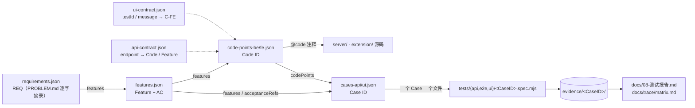

强制规则摘要（validator 检查）：layers 含 BE 的 inScope Feature 需 ≥ 1 个 C-BE 与 ≥ 1 个 API/E2E 用例；含 FE 需 ≥ 1 个 C-FE 与 ≥ 1 个 UI 用例；每个代码点 ≥ 1 个 Feature 且被 ≥ 1 个用例引用；用例引用的代码点与用例的 Feature 必须有交集；API / E2E 只引用 C-BE，UI 至少引用 1 个 C-FE；每条 AC 至少被 1 个用例的 `acceptanceRefs` 引用；`expected` 第 n 条对应断言消息 `[En]`。

### 11.1 Feature → Code → Case（按模块聚合）

> Case 列为阶段 3 的设计要求：用例由测试设计按 `TC-<API|E2E|UI>-<MOD>-<NNN>` 编号写入 `docs/trace/cases-api.json` / `cases-ui.json`，逐条明细由 `node .workflow/validators/validate.mjs trace` 生成到 `docs/trace/matrix.md`。本表不预填具体 Case ID，避免出现未登记的 ID。

| 模块 | inScope Feature（层） | C-BE 代码点 | C-FE 代码点 | 用例要求（Case 类型 / 最少条数） |
| --- | --- | --- | --- | --- |
| CORE | —（共享层） | C-BE-CORE-01、C-BE-CORE-02、C-BE-CORE-03、C-BE-CORE-04、C-BE-CORE-05、C-BE-CORE-06、C-BE-CORE-07、C-BE-CORE-08、C-BE-CORE-09、C-BE-CORE-10、C-BE-CORE-11、C-BE-CORE-12、C-BE-CORE-13、C-BE-CORE-14、C-BE-CORE-15 | C-FE-CORE-01、C-FE-CORE-02、C-FE-CORE-03、C-FE-CORE-04、C-FE-CORE-05、C-FE-CORE-06、C-FE-CORE-07 | 由引用这些代码点的业务用例覆盖（规则 2：每个代码点 ≥ 1 个用例） |
| CTX | F-CTX-01（FE）、F-CTX-02（FE）、F-CTX-03（FE）、F-CTX-04（FE）、F-CTX-05（FE）、F-CTX-06（FE）、F-CTX-07（FE） | — | C-FE-CTX-01、C-FE-CTX-02、C-FE-CTX-03、C-FE-CTX-04、C-FE-CTX-05、C-FE-CTX-06 | UI：7 个 FE Feature 各 ≥ 1 |
| SYNC | F-SYNC-01（FE+BE）、F-SYNC-02（BE）、F-SYNC-03（BE）、F-SYNC-04（BE）、F-SYNC-05（BE）、F-SYNC-06（FE）、F-SYNC-07（BE） | C-BE-SYNC-01、C-BE-SYNC-02、C-BE-SYNC-03、C-BE-SYNC-04、C-BE-SYNC-05 | C-FE-SYNC-01、C-FE-SYNC-02、C-FE-SYNC-03、C-FE-SYNC-04、C-FE-SYNC-05 | API/E2E：6 个 BE Feature 各 ≥ 1；UI：2 个 FE Feature 各 ≥ 1 |
| PRIV | F-PRIV-01（FE）、F-PRIV-02（FE）、F-PRIV-03（BE）、F-PRIV-04（FE）、F-PRIV-05（BE） | C-BE-PRIV-01、C-BE-PRIV-02、C-BE-PRIV-03 | C-FE-PRIV-01、C-FE-PRIV-02、C-FE-PRIV-03 | API/E2E：2 个 BE Feature 各 ≥ 1；UI：3 个 FE Feature 各 ≥ 1 |
| INCR | F-INCR-01（FE） | — | C-FE-INCR-01、C-FE-INCR-02 | UI：1 个 FE Feature 各 ≥ 1 |
| RANK | F-RANK-01（BE）、F-RANK-02（BE）、F-RANK-03（BE）、F-RANK-04（BE）、F-RANK-05（FE） | C-BE-RANK-01、C-BE-RANK-02、C-BE-RANK-03、C-BE-RANK-04、C-BE-RANK-05 | C-FE-RANK-01、C-FE-RANK-02、C-FE-RANK-03 | API/E2E：4 个 BE Feature 各 ≥ 1；UI：1 个 FE Feature 各 ≥ 1 |
| REC | F-REC-01（BE）、F-REC-02（BE）、F-REC-03（BE）、F-REC-04（BE）、F-REC-05（BE）、F-REC-06（BE）、F-REC-07（BE）、F-REC-08（FE） | C-BE-REC-01、C-BE-REC-02、C-BE-REC-03、C-BE-REC-04、C-BE-REC-05、C-BE-REC-06、C-BE-REC-07 | C-FE-REC-01、C-FE-REC-02、C-FE-REC-03 | API/E2E：7 个 BE Feature 各 ≥ 1；UI：1 个 FE Feature 各 ≥ 1 |
| PERF | F-PERF-01（BE）、F-PERF-02（BE） | C-BE-PERF-01、C-BE-PERF-02、C-BE-PERF-03 | — | API/E2E：2 个 BE Feature 各 ≥ 1 |
| CLEAN | F-CLEAN-01（BE）、F-CLEAN-02（BE）、F-CLEAN-03（BE）、F-CLEAN-04（BE）、F-CLEAN-05（BE）、F-CLEAN-06（BE）、F-CLEAN-07（FE）、F-CLEAN-08（FE+BE） | C-BE-CLEAN-01、C-BE-CLEAN-02、C-BE-CLEAN-03、C-BE-CLEAN-04、C-BE-CLEAN-05 | C-FE-CLEAN-01、C-FE-CLEAN-02、C-FE-CLEAN-03、C-FE-CLEAN-04、C-FE-CLEAN-05 | API/E2E：7 个 BE Feature 各 ≥ 1；UI：2 个 FE Feature 各 ≥ 1 |
| RULE | F-RULE-01（FE+BE）、F-RULE-02（BE）、F-RULE-03（BE）、F-RULE-04（BE）、F-RULE-05（BE）、F-RULE-06（FE+BE）、F-RULE-07（FE+BE）、F-RULE-08（FE+BE）、F-RULE-09（FE+BE）、F-RULE-10（BE） | C-BE-RULE-01、C-BE-RULE-02、C-BE-RULE-03、C-BE-RULE-04、C-BE-RULE-05、C-BE-RULE-06、C-BE-RULE-07、C-BE-RULE-08 | C-FE-RULE-01、C-FE-RULE-02、C-FE-RULE-03、C-FE-RULE-04、C-FE-RULE-05 | API/E2E：10 个 BE Feature 各 ≥ 1；UI：5 个 FE Feature 各 ≥ 1 |
| DIAG | F-DIAG-01（FE+BE）、F-DIAG-02（FE）、F-DIAG-03（FE）、F-DIAG-04（FE）、F-DIAG-05（FE）、F-DIAG-06（FE）、F-DIAG-07（FE）、F-DIAG-08（FE）、F-DIAG-09（BE）、F-DIAG-10（BE）、F-DIAG-11（FE） | C-BE-DIAG-01、C-BE-DIAG-02 | C-FE-DIAG-01、C-FE-DIAG-02、C-FE-DIAG-03、C-FE-DIAG-04、C-FE-DIAG-05、C-FE-DIAG-06、C-FE-DIAG-07、C-FE-DIAG-08、C-FE-DIAG-09、C-FE-DIAG-10、C-FE-DIAG-11、C-FE-DIAG-12 | API/E2E：3 个 BE Feature 各 ≥ 1；UI：9 个 FE Feature 各 ≥ 1 |
| CACHE | F-CACHE-01（FE）、F-CACHE-02（FE） | — | C-FE-CACHE-01、C-FE-CACHE-02、C-FE-CACHE-03、C-FE-CACHE-04 | UI：2 个 FE Feature 各 ≥ 1 |
| MENU | F-MENU-01（FE+BE） | C-BE-MENU-01、C-BE-MENU-02 | C-FE-MENU-01、C-FE-MENU-02、C-FE-MENU-03 | API/E2E：1 个 BE Feature 各 ≥ 1；UI：1 个 FE Feature 各 ≥ 1 |
| PERSIST | F-PERSIST-01（BE） | C-BE-PERSIST-01、C-BE-PERSIST-02 | — | API/E2E：1 个 BE Feature 各 ≥ 1 |
| DEMO | F-DEMO-01（BE）、F-DEMO-02（BE） | C-BE-DEMO-01、C-BE-DEMO-02、C-BE-DEMO-03 | — | API/E2E：2 个 BE Feature 各 ≥ 1 |

### 11.2 接口与 UI 契约的追溯

- 每个接口在 `api-contract.json` 中登记 `codePoints`（只能是 C-BE）与 `features`，见第 5 章总表。
- 每个 testId / 消息在 `ui-contract.json` 中登记 `codePoints`（只能是 C-FE）；UI 用例选择器只能使用登记过的 testId。
- 开发阶段只允许新增 element / message / 响应字段，不得删除或改名（BE-NAME-02，ui-contract 规则）。

---

## 12 文件所有权与并行开发

### 12.1 原则

1. **一个文件只属于一个模块**；被多个模块共用的文件归 **CORE**，由 lead 维护。当前 ownership.json 中 CONFLICT 文件数：0（`routes/health.js`、`services/health-service.js` 同时登记在 C-BE-CORE-15 与 C-BE-DIAG-01，按「共用归 CORE」判定所有者为 CORE）。
2. 模块开发只改本模块文件；需要改 CORE 文件时写进结构化输出的 `blockedBy`，由 lead 合并。
3. 注册表（后端 `routes/index.js`、插件 `handlers/index.js` 与 `views/index.js`、`popup.html` 的 `data-slot`）由 lead 一次性登记全部模块文件。**桩文件规则**：lead 按 `ownership.json` 为**每一个**业务模块文件生成桩，把 `code-points-be.json` / `code-points-fe.json` 中该文件登记的**全部 symbols** 都导出，并附 JSDoc 签名（唯一来源是 docs/03 §12「跨模块接口表」与 docs/04 §11.1 / §11.2，见 12.4、12.6），不写 `@code` 注释（由模块开发者实现时补上）：
   - 后端函数桩抛 `AppError('INTERNAL', 500, '尚未实现')`；常量（`RULE_TYPES`、`ACTION_BY_TYPE`、`RULE_EXAMPLES`）直接写最终值；桩不得有顶层副作用（不注册 `onStateChange` / `onReset`）；路由桩与 docs/03 §12 一致：按第 5 章接口总览**填好 method + path**，handler 抛 `AppError('INTERNAL', 500, '尚未实现')`（不得导出空路由数组，否则未实现接口会返回 404 / 405 而不是 500，例如 PRIV 未实现时 `PUT /api/config` 会变成 405）；
   - 插件函数桩抛 `{ code: 'NOT_IMPLEMENTED', message: '<symbol> 尚未实现' }`；`handlers.X` 形式的 symbol 导出 `export const handlers = { X: stub }`；视图导出 `mount()` 渲染空容器（单个视图 mount 抛错只记日志、该 slot 留空，见 docs/04 §11.2）；
   - 目的：ESM 在链接阶段就会对不存在的具名导出报 SyntaxError，只导出空对象会让整个后端进程或 MV3 Service Worker（`type: module`）无法启动，所有模块组的测试一起失败。桩齐全后，各组即使依赖方尚未实现也能启动，失败只局限在调用到桩的用例；
   - **桩的三类例外**（否则骨架检查与各组自测无法进行）：
     1. **健康检查真实实现（C-BE-CORE-15，所有者 CORE）**：`validate.mjs skeleton` 与 `playwright.config.mjs` 的 webServer 都以 `GET /api/health` 返回 2xx 作为就绪条件，所以 `routes/health.js` + `services/health-service.js`（`healthRoutes`、`getHealth`）由 lead 在骨架阶段直接写成真实实现：返回 200 `{ status:'ok', version: APP_VERSION, uptime, pageCount, ruleCount, enabledRuleCount, lastSyncAt, persistence, startedAt }`，数据只取 CORE 的 `store/page-repo.js`、`store/rule-repo.js`、`store/state.js` 与 `config.js`（`persistence` 按是否配置 `snapshotFile` 取 `snapshot` / `memory`），不 import 任何业务模块。这两个文件与 C-BE-DIAG-01 共用，按「共用归 CORE」由 lead 维护；**DIAG 只负责字段口径与用例验收（C-BE-DIAG-01），需要改这两个文件时写进 `blockedBy`**，由 lead 合并（docs/03 §1.2 差异表、§12 第 1 条）；
     2. **持久化 no-op 桩**（与 docs/03 §12 第 2 条一致）：`createSnapshotWriter()` 返回 `{ schedule() {} }`，`flushSnapshotSync()` 与 `writeSnapshotAtomic()` 为 no-op（不抛错），`loadSnapshot()` 返回 `{ ok: false, reason: 'NOT_IMPLEMENTED' }`。CORE `index.js` 只有配置了 `snapshotFile` 才调用它们，加载时按 `result.ok` 判定（`ok:false` 即按空库启动并记 warn，不做判空），flush 包在 try/finally 中，finally 里 `server.close()` 并 `process.exit(0)`（见第 8 章「优雅退出」），保证 SIGTERM 后 5 秒内退出（BE-RUN-03）；
     3. **reset 回调**：`resetRankCache`、`clearRecCache`、`resetKeywordCache` 的桩为 no-op、不抛错（各模块实现时再经 `onReset` 注册），否则 reset 失败会拖垮全部用例。
   - **骨架验收口径：`node .workflow/validators/validate.mjs skeleton` 通过**（端口 4198：后端启动、`/api/health` 返回 200 完整字段、SIGTERM 5 秒内退出、`LOG_FILE` 写出日志、manifest 合法、规范机检通过）；另外 `POST /api/__test__/reset` 返回 200，未实现的业务接口返回 500 `INTERNAL` 而不是 404 / 405 或进程崩溃（与 docs/03 §12 第 4 条一致）。之后桩文件归模块所有，模块开发者只替换函数体，**不得删除或改名已导出的 symbol**。
4. 测试文件（`tests/**`、`playwright.config.mjs`）评审后锁定，开发 agent 不得修改，有异议提交 `testDisputes`。

### 12.2 文件归属表（由 `.workflow/context/packs/ownership.json` 生成）

| 模块 | 后端文件（server/ scripts/ resources/） | 插件文件（extension/） |
| --- | --- | --- |
| CORE | `server/src/index.js`<br>`server/src/config.js`<br>`server/src/app.js`<br>`server/src/routes/index.js`<br>`server/src/lib/http.js`<br>`server/src/lib/errors.js`<br>`server/src/lib/logger.js`<br>`server/src/lib/clock.js`<br>`server/src/lib/validate.js`<br>`server/src/domain/url.js`<br>`server/src/store/page-repo.js`<br>`server/src/store/indexes.js`<br>`server/src/store/rule-repo.js`<br>`server/src/store/state.js`<br>`server/src/store/settings-repo.js`<br>`server/src/domain/rule-match.js`<br>`server/src/routes/test-api.js`<br>`server/src/routes/health.js`<br>`server/src/services/health-service.js` | `extension/manifest.json`<br>`extension/background/service-worker.js`<br>`extension/background/handlers/index.js`<br>`extension/background/services/api-client.js`<br>`extension/shared/messages.js`<br>`extension/shared/storage-keys.js`<br>`extension/shared/constants.js`<br>`extension/background/services/storage.js`<br>`extension/shared/url.js`<br>`extension/shared/logger.js`<br>`extension/popup/popup.html`<br>`extension/popup/popup.css`<br>`extension/popup/popup.js`<br>`extension/popup/views/index.js`<br>`extension/popup/lib/messaging.js`<br>`extension/popup/lib/bus.js`<br>`extension/popup/lib/dom.js` |
| CTX | — | `extension/background/services/current-page.js`<br>`extension/background/services/collector.js`<br>`extension/background/handlers/context.js`<br>`extension/popup/views/current-page.js`<br>`extension/popup/views/current-page.css`<br>`extension/popup/views/context.js`<br>`extension/popup/views/context.css` |
| SYNC | `server/src/routes/sync.js`<br>`server/src/domain/sync-sanitize.js`<br>`server/src/domain/page-merge.js`<br>`server/src/services/sync-service.js`<br>`server/src/services/open-snapshot.js` | `extension/popup/views/sync.js`<br>`extension/popup/views/sync.css`<br>`extension/background/handlers/sync.js`<br>`extension/background/services/sync.js`<br>`extension/background/services/sync-state.js`<br>`extension/background/services/sync-payload.js` |
| PRIV | `server/src/domain/privacy.js`<br>`server/src/services/privacy-service.js`<br>`server/src/routes/config-update.js`<br>`server/src/services/settings-service.js` | `extension/background/services/privacy.js`<br>`extension/background/services/privacy-config.js` |
| INCR | — | `extension/background/services/cursor.js`<br>`extension/popup/views/sync-mode.js`<br>`extension/popup/views/sync-mode.css` |
| RANK | `server/src/domain/scoring.js`<br>`server/src/domain/domain-boost.js`<br>`server/src/domain/rank-reason.js`<br>`server/src/services/rank-service.js`<br>`server/src/routes/ranked.js` | `extension/background/handlers/ranked.js`<br>`extension/popup/views/ranked-home.js`<br>`extension/popup/views/ranked-home.css`<br>`extension/popup/views/ranked.js`<br>`extension/popup/views/ranked.css` |
| REC | `server/src/routes/recommendations.js`<br>`server/src/domain/rec-same-repo.js`<br>`server/src/domain/rec-site.js`<br>`server/src/domain/rec-fallback.js`<br>`server/src/domain/rec-rule-trigger.js`<br>`server/src/domain/rec-rank.js`<br>`server/src/services/recommend-service.js` | `extension/background/handlers/recommend.js`<br>`extension/popup/views/recommend.js`<br>`extension/popup/views/recommend.css`<br>`extension/background/handlers/open-url.js` |
| PERF | `server/src/services/rec-cache.js`<br>`server/src/domain/top-k.js`<br>`scripts/bench-perf.mjs` | — |
| CLEAN | `server/src/domain/archive-verdict.js`<br>`server/src/domain/duplicate-groups.js`<br>`server/src/domain/cleanup.js`<br>`server/src/services/cleanup-service.js`<br>`server/src/routes/cleanup.js`<br>`server/src/services/page-action-service.js`<br>`server/src/routes/page-actions.js` | `extension/background/handlers/cleanup.js`<br>`extension/background/handlers/cleanup-actions.js`<br>`extension/popup/views/cleanup-home.js`<br>`extension/popup/views/cleanup-home.css`<br>`extension/popup/views/cleanup.js`<br>`extension/popup/views/cleanup.css`<br>`extension/popup/views/cleanup-actions.js` |
| RULE | `server/src/domain/rule-clauses.js`<br>`server/src/domain/rule-lexicon.js`<br>`server/src/domain/rule-parser.js`<br>`server/src/domain/rule-diagnose.js`<br>`server/src/domain/rule-schema.js`<br>`server/src/services/rule-service.js`<br>`server/src/routes/rules-parse.js`<br>`server/src/routes/rules.js` | `extension/background/handlers/rules.js`<br>`extension/popup/views/rule-parse.js`<br>`extension/popup/views/rule-parse.css`<br>`extension/popup/views/rule-list.js`<br>`extension/popup/views/rule-list.css`<br>`extension/popup/views/rule-home.js`<br>`extension/popup/views/rule-home.css` |
| DIAG | `server/src/routes/config.js`<br>`server/src/services/config-service.js` | `extension/background/services/diag-checks-backend.js`<br>`extension/popup/views/connection.js`<br>`extension/popup/views/connection.css`<br>`extension/background/handlers/api-base.js`<br>`extension/popup/views/diag-api-base.js`<br>`extension/popup/views/diag-api-base.css`<br>`extension/background/services/diag-checks-env.js`<br>`extension/background/services/diagnostics.js`<br>`extension/background/handlers/diagnostics.js`<br>`extension/background/services/diag-report.js`<br>`extension/popup/views/diagnostics.js`<br>`extension/popup/views/diagnostics.css`<br>`extension/popup/views/diag-home.js`<br>`extension/popup/views/diag-home.css` |
| CACHE | — | `extension/background/services/cache.js`<br>`extension/popup/views/offline-banner.js`<br>`extension/popup/views/offline-banner.css`<br>`extension/background/services/recovery.js`<br>`extension/background/handlers/recovery.js`<br>`extension/popup/lib/cache-first.js` |
| MENU | `server/src/routes/manual-pages.js`<br>`server/src/services/manual-page-service.js`<br>`server/src/routes/important.js`<br>`server/src/services/important-service.js` | `extension/background/services/context-menu.js`<br>`extension/background/handlers/important.js`<br>`extension/popup/views/important-star.js`<br>`extension/popup/views/important-star.css` |
| PERSIST | `server/src/store/snapshot-writer.js`<br>`server/src/store/snapshot-loader.js` | — |
| DEMO | `scripts/start.sh`<br>`scripts/print-health.mjs`<br>`resources/sample-history.json`<br>`scripts/import-sample.mjs` | — |

说明：本表按 `node .workflow/validators/validate.mjs pack` 重新生成后的 `ownership.json` 输出（共 152 个文件）。相对上一版的变化：`server/src/routes/health.js`、`server/src/services/health-service.js` 由 DIAG 改归 CORE（C-BE-CORE-15）；每个视图新增同名 `popup/views/<view>.css`，归视图所属模块（docs/04 §11、§11.2 ④）。`cleanup-actions.js` 只渲染行内按钮与撤销条，没有独立 slot，也没有独立 css。

### 12.3 并行开发编排

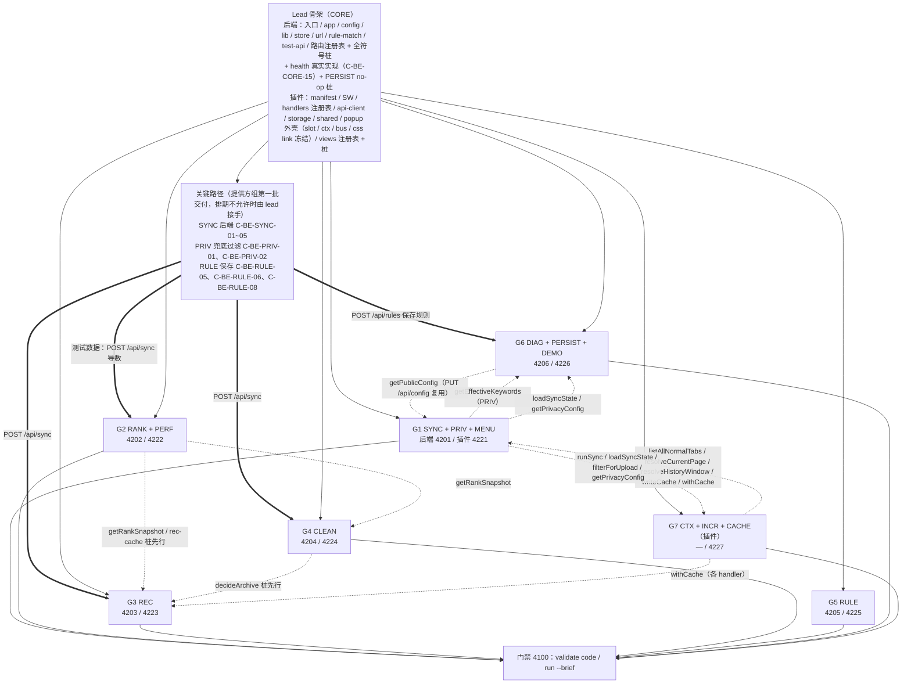

| 组 | 模块 | 代码依赖（运行时调用） | 测试数据依赖（用例前置怎么造数） | 说明 |
| --- | --- | --- | --- | --- |
| G1 | SYNC、PRIV、MENU | CORE；G6（`getPublicConfig`）；G7（采集、游标、缓存） | 自身即造数入口（`POST /api/sync`）；PRIV 的 privacy_filter 规则类用例依赖 RULE 保存（`POST /api/rules`） | MENU 复用 SYNC 的 `mergeObservation`、PRIV 的 `getEffectiveKeywords`；插件 `services/sync.js` 依赖 G7 的导出 |
| G2 | RANK、PERF | CORE、RULE 仓储（CORE） | **`POST /api/sync` 导数**（SYNC 后端 + PRIV 兜底）；boost_domain 规则用例依赖 RULE 保存 | 提供 `getRankSnapshot` 与 rec-cache 函数 |
| G3 | REC | G2、G4 | **`POST /api/sync` 导数**；recommend_related 规则用例依赖 RULE 保存 | 依赖方由桩兜底，可并行编码 |
| G4 | CLEAN | CORE、G2 | **`POST /api/sync` 导数**（带 `lastVisitedAt` 的老页面）；archive_candidate / never_archive 用例依赖 RULE 保存 | 提供 `decideArchive` |
| G5 | RULE | CORE | 自身即造数入口（`POST /api/rules`）；规则生效类用例需 `POST /api/sync` | 规则执行由 RANK / CLEAN / REC / PRIV 读取 |
| G6 | DIAG、PERSIST、DEMO | CORE；G1（`getEffectiveKeywords`、`loadSyncState`、`getPrivacyConfig`） | health 的 `pageCount` / `ruleCount` 用例依赖 `POST /api/sync` 与 `POST /api/rules`；PERSIST 重启用例同样先导数；DEMO 的 import-sample 走真实 `POST /api/sync` | DEMO 依赖 SYNC 接口可用后才能端到端验证 |
| G7 | CTX、INCR、CACHE | CORE（插件）；G1（`runSync`、`filterForUpload` 等） | UI 用例的「有缓存」前置需要真实同步成功一次（后端 SYNC 可用） | 纯插件模块；`recovery.js` 调用 SYNC 的 `runSync`；`withCache` 被几乎所有插件 handler 使用 |

依赖边只表示「运行时调用对方导出的函数」。由于 lead 骨架已导出全部 symbols 的桩，**代码依赖不阻塞编码与启动**；但**测试数据依赖会阻塞自测**：按 CONVENTIONS §5「状态隔离」，样例数据经真实接口 `POST /api/sync` 导入（夹具 `api.loadSample()`），规则经 `POST /api/rules` 写入，用例不直写 store，SYNC 后端未实现时 RANK / REC / CLEAN / DIAG 的绝大多数用例都无法进入断言阶段。因此：

1. **关键路径**：SYNC 后端（C-BE-SYNC-01 ~ C-BE-SYNC-05）、PRIV 兜底过滤（C-BE-PRIV-01、C-BE-PRIV-02，`POST /api/sync` 内部调用）、RULE 保存（C-BE-RULE-05、C-BE-RULE-06、C-BE-RULE-08）**由提供方组作为第一批交付**（G1 先做 SYNC 写入链路 + PRIV 兜底过滤，再做 MENU / `PUT /api/config`；G5 先做 RULE-05/06/08，再做自然语言解析），lead 在骨架完成后优先评审合并并经门禁 4100 验证，再放行 G2 / G3 / G4 / G6 的接口自测；排期不允许时由 lead 接手实现（与 docs/03 §12「测试数据依赖与关键路径」一致）。`POST /api/__test__/reset`（C-BE-CORE-14）与 `GET /api/health`（C-BE-CORE-15）已在骨架内实现。文件归属不变，仍归 SYNC / PRIV / RULE；对应组接手后补齐边界、错误码与 `@code` 标注，不改变已冻结的导出签名与响应字段；
2. 门禁按「关键路径 → G2 → G4 → G3、G1 ↔ G7、G1 ↔ G6」的顺序复验跨组用例；
3. 规则解析（C-BE-RULE-01 ~ C-BE-RULE-04、`POST /api/rules/parse`）不在关键路径上：其他组的用例直接用结构化规则调用 `POST /api/rules` 造数，不依赖解析器。

### 12.4 跨模块接口表

**本节不再定义签名。** 跨模块接口签名的唯一来源是技术方案中的跨模块接口表：后端为 docs/03 §12「跨模块接口表」，插件为 docs/04 §11.1。lead 生成桩和 JSDoc 时逐字照抄这两张表，实现时只能新增可选参数，不得改变已有参数含义。下表只做「提供方 → 调用方」索引，方便按组排期。

**后端（签名见 docs/03 §12）**

| 提供文件（模块 / 组） | 符号 | Code ID | 调用方 |
| --- | --- | --- | --- |
| `server/src/services/rank-service.js`（RANK / G2） | `getRankSnapshot` | C-BE-RANK-04 | REC（G3）、CLEAN（G4） |
| `server/src/services/rec-cache.js`（PERF / G2） | `buildRecCacheKey`、`getCachedRecs`、`putCachedRecs`、`clearRecCache` | C-BE-PERF-01 | REC（G3）；`clearRecCache` 经 `onReset` 自注册 |
| `server/src/domain/scoring.js`（RANK / G2） | `round2` | C-BE-RANK-01 | REC（G3）、CLEAN（G4） |
| `server/src/domain/archive-verdict.js`（CLEAN / G4） | `decideArchive`、`ageInDays` | C-BE-CLEAN-01 | REC（G3，只按 `verdict === 'archive'` 排除，F-REC-05 AC2） |
| `server/src/domain/page-merge.js`（SYNC / G1） | `createPageRecord`、`mergeObservation` | C-BE-SYNC-03 | MENU（G1）、CLEAN（G4） |
| `server/src/domain/sync-sanitize.js`（SYNC / G1） | `sanitizeEntry` | C-BE-SYNC-02 | MENU（G1） |
| `server/src/services/privacy-service.js`（PRIV / G1） | `getEffectiveKeywords`、`isPrivacyFilterEnabled` | C-BE-PRIV-02 | SYNC、MENU（G1）、DIAG（G6） |
| `server/src/services/config-service.js`（DIAG / G6） | `getPublicConfig` | C-BE-DIAG-02 | PRIV `routes/config-update.js`（G1） |
| `server/src/store/snapshot-writer.js` / `snapshot-loader.js`（PERSIST / G6） | `createSnapshotWriter`、`flushSnapshotSync`、`loadSnapshot` | C-BE-PERSIST-01、C-BE-PERSIST-02 | CORE `index.js` |
| `server/src/store/state.js`（CORE） | `onReset`、`onStateChange`、`getVersions` | C-BE-CORE-12 | 全部模块 |

**插件（签名见 docs/04 §11.1，唯一来源）**

| 提供文件（模块 / 组） | 符号 | Code ID | 调用方 |
| --- | --- | --- | --- |
| `extension/background/services/collector.js`（CTX / G7） | `listAllNormalTabs`、`readHistory` | C-FE-CTX-02、C-FE-CTX-03 | SYNC（G1）、REC（G3） |
| `extension/background/services/current-page.js`（CTX / G7） | `resolveCurrentPage` | C-FE-CTX-01 | SYNC、MENU（G1）、REC（G3） |
| `extension/background/services/privacy.js`（PRIV / G1） | `classifyUrl`、`filterForUpload`、`isUploadableTab` | C-FE-PRIV-01、C-FE-PRIV-03 | SYNC、MENU（G1）、REC（G3）、CTX `handlers/context.js`（G7） |
| `extension/background/services/privacy-config.js`（PRIV / G1） | `getPrivacyConfig` | C-FE-PRIV-02 | SYNC、MENU（G1）、REC（G3）、CTX（G7）、DIAG（G6） |
| `extension/background/services/cursor.js`（INCR / G7） | `resolveHistoryWindow`、`resetCursor` | C-FE-INCR-01 | SYNC（G1）、DIAG `handlers/api-base.js`（G6） |
| `extension/background/services/cache.js`（CACHE / G7） | `withCache`、`readCache`、`writeCache`、`invalidate` | C-FE-CACHE-01 | 全部插件 handler、SYNC、MENU、DIAG |
| `extension/background/handlers/ranked.js`（RANK / G2） | `refreshRanked` | C-FE-RANK-01 | SYNC（G1，同步成功后刷新缓存） |
| `extension/background/handlers/recommend.js`（REC / G3） | `refreshRecommendations` | C-FE-REC-01 | SYNC（G1） |
| `extension/background/handlers/cleanup.js`（CLEAN / G4） | `refreshCleanup` | C-FE-CLEAN-01 | SYNC（G1） |
| `extension/background/handlers/rules.js`（RULE / G5） | `refreshRules` | C-FE-RULE-01 | SYNC（G1） |
| `extension/background/services/sync.js`（SYNC / G1） | `runSync`、`isSyncInFlight` | C-FE-SYNC-03 | SYNC handler、`sync-state.js`、CACHE `services/recovery.js`（G7） |
| `extension/background/services/sync-state.js`（SYNC / G1） | `loadSyncState` | C-FE-SYNC-04 | DIAG（G6）、CACHE（G7） |
| `extension/background/services/context-menu.js`（MENU / G1） | `addToAnalysis` | C-FE-MENU-01 | MENU（`onMenuClick`、`handlers.ADD_TO_ANALYSIS`，同组） |
| `extension/background/handlers/important.js`（MENU / G1） | `markImportant` | C-FE-MENU-02 | MENU `context-menu.js`（同组） |
| `extension/background/services/api-client.js`（CORE） | `callApi` | C-FE-CORE-03 | 全部插件模块；online→offline 时置位 `connection.recoverPending=true`（见 3.7） |

**签名冲突收敛结果（已定稿）**：上一版在此列出的跨模块签名冲突已全部在技术方案中定稿（docs/03 §12、docs/04 §11.1 / §13 第 8、9 条，并登记进 code-points 的 symbols）。下表只记录定稿值，供 lead 生成桩时核对；如与 docs/03 / docs/04 字面不一致，以 docs/03 / docs/04 为准。

| 符号 | 定稿值 | 定稿位置 |
| --- | --- | --- |
| `getPrivacyConfig` | `() → Promise<{ enabled, keywords, source: 'server' \| 'cache' \| 'default' }>` | docs/04 §11.1、C-FE-PRIV-02 |
| `classifyUrl` | `(url, keywords) → { uploadable, reason: 'system' \| 'sensitive' \| 'incognito' \| null, keyword? }` | docs/04 §11.1、C-FE-PRIV-01 |
| `filterForUpload` | `(snapshot, privacy) → { payload, filteredCount, skippedSystem }` | docs/04 §11.1、C-FE-PRIV-03 |
| `isUploadableTab` | `(tab) → boolean` | docs/04 §11.1 |
| `resolveHistoryWindow` | `→ { mode, startTime, maxResults, cursor?, fullReason? }` | docs/04 §11.1、C-FE-INCR-01 |
| `runSync` / `isSyncInFlight` | `({ mode?, trigger }) → Promise<{ ok: true, data: { syncState, result, fullReason } } \| { ok: false, error }>`，模块级 `inFlight` 单飞；`() → boolean` | docs/04 §11.1、C-FE-SYNC-03 |
| `withCache` | `(name, fetcher, { source, key? }) → Promise<{ ok: true, data, fromCache, offline, cachedAt } \| { ok: false, error }>` | docs/04 §11.1、C-FE-CACHE-01 |
| `decideArchive` | `(page, { rules, settings, now }) → { verdict: 'archive' \| 'keep' \| 'open' \| 'none', ageDays, threshold, ruleId, reason }`，REC 只按 `verdict === 'archive'` 排除 | docs/03 §12、C-BE-CLEAN-01 |
| SYNC 刷新缓存 | `refreshRanked` / `refreshRecommendations` / `refreshCleanup` / `refreshRules`（各自 handler 导出），config 由 `getPrivacyConfig()` 刷新 | docs/04 §11.1、§13 第 8 条 |
| MENU 可测入口 | 按钮 `current-page-add` → 消息 `ADD_TO_ANALYSIS` → `addToAnalysis(url, title)`（与 `onMenuClick` 共用） | docs/04 §5.8、§11.1、C-FE-MENU-01 / C-FE-MENU-02 / C-FE-MENU-03 |
| PERSIST 桩返回值 | `createSnapshotWriter → { schedule() {} }`；`loadSnapshot → { ok, data?, reason? }`（桩为 `{ ok:false, reason:'NOT_IMPLEMENTED' }`） | docs/03 §12、C-BE-PERSIST-01 / C-BE-PERSIST-02 |
| health 归属 | C-BE-CORE-15（CORE 实现）+ C-BE-DIAG-01（DIAG 口径与用例），文件归 CORE | docs/03 §1.2、§12 |

同组串行、组间并行；后端组 g 使用端口 4200 + g，插件组 g 使用 4220 + g，修复使用 4240 + g / 4260 + g。前后端同一模块可并行开发：插件以 `api-contract.json` 为准对接，后端以契约中的响应示例为准实现。

### 12.5 共享常量与模块私有常量（后端 `config.js` 的边界）

`server/src/config.js`（C-BE-CORE-02）归 CORE。**清单与取值以 docs/03 §1.4 为唯一来源**，本节不另列取值，只说明边界：

- **判定规则**（docs/03 §1.4）：被两个及以上模块使用，或经 `GET /api/config` / `GET /api/health` 对外输出 → 进 `config.js`，由 lead 骨架阶段一次写全并冻结；否则写在所属模块文件顶部（`export const`，带注释理由）。
- **共享常量 = C-BE-CORE-02 登记的 9 个 symbols**：`loadConfig`、`DAY_MS`、`DEFAULT_SETTINGS`、`SCORE_WEIGHTS`、`RECENCY_HALF_LIFE_DAYS`、`MIN_RECOMMENDATION_SCORE`、`LIMITS`、`APP_VERSION`、`API_VERSION`。各自的值、使用方与理由见 docs/03 §1.4 表。其中 `RECENCY_HALF_LIFE_DAYS`、`MIN_RECOMMENDATION_SCORE`、`SCORE_WEIGHTS`、`LIMITS`、`APP_VERSION` / `API_VERSION` 都经 `GET /api/config` 或 `GET /api/health` 对外输出，RANK / REC / DIAG 必须 import 这里的值，**不得在模块内另定义同名或同义常量**，否则 `GET /api/config` 的输出口径会分叉。
- **环境变量**只在 `loadConfig()` 中读取（BE-RUN-01）：`PORT`、`HOST`、`SNAPSHOT_FILE`、`ENABLE_TEST_API`、`LOG_FILE`、`LOG_LEVEL`。
- **模块私有常量**不进 `config.js`，示例清单同 docs/03 §1.4 末段（如 RANK 的 `RANK_FRESH_MS`、`RANK_STALE_MAX_MS`，PERF 的 `BUCKET_TOP_K`，PERSIST 的 `SNAPSHOT_DEBOUNCE_MS` 等），以模块文件为准。
- 这一偏离（BE-STYLE-06 推荐集中）已登记在 docs/03 §1.2「与规范差异」表。私有常量后来被第二个模块使用或需要对外输出时，由该模块写进 `blockedBy`，lead 迁入 `config.js` 并在 C-BE-CORE-02 symbols 中登记。

### 12.6 popup 侧接口表（骨架冻结；以 docs/04 §11.2 为唯一来源）

popup 外壳（C-FE-CORE-06：`popup.html`、`popup.css`、`popup.js`、`views/index.js`）与 popup 工具（C-FE-CORE-07：`lib/messaging.js`、`lib/bus.js`、`lib/dom.js`）都归 CORE。**slot 清单、`ctx` 结构、bus 事件、样式归属的唯一来源是 docs/04 §11.2**，lead 生成 `popup.html` 与 `views/index.js` 时照抄该节；下文是与其逐项同步的摘要，若有出入以 docs/04 §11.2 为准。模块视图只在自己的 slot 内渲染，不得跨 slot 查询 DOM。

**① slot 清单与嵌套**（`popup.html` 中静态存在的 `data-slot` 容器；slot 名 = 视图文件名，离线横幅例外；`views/index.js` 的 `VIEWS = [{ slot, mount }]`，顺序即下表顺序）

| 位置 / 父容器 | `data-slot` | 视图文件（Code ID） | 样式文件 | 模块 |
| --- | --- | --- | --- | --- |
| 顶栏 | `connection` | `popup/views/connection.js`（C-FE-DIAG-02） | `connection.css` | DIAG |
| `current-page-card`（外壳静态 section） | `current-page` | `popup/views/current-page.js`（C-FE-CTX-05） | `current-page.css` | CTX |
| `current-page-card` 内、`current-page` 之后 | `current-page-actions`（为 MENU 预留：☆、「添加到分析」） | `popup/views/important-star.js`（C-FE-MENU-03） | `important-star.css` | MENU |
| 同步区 | `sync` | `popup/views/sync.js`（C-FE-SYNC-01） | `sync.css` | SYNC |
| 同步区、`sync` 之后 | `sync-mode` | `popup/views/sync-mode.js`（C-FE-INCR-02） | `sync-mode.css` | INCR |
| `panel-home` 顶部 | `offline-banner-home` | `popup/views/offline-banner.js`（C-FE-CACHE-02） | `offline-banner.css` | CACHE |
| `panel-home` | `recommend` | `popup/views/recommend.js`（C-FE-REC-02） | `recommend.css` | REC |
| `panel-home` | `ranked-home` | `popup/views/ranked-home.js`（C-FE-RANK-02） | `ranked-home.css` | RANK |
| `panel-home` | `cleanup-home` | `popup/views/cleanup-home.js`（C-FE-CLEAN-03） | `cleanup-home.css` | CLEAN |
| `panel-home` | `rule-home` | `popup/views/rule-home.js`（C-FE-RULE-05） | `rule-home.css` | RULE |
| `panel-home` | `diag-home` | `popup/views/diag-home.js`（C-FE-DIAG-12） | `diag-home.css` | DIAG |
| `panel-context` | `context` | `popup/views/context.js`（C-FE-CTX-06） | `context.css` | CTX |
| `panel-ranked` 顶部 | `offline-banner-ranked` | `popup/views/offline-banner.js`（同一 mount） | `offline-banner.css` | CACHE |
| `panel-ranked` | `ranked` | `popup/views/ranked.js`（C-FE-RANK-03） | `ranked.css` | RANK |
| `panel-cleanup` 顶部 | `offline-banner-cleanup` | `popup/views/offline-banner.js`（同一 mount） | `offline-banner.css` | CACHE |
| `panel-cleanup` | `cleanup` | `popup/views/cleanup.js`（C-FE-CLEAN-04；行内按钮与撤销条由同模块 `cleanup-actions.js` 的 `renderItemActions` / `renderUndoBar` 渲染，C-FE-CLEAN-05，无独立 slot） | `cleanup.css` | CLEAN |
| `panel-rules` | `rule-parse` | `popup/views/rule-parse.js`（C-FE-RULE-02、C-FE-RULE-03） | `rule-parse.css` | RULE |
| `panel-rules` | `rule-list` | `popup/views/rule-list.js`（C-FE-RULE-04） | `rule-list.css` | RULE |
| `panel-diag` | `diag-api-base` | `popup/views/diag-api-base.js`（C-FE-DIAG-03） | `diag-api-base.css` | DIAG |
| `panel-diag` | `diagnostics` | `popup/views/diagnostics.js`（C-FE-DIAG-11） | `diagnostics.css` | DIAG |

- 离线横幅：ui-contract 登记了 `offline-banner-home` / `offline-banner-ranked` / `offline-banner-cleanup` 三个 testId，所以是 **3 个 slot、同一个 `mount`**，视图按 `slotEl.dataset.slot` 设置同名 testId（C-FE-CACHE-02）。
- 页签按钮与面板（`tab-home` / `tab-context` / `tab-ranked` / `tab-cleanup` / `tab-rules` / `tab-diag` 及 `panel-*`）、`current-page-card` 外层 section、`tab-cleanup-count`、`tab-diag-alert` 由 CORE 静态写在 `popup.html`；计数与红点只经 `ctx.setTabBadge` 修改。
- 单个视图 `mount` 抛错（包括桩阶段的 `NOT_IMPLEMENTED`）只记日志并在该 slot 留空，不影响其他视图。

**② mount 签名与 ctx 冻结结构**

```text
mount(slotEl: HTMLElement, ctx) → void | (() => void)      // 可返回卸载函数
ctx = {
  send(type, payload?, { timeoutMs? }) → Promise<{ ok, data?, error? }>          // lib/messaging.js；fromCache / offline / cachedAt 在 data 内
  bus: { on(event, fn) → off, emit(event, payload) }                            // lib/bus.js，同步派发
  toast(text, { kind?: 'info'|'error', ms? })                                   // 渲染到 testId=toast
  switchTab(tab: 'home'|'context'|'ranked'|'cleanup'|'rules'|'diag', { focus? }?)
  setTabBadge(tab: 'cleanup'|'diag', value: number|boolean|null)               // cleanup 写数字，diag 写 true/false
  getState() → { currentPage, connection, activeTab }                           // 只读快照，由 CORE 维护
}
```

视图读缓存标记一律用 `res.data.fromCache` / `res.data.offline` / `res.data.cachedAt`，不读顶层字段：`withCache` 的 Result 把这三个字段放在 `data` 旁边，handler 返回 popup 前把它们并入 `data`（与 ui-contract 各 message 的 response 字段一致，如 `GET_RANKED.response.fromCache`）。

**③ bus 事件（名称与载荷冻结）**

| 事件 | 载荷 | 发出方 | 订阅方 |
| --- | --- | --- | --- |
| `current-page:changed` | `{ url, title, isSystem, uploadable }` | CTX `current-page.js`（GET_CONTEXT 返回后） | MENU `important-star.js`、REC `recommend.js`、CORE（`getState().currentPage`） |
| `rule:parse` | `{ text }` | RULE `rule-home.js`（先 `ctx.switchTab('rules')`） | RULE `rule-parse.js`（填入输入框并解析）；沿用 C-FE-RULE-05 已登记的事件名，不另设 `rules:prefill` |
| `nav:tab` | `{ tab, focus? }` | CORE `switchTab` 完成后广播 | 切到本页签时懒加载的视图（`ranked`、`cleanup`、`diagnostics`） |
| `sync:requested` | `{ mode: 'auto'\|'full' }` | SYNC `sync.js` / INCR `sync-mode.js` 点击时（`send` 之前同步发出） | SYNC `sync.js`、INCR `sync-mode.js`（两个同步按钮同步置 `disabled`，F-SYNC-01 AC3） |
| `storage:<key>` | `{ newValue, oldValue }`，`<key>` ∈ `syncState` / `cache` / `connection` / `lastDiagnostics` / `importantUrls` | CORE `bus.js` 的 `onStorageChange` 转发 `chrome.storage.onChanged` | 各视图按需订阅 |

**④ 样式归属**：`popup.css`（CORE）只放设计令牌（`:root` 变量）、整体布局、顶栏、页签、通用组件（按钮、列表、徽标、空 / 加载 / 错误三态、toast）。每个视图一个样式文件 `popup/views/<view>.css`（见①「样式文件」列），归该视图所属模块，已登记在对应 Code ID 的 files 中并出现在 12.2 归属表；选择器以 `[data-slot="<slot>"]` 为作用域前缀（离线横幅用 `[data-slot^="offline-banner-"]`）；lead 在骨架中创建全部空 css 文件并在 `popup.html` 中预先 `<link>`，模块开发者只改自己的 css。
